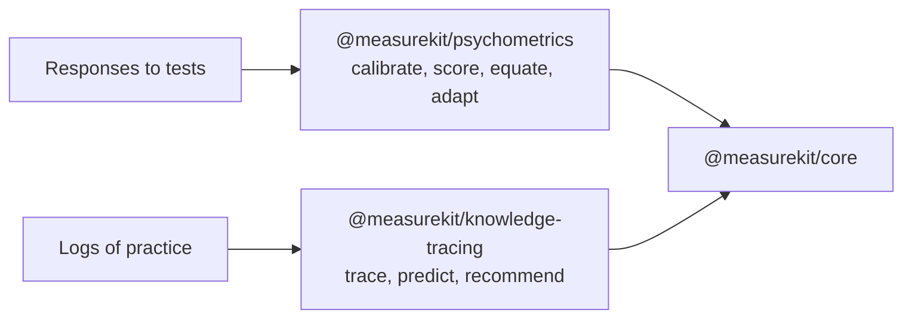

# measurekit

Psychometrics and knowledge tracing for JavaScript and TypeScript, validated against R, pyBKT and RSMTool: IRT, CTT,
adaptive testing, cognitive diagnosis, BKT.

| Package                                                                                        | What it is                                                                              |
| ---------------------------------------------------------------------------------------------- | --------------------------------------------------------------------------------------- |
| [`@measurekit/psychometrics`](https://measurekit.wakan.dev/_measurekit/psychometrics/)         | Item response theory, classical test theory, adaptive testing, cognitive diagnosis, DIF |
| [`@measurekit/knowledge-tracing`](https://measurekit.wakan.dev/_measurekit/knowledge-tracing/) | Bayesian knowledge tracing, AFM and PFA, Elo, online IRT, knowledge space theory        |
| [`@measurekit/core`](https://measurekit.wakan.dev/_measurekit/core/)                           | The shared foundation of the packages                                                   |

The guides, the evidence of each package and the API are at [measurekit.wakan.dev](https://measurekit.wakan.dev/). Two
sibling families build on the same rules: [assesskit](https://assesskit.wakan.dev/) for assessment items and tests, and
[interopkit](https://interopkit.wakan.dev/) for the standards that learning platforms exchange data by.
