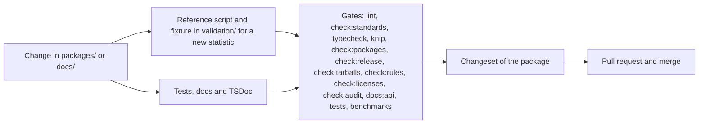

# Contributing

Contributions in English or Bahasa Indonesia are welcome.
Everyone taking part is expected to follow the [Code of Conduct](CODE_OF_CONDUCT.md).

## Setup

Node.js 22.18+ and pnpm 12 are required. `pnpm install` also installs the Lefthook git hooks. [AGENTS.md](AGENTS.md)
lists the commands and the conventions for layout, naming, code, docs, validation and tests;
[psychometrics](docs/psychometrics/architecture.md) and [knowledge tracing](docs/knowledge-tracing/architecture.md)
state the design principles of each package.

## Validation

A new or changed statistic needs a reference and a fixture: extend the script for its module in
`validation/<package>/` and regenerate the fixtures as [validation/README.md](validation/README.md) describes. Name
the reference function or the formula in the pull request, and add the reference and its tolerance to the package's
`docs/<package>/validation.md`. Commit the regenerated fixtures; CI runs only the TypeScript tests.

## Before opening a pull request

Run `pnpm lint`, `pnpm check:standards`, `pnpm typecheck`, `pnpm test` and `pnpm knip`, then `pnpm build`,
`pnpm check:packages`, `pnpm check:release`, `pnpm check:tarballs`, `pnpm check:rules`, `pnpm check:licenses`, `pnpm check:audit` and `pnpm docs:api`. A bug fix comes with a test that fails without it. A change to a package goes into the pending
release's changeset for that package in `.changeset/`, or a new one made with `pnpm changeset` when none is pending
([AGENTS.md](AGENTS.md#releases)).

The pre-commit hook formats staged code, JSON, Markdown and YAML with Biome; the pre-push hook runs the type check,
tests and Knip. CI tests each package, the scripts that check the repository and the examples on Node.js 22 and 24, with
the coverage floors of core and knowledge tracing. The mutation rules and the coverage floor of psychometrics, which take
long, run each week and before a release, so that per-push CI stays short.

## License of contributions

measurekit is licensed under the [Apache License 2.0](LICENSE). As its section 5 states, a contribution you submit for
inclusion is licensed under the same terms, unless you state otherwise. There is no contributor license agreement;
you keep the copyright in your contributions.
