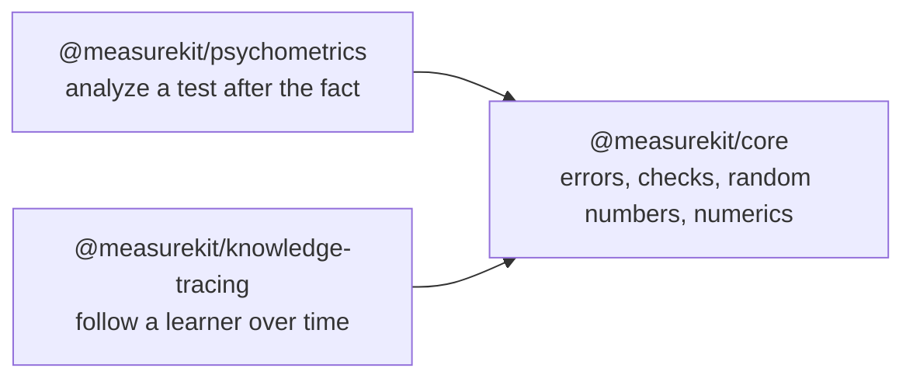

# measurekit

Libraries for measuring what people know, for JavaScript and TypeScript. This repository holds two libraries and
the core that they share. They run in any JavaScript runtime.



| Package                                                                 | What it is                                                                                                                                                                                                                                                                                                                                                                                             |
| ----------------------------------------------------------------------- | ------------------------------------------------------------------------------------------------------------------------------------------------------------------------------------------------------------------------------------------------------------------------------------------------------------------------------------------------------------------------------------------------------ |
| [`@measurekit/psychometrics`](packages/psychometrics/README.md)         | Classical test theory, item response theory including multidimensional models, cognitive diagnosis, adaptive and multistage testing, item fit, differential item functioning, equating, score scaling and prediction, gains and reliable change, dimensionality, explanatory item response models, simulation, standard setting, rater agreement and effects, and response times. Validated against R. |
| [`@measurekit/knowledge-tracing`](packages/knowledge-tracing/README.md) | Learner models that estimate what learners know as they practice: Bayesian knowledge tracing, logistic models, Elo, online IRT and knowledge space theory, with practice recommendations and evaluation. Validated against pyBKT and R.                                                                                                                                                                |
| [`@measurekit/core`](packages/core/README.md)                           | The shared foundation of the two libraries: their errors, argument checks, seeded random number generator and common numerics. Most users install a library, which depends on it.                                                                                                                                                                                                                      |

```bash
npm install @measurekit/psychometrics
npm install @measurekit/knowledge-tracing
```

Each library installs `@measurekit/core` with it, and re-exports `createRandom`, `Random`, `DataError`
and `MeasurekitError`, so you do not import core yourself.

## Which package

- **Psychometrics** analyzes a test after the fact: item statistics, calibration, ability estimates, fit, bias and
  equating. It also runs adaptive tests and standard setting, reports and predicts scores, and checks dimensionality.
- **Knowledge tracing** follows a learner over time: each event updates the learner's state, which models predict from
  and practice recommendations use.

The libraries do not import each other. They share core, and conventions: both validate input and throw
`DataError`, take a seeded `Random` and never return `NaN`, and a Q-matrix has the same shape in both.
An `instanceof DataError` check holds for an error from either library. Each README has examples, the list of its
import paths and links to its guides.

## Documentation

- Guides of [psychometrics](docs/psychometrics/architecture.md)
  and [knowledge tracing](docs/knowledge-tracing/architecture.md), one per module, with their validation against R
  and pyBKT.
- [Performance](docs/performance.md): the hot path of every module against its reference, and the budgets.
- The API reference is generated by TypeDoc, a section per package: `pnpm docs:api` writes it to `docs/api`.

## Development

Node.js 22.18+ and pnpm 12 are required.

```bash
pnpm install
pnpm lint               # Biome and cspell
pnpm check:standards    # the rules of the standards that a script can check
pnpm check:duplication  # repeated code of the sources, against the repeats that AGENTS.md lists
pnpm typecheck          # every package and its examples
pnpm test               # Vitest, a project per package, the scripts and the examples; runs offline
pnpm test:coverage      # the coverage floors of the packages
pnpm bench              # the benchmarks of every package, against their budgets
pnpm knip               # unused files, exports and dependencies
pnpm build              # the built packages
pnpm check:packages     # publint and Are the Types Wrong on the packed packages
pnpm check:release      # every package of a changeset is published, and a first release is 1.0.0
pnpm check:tarballs     # packs the packages, installs them and imports every subpath
pnpm check:rules        # the rules on untrusted input: each one's test fails without it; a run that takes too long exits 2
pnpm check:licenses     # the licenses of the production dependencies
pnpm check:audit        # known vulnerabilities of the dependencies
pnpm docs:api           # builds, then TypeDoc into docs/api; fails on undocumented exports
```

[AGENTS.md](AGENTS.md) states the conventions, [CONTRIBUTING.md](CONTRIBUTING.md) the process and
[SECURITY.md](SECURITY.md) how to report a vulnerability and how to deploy safely.

## Layout

```
packages/core/               @measurekit/core: what both libraries use
packages/psychometrics/      @measurekit/psychometrics: src/, test/ with its fixtures, README.md
packages/knowledge-tracing/  @measurekit/knowledge-tracing: src/, test/ with its fixtures, README.md
docs/                        guides of each package, in a folder named after it
validation/                  R and Python scripts that write the fixtures and time the references; README.md runs them
examples/                    runnable examples, run by a test
scripts/                     the checks of the repository, the harness that the benchmarks share and the size and memory budgets
biome/                       GritQL lint rules
```

## License

[Apache-2.0](LICENSE). Copyright Fariz Wakan; see the NOTICE of each package.
