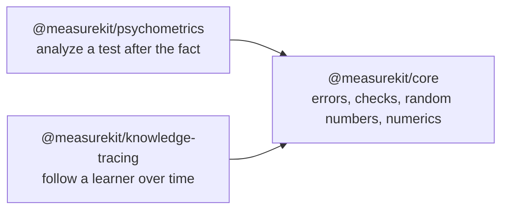

# measurekit

Psychometrics and knowledge tracing for JavaScript and TypeScript, validated against R, pyBKT and RSMTool: IRT, CTT,
adaptive testing, cognitive diagnosis, BKT.

This repository holds two libraries and the core that they share. They run in any JavaScript runtime:
[`compat/`](https://github.com/measurekit/measurekit/blob/main/compat/README.md) runs them on Node.js, Deno, Bun and
workerd.



## Which package

| Package                                                                                        | What it is                                                                                                                                                                                                                                                                                                                                                         |
| ---------------------------------------------------------------------------------------------- | ------------------------------------------------------------------------------------------------------------------------------------------------------------------------------------------------------------------------------------------------------------------------------------------------------------------------------------------------------------------ |
| [`@measurekit/psychometrics`](https://measurekit.wakan.dev/_measurekit/psychometrics/)         | Psychometrics for JavaScript and TypeScript, validated against R and RSMTool: item response theory including multidimensional models, classical test theory, adaptive testing, cognitive diagnosis, differential item functioning, equating, generalizability theory, standard setting, rater agreement, the evaluation of automated scores and answer similarity. |
| [`@measurekit/knowledge-tracing`](https://measurekit.wakan.dev/_measurekit/knowledge-tracing/) | Knowledge tracing for JavaScript and TypeScript, validated against pyBKT and R: Bayesian knowledge tracing, AFM and PFA, Elo, online IRT and knowledge space theory, with evaluation, mastery criteria and practice recommendations.                                                                                                                               |
| [`@measurekit/core`](https://measurekit.wakan.dev/_measurekit/core/)                           | The shared foundation of the measurekit packages: errors, argument checks, a seeded random number generator and numerics. Install @measurekit/psychometrics or @measurekit/knowledge-tracing.                                                                                                                                                                      |

```bash
npm install @measurekit/psychometrics
npm install @measurekit/knowledge-tracing
```

Each library installs `@measurekit/core` with it, and re-exports `createRandom`, `DataError`, `MeasurekitError` and the
types of core that its API names, such as `Random` and `QMatrix`, so you do not import core yourself.

- **Psychometrics** analyzes a test after the fact: item statistics, calibration, ability estimates, fit, bias and
  equating. It also runs adaptive tests and standard setting, reports and predicts scores, and checks dimensionality.
- **Knowledge tracing** follows a learner over time: each event updates the learner's state, which models predict from
  and practice recommendations use.

The libraries do not import each other. They share core, and conventions: both validate input and throw
`DataError`, take a seeded `Random` and never return `NaN`, and a Q-matrix has the same shape in both.
An `instanceof DataError` check holds for an error from either library. Each README has examples, the list of its
import paths and links to its guides.

## Documentation

The docs site, [measurekit.wakan.dev](https://measurekit.wakan.dev/), holds the READMEs, the guides and the API reference
generated by TypeDoc; `pnpm docs:api` builds it into `docs/api`.

- Guides of [psychometrics](https://measurekit.wakan.dev/_measurekit/psychometrics/architecture/)
  and [knowledge tracing](https://measurekit.wakan.dev/_measurekit/knowledge-tracing/architecture/), one per module, with
  their validation against [R and RSMTool](https://measurekit.wakan.dev/_measurekit/psychometrics/validation/) and
  [pyBKT and R](https://measurekit.wakan.dev/_measurekit/knowledge-tracing/validation/).
- Each package has a Supported page that lists what it includes and what it leaves out, an Evidence page that gives its
  references, tolerances and recovery studies, and a Choosing page that says when another library fits better:
  [psychometrics](https://measurekit.wakan.dev/_measurekit/psychometrics/choosing/),
  [knowledge tracing](https://measurekit.wakan.dev/_measurekit/knowledge-tracing/choosing/) and
  [core](https://measurekit.wakan.dev/_measurekit/core/choosing/). [Coming from R](https://measurekit.wakan.dev/_measurekit/psychometrics/coming-from-r/)
  and [coming from pyBKT](https://measurekit.wakan.dev/_measurekit/knowledge-tracing/coming-from-pybkt/) put their calls
  beside the packages'.
- Performance of [core](https://measurekit.wakan.dev/_measurekit/core/performance/),
  [psychometrics](https://measurekit.wakan.dev/_measurekit/psychometrics/performance/) and
  [knowledge tracing](https://measurekit.wakan.dev/_measurekit/knowledge-tracing/performance/): the hot path of every
  module against its reference, the sizes, the peak memory and the budgets.

## Development

Node.js 22.18+ and pnpm 12 are required. One command sets the repository up and, in a git clone, installs the git hooks:

```bash
pnpm install
```

[AGENTS.md](https://github.com/measurekit/measurekit/blob/main/AGENTS.md) lists every command with the gate it runs and
the conventions, [CONTRIBUTING.md](https://github.com/measurekit/measurekit/blob/main/CONTRIBUTING.md) the process and
[SECURITY.md](https://github.com/measurekit/measurekit/blob/main/SECURITY.md) how to report a vulnerability and how to deploy safely.

## Layout

The diagram of [CONTRIBUTING.md](https://github.com/measurekit/measurekit/blob/main/CONTRIBUTING.md) shows the repository
and the path of a change to a merge; the table of [AGENTS.md](https://github.com/measurekit/measurekit/blob/main/AGENTS.md#layout)
names what each folder holds.

## License

[Apache-2.0](https://github.com/measurekit/measurekit/blob/main/LICENSE). Copyright Fariz Wakan; see the NOTICE of each package.
