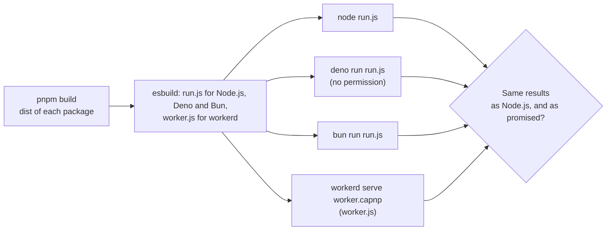

# Runtimes

The packages claim to run in any JavaScript runtime. `pnpm compat:runtimes` shows it: it bundles a 2PL calibration and a Bayesian
knowledge tracing fit, each of simulated data from a seed, and runs the bundle on Node.js, Deno, Bun and workerd, the runtime of
Cloudflare Workers. The bundle holds the packages as they ship, built with `pnpm build`, and nothing of Node.js.



| File           | Holds                                                                                                        |
| -------------- | ------------------------------------------------------------------------------------------------------------ |
| `scenarios.ts` | `runAll`: the calibration and the fit, and the results they return, rounded to 6 decimals                    |
| `run.ts`       | The entry of Node.js, Deno and Bun: it prints the results as JSON                                            |
| `worker.ts`    | The entry of workerd: a worker that answers with the results as JSON                                         |
| `worker.capnp` | The configuration of workerd: the worker, its compatibility date and its socket, with no compatibility flags |
| `check.ts`     | Bundles, runs each runtime and compares the results                                                          |

## What is checked

| Check                 | Proves                                                                                                                                                                                                                                              |
| --------------------- | --------------------------------------------------------------------------------------------------------------------------------------------------------------------------------------------------------------------------------------------------- |
| The calibration       | 15 items and 400 persons simulated by `createRandom`, a 2PL calibration by EM with the standard errors of its Hessian, Cronbach's alpha and five abilities: the same random numbers, parameters, standard errors and log-likelihood on each runtime |
| The knowledge tracing | 60 learners at 12 items and 3 skills simulated by `createRandom`, a BKT fit by EM: the same rates of each skill, predictions and mastery on each runtime                                                                                            |
| The same results      | Each runtime gives the results that Node.js gives, and Node.js gives what the packages promise: both fits converge                                                                                                                                  |

The engines may differ in the last bit of `Math.exp` and `Math.log`, so the results are rounded to 6 decimals: an estimate that stops
within its tolerance of 1e-8 keeps such a difference far below that. The bundle uses the browser's platform, so a module of Node.js in
a package fails the bundling, and Deno runs it with no permission, so a call to the file system, the network or the environment fails.
esbuild reads no tsconfig, because the `paths` of the one in this folder, which point the type checker at the sources, would bundle
the sources and not the build; its metafile lists every input, and a path of `packages/` outside a `dist/` fails the check before a
runtime runs.

## Running it

Node.js 22.18 or later runs `check.ts`. Deno and Bun are programs of their own, and the check runs each that you name. With no
argument it runs all four and fails when one is missing.

```sh
pnpm compat:runtimes                # builds, then runs node, deno, bun and workerd
pnpm compat:runtimes node workerd   # only these (node always runs, as the reference)
```

| Runtime | Pinned in                          | Version      |
| ------- | ---------------------------------- | ------------ |
| Node.js | `.node-version`, CI                | 22 and later |
| Deno    | CI                                 | 2.9.6        |
| Bun     | CI                                 | 1.4.3        |
| workerd | `workerd` in `compat/package.json` | 1.20261016.1 |
