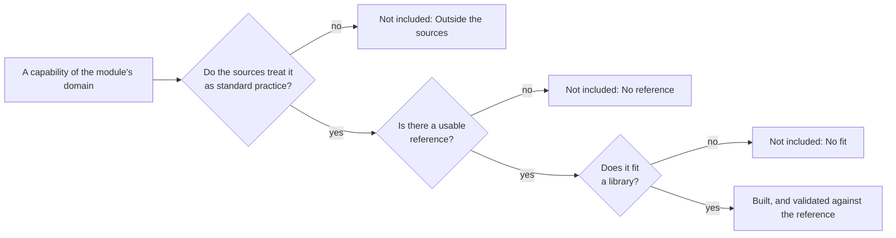

# Architecture of core

The principles that `@measurekit/core` and both libraries follow, the rule by which a capability is built, and the rules of
their numerics. [Psychometrics](../psychometrics/architecture.md) and
[knowledge tracing](../knowledge-tracing/architecture.md) add their own.

## Principles

- **Correct first.** Every statistic matches a named reference, an R package, RSMTool or pyBKT, within a documented
  tolerance ([psychometrics](../psychometrics/validation.md), [knowledge tracing](../knowledge-tracing/validation.md)), and
  the fixtures are committed.
- **Portable.** No platform API (`node:*`, `fetch`, DOM, `process`). The libraries' one runtime dependency is
  `@measurekit/core`, which has none and holds the errors, argument checks and random number generator that they share.
  ESM, strict TypeScript.
- **Deterministic.** The libraries never call `Math.random`, which a Biome plugin enforces. Randomness comes from a
  `Random` passed in, so a seed reproduces a result. Results are identical within one JavaScript engine version:
  `Math.log`, `Math.exp` and the other `Math` functions may differ in their last bits between engines and between
  versions of one engine, such as V8's, which can move results by a few units in the last place.
- **Data in, data out.** Functions take plain arrays and objects and return plain, typed result objects. No I/O, no
  logging, no localized text.
- **Defined results.** Invalid input throws `DataError`, also input of another type than documented, as plain JavaScript or
  JSON may pass it: `null` or a number for an array or for options, a string for a number, or an object that does not have
  the members of its interface. An option set to `null` is invalid, not absent, and an option a function does not take is
  refused with its name, as are the fields a record of settings does not have: a misspelled name would otherwise leave a
  default in place. A statistic that is undefined for the data is `null` in
  a table and a `DataError` from a function that returns only that statistic; results never contain `NaN`. Iterative
  methods report convergence instead of throwing.
- **Complete at the first version.** Each module has a fixed list of authoritative sources and builds what they treat as
  standard practice. A new capability afterwards means changing the list.

## Sources

A capability is built when it passes all three tests below. Every method that is not built is listed under "Not included" in
the module's guide, one method per line, with the first test it fails. The sources of each module are in
[psychometrics](../psychometrics/architecture.md#sources) and [knowledge tracing](../knowledge-tracing/architecture.md#sources).

## Numerics

- Numerics work on `Float64Array` and do not allocate in inner loops.
- Functions in `math/` assume valid input; public functions validate before calling them.
- What only one library needs stays in that library's own `math/`, which no subpath exports; core holds what both use, and
  [why the numerics are written here](../../packages/core/README.md#why-the-numerics-are-written-here) rather than taken
  from `ml-matrix` or `@stdlib`.
