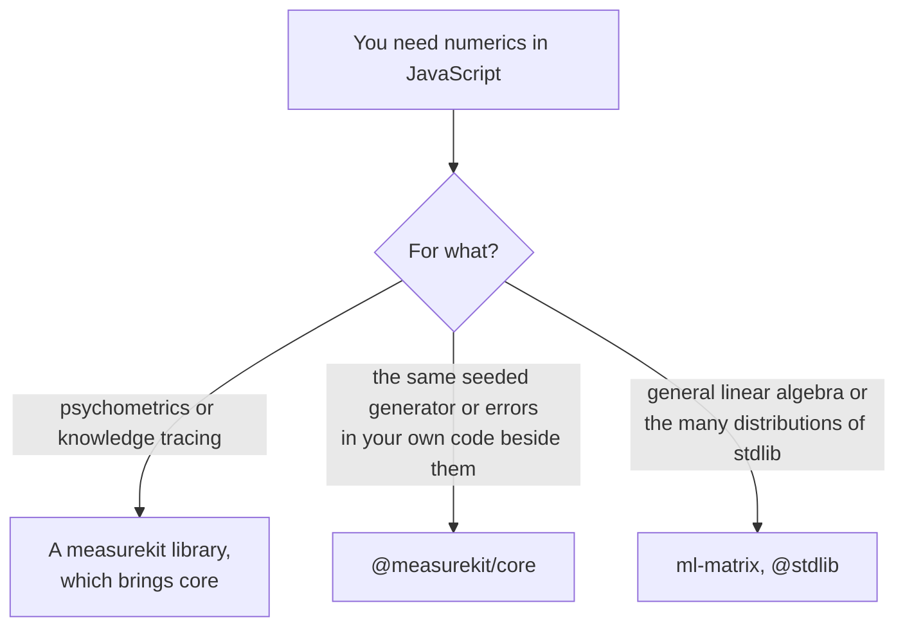

# Choosing core

When to install `@measurekit/core` itself, and when another library fits better. Most users install
`@measurekit/psychometrics` or `@measurekit/knowledge-tracing`, which depend on it and re-export `createRandom`, `Random`,
`DataError` and `MeasurekitError`.

| You need                                                                      | Use                                                            |
| ----------------------------------------------------------------------------- | -------------------------------------------------------------- |
| A statistic of a test or a model of learners                                  | `@measurekit/psychometrics` or `@measurekit/knowledge-tracing` |
| The generator and the errors that the libraries use, in code of your own      | This package: `createRandom`, `DataError`                      |
| Matrix decompositions beyond Cholesky, such as the SVD or QR                  | ml-matrix                                                      |
| Distributions beyond the normal, the logistic, the chi-square and Student's t | the `@stdlib/stats-base-dists-*` packages                      |

## What the others have that the package lacks

The README compares the package with `ml-matrix` 6.15.1 and `@stdlib` 0.3.1, measured on the same inputs on 2026-11-04
([why the numerics are written here](https://measurekit.wakan.dev/_measurekit/core/#why-the-numerics-are-written-here)):

| Comparator, version                                         | What it has                                                             | Here                                                                         |
| ----------------------------------------------------------- | ----------------------------------------------------------------------- | ---------------------------------------------------------------------------- |
| [ml-matrix](https://www.npmjs.com/package/ml-matrix) 6.15.1 | A matrix class with the eigen, singular value, QR and LU decompositions | Excluded: the eigendecomposition is in psychometrics' `math/`, the only user |
| [@stdlib](https://www.npmjs.com/org/stdlib) 0.3.1           | The quantile and distribution functions of many distributions           | Excluded: core holds the distributions that both libraries use               |
