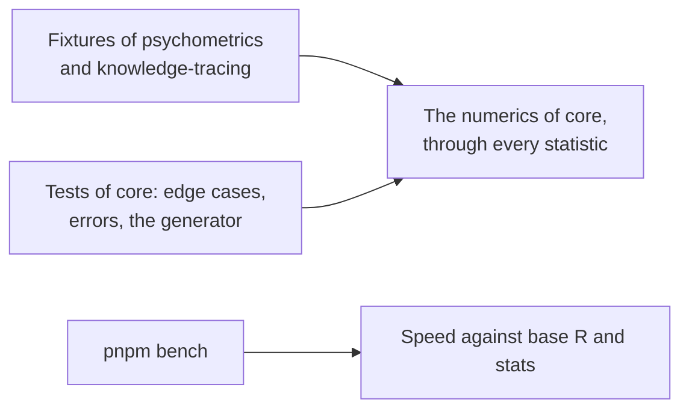

# Evidence for core

What shows that `@measurekit/core` does what it says: the fixtures of the two libraries, which compare its numerics with R
through every statistic built on them, and its own tests of the edge cases, the errors and the generator.

| Layer      | Question                                                                                                     | Where                                                                                                                                                                                                   | Runs         |
| ---------- | ------------------------------------------------------------------------------------------------------------ | ------------------------------------------------------------------------------------------------------------------------------------------------------------------------------------------------------- | ------------ |
| References | Do the normal quantile, the logistic function and the chi-square tail equal R's?                             | The fixtures of the libraries: 1e-14 relative for the normal quantile and the logistic function, 1e-12 relative for the chi-square upper tail ([validation](../psychometrics/validation.md#tolerances)) | `pnpm test`  |
| Edge cases | Do the routines stay finite at extreme arguments, and refuse what they cannot compute with `DataError`?      | `test/numerics.test.ts`, `test/distributions.test.ts`, `test/optimize.test.ts`                                                                                                                          | `pnpm test`  |
| Checks     | Does each check refuse a value of another type, a hole and an unknown option, with a sentence that names it? | `test/checks.test.ts`                                                                                                                                                                                   | `pnpm test`  |
| Generator  | Do equal seeds give equal draws, and do the draws have their distributions' moments?                         | `test/random.test.ts`                                                                                                                                                                                   | `pnpm test`  |
| Speed      | How long do the numerics and the generator take against base R and stats?                                    | [performance](performance.md)                                                                                                                                                                           | `pnpm bench` |
