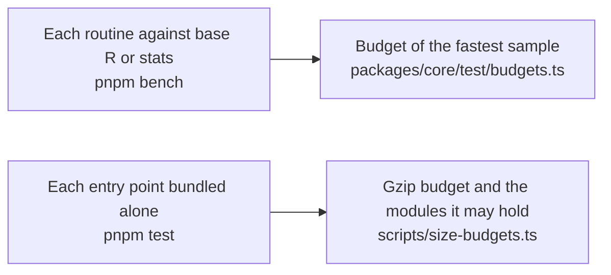

# Performance of core

How the speed of the numerics of `@measurekit/core` is guarded against base R and stats, and how much its entry point adds
to a bundle. core reads no untrusted input of its own: the readers of the libraries do, and their pages give the memory
they need.

## Speed

Each routine has a benchmark in `packages/core/test/*.bench.ts` that times it against base R or stats on the same data, and
the `bench` job of CI holds each one to a budget in `packages/core/test/budgets.ts`. The docs publish no measured time: it
differs on every machine and goes stale with each change. How each side is timed, how the budgets are set and how a user
times the references on their machine are in the [method](../../validation/README.md#benchmarks).

## Size

Each entry point bundled alone with esbuild ([method](../../validation/README.md#sizes-and-peak-memory)).

| Entry point        | Minified (bytes) | Gzip (bytes) | Modules it holds besides its own |
| ------------------ | ---------------: | -----------: | -------------------------------- |
| `@measurekit/core` |           16,671 |        6,924 | nothing                          |
