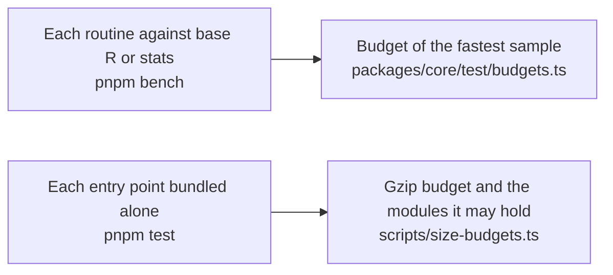
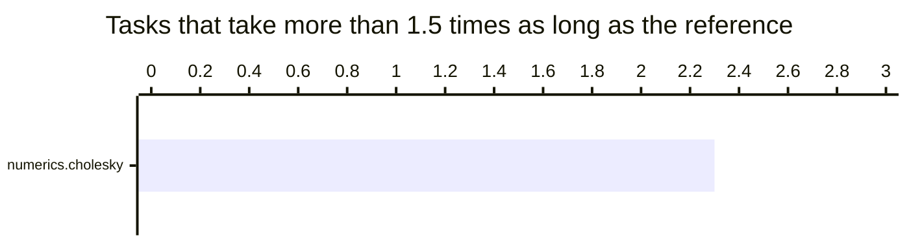
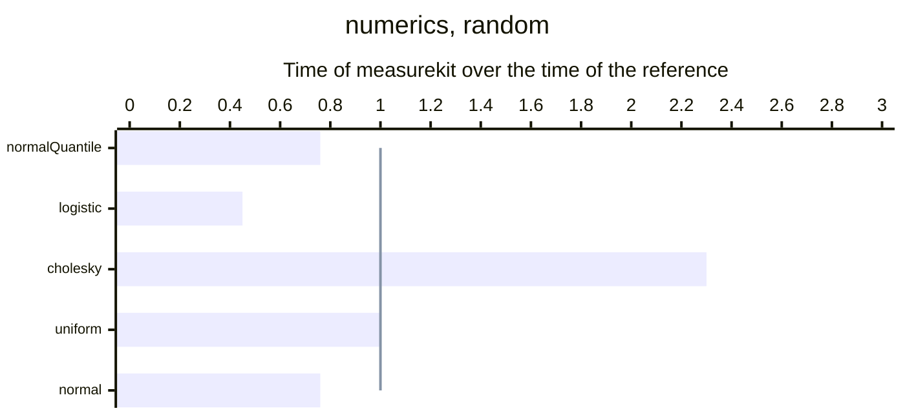

# Performance of core

What the numerics of `@measurekit/core` cost against base R and stats, and how much its entry point adds to a bundle. A
budget holds each number and fails a gate of CI: `pnpm bench` for the time, `pnpm test` for the size. core reads no
untrusted input of its own: the readers of the libraries do, and their pages give the memory they need.

## Speed

Each benchmark times the numerics against base R and stats, on the same data, with one thread. The ratio is the time of
measurekit over the time of the reference: above 1, measurekit is slower, and above 1.5 the row is in bold. A benchmark
fails `pnpm bench` when its fastest sample is above its budget in `packages/core/test/budgets.ts`: five times the
fastest sample of the CI runner, rounded up to one significant digit, as STANDARDS.md section 11 sets every budget. How
each side is timed, how the budgets were measured and how to refresh this page are in
[validation](../../validation/README.md#benchmarks).

<!-- charts -->

### Where measurekit is slower

A bar above the line takes longer than the reference.

### Every task

<!-- /charts -->

### Results

<!-- tables -->

Measured on Apple M5 with 10 cores, 16 GB of memory, Node.js 26.8.1 and R version 4.6.1 (2026-06-24).

| Task                       | Size                              | measurekit (ms) | Reference            | Reference (ms) |    Ratio |
| -------------------------- | --------------------------------- | --------------: | -------------------- | -------------: | -------: |
| Normal quantile function   | 1,000,000 probabilities           |            4.16 | stats 4.6.1 `qnorm`  |           5.44 |    0.76× |
| Logistic function          | 1,000,000 points                  |            2.37 | stats 4.6.1 `plogis` |           5.22 |    0.45× |
| **Cholesky factorization** | A correlation matrix of order 200 |           0.267 | base 4.6.1 `chol`    |          0.118 | **2.3×** |
| Uniform draws              | 1,000,000 draws                   |            3.09 | stats 4.6.1 `runif`  |           3.00 |       1× |
| Normal draws               | 1,000,000 draws                   |            8.84 | stats 4.6.1 `rnorm`  |           11.6 |    0.76× |

- Cholesky factorization: R's LAPACK calls OpenBLAS, whose kernels add and multiply two doubles per instruction and fuse each pair; JavaScript has neither. measurekit's loops share their reads across a block of 4 rows and 3 columns, and the same loops in C compiled without vector instructions or fused multiply-add take 0.77 times as long as measurekit's and, compiled with both, 0.48 times as long.

<!-- /tables -->

## Size

Each entry point bundled alone, as a host's bundler makes it: minified with esbuild and code splitting on, `export *` of
the entry, core from its sources. The bytes and the modules are those of the entry chunk and the chunks it imports
statically, which load with it; a module that a dynamic `import()` loads later is a chunk of its own and is not counted.
The modules each holds are those the import rules of [AGENTS.md](../../AGENTS.md#dependencies) allow it.

| Entry point        | Minified (bytes) | Gzip (bytes) | Modules it holds besides its own |
| ------------------ | ---------------: | -----------: | -------------------------------- |
| `@measurekit/core` |           14,392 |        5,888 | nothing                          |

`scripts/test/entry-sizes.test.ts`, which `pnpm test --project scripts` runs without a build, bundles each entry point
and fails when it takes more than its budget after gzip, or holds a module that its budget in `scripts/size-budgets.ts`
does not list. A budget is 1.25 times the size measured after gzip, rounded up to the next 500 bytes. `node
scripts/entry-sizes.ts` prints the sizes; the table gives them on Node.js 22, the version of the runner, and the gzip of
Node.js 26 is up to 1.2 percent less.
