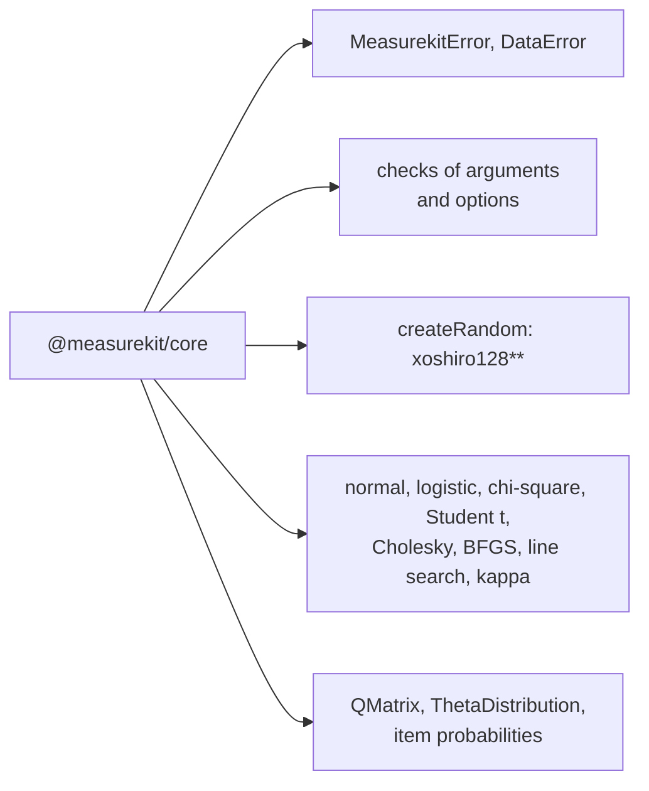

# What core supports

What `@measurekit/core` holds for the two libraries: their errors, the checks of their arguments, a seeded random number
generator, the numerics that both use and the types that they share. It implements no statistic that a user calls on its
own; the libraries do.

| Part           | Holds                                                                                                                                                                  | Checked against                                                                         |
| -------------- | ---------------------------------------------------------------------------------------------------------------------------------------------------------------------- | --------------------------------------------------------------------------------------- |
| Errors         | `MeasurekitError` and `DataError`, the classes of every error that the libraries throw                                                                                 | `test/errors.test.ts`                                                                   |
| Checks         | The checks of arguments, of lists, which refuse holes, of options objects, which refuse an unknown key, and of records, which refuse a reserved key or hold it as data | `test/checks.test.ts`                                                                   |
| Random         | `createRandom(seed)`, a seeded xoshiro128** generator of uniform and normal draws, and `shuffle`                                                                       | `test/random.test.ts`: seeded properties of the distributions                           |
| Distributions  | The normal distribution function, density and quantile, the logistic function, the chi-square upper tail and Student's t distribution function                         | R's `qnorm`, `plogis` and `pchisq`, in the fixtures of the libraries                    |
| Optimization   | BFGS, Armijo's line search, a descent step and a fixed-point iteration that report `converged` and `iterations`                                                        | `test/optimize.test.ts`, and the calibrations of the libraries against R                |
| Linear algebra | The Cholesky factor, the inverse of a symmetric positive definite matrix and products of vectors on `Float64Array`                                                     | `test/numerics.test.ts`                                                                 |
| Agreement      | Kappa of pairs of categories, unweighted, linear or quadratic                                                                                                          | `irr::kappa2`, in the fixtures of both libraries                                        |
| Items          | The probabilities of logistic, graded and partial credit items, a softmax, and the checks of their parameters                                                          | `test/item-probabilities.test.ts`, and mirt's `probtrace` in the psychometrics fixtures |

What only one library needs, such as an eigendecomposition, stays in that library's own `math/`, which no subpath exports.
