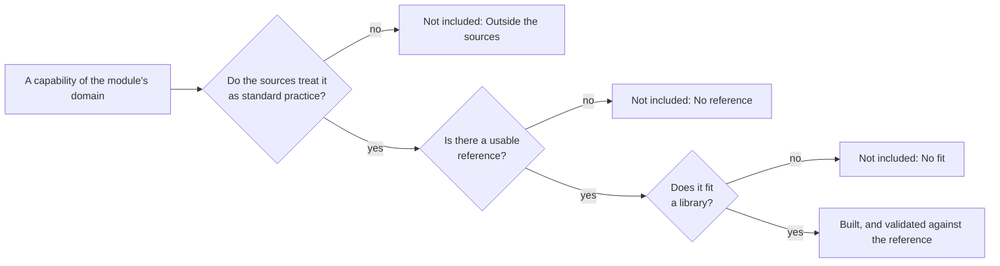

# Architecture of knowledge-tracing

## Principles

- **Correct first.** Every statistic matches a named reference, R or pyBKT, within a documented tolerance
  ([validation](validation.md)), and the fixtures are committed.
- **Portable.** No platform API (`node:*`, `fetch`, DOM, `process`) and one runtime dependency,
  `@measurekit/core`, which has none and holds the errors, argument checks and random number generator that
  both packages share. ESM, strict TypeScript.
- **Deterministic.** The library never calls `Math.random`, which a Biome plugin enforces. Randomness comes from a
  `Random` passed in, or for a fit from a seed in the model's options, so a seed reproduces a result. Results are
  identical within one JavaScript engine version: `Math.log`, `Math.exp` and the other `Math` functions may differ in
  their last bits between engines and between versions of one engine, such as V8's, which can move results by a few
  units in the last place.
- **Data in, data out.** Functions take plain arrays and objects and return plain, typed result objects. No I/O, no
  logging, no localized text.
- **Online and batch.** Every model is fitted to a log in batch and updates a learner's state one event at a time
  online, with the same arithmetic.
- **Serializable state.** Learner states and model parameters are plain data that JSON serializes, so they can be
  stored in a database or in browser storage and resumed exactly.
- **Defined results.** Invalid input throws `DataError`, also input of another type than documented, as plain
  JavaScript or JSON may pass it: `null` or a number for an array or for options, a string for a number, or a model,
  state or random number generator that is not an object of its interface. An option set to `null` is invalid, not
  absent, and an option a function does not take is refused with its name, as are the fields a record of settings does
  not have, such as BKT's bounds or a prior: a misspelled name would otherwise leave a default in place. Records of
  data, such as events, states and parameters, may carry fields of their own. A statistic that is undefined for the data is `null` in a table and a `DataError` from a function that
  returns only that statistic; results never contain `NaN`. Iterative methods report convergence instead of throwing.
- **Extensible.** Every model implements one interface, `LearnerModel`, and evaluation uses only that interface, so a
  model written outside the package is evaluated as a built-in one is.
- **Complete at the first version.** Each module has a fixed list of authoritative [sources](#sources), which the owner set,
  and builds what they treat as standard practice. A new capability afterwards means changing the list.

## Sources

A capability is built when it passes all three tests below. Every method that is not built is listed under "Not included" in the module's guide, one method per line, with the first test it fails.



| Module     | Sources                                                                                                                                                                                   | Covers                                                                                      |
| ---------- | ----------------------------------------------------------------------------------------------------------------------------------------------------------------------------------------- | ------------------------------------------------------------------------------------------- |
| `bkt`      | [Pelánek (2017)](https://doi.org/10.1007/s11257-017-9193-2); [Pardos and Heffernan (2009)](https://researchr.org/publication/PardosH09-0)                                                 | The BKT family; the item-pair model                                                         |
| `logistic` | [Pavlik, Eglington and Harrell-Williams (2021)](https://doi.org/10.1109/TLT.2021.3128569); [Gervet et al. (2020)](https://jedm.educationaldatamining.org/index.php/JEDM/article/view/451) | LKT features; Best-LR and the logistic family                                               |
| `elo`      | [Pelánek (2016)](https://doi.org/10.1016/j.compedu.2016.03.017)                                                                                                                           | Elo in adaptive education                                                                   |
| `irt`      | [Pelánek (2017)](https://doi.org/10.1007/s11257-017-9193-2); [Wang, Berger and Burdick (2013)](https://doi.org/10.1214/12-AOAS608)                                                        | Online ability; ability that drifts                                                         |
| `kst`      | [Falmagne and Doignon (2011)](https://doi.org/10.1007/978-3-642-01039-2), chapters 2 to 5, 11 to 16; [Heller and Wickelmaier (2013)](https://doi.org/10.1016/j.endm.2013.05.145)          | Structures, spaces, surmise systems, probabilistic models, assessment, building; estimation |
| `evaluate` | [Pelánek (2015)](https://jedm.educationaldatamining.org/index.php/JEDM/article/view/JEDM087)                                                                                              | Metrics of student models                                                                   |
| `practice` | [Pelánek and Řihák (2017)](https://doi.org/10.1145/3079628.3079667)                                                                                                                       | Mastery criteria                                                                            |

`data`, `math` and `sim` have no list of their own: they follow what the other modules need.

## Modules

Each module is a folder of `packages/knowledge-tracing/src/` with an `index.ts` that lists its public API.
[AGENTS.md](../../AGENTS.md#layout) shows the layout of the repository and
the [README](../../packages/knowledge-tracing/README.md#api) the contents of each module. The package exports `.`
and one subpath per module: `@measurekit/knowledge-tracing/data`,
`@measurekit/knowledge-tracing/evaluate`, `@measurekit/knowledge-tracing/elo`,
`@measurekit/knowledge-tracing/bkt`, `@measurekit/knowledge-tracing/logistic`,
`@measurekit/knowledge-tracing/irt`, `@measurekit/knowledge-tracing/kst`, `@measurekit/knowledge-tracing/practice`
and `@measurekit/knowledge-tracing/sim`. Each public name has one entry, its module's subpath. `.` holds the model
interface, `LearnerModel` and `ModelFit`, which no module owns, and what the modules share and core owns, so that a user
does not import core ([AGENTS.md](../../AGENTS.md#deviations-from-the-standards)): `createRandom`, `DataError`,
`MeasurekitError` and the types of core that the modules take or return, `Random`, `QMatrix`, `ThresholdItem`,
`NominalParameters` and `ThetaDistribution`, which no module re-exports. `math/` is not exported.

## Dependencies between modules

Modules form layers; a module imports only from lower layers, never from its own or a higher one.

| Layer | Modules                                                                       |
| ----- | ----------------------------------------------------------------------------- |
| 1     | `@measurekit/core`                                                            |
| 2     | `math/`, `data/`                                                              |
| 3     | `model.ts`                                                                    |
| 4     | `elo/`, `bkt/`, `logistic/`, `irt/`, `kst/`, `evaluate/`, `practice/`, `sim/` |

`math/` and `data/` import nothing but core, and `model.ts` the types of `data/`. The model families,
`evaluate/`, `practice/` and `sim/` never import each other: evaluation, practice and simulation know models only
through the interface. [AGENTS.md](../../AGENTS.md#dependencies) lists the imports each module may use; Biome enforces
them, the absence of Node modules and platform globals in `src/`, and that code outside `packages/` imports
`@measurekit/knowledge-tracing` by name.

## The learner model interface

A learner model has parameters, estimated from a log in batch, and a state per learner, updated one event at a time
online. `LearnerModel<TState, TParameters>`:

| Member                    | Contract                                                                                                                                                                                                                                               |
| ------------------------- | ------------------------------------------------------------------------------------------------------------------------------------------------------------------------------------------------------------------------------------------------------ |
| `parameters`              | The model's parameters: plain data, from which the family's factory rebuilds the model, as `elo({ parameters })`.                                                                                                                                      |
| `fit(log)`                | Estimates the parameters from a log, starting from the model's own, and returns a `ModelFit` with a new model.                                                                                                                                         |
| `initialState(learner)`   | The learner's state before any event. Learner-specific parameters, such as an individual prior or a learner intercept, enter here; an unknown learner gets the population's.                                                                           |
| `update(state, event)`    | The state after an event: a new object; the state given is unchanged. It accepts `outcome: null`, a learning opportunity with nothing observed, and applies what such an event does to a learner.                                                      |
| `predict(state, attempt)` | P(correct) for an attempt, an event without its outcome: the expected outcome, a score from 0 to 1 for an item of several categories. A log's events are predicted, then passed to `update`; the library never predicts an event with `outcome: null`. |
| `mastery?(state, skill)`  | P(skill mastered), only for models that define mastery.                                                                                                                                                                                                |

`ModelFit` reports the same quantities for every model:

| Field                     | Meaning                                                                                                                                                                 |
| ------------------------- | ----------------------------------------------------------------------------------------------------------------------------------------------------------------------- |
| `model`                   | The model with the estimated parameters                                                                                                                                 |
| `states`                  | Each learner's state after their events, by learner id; a KST fit gives them with `posteriors: true`, and each learner's most likely state otherwise                    |
| `predictions`             | Each event's prediction, made before its outcome, in log order; `null` for an event without an outcome                                                                  |
| `logLikelihood`           | Σ y ln p + (1 - y) ln(1 - p) over the events with an outcome, from `predictions`; for learners drawn from a distribution, the marginal log-likelihood, θ integrated out |
| `aic`, `bic`              | 2k - 2 ln L and k ln n - 2 ln L with k estimated parameters and n events with an outcome; `null` for a model without k: fitted in one pass, with a penalty or elsewhere |
| `converged`, `iterations` | Whether the estimation converged, and its iterations or passes over the log                                                                                             |

A family's factory takes options, which fix the model's structure and its estimation, and `parameters`, which restore a
fitted model. `fit` takes only the log, so cross-validation fits any model the same way, and is a function of the model
and the log: an estimation that draws random numbers, such as EM restarts, takes a seed from the options. A family can
add members to its model type, as Elo adds `updateItem` for online item ratings, BKT `opportunitiesToMastery` and IRT
`ability` and KST `nextQuestion`, and narrow `fit`'s result. A family whose parameters are given, as IRT's, returns
itself from `fit`.

The interface covers the classical families of learner models:

| Family        | Parameters                                                                                    | State                                                                           | `update`                                  | `mastery`                    | `fit`                                                                   |
| ------------- | --------------------------------------------------------------------------------------------- | ------------------------------------------------------------------------------- | ----------------------------------------- | ---------------------------- | ----------------------------------------------------------------------- |
| Elo           | Item difficulties                                                                             | Global and skill abilities                                                      | One Elo step                              | none                         | One replay of the log                                                   |
| BKT           | Per skill: prior, learn, forget, guess, slip; per group, resource or item with the extensions | P(L) per skill                                                                  | Condition on the outcome, then transition | P(L)                         | EM from the model's parameters                                          |
| AFM, PFA, LKT | Per skill: an intercept and a coefficient per feature; per learner: θ                         | Per skill: successes, failures, last time, decayed counts                       | Count the event in each of its skills     | none                         | Newton, by the Schur complement of the learners; Laplace for a random θ |
| IRT           | Given item parameters: 1PL to 4PL, graded, partial credit, nominal                            | The log-posterior of θ on a grid, with its derivatives or the time of its drift | Add the outcome's log-probability         | none                         | None: the parameters are given; the states after the log                |
| KST           | π of each knowledge state; per item: guess, slip                                              | The probability of each knowledge state                                         | Bayes' rule                               | P(the state holds the skill) | EM, or minimum discrepancy in one pass                                  |

`predict` takes the attempt's time, so time-aware features such as recency decay need no other member, and
`initialState` takes the learner id for learner-level parameters.

### Estimation options

Families that estimate parameters iteratively take the same options, checked by `checkStopping` of
`@measurekit/core`: `tolerance` is a number of at least 0, `maxIterations` a positive integer, `restarts` a
positive integer and `seed` a safe integer. A fit reports `converged` and `iterations`, and does not throw when it
stops at `maxIterations`.

| Option          | Meaning                                                                                                                                         | BKT    | Logistic | KST     |
| --------------- | ----------------------------------------------------------------------------------------------------------------------------------------------- | ------ | -------- | ------- |
| `tolerance`     | The convergence threshold: the change of the log-likelihood between EM iterations; for logistic models, the largest absolute gradient component | `1e-6` | `1e-8`   | `1e-8`  |
| `maxIterations` | The most iterations; for BKT, of one start                                                                                                      | `500`  | `100`    | `10000` |
| `restarts`      | Random starts of EM for a skill without parameters; the best by log-likelihood is kept                                                          | `5`    | none     | none    |
| `seed`          | The seed of the random starts                                                                                                                   | `0`    | none     | none    |

Elo and IRT estimate nothing iteratively, so they take none of these. The defaults differ because the criteria do.

### Events with several skills

Every model treats an event with several skills as an event of each skill. Each skill takes the event's whole evidence,
not a share of it, and a fit counts the event once for each of its skills. Elo and BKT predict with the mean over the
skills, on the scale where each combines them; the logistic models add the skills' terms, as AFM, PFA and LKT define
them. IRT does not use skills: its θ is the scale of one calibration, and a test calibrated in sections takes one model
per section. KST over skills masters an item when the knowledge state holds all its skills, the conjunctive model.

| Model    | Prediction of an event with skills K                                   | Update of each skill k                                  |
| -------- | ---------------------------------------------------------------------- | ------------------------------------------------------- |
| Elo      | logistic(θ + mean over K of θ_k - d): abilities add on the logit scale | θ_k moves by γ U(n_k) (y - P), the event's whole error  |
| BKT      | The mean over K of each skill's P(correct)                             | P(L) of k is conditioned on y as if k alone produced it |
| Logistic | logistic(θ + Σ over K of (β_k + Σ_f w_kf x_kf))                        | k's counts take the whole outcome                       |

The mean treats skills as compensating for each other and gives an event of several skills the weight of one in the
prediction. In a logistic model the skills' intercepts and coefficients are estimated together, from rows that add
them, so the sum is what they mean.

### Writing a model

A model written outside the package implements `LearnerModel` and works with every function
of `@measurekit/knowledge-tracing/evaluate`. This one, for outcomes of 0 or 1, predicts the rate of correct outcomes
of the log it was fitted to:

```ts
import type { LearnerModel } from "@measurekit/knowledge-tracing";

function baseRate(rate = 0.5): LearnerModel<string, { rate: number }> {
  return {
    parameters: { rate },
    fit(log) {
      // An event without an outcome has no prediction and no term of the likelihood.
      const outcomes = log.flatMap((event) => (event.outcome === null ? [] : [event.outcome]));
      const p = outcomes.reduce((sum, outcome) => sum + outcome, 0) / outcomes.length;
      const logLikelihood = outcomes.reduce((sum, outcome) => sum + Math.log(outcome === 1 ? p : 1 - p), 0);
      return {
        model: baseRate(p),
        states: Object.fromEntries(log.map((event) => [event.learner, event.learner])),
        predictions: log.map((event) => (event.outcome === null ? null : p)),
        logLikelihood,
        aic: 2 - 2 * logLikelihood,
        bic: Math.log(outcomes.length) - 2 * logLikelihood,
        converged: true,
        iterations: 1,
      };
    },
    initialState: (learner) => learner,
    update: (state) => state,
    predict: () => rate,
  };
}
```

A built-in model also validates its states and events, throwing `DataError`, so that states from storage are checked.
Evaluation, practice and simulation check that a model passed in is an object with the methods `fit`, `initialState`,
`update` and `predict`, and `thresholdMastery` that it has `mastery`.

## Numerics

- Numerics work on `Float64Array` and do not allocate in inner loops.
- Functions in `math/` assume valid input; public functions validate before calling them.
- A fit's predictions and states come from one pass over the log with the model's steps, `onePass` of `data/replay.ts`:
  the arithmetic of online updates without their checks, as the log was checked as a whole, so they equal the same events
  applied online, to the last bit. Elo's and IRT's fits pass with their own step, which also moves Elo's item ratings; an
  event without an outcome leaves the learner's state as it was, or with IRT's drift advances it to its time. KST's fit
  replays one learner at a time with its steps, as the learners are independent at given parameters.
- Newton's line search takes a step that raises the objective by no more than its rounding error, 1e-12 relative: near
  the optimum a Newton step lowers it by less, and the gradient decides convergence.
- Logistic regressions with an intercept per learner have an arrow-shaped Hessian; Newton steps solve it by the Schur
  complement of the learners' diagonal block, in time and memory linear in learners and events. A random intercept
  takes each learner's conditional mode by one-dimensional Newton steps, and the Laplace approximation's exact gradient.
- IRT keeps the log-posterior and its first two derivatives at each grid point, so EAP is a sum over the grid and MAP
  the root of a quintic between the two points nearest the mode, accurate to about 1e-5 at the default grid. With drift,
  it keeps the log-posterior and its time; a gap is a reflecting walk on the grid, summed by uniformization in
  `math/reflected-walk.ts` with a lower bound for the points that underflow, and MAP takes the derivatives by
  differences.
- KST keeps knowledge states as bitsets. A quasi-ordinal space is enumerated with prerequisites first, so every branch
  ends in a state, and stops at `maxStates`. BLIM's EM merges learners with equal answers and sums each state's
  log-likelihood on its own, so a rate of 0 or 1 excludes states without `NaN`.
- BKT's E-step runs the forward-backward algorithm on each learner's sequence of a skill, and attributes its expected
  counts to the rate classes, resolved once per item and group per iteration.
- A log-likelihood term of weight 0 is 0: a certain prediction that is right contributes 0, never `NaN`.
- The forward-backward algorithm normalizes the forward variables at every step and smooths them backward, ξ_t(i, j) =
  α_t(i) A(i, j) / p_(t+1)(j) · γ_(t+1)(j), from probabilities and shares of them only: a sequence of thousands of
  attempts, where a state's filtered probability underflows to 0, gives no `NaN`.
- AUC comes from midranks, exact for ties; calibration bins compare predictions with the bounds k / K as computed.
- The numerics are written here rather than taken from `ml-matrix` or `@stdlib`, for the reasons that core's
  [README](../../packages/core/README.md#why-the-numerics-are-written-here) gives.

## Not included

| Not included | Why                                                                                                                                                                                                                                                                                              |
| ------------ | ------------------------------------------------------------------------------------------------------------------------------------------------------------------------------------------------------------------------------------------------------------------------------------------------ |
| DKT          | No fit: a recurrent network needs a tensor runtime, against the one-dependency rule, and its state is a hidden vector, not a mastery for each skill. `pyKT` is the reference, and it belongs in a package of its own. [`LearnerModel`](#the-learner-model-interface) lets one be evaluated here. |
| DKVMN        | No fit: as DKT, it needs a tensor runtime and its state is a hidden memory, not a mastery for each skill; `pyKT` is the reference.                                                                                                                                                               |
| SAKT         | No fit: as DKT, it needs a tensor runtime and its state is a hidden vector, not a mastery for each skill; `pyKT` is the reference.                                                                                                                                                               |
| AKT          | No fit: as DKT, it needs a tensor runtime and its state is a hidden vector, not a mastery for each skill; `pyKT` is the reference.                                                                                                                                                               |
| DKT+         | No fit: as DKT, it needs a tensor runtime and its state is a hidden vector, not a mastery for each skill.                                                                                                                                                                                        |
| GKT          | No fit: as DKT, it needs a tensor runtime and its state is a hidden vector, not a mastery for each skill.                                                                                                                                                                                        |
| LPKT         | No fit: as DKT, it needs a tensor runtime and its state is a hidden vector, not a mastery for each skill.                                                                                                                                                                                        |
| LBKT         | No fit: as DKT, it needs a tensor runtime and its state is a hidden vector, not a mastery for each skill.                                                                                                                                                                                        |
| KPT          | No fit: a tensor runtime, and features computed from text.                                                                                                                                                                                                                                       |
| EKPT         | No fit: a tensor runtime, and features computed from text.                                                                                                                                                                                                                                       |
