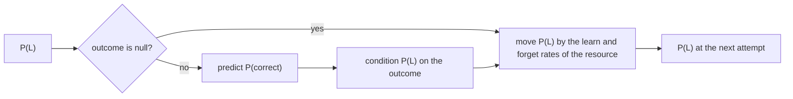

# Bayesian knowledge tracing

`@measurekit/knowledge-tracing/bkt` traces each skill with Bayesian knowledge tracing (Corbett and Anderson, 1994)
and the extensions of pyBKT (Badrinath, Wang and Pardos, 2021): forgetting, item guess and slip, resource learning and
prior groups. Inference at fixed parameters and EM fitting, with and without events that have no outcome, are validated
against pyBKT ([validation](validation.md#bayesian-knowledge-tracing)).



## The model

For each skill, a learner either knows it or not:

| Rate  | Field    | Meaning                                                                 |
| ----- | -------- | ----------------------------------------------------------------------- |
| P(L0) | `prior`  | The probability of knowing the skill before practicing it               |
| P(T)  | `learn`  | The probability of learning it from an attempt                          |
| P(F)  | `forget` | The probability of forgetting it after an attempt; 0 without forgetting |
| P(G)  | `guess`  | The probability of a correct answer without knowing it                  |
| P(S)  | `slip`   | The probability of an incorrect answer despite knowing it               |

With P(L), the probability that the learner knows the skill at their next attempt,

P(correct) = P(L) (1 - P(S)) + (1 - P(L)) P(G).

After the outcome, P(L) is conditioned on it by Bayes' rule, then moved by the rates of the resource just practiced:
P(L) ← P(L | outcome) (1 - P(F)) + (1 - P(L | outcome)) P(T).

- **Outcomes** are 0 or 1, and every event with an outcome needs at least one skill; other events throw `DataError`.
- **Events without an outcome.** An event with `outcome: null`, such as a lesson, shows nothing about P(L), so only the
  learn and forget rates apply: P(L) ← P(L) (1 - P(F)) + (1 - P(L)) P(T). It has no prediction, adds no guess or slip,
  and a skill without parameters stays as it is, online too. Its skills may be none.
- **Several skills.** An event with several skills is an event of each: each skill's P(L) updates as for that skill
  alone, the prediction is the mean of the skills' predictions, and fitting counts the event in every skill's
  sequences, as Elo does ([architecture](architecture.md#events-with-several-skills)).
- **Skills are independent.** Each has its own parameters and is fitted on its own events.

## Options

| Option             | Default | Meaning                                                                                     | pyBKT        |
| ------------------ | ------- | ------------------------------------------------------------------------------------------- | ------------ |
| `forgetting`       | `false` | Estimate P(F); without it P(F) is 0                                                         | `forgets`    |
| `itemGuessSlip`    | `false` | Each item has its own P(G) and P(S)                                                         | `multigs`    |
| `resourceLearning` | `false` | Each resource has its own P(T), and P(F) with forgetting, applied after an attempt with it  | `multilearn` |
| `priorGroups`      | none    | The group of each learner, by learner id; each group has its own P(L0) per skill            | `multiprior` |
| `restarts`         | `5`     | Random starts of EM for a skill without parameters; the highest log-likelihood is kept      | `num_fits`   |
| `seed`             | `0`     | The seed of the random starts; every skill draws its starts from a generator with this seed | `seed`       |
| `tolerance`        | `1e-6`  | EM has converged when a skill's log-likelihood changes by at most this                      | `tol`        |
| `maxIterations`    | `500`   | The most EM iterations of a start                                                           | `maxiter`    |
| `parameters`       | none    | The parameters to predict with and to start EM from                                         | `coef_`      |

The options combine freely. Guess and slip use the event's `item`: to share them among items, such as those of one
template, give their events the template's id as `item`. Learn and forget rates use the event's `resource`, which is its
item when it has none: a lesson, a video and an exercise can each have rates of their own.

## Parameters

`model.parameters` is plain data, `{ skills: { [skill]: BktSkill } }`. A skill has the five rates above and, with the
extensions, `groupPriors` by group, `resourceLearning` `{ learn, forget }` by resource and `itemGuessSlip`
`{ guess, slip }` by item. An item uses its own guess and slip, and a resource its own learn and forget rates, when the
skill has them and the skill's otherwise; a learner uses their group's prior when the skill has one and the skill's
otherwise. So items, resources and learners that a fit did not see, such as new items, use the skill's rates. Where
every item, resource or group has its own, the skill's rate is their pooled estimate: the expected count over the
expected opportunities of all of them.

## Fitting

`fit(log)` estimates each skill by expectation maximization on its learners' sequences, with the forward-backward
algorithm (Baum-Welch). A skill with parameters in the model starts from them; any other starts from `restarts` random
starts: P(L0) from U(0, 1), P(T) from U(0, 0.4), P(F) from U(0, 0.2) with forgetting, P(G) from U(0, 0.4) and P(S) from
U(0, 0.3), as pyBKT draws them except P(F). EM stops when the log-likelihood changes by at most `tolerance`. It keeps
P(G) and P(S) at least 2⁻⁵² from 0 and 1, so that a fitted model gives every outcome a positive probability: data whose
outcomes of a skill are all correct would otherwise fit P(S) = 0, and an incorrect answer would be impossible.

```ts
import { createRandom } from "@measurekit/knowledge-tracing";
import { bkt } from "@measurekit/knowledge-tracing/bkt";
import { eventLog } from "@measurekit/knowledge-tracing/data";

const random = createRandom(1);
const events = Array.from({ length: 30 }, (_, learner) =>
  Array.from({ length: 8 }, (_, attempt) => ({
    learner: `l${learner}`,
    item: `q${1 + (attempt % 4)}`,
    time: learner * 10 + attempt,
    outcome: random.uniform() < 0.3 + 0.08 * attempt ? 1 : 0,
  })),
).flat();
const qMatrix = { q1: ["fractions"], q2: ["fractions"], q3: ["decimals"], q4: ["decimals"] };
const log = eventLog(events, { qMatrix });
const fit = bkt({ forgetting: true, itemGuessSlip: true }).fit(log);
fit.model.parameters.skills.fractions; // { prior, learn, forget, guess, slip, itemGuessSlip: { q1, q2 } }
fit.states.l0; // { learner: "l0", skills: { fractions, decimals } }: the learner's P(L) after the log
```

| Fit field                 | Meaning                                                                                                                                                                           |
| ------------------------- | --------------------------------------------------------------------------------------------------------------------------------------------------------------------------------- |
| `predictions`             | Each event's prediction by online inference with the fitted parameters; `null` for an event without an outcome                                                                    |
| `logLikelihood`           | The log-likelihood of those predictions: for events of one skill, the HMM log-likelihood                                                                                          |
| `aic`, `bic`              | With k the rates the events estimate: of each skill, its priors, learn rates, forget rates with forgetting, guess and slip rates in use; n of `bic` is the events with an outcome |
| `converged`, `iterations` | Whether every skill's chosen start converged, and the most iterations of any                                                                                                      |

In EM, an event without an outcome has probability 1 in both states and adds no guess or slip count, while the learning
step after it counts for its resource: a lesson's P(T) is estimated from the outcomes that follow it. A transition with
no outcome after it in the sequence, such as a lesson at its end, teaches nothing and is not counted in `aic` and `bic`;
a skill met only through events without an outcome gets no parameters, and a lesson gets no guess or slip. `fit` throws
`DataError` for a log with no event with an outcome.

A rate without expected opportunities in the data, such as P(T) of a skill whose learners each attempted it once, keeps
its starting value. Skills of the model absent from the log keep their parameters. A log too large for memory can be
fitted skill by skill and the results merged ([storage](storage.md#fitting-bkt-skill-by-skill)).

## Online

```ts
import { bkt } from "@measurekit/knowledge-tracing/bkt";

const model = bkt({
  parameters: { skills: { fractions: { prior: 0.3, learn: 0.2, forget: 0, guess: 0.2, slip: 0.1 } } },
});
const ana = model.initialState("ana"); // { learner: "ana", skills: {} }
const attempt = { learner: "ana", item: "q1", skills: ["fractions"], time: 1 };
model.predict(ana, attempt); // 0.41
const next = model.update(ana, { ...attempt, outcome: 1 }); // { learner: "ana", skills: { fractions: 0.73 } }
model.mastery(next, "fractions"); // 0.73, P(L)
model.opportunitiesToMastery(next, "fractions"); // 8
```

- `update(state, event)` returns a new state; `predict` and `mastery` read it. A skill the learner has not practiced
  has their prior. The model has no parameters for a skill it was not fitted to, and throws `DataError` for it.
- The state, `{ learner, skills: { [skill]: P(L) } }`, is plain data: store it as JSON and pass it back. Model methods
  check it.
- An outcome that has probability 0 under given parameters, as a correct answer with P(L) = 0 and P(G) = 0, throws
  `DataError`; fitted parameters give every outcome a positive probability.

## Mastery

`mastery(state, skill)` is P(L). `opportunitiesToMastery(state, skill, { threshold })` is the number of further
attempts at the skill after which P(L) is expected to reach the threshold (default `0.95`), before their outcomes are
known. Without new outcomes, the expected P(L) moves by the learn and forget rates alone, so after n attempts it is
limit + (P(L) - limit) (1 - P(T) - P(F))ⁿ with limit = P(T) / (P(T) + P(F)). The result is 0 when P(L) has reached the
threshold, and `Infinity` when the limit is at or below it or the number exceeds the largest double, as for a P(T) near
the smallest double. It uses the skill's P(T) and P(F), as the items to come are not known.

## References

- Badrinath, A., Wang, F., & Pardos, Z. (2021). pyBKT: An accessible Python library of Bayesian knowledge tracing
  models. In Proceedings of the 14th International Conference on Educational Data Mining.
- Corbett, A. T., & Anderson, J. R. (1994). Knowledge tracing: Modeling the acquisition of procedural knowledge. User
  Modeling and User-Adapted Interaction, 4(4), 253-278.
- Pardos, Z. A., & Heffernan, N. T. (2010). Modeling individualization in a Bayesian networks implementation of
  knowledge tracing. In User Modeling, Adaptation, and Personalization (UMAP 2010).
- Pardos, Z. A., & Heffernan, N. T. (2011). KT-IDEM: Introducing item difficulty to the knowledge tracing model. In
  User Modeling, Adaption and Personalization (UMAP 2011).
