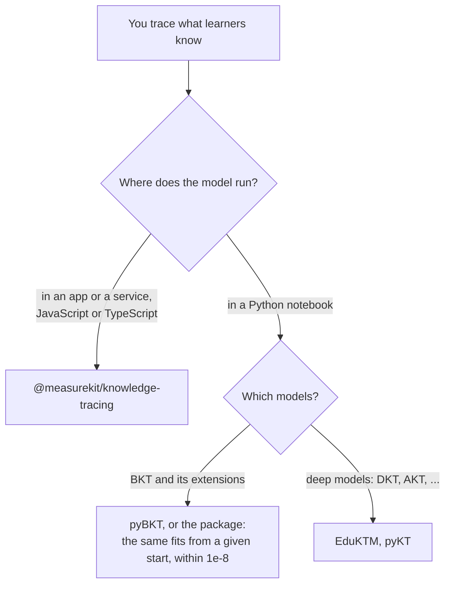

# Choosing knowledge-tracing

When `@measurekit/knowledge-tracing` fits a project that follows learners as they practice, and when another library fits
better. Each comparator was read on 2026-11-02, at the version that its row gives, from its page on PyPI or its package on
npm; LKT, pks, kst and DAKS are the package's references ([validation](validation.md)) rather than comparators.

| You need                                                                       | Use                                                                             |
| ------------------------------------------------------------------------------ | ------------------------------------------------------------------------------- |
| A learner's state updated online, one event at a time, stored as JSON          | This package: `update` and `predict` of any `LearnerModel`                      |
| BKT with pyBKT's extensions, fitted in batch, in TypeScript                    | This package: `bkt`; [coming from pyBKT](coming-from-pybkt.md) maps the options |
| Logistic models, Elo, online IRT or knowledge space theory under one interface | This package: `logistic`, `elo`, `irt`, `kst`                                   |
| Models compared by cross-validation, with learning curves                      | This package: `evaluate`                                                        |
| Per-student learn, guess and slip rates of BKT                                 | pyBKT 1.4.3                                                                     |
| Deep knowledge tracing: DKT, DKVMN, AKT, GKT, LPKT and others                  | EduKTM 0.0.10, or pyKT; they need a tensor runtime                              |

## What the others have that the package lacks

| Comparator, version                                                      | What it has                                                 | Here                                                                          |
| ------------------------------------------------------------------------ | ----------------------------------------------------------- | ----------------------------------------------------------------------------- |
| [pyBKT](https://pypi.org/project/pyBKT/) 1.4.3                           | Per-student learn, guess and slip rates (individualization) | Excluded: [bkt](bkt.md#not-included); prior groups give a group its own P(L0) |
| [EduKTM](https://pypi.org/project/EduKTM/) 0.0.10                        | DKT, DKVMN, AKT, DKT+, GKT, LPKT, LBKT, KPT and EKPT        | Excluded: [architecture](architecture.md#not-included), a tensor runtime      |
| [masterytrace-cli](https://www.npmjs.com/package/masterytrace-cli) 0.1.3 | BKT and the 2PL in one command line                         | Built: `bkt` and `irt`; a command line is the host's                          |

## Where the evidence is

[The evidence](evidence.md) gives the references, their tolerances and the recovery studies; [coming from pyBKT](coming-from-pybkt.md)
puts each pyBKT call beside its function; [performance](performance.md) times every hot path against its reference.
