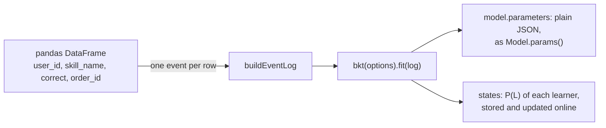

# Coming to knowledge tracing from pyBKT

How a pyBKT 1.4.3 model maps to `bkt` of `@measurekit/knowledge-tracing`: the data, the options, the calls, the
tolerance of each comparison from [validation](validation.md#tolerances), and the time of measurekit over pyBKT's from
[performance](performance.md#results), measured on Apple M5 with Node.js 26.8.1 and published there on 2026-11-04: below 1,
measurekit takes less time.



## Side by side

In Python:

```python
from pyBKT.models import Model

model = Model(seed=42, num_fits=5)
model.fit(data=df, forgets=True)
model.params()
model.predict(data=df)[["correct_predictions", "state_predictions"]]
```

The same in TypeScript, on rows with pyBKT's columns:

```ts
import { createRandom } from "@measurekit/knowledge-tracing";
import { bkt } from "@measurekit/knowledge-tracing/bkt";
import { buildEventLog } from "@measurekit/knowledge-tracing/data";

const random = createRandom(1);
const rows = Array.from({ length: 30 }, (_, learner) =>
  Array.from({ length: 8 }, (_, attempt) => ({
    user_id: `l${learner}`,
    skill_name: attempt % 2 === 0 ? "fractions" : "decimals",
    correct: random.uniform() < 0.3 + 0.08 * attempt ? 1 : 0,
    order_id: learner * 10 + attempt,
  })),
).flat();
const log = buildEventLog(
  rows.map((row) => ({
    learner: row.user_id,
    item: row.skill_name,
    skills: [row.skill_name],
    time: row.order_id,
    outcome: row.correct,
  })),
);
const fit = bkt({ forgetting: true, restarts: 5, seed: 42 }).fit(log);
fit.model.parameters.skills.fractions;
// => { prior: 0.17, learn: 0.80, forget: 0.00, guess: 0.08, slip: 0.22 }: model.params()
fit.predictions.slice(0, 3); // => [0.20, 0.35, 0.65]: correct_predictions
fit.states.l0; // => { learner: "l0", skills: { fractions: 1.00, decimals: 0.99 } }: P(L) after the log
```

The random starts of `bkt` come from its own generator, so a seed gives other starts than pyBKT's; both reach the same
optimum as the given starts on the practice log of the [validation](validation.md#bayesian-knowledge-tracing).

## The data

| pyBKT                                            | measurekit                                                                                                                                                 |
| ------------------------------------------------ | ---------------------------------------------------------------------------------------------------------------------------------------------------------- |
| A DataFrame, or a CSV of ASSISTments or DataShop | Events `{ learner, item, skills, time, outcome }` in `buildEventLog`; [data](data.md#recipe-the-rows-of-an-export) turns the rows of an export into events |
| `user_id`, `skill_name`, `correct`, `order_id`   | `learner`, `skills`, `outcome`, `time`                                                                                                                     |
| One row for each skill of a step                 | One event with every skill of the attempt                                                                                                                  |
| `correct = -1` for a row without an outcome      | `outcome: null`                                                                                                                                            |
| A fitted `Model` object, saved with `save`       | `model.parameters`, plain JSON, and a model rebuilt by `bkt({ parameters })`                                                                               |
| `Model.predict` over a whole DataFrame           | `fit.predictions`, and `predict` and `update` of one learner's state, online                                                                               |

## Options

| pyBKT              | `bkt` option                                      |
| ------------------ | ------------------------------------------------- |
| `forgets = True`   | `forgetting: true`                                |
| `multigs`          | `itemGuessSlip: true`, on the event's `item`      |
| `multilearn`       | `resourceLearning: true`, on its `resource`       |
| `multipair`        | `pairLearning: true`                              |
| `multiprior`       | `priorGroups`, the group of each learner          |
| `fixed`            | `fixed`, the rates held by skill                  |
| `num_fits`, `seed` | `restarts`, `seed`                                |
| `tol`, `maxiter`   | `tolerance`, `maxIterations`                      |
| none               | `bounds`, a lower and an upper bound of each rate |

## Calls

| pyBKT                                         | measurekit                                    | Tolerance                                                           | Time over pyBKT |
| --------------------------------------------- | --------------------------------------------- | ------------------------------------------------------------------- | --------------: |
| `Model.fit`, 5 skills                         | `bkt(options).fit(log)`                       | 1e-8 absolute, the parameters and log-likelihood from a given start |         0.0042× |
| `Model.fit`, each learner at 20 of 400 skills | `bkt(options).fit(log)`                       | the same                                                            |          0.019× |
| `Model.fit` with `correct = -1` rows          | `fit` of a log with events without an outcome | 1e-8 absolute                                                       |         0.0057× |
| `Model.fit(multipair = True)`                 | `fit` with `pairLearning: true`               | 1e-8 absolute                                                       |         0.0056× |
| `Model.predict`                               | `fit.predictions`, or `predict` and `update`  | 1e-13 absolute, P(correct) and P(L) at fixed parameters             |          0.024× |
| `Model.evaluate(metric = "auc")`              | `metrics` and `crossValidate` of `evaluate`   | 1e-12 absolute, against base R and pROC                             |       not timed |

## Where measurekit differs

[The BKT guide](bkt.md#differences-from-the-references) lists every difference: a group's prior is its own P(L0) rather
than a phantom step, the random starts draw P(F) from U(0, 0.2), guess and slip stay 2⁻⁵² from 0 and 1, and bounds
clamp a rate that EM estimates. Beyond BKT, the package has logistic models, Elo, online IRT and knowledge space theory
under the same `LearnerModel` interface, which pyBKT does not.
