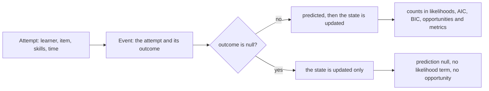
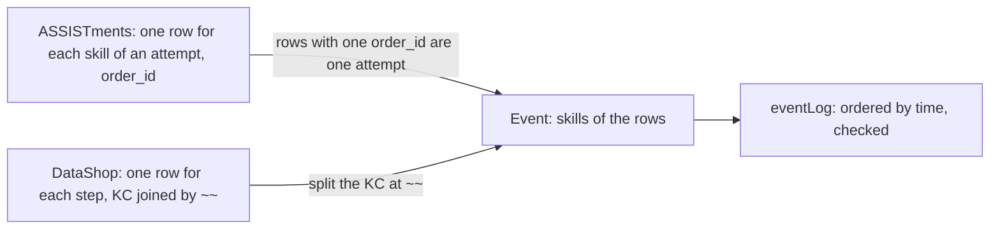

# Data

Functions in `@measurekit/knowledge-tracing/data` build the logs that every model and evaluation takes, keep the first
attempts of a log, and split it into folds. Logs are plain arrays of plain objects, so they can be built by hand or
loaded from JSON; every function that takes a log checks it.



## Events

An event is one attempt of a learner at an item, with its outcome, or with `outcome: null` when the attempt is a learning
opportunity with nothing observed: a lesson, a video, or a success with hints that counts as no evidence. One log holds
everything a learner did, in time order.

| Field           | Meaning                                                                                                     | Default       |
| --------------- | ----------------------------------------------------------------------------------------------------------- | ------------- |
| `learner`       | The learner's id: a non-empty string.                                                                       | required      |
| `item`          | The item's id: a non-empty string.                                                                          | required      |
| `skills`        | The ids of the skills (knowledge components) the item practices: distinct non-empty strings, possibly none. | required      |
| `time`          | A finite number that orders the attempts, such as epoch milliseconds or a sequence number.                  | required      |
| `outcome`       | From 0 to 1: 1 correct, 0 incorrect, and between them partial credit, where a model supports it; or `null`. | required      |
| `resource`      | The key of the learn and forget rates of the attempt: a lesson, a video or an item.                         | the item      |
| `covariates`    | Finite numbers by name, known before the outcome, which a model written outside the package can read.       | none          |
| `hints`         | The hints taken before the outcome: an integer from 0.                                                      | none recorded |
| `duration`      | The time spent on the attempt, above 0, in the units of `time`.                                             | none recorded |
| `attemptNumber` | Which try at the item this is: an integer from 1.                                                           | none recorded |

An attempt is an event without its outcome and the metadata that follows it: what a model predicts from. Models take the
attempt's skills, time and resource, so time-aware and skill-based models need nothing else. A missing `outcome` is an
error: only an explicit `null` means that nothing was observed.

## Logs

`eventLog(events, options)` checks and copies events, and orders them by time, keeping the given order of events with
equal times. The result is an `EventLog`: events in time order, for each learner and for all learners together, which
models that also update items, such as Elo, need. Every event counts as an attempt, so remove the repeated rows some
exports hold, as ASSISTments 2009 does: there, one row per skill of an event and copies of rows. Events with equal times
keep the order given, which another tool may not: order them by a unique time, such as a row number, to compare.

```ts
import { eventLog } from "@measurekit/knowledge-tracing/data";

const log = eventLog(
  [
    { learner: "budi", item: "q2", time: 1730190000000, outcome: 0 },
    { learner: "ana", item: "q1", time: 1730180000000, outcome: 1 },
    { learner: "ana", item: "q3", skills: ["decimals"], time: 1730200000000, outcome: 0.5 },
  ],
  { qMatrix: { q1: ["fractions"], q2: ["fractions", "decimals"] } },
);
log.map((event) => event.skills); // [["fractions"], ["fractions", "decimals"], ["decimals"]]
```

| Rule   | Detail                                                                                                                                       |
| ------ | -------------------------------------------------------------------------------------------------------------------------------------------- |
| Size   | At least one event.                                                                                                                          |
| Skills | An event's own `skills`; without them, its item's row of the Q-matrix; without a Q-matrix, none.                                             |
| Order  | By `time`, stable. Functions that take a log reject one out of time order, which a log built by hand may be.                                 |
| Copies | The events are copied, with only the fields above, so later changes to the input do not change the log. A field that is absent stays absent. |
| Parts  | Any subsequence of a log, such as `log.filter(...)`, is a log.                                                                               |

A malformed event throws `DataError` naming the first problem and the event's position in the input, e.g.
`Event 3 needs an outcome from 0 to 1 or null, found 2.` `NaN`, infinite times, repeated skills, empty ids and values of
other types are rejected.

## First attempts

`firstAttempts(log, options)` keeps the first try of each learner at each item: the events with `attemptNumber` 1 or,
without one, the learner's first event with an outcome at the item. Events without an outcome stay.

| Option   | Default       | Values                                                                                                       |
| -------- | ------------- | ------------------------------------------------------------------------------------------------------------ |
| `hinted` | `"incorrect"` | What a first attempt with `hints` above 0 counts as: `"incorrect"`, as DataShop does; `"null"`; or `"keep"`. |

## Q-matrices

A `QMatrix` gives the skills of each item, `{ [item]: skills }`, for events that do not carry skills. It is the
`QMatrix` of `@measurekit/core`, which `@measurekit/psychometrics` shares; a row may be empty here, as an item may practice no skill,
where its cognitive diagnosis needs at least one attribute per item.

An event without skills whose item the Q-matrix lacks throws `DataError`:
`Event 7 has no skills, and the Q-matrix lacks its item "q9".` A skill a model has no parameters for, such as a skill new
to a test block, is no error of the log: Elo and IRT models start it from its initial value, while BKT and logistic
models throw `DataError` when they predict it. [`crossValidate`](evaluate.md#skills-new-to-a-test-block) has the option
`unseenSkills` for it.

## Splits

Splits return folds `{ train, test }` of one log, for cross-validation without leakage ([evaluation](evaluate.md)).

| Function                             | Folds                                                                                       |
| ------------------------------------ | ------------------------------------------------------------------------------------------- |
| `splitByLearner(log, folds, random)` | Each learner's events are in one fold's test log and the other folds' training logs.        |
| `splitByItem(log, folds, random)`    | Each item's events are in one fold's test log: predictions of items the model has not seen. |
| `splitByTime(log, folds)`            | `folds + 1` consecutive blocks; fold k trains on blocks 1 to k and tests on block k + 1.    |

Events without an outcome have nothing to predict, so the splits count the events with an outcome and the items they
have.

| Split      | An event without an outcome                                                                            |
| ---------- | ------------------------------------------------------------------------------------------------------ |
| By learner | Goes with its learner.                                                                                 |
| By item    | Is in the training log of every fold; a lesson is no item, so it is not counted among the items dealt. |
| By time    | Is in the block that holds its time; blocks have about equal numbers of events with an outcome.        |

```ts
import { createRandom } from "@measurekit/knowledge-tracing";
import { splitByLearner, splitByTime } from "@measurekit/knowledge-tracing/data";

const byLearner = splitByLearner(log, 2, createRandom(42)); // [{ train, test }, { train, test }]
const byTime = splitByTime(log, 1); // [{ train: the earlier events, test: the later ones }]
```

- **By learner and by item.** Learners or items are dealt to folds in an order drawn from `random`, so folds differ in
  size by at most one learner or item, and the same seed gives the same folds. `folds` is at least 2 and at most the
  number of learners, or of items with an outcome.
- **By time.** Blocks have about equal numbers of events. A boundary falls after the last event of its time, so a
  model never trains on an event at or after the time of one it predicts. `folds` is at least 1; one fold is a single
  split at the middle of the log. Too few distinct times for the blocks throw `DataError`.

## Recipe: the rows of an export

A log read from a file is a table of rows. The package does no I/O, so a caller reads the file and maps the columns to
events in a few lines. The mapping decides three things: which column orders the attempts, which holds the outcome, and
how an attempt with several skills is written. `eventLog` then orders the events by that time and checks them.



| Event field | ASSISTments                                  | DataShop                                                          |
| ----------- | -------------------------------------------- | ----------------------------------------------------------------- |
| `learner`   | `user_id`                                    | `Anon Student Id`                                                 |
| `item`      | `problem_id`                                 | `Problem Name` and `Step Name`                                    |
| `skills`    | The `skill_name` of every row of the attempt | `KC (Default)` split at `~~`; none where it is empty              |
| `time`      | `order_id`                                   | `Row`, which orders the steps and breaks ties of equal timestamps |
| `outcome`   | `correct`                                    | 1 for `correct`; 0 for `incorrect` and `hint`, as DataShop counts |

```ts
import { eventLog } from "@measurekit/knowledge-tracing/data";

interface AssistmentsRow {
  order_id: number;
  user_id: number;
  problem_id: number;
  skill_name: string;
  correct: number;
}

// Rows that share an order_id are one attempt at several skills.
function assistmentsLog(rows: readonly AssistmentsRow[]) {
  const attempts = new Map<
    number,
    { learner: string; item: string; skills: string[]; time: number; outcome: number }
  >();
  for (const row of rows) {
    const attempt = attempts.get(row.order_id) ?? {
      learner: String(row.user_id),
      item: String(row.problem_id),
      skills: [],
      time: row.order_id,
      outcome: row.correct,
    };
    attempt.skills.push(row.skill_name);
    attempts.set(row.order_id, attempt);
  }
  return eventLog([...attempts.values()]);
}

interface DataShopRow {
  Row: number;
  "Anon Student Id": string;
  "Problem Name": string;
  "Step Name": string;
  "KC (Default)": string;
  "First Attempt": string;
}

function dataShopLog(rows: readonly DataShopRow[]) {
  return eventLog(
    rows.map((row) => ({
      learner: row["Anon Student Id"],
      item: `${row["Problem Name"]} ${row["Step Name"]}`,
      skills: row["KC (Default)"] === "" ? [] : row["KC (Default)"].split("~~"),
      time: row.Row,
      outcome: row["First Attempt"] === "correct" ? 1 : 0,
    })),
  );
}
```

A step with no skill is an attempt at none, which no skill's model counts. The test of this recipe runs both functions
on seeded rows of each export and compares the outcomes of each learner at each skill, in order, with the data that
pyBKT's `convert_data` makes of the same rows ([validation](validation.md)).

## Not included

- **Reading files.** No fit: the package does no I/O, so a caller reads the file and maps its rows, as the recipe above
  shows.
- **Reading the rows of DataShop and ASSISTments.** No fit: a map of column names is not a method; the [recipe
  above](#recipe-the-rows-of-an-export) is the map.
