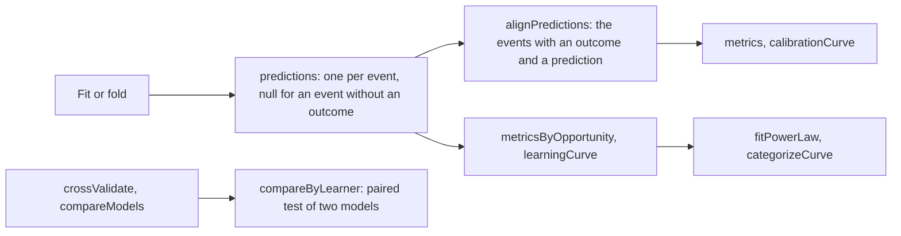
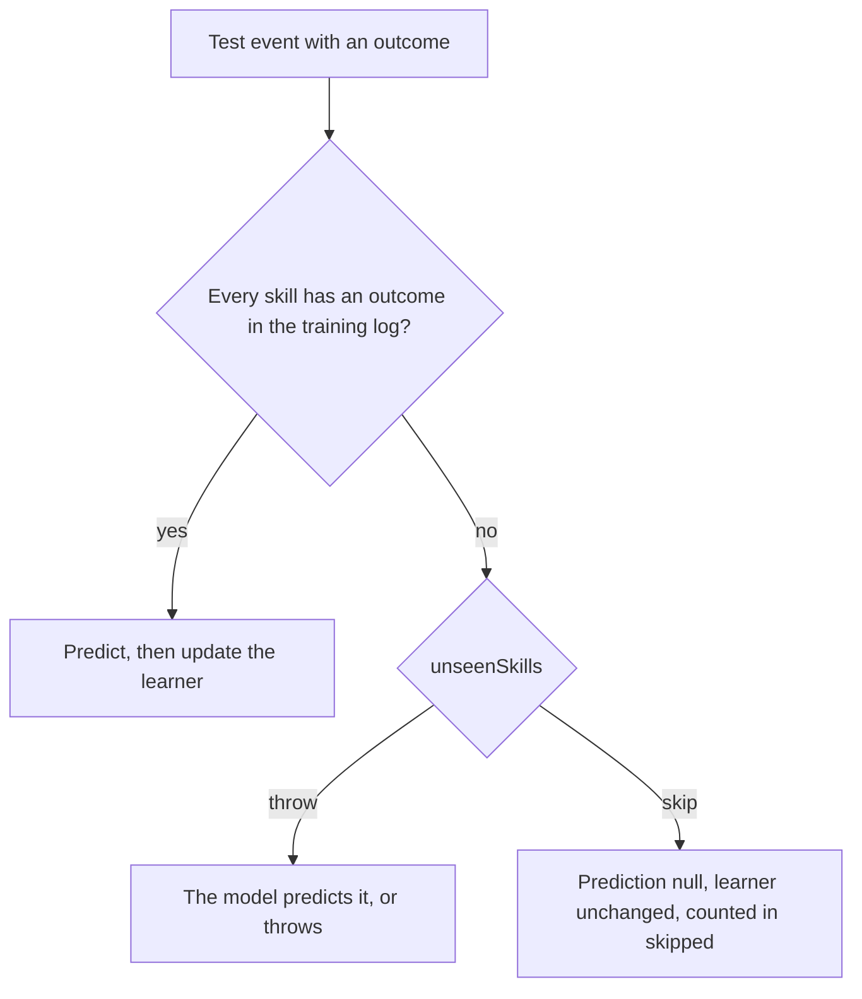

# Evaluation

`@measurekit/knowledge-tracing/evaluate` measures how well learner models predict outcomes: metrics and calibration of
predictions, cross-validation and comparison of any [`LearnerModel`](architecture.md#the-learner-model-interface), a
paired test between two models, and learning curves with their power laws and categories. The metrics are validated
against pROC, irr and base R ([validation](validation.md)).



## Quick start

Score four predictions against their outcomes:

```ts
import { auc, metrics } from "@measurekit/knowledge-tracing/evaluate";

auc([0.1, 0.4, 0.35, 0.8], [0, 0, 1, 1]); // => 0.75
metrics([0.1, 0.4, 0.35, 0.8], [0, 0, 1, 1]);
// => { count: 4, auc: 0.75, rmse: 0.4, logLoss: 0.47, accuracy: 0.75, rSquared: 0.37, kappa: 0.5 }
```

## Metrics

Each function takes predictions, probabilities of a correct outcome, and the outcomes, from 0 to 1, as two arrays of
equal length with at least one entry.

| Function                          | Result                                                                                                            | Defined for                |
| --------------------------------- | ----------------------------------------------------------------------------------------------------------------- | -------------------------- |
| `auc(predictions, outcomes)`      | The area under the ROC curve: P(a correct outcome has a higher prediction than an incorrect one), ties counting ½ | 0/1 outcomes, both present |
| `rmse(predictions, outcomes)`     | √(mean (p - y)²)                                                                                                  | Any outcomes               |
| `logLoss(predictions, outcomes)`  | -mean(y ln p + (1 - y) ln(1 - p)), natural logarithm, p clipped to [ε, 1 - ε] with ε = 2^-52                      | Any outcomes               |
| `accuracy(predictions, outcomes)` | The share of outcomes predicted right; a prediction above 0.5 predicts a correct outcome                          | 0/1 outcomes               |
| `rSquared(predictions, outcomes)` | 1 - Σ(y - p)² / Σ(y - ȳ)²: the share of the variance of the outcomes that the predictions explain                 | Outcomes not all equal     |
| `kappa(predictions, outcomes)`    | Cohen's kappa of the predictions above 0.5 and the outcomes: agreement beyond chance, (p_o - p_e) / (1 - p_e)     | 0/1 outcomes, p_e below 1  |
| `metrics(predictions, outcomes)`  | `{ count, auc, rmse, logLoss, accuracy, rSquared, kappa }`, with the undefined ones `null`                        | Any outcomes               |

- **AUC** depends only on the order of the predictions, so it is unchanged by any increasing transformation of them.
  It measures how well predictions rank outcomes, not whether their values are right; RMSE, log-loss and calibration
  measure that.
- **Log-loss** clips each prediction to [ε, 1 - ε], with ε = 2^-52 ≈ 2.2e-16, the machine epsilon of a double, as
  scikit-learn's `log_loss` does. A prediction of 0 or 1 that is wrong adds -ln ε ≈ 36.04 instead of making the mean
  infinite, and a right one adds about ε. Logistic models predict exactly 1 once their linear predictor passes about
  36.7; R's `glm` bounds the probabilities of its logit link by the same ε, so their log-loss is the one `glm`'s
  predictions would have.
- **R²** is 0 for predictions that equal the mean outcome and below 0 for worse ones. Like RMSE it measures the values
  of the predictions, not their order.
- **Kappa** is 0 for predictions that agree with the outcomes only as often as chance gives, and 1 for exact agreement.
  It depends on the 0.5 cutoff, as accuracy does.
- **Undefined statistics.** `auc` throws `DataError` when all outcomes are equal or one is partial credit, `accuracy`
  and `kappa` when one is partial credit, `rSquared` when all outcomes are equal, and `kappa` when chance agreement is
  1, as when every prediction and every outcome is correct; `metrics` gives `null` for them instead.

## Calibration

`calibrationCurve(predictions, outcomes, { binCount })` groups predictions into `binCount` bins of equal width (default
`10`): bin k of K covers [k / K, (k + 1) / K), and the last bin includes 1. A calibrated model's mean outcome is close
to its mean prediction in every bin.

| Field            | Meaning                                                |
| ---------------- | ------------------------------------------------------ |
| `lower`, `upper` | The bin's bounds                                       |
| `count`          | The number of predictions in the bin                   |
| `meanPrediction` | Their mean, or `null` for an empty bin                 |
| `meanOutcome`    | The mean of their outcomes, or `null` for an empty bin |

## Cross-validation

`crossValidate(model, folds)` evaluates a model on folds `{ train, test }`, from a [split](data.md#splits) or built by
hand; a single fold is a train-test split. For each fold:

1. the model is fitted to the training log;
2. every learner of the test log starts from `initialState` and goes through their events of both logs in time order,
   training events first at equal times;
3. each test event is predicted, then updates the learner's state; training events only update it. A test event without
   an outcome, such as a lesson, updates the state and has a `null` prediction.

A learner's earlier events thus inform the predictions of their later ones, as they would online, and the fitted
parameters, such as Elo's item ratings, stay fixed.

| Option         | Meaning                                                                                           | Default   |
| -------------- | ------------------------------------------------------------------------------------------------- | --------- |
| `unseenSkills` | `"throw"` or `"skip"`: what happens to a test event of a skill the training log has no outcome of | `"throw"` |

```ts
import { createRandom } from "@measurekit/knowledge-tracing";
import { buildEventLog, splitByLearner } from "@measurekit/knowledge-tracing/data";
import { elo } from "@measurekit/knowledge-tracing/elo";
import { crossValidate } from "@measurekit/knowledge-tracing/evaluate";

const log = buildEventLog(
  ["ana", "budi", "citra", "dewi"].flatMap((learner, i) =>
    ["q1", "q2", "q3"].map((item, j) => ({
      learner,
      item,
      skills: ["fractions"],
      time: 3 * i + j,
      outcome: (i + j) % 2,
    })),
  ),
);
const result = crossValidate(elo(), splitByLearner(log, 2, createRandom(1)));
result.metrics; // => { count: 12, auc: 0, rmse: 0.76, logLoss: 1.48, accuracy: 0, rSquared: -1.33, kappa: -1 }
result.folds[0];
// => { predictions: [0.30, 0.85, 0.27, 0.30, 0.85, 0.27], metrics: { count: 6, auc: 0, ... }, skipped: 0 }: the
//    predictions of the fold's test events, in log order
```

The metrics are those of the test events with an outcome and a prediction. A fold whose test log has none has
`metrics: null`, and `crossValidate` throws `DataError` when no fold has one.

| Split            | Measures predictions of                                                  |
| ---------------- | ------------------------------------------------------------------------ |
| `splitByLearner` | New learners, from their first event on: the usual choice                |
| `splitByItem`    | Items the model has not been fitted to                                   |
| `splitByTime`    | Later events from earlier ones, as a model deployed at a date would make |

### Skills new to a test block

A log in curriculum order introduces skills over time, so a block of a split by time holds skills that the training log
has no outcome of. Elo and IRT models start such a skill from its initial value. BKT and logistic models have no
parameters for it and throw `DataError`.



With `"skip"`, such an event has a `null` prediction and does not update its learner's state, and the fold's `skipped`
counts them. A skill met only through events without an outcome, such as lessons, counts as unseen: a model gets no
parameters from them. An event without skills is never skipped. Every model of `compareModels` skips the same events,
since the skills of the training log decide, so their metrics compare the same predictions.

```ts
import { buildEventLog, splitByTime } from "@measurekit/knowledge-tracing/data";
import { bkt } from "@measurekit/knowledge-tracing/bkt";
import { crossValidate } from "@measurekit/knowledge-tracing/evaluate";

// Six learners meet fractions, decimals and percent in turn, and review the skill before each new one.
const skills = ["fractions", "decimals", "percent"];
const log = buildEventLog(
  ["ana", "budi", "citra", "dewi", "eka", "fiona"].flatMap((learner, i) =>
    skills.flatMap((skill, s) =>
      [0, 1, 2, 3].map((j) => {
        const practiced = j % 2 === 1 && s > 0 ? (skills[s - 1] ?? skill) : skill;
        return {
          learner,
          item: `${practiced}-${j}`,
          skills: [practiced],
          time: 100 * s + 10 * i + j,
          outcome: (7 * i + 3 * j + s) % 10 < 3 + j ? 1 : 0,
        };
      }),
    ),
  ),
);
const folds = splitByTime(log, 2); // train on fractions, test decimals; train on both, test percent

// crossValidate(bkt(), folds) throws: The model has no parameters for skill "decimals".
const result = crossValidate(bkt(), folds, { unseenSkills: "skip" });
result.folds.map((fold) => fold.skipped); // => [12, 12]
result.metrics.count; // => 24, of the 48 test events
```

## Predictions with nulls

A fit's `predictions` and a fold's have one entry per event, `null` where the event has no outcome. The metric functions
take numbers only: `alignPredictions(log, predictions)` returns `{ predictions, outcomes }` of the events with both an
outcome and a prediction, in log order, for them.

```ts continues
import { elo } from "@measurekit/knowledge-tracing/elo";
import { alignPredictions, metrics } from "@measurekit/knowledge-tracing/evaluate";

// log: a log with lessons, events with outcome: null
const { predictions, outcomes } = alignPredictions(log, elo().fit(log).predictions);
metrics(predictions, outcomes);
```

## Model comparison

`compareModels(models, folds, options)` cross-validates several models, named by their keys, on the same folds, so their
metrics compare predictions of the same events. Options are those of `crossValidate`. Rows follow the order of
`models`; each row is a cross-validation with the model's `name`.

```ts continues
import { createRandom } from "@measurekit/knowledge-tracing";
import { splitByLearner } from "@measurekit/knowledge-tracing/data";
import { elo } from "@measurekit/knowledge-tracing/elo";
import { compareModels } from "@measurekit/knowledge-tracing/evaluate";

// log: the log of the curriculum sample
const folds = splitByLearner(log, 2, createRandom(1));
compareModels({ elo: elo(), "concept elo": elo({ skills: true }) }, folds);
// => [{ name: "elo", metrics: { auc: 0.28, ... }, folds: [...] }, { name: "concept elo", ... }]
```

A fit's `logLikelihood`, `aic` and `bic` compare models on the data they were fitted to, where the models define
them.

### Is one model better?

`compareByLearner(first, second, folds, options)` tests whether two models predict differently well: a paired t test of
their losses on the test events, averaged per learner first.

| Field              | Meaning                                                                                            |
| ------------------ | -------------------------------------------------------------------------------------------------- |
| `learners`         | Learners with a test event that both models predicted                                              |
| `meanDifference`   | Mean over learners of the first model's loss minus the second's; negative when the first is better |
| `standardError`    | s / √n of the differences                                                                          |
| `statistic`        | t, `meanDifference` over `standardError`                                                           |
| `degreesOfFreedom` | `learners` - 1                                                                                     |
| `pValue`           | The two-sided p-value                                                                              |

| Option | Meaning                                                                         | Default |
| ------ | ------------------------------------------------------------------------------- | ------- |
| `loss` | `"log"`, -(y ln p + (1 - y) ln(1 - p)), or `"squared"`, (p - y)² per test event | `"log"` |

```ts continues
import { createRandom } from "@measurekit/knowledge-tracing";
import { splitByLearner } from "@measurekit/knowledge-tracing/data";
import { elo } from "@measurekit/knowledge-tracing/elo";
import { compareByLearner, compareModels } from "@measurekit/knowledge-tracing/evaluate";

// log: the log of the curriculum sample
const folds = splitByLearner(log, 3, createRandom(1));
const [plain, concept] = compareModels({ elo: elo(), "concept elo": elo({ skills: true }) }, folds);
compareByLearner(plain, concept, folds);
// => { learners: 6, meanDifference: -0.19, standardError: 0.023, statistic: -8.27, degreesOfFreedom: 5, pValue: 0.0004 }
```

- **Why by learner.** The events of a learner depend on each other, and a test on the AUC over events assumes independent
  ones. Learners are the independent units, and losses add up per event, which the AUC does not. A learner in several
  test folds, as under a split by item or by time, has the mean over all of their test events.
- **Pairing.** Only test events with an outcome that both models predicted take part, so `unseenSkills: "skip"` leaves
  the same events out of both.
- **Where the test is undefined.** `statistic` and `pValue` are `null` with one learner and when every difference is
  equal, as for a model against itself. The log loss of a prediction is clipped as `logLoss` clips it, so a certain
  prediction that is wrong counts -ln ε, about 36.04.
- **Comparing Q-matrices.** Build one log per Q-matrix from the same events with `buildEventLog(events, { qMatrix })`,
  split each with `splitByLearner` and the same seed, so that the folds hold the same learners, run `compareModels` on
  each, and pass a row of each to `compareByLearner` with either log's folds.

## Learning curves

`learningCurve(log, options)` gives the error rate, 1 - mean outcome, by opportunity: the number of times the learner
has practiced the skill, the event included. Error rates that fall with practice show skills that model what learners
learn; a flat or jagged curve suggests a skill to split or merge.

| Option             | Meaning                                                                                                                   | Default |
| ------------------ | ------------------------------------------------------------------------------------------------------------------------- | ------- |
| `predictions`      | The prediction of each event in log order, such as a fit's: a probability, or `null` for an event without one             | none    |
| `minOpportunities` | Keeps only learner and skill pairs with at least this many opportunities in the log, so who left does not shape the curve | `1`     |

```ts continues
import { elo } from "@measurekit/knowledge-tracing/elo";
import { learningCurve } from "@measurekit/knowledge-tracing/evaluate";

// log: the log of the curriculum sample
const curve = learningCurve(log, { predictions: elo({ skills: true }).fit(log).predictions });
curve.overall; // => [{ opportunity: 1, count: 18, errorRate: 0.67, predictedErrorRate: 0.52 }, { opportunity: 2, ... }, ...]
curve.skills.fractions; // => [{ opportunity: 1, count: 6, errorRate: 0.67, predictedErrorRate: 0.52 }, ...]: one skill's
```

| Field                | Meaning                                                                              |
| -------------------- | ------------------------------------------------------------------------------------ |
| `opportunity`        | 1 for a learner's first event with the skill, 2 for the second, and so on            |
| `count`              | Learner and skill pairs at this opportunity; an event with two skills counts in both |
| `errorRate`          | 1 - the mean outcome                                                                 |
| `predictedErrorRate` | 1 - the mean prediction of the events that have one, or `null` without any           |

`overall` pools every skill; `skills` has one curve per skill, in the order the skills first appear. Opportunities
count the events of the log given, so pass whole learner histories: a full log, or the test log of a split by learner.
Events without skills are left out; a log without skills throws `DataError`. Events without an outcome are no
opportunity and have no error rate, so they are left out too. An event with an outcome and a `null` prediction, such as
one that `unseenSkills: "skip"` skipped, counts in the error rate and leaves the predicted one.

### Metrics by opportunity

`metricsByOpportunity(log, predictions)` has the shape of `learningCurve`, with the `metrics` of the events at each
opportunity in place of the rates. A model that ignores learning predicts the first opportunities best, and one that
overrates it, the late ones. An opportunity whose events have no prediction has `metrics: null`, and its `auc` is `null`
when its outcomes are all equal. The overall metrics count an event of two skills twice, as the curve does.

```ts continues
import { elo } from "@measurekit/knowledge-tracing/elo";
import { metricsByOpportunity } from "@measurekit/knowledge-tracing/evaluate";

// log: the log of the curriculum sample
const table = metricsByOpportunity(log, elo({ skills: true }).fit(log).predictions);
table.skills.fractions[0]; // => { opportunity: 1, metrics: { count: 6, auc: 0.25, rmse: 0.53, ... } }
```

### Power law and categories

`fitPowerLaw(points)` fits the power law of practice, e(n) = a n^(-b), to the points of a curve, such as
`curve.skills.fractions`, by least squares on the logarithms weighted by `count`. It returns `{ scale, exponent,
rSquared }`: the error rate at the first opportunity, the rate of learning, and the R² of the fit, `null` when every
error rate is equal. Points with an error rate of 0 have no logarithm and are left out; the fit is `null` under two
points.

`categorizeCurve(points, options)` returns DataShop's category of a skill's curve. The points of fewer than
`minLearners` learners are discarded, and the first rule that holds decides:

| Order | Rule                                   | Category            |
| ----- | -------------------------------------- | ------------------- |
| 1     | Fewer than `minPoints` points are left | `"too little data"` |
| 2     | A point is below `lowError`            | `"low and flat"`    |
| 3     | The last point is above `highError`    | `"still high"`      |
| 4     | `slope` is below `minSlope`            | `"no learning"`     |
| 5     | None of the above                      | `"good"`            |

| Option        | Meaning                                                                         | Default |
| ------------- | ------------------------------------------------------------------------------- | ------- |
| `minLearners` | The learners a point needs: DataShop's student threshold                        | none    |
| `minPoints`   | The points a curve needs: DataShop's opportunity threshold                      | none    |
| `slope`       | The skill's slope in AFM, its rise in the logit of P(correct) per opportunity   | none    |
| `minSlope`    | The slope below which a curve shows no learning: DataShop's AFM slope threshold | none    |
| `lowError`    | The error rate under which a point makes the curve low and flat: Bloom's 20%    | `0.2`   |
| `highError`   | The error rate over which the last point makes the curve still high             | `0.4`   |

The first four depend on the curriculum, so they are required. `slope` comes from a fit of AFM with the same Q-matrix.

```ts continues
import { elo } from "@measurekit/knowledge-tracing/elo";
import { categorizeCurve, fitPowerLaw, learningCurve } from "@measurekit/knowledge-tracing/evaluate";

// log: the log of the curriculum sample
const fractions =
  learningCurve(log, { predictions: elo({ skills: true }).fit(log).predictions }).skills.fractions ?? [];
fitPowerLaw(fractions); // => { scale: 0.60, exponent: 0.21, rSquared: 0.19 }
categorizeCurve(fractions, { minLearners: 3, minPoints: 3, slope: 0.2, minSlope: 0.1 }); // => "good"
```

## Errors

| Message begins                                                               | Cause and remedy                                                                                        |
| ---------------------------------------------------------------------------- | ------------------------------------------------------------------------------------------------------- |
| `The model has no parameters for skill`                                      | A test event has a skill the training log lacks: pass `unseenSkills: "skip"`, or train on all skills    |
| `Cross-validation needs a test event with a prediction`                      | No test event is left to score: the test logs have no outcomes, or `"skip"` skipped them all            |
| `A comparison needs a test event with an outcome that both models predicted` | The two evaluations share no scored event: evaluate both models on the same folds with the same options |
| `Kappa is undefined`, `R² needs outcomes that are not all equal`             | The data leave the statistic undefined: use `metrics`, which gives `null`                               |
| `A learning curve needs a learner and skill with at least`                   | `minOpportunities` is above every learner's practice: lower it                                          |
| `Found N predictions for M events.`                                          | The predictions are not one per event of the log: pass those of a fit of this log                       |

## Not included

| Not included               | Why                                                                                                                                                                                                               |
| -------------------------- | ----------------------------------------------------------------------------------------------------------------------------------------------------------------------------------------------------------------- |
| DeLong's test of two AUCs  | No fit: it assumes independent events, which a log breaks. Use `compareByLearner`; `pROC` has DeLong's.                                                                                                           |
| Knowledge component search | No reference: no package implements Learning Factors Analysis, as one search and a CRAN listing found. LKT's `autoKC` clusters items, which is another method. The evaluation tools compare candidate Q-matrices. |

## Differences from the references

- `compareByLearner` gives `null` where `t.test` stops with "data are essentially constant" or with one pair.
- `logLoss` clips predictions at the machine epsilon, as scikit-learn's `log_loss` does, and so pyBKT's `evaluate` with
  `metric="log_loss"`, which calls it. LKT clips the predictions of its LiblineaR fits to [1e-5, 1 - 1e-5] before its
  log-likelihood, which changes the predictions themselves; measurekit leaves predictions as the models give them.
- `categorizeCurve` takes the AFM slope as an argument; DataShop computes it on its own.
