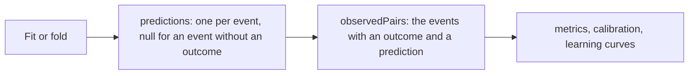

# Evaluation

`@measurekit/knowledge-tracing/evaluate` measures how well learner models predict outcomes: metrics and calibration of
predictions, cross-validation and comparison of any [`LearnerModel`](architecture.md#the-learner-model-interface), and
learning curves. The metrics are validated against pROC and base R ([validation](validation.md)).



## Metrics

Each function takes predictions, probabilities of a correct outcome, and the outcomes, from 0 to 1, as two arrays of
equal length with at least one entry.

| Function                          | Result                                                                                                            | Defined for                |
| --------------------------------- | ----------------------------------------------------------------------------------------------------------------- | -------------------------- |
| `auc(predictions, outcomes)`      | The area under the ROC curve: P(a correct outcome has a higher prediction than an incorrect one), ties counting ½ | 0/1 outcomes, both present |
| `rmse(predictions, outcomes)`     | √(mean (p - y)²)                                                                                                  | Any outcomes               |
| `logLoss(predictions, outcomes)`  | -mean(y ln p + (1 - y) ln(1 - p)), natural logarithm                                                              | Any outcomes               |
| `accuracy(predictions, outcomes)` | The share of outcomes predicted right; a prediction above 0.5 predicts a correct outcome                          | 0/1 outcomes               |
| `metrics(predictions, outcomes)`  | `{ count, auc, rmse, logLoss, accuracy }`, with `auc` and `accuracy` `null` where undefined                       | Any outcomes               |

```ts
import { auc, metrics } from "@measurekit/knowledge-tracing/evaluate";

auc([0.1, 0.4, 0.35, 0.8], [0, 0, 1, 1]); // 0.75
metrics([0.1, 0.4, 0.35, 0.8], [0, 0, 1, 1]); // { count: 4, auc: 0.75, rmse: 0.4, logLoss: 0.47, accuracy: 0.75 }
```

- **AUC** depends only on the order of the predictions, so it is unchanged by any increasing transformation of them.
  It measures how well predictions rank outcomes, not whether their values are right; RMSE, log-loss and calibration
  measure that.
- **Log-loss** is `Infinity` when a prediction of 0 or 1 is wrong; a right one adds 0.
- **Undefined statistics.** `auc` throws `DataError` when all outcomes are equal or one is partial credit, `accuracy`
  when one is partial credit; `metrics` gives `null` for them instead.

## Calibration

`calibration(predictions, outcomes, { binCount })` groups predictions into `binCount` bins of equal width (default
`10`): bin k of K covers [k / K, (k + 1) / K), and the last bin includes 1. A calibrated model's mean outcome is close
to its mean prediction in every bin.

| Field            | Meaning                                                |
| ---------------- | ------------------------------------------------------ |
| `lower`, `upper` | The bin's bounds                                       |
| `count`          | The number of predictions in the bin                   |
| `meanPrediction` | Their mean, or `null` for an empty bin                 |
| `meanOutcome`    | The mean of their outcomes, or `null` for an empty bin |

## Cross-validation

`crossValidate(model, folds)` evaluates a model on folds `{ train, test }`, from a [split](data.md#splits) or built by
hand; a single fold is a train-test split. For each fold:

1. the model is fitted to the training log;
2. every learner of the test log starts from `initialState` and goes through their events of both logs in time order,
   training events first at equal times;
3. each test event is predicted, then updates the learner's state; training events only update it. A test event without
   an outcome, such as a lesson, updates the state and has a `null` prediction.

A learner's earlier events thus inform the predictions of their later ones, as they would online, and the fitted
parameters, such as Elo's item ratings, stay fixed. A test event the fitted model cannot predict throws its `DataError`,
as an event of a skill absent from the training log does for BKT; splits by learner rarely leave a skill out.

```ts
import { createRandom } from "@measurekit/knowledge-tracing";
import { eventLog, splitByLearner } from "@measurekit/knowledge-tracing/data";
import { elo } from "@measurekit/knowledge-tracing/elo";
import { crossValidate } from "@measurekit/knowledge-tracing/evaluate";

const log = eventLog(
  ["ana", "budi", "citra", "dewi"].flatMap((learner, i) =>
    ["q1", "q2", "q3"].map((item, j) => ({
      learner,
      item,
      skills: ["fractions"],
      time: 3 * i + j,
      outcome: (i + j) % 2,
    })),
  ),
);
const result = crossValidate(elo(), splitByLearner(log, 2, createRandom(1)));
result.metrics; // the metrics of every fold's predictions together
result.folds[0]; // { predictions, metrics }: the predictions of the fold's test events, in log order
```

The metrics are those of the test events with an outcome. A fold whose test log has none has `metrics: null`, and
`crossValidate` throws `DataError` when no fold has one.

| Split            | Measures predictions of                                                  |
| ---------------- | ------------------------------------------------------------------------ |
| `splitByLearner` | New learners, from their first event on: the usual choice                |
| `splitByItem`    | Items the model has not been fitted to                                   |
| `splitByTime`    | Later events from earlier ones, as a model deployed at a date would make |

## Predictions with nulls

A fit's `predictions` and a fold's have one entry per event, `null` where the event has no outcome. The metric functions
take numbers only: `observedPairs(log, predictions)` returns `{ predictions, outcomes }` of the events with both an
outcome and a prediction, in log order, for them.

```ts
import { elo } from "@measurekit/knowledge-tracing/elo";
import { metrics, observedPairs } from "@measurekit/knowledge-tracing/evaluate";

// log: a log with lessons, events with outcome: null
const { predictions, outcomes } = observedPairs(log, elo().fit(log).predictions);
metrics(predictions, outcomes);
```

## Model comparison

`compareModels(models, folds)` cross-validates several models, named by their keys, on the same folds, so their
metrics compare predictions of the same events. Rows follow the order of `models`; each row is a cross-validation with
the model's `name`. The metrics of each fold support paired comparisons across folds.

```ts
import { createRandom } from "@measurekit/knowledge-tracing";
import { splitByLearner } from "@measurekit/knowledge-tracing/data";
import { elo } from "@measurekit/knowledge-tracing/elo";
import { compareModels } from "@measurekit/knowledge-tracing/evaluate";

// log: the log of the previous sample
const folds = splitByLearner(log, 2, createRandom(1));
compareModels({ elo: elo(), "concept elo": elo({ skills: true }) }, folds);
// [{ name: "elo", metrics, folds }, { name: "concept elo", metrics, folds }]
```

A fit's `logLikelihood`, `aic` and `bic` compare models on the data they were fitted to, where the models define
them.

## Learning curves

`learningCurve(log, predictions)` gives the error rate, 1 - mean outcome, by opportunity: the number of times the
learner has practiced the skill, the event included. Error rates that fall with practice show skills that model what
learners learn; a flat or jagged curve suggests a skill to split or merge.

```ts
import { elo } from "@measurekit/knowledge-tracing/elo";
import { learningCurve } from "@measurekit/knowledge-tracing/evaluate";

// log: the log of the previous sample
const curve = learningCurve(log, elo().fit(log).predictions);
curve.overall; // [{ opportunity: 1, count, errorRate, predictedErrorRate }, { opportunity: 2, ... }, ...]
curve.skills.fractions; // the curve of one skill
```

| Field                | Meaning                                                                              |
| -------------------- | ------------------------------------------------------------------------------------ |
| `opportunity`        | 1 for a learner's first event with the skill, 2 for the second, and so on            |
| `count`              | Learner and skill pairs at this opportunity; an event with two skills counts in both |
| `errorRate`          | 1 - the mean outcome                                                                 |
| `predictedErrorRate` | 1 - the mean prediction, or `null` without predictions                               |

`overall` pools every skill; `skills` has one curve per skill, in the order the skills first appear. Opportunities
count the events of the log given, so pass whole learner histories: a full log, or the test log of a split by learner.
Events without skills are left out; a log without skills throws `DataError`. Events without an outcome are no
opportunity and have no error rate, so they are left out too. `predictions` (default: none) has one prediction per event
in log order, such as a fit's: a probability for each event with an outcome, and `null` for each without one.
