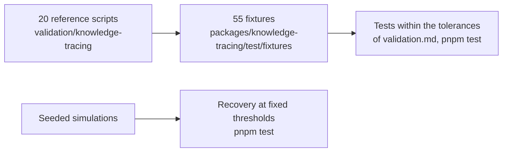

# Evidence for knowledge-tracing

What shows that `@measurekit/knowledge-tracing` does what it says: every statistic against pyBKT or an R package within a
stated tolerance, recovery studies of each model family at thresholds fixed before their first run, properties of the
learner model interface, the samples of the guides and its runs on four runtimes. The counts below are those of the
repository at `1506fa8e`, on 2026-11-06.

| Layer      | Question                                                                                                                  | Where                                                                                                                                                           | Runs                                                           |
| ---------- | ------------------------------------------------------------------------------------------------------------------------- | --------------------------------------------------------------------------------------------------------------------------------------------------------------- | -------------------------------------------------------------- |
| References | Does each statistic equal pyBKT's or the R package's?                                                                     | 20 R and Python scripts of `validation/knowledge-tracing/` write 55 fixtures; [validation](validation.md) gives the references, the versions and the tolerances | `pnpm test`; the scripts when a reference or a formula changes |
| Recovery   | Does each family recover the values a simulation set, at thresholds fixed before the first run?                           | [validation](validation.md#simulation-recovery): Elo, BKT, AFM, IRT, BLIM and the assessment                                                                    | `pnpm test`                                                    |
| Interface  | Does every model leave a state unchanged by `update`, continue the same after a JSON round trip, and read a stored state? | fast-check in the tests of each model; `test/model.test.ts` reads `test/fixtures/stored-state.json`                                                             | `pnpm test`                                                    |
| Samples    | Does every sample of the guides and every `@example` give the values it shows?                                            | `examples/test/guides.test.ts`, `examples/test/tsdoc.test.ts`                                                                                                   | `pnpm test --project examples`                                 |
| Runtimes   | Do Node.js, Deno, Bun and workerd give Node.js's results of a BKT fit?                                                    | `compat/`                                                                                                                                                       | `pnpm compat:runtimes`                                         |
| Speed      | Does each hot path stay within the budget of its benchmark, timed against its reference?                                  | [performance](performance.md#speed)                                                                                                                             | `pnpm bench`                                                   |

Some of the comparisons, as [validation](validation.md) gives them:

| Quantity                                                    | Reference            | Tolerance                                      | Found           |
| ----------------------------------------------------------- | -------------------- | ---------------------------------------------- | --------------- |
| BKT P(correct) and P(L) at fixed parameters                 | pyBKT 1.4.3          | 1e-13 absolute                                 | 2.3e-14         |
| BKT parameters and log-likelihood fitted from a given start | pyBKT 1.4.3          | 1e-8 absolute                                  | 6.8e-13         |
| BKT recovery: 1,000 learners, 20,000 events                 | The simulated values | P(L0) within 0.1; P(T), P(G), P(S) within 0.05 | 0.017; 0.014    |
| Elo recovery: 400 learners, 60 items                        | The simulated values | correlations at least 0.85 and 0.95            | 0.937 and 0.985 |
| Logistic coefficients, proficiencies and log-likelihood     | `glm`                | 1e-8 absolute                                  | 5.4e-10         |
| IRT EAP, its standard error, predictions                    | mirt 1.48, base R    | 1e-10 absolute                                 | 2.2e-15         |
| BLIM parameters by ML                                       | pks 0.8.0            | 1e-6 absolute                                  | 1.3e-7          |
| Metrics, calibration bins, learning curves                  | pROC 1.19.1, base R  | 1e-12 absolute                                 | 3e-16           |
