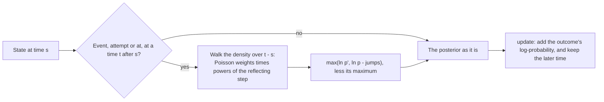

# Item response theory

`@measurekit/knowledge-tracing/irt` estimates learners' ability online from item parameters calibrated beforehand, as
by `@measurekit/psychometrics` or mirt: each outcome updates the posterior of the learner's θ, and the model
predicts the next outcome from it. With `drift`, θ moves between events, so that the posterior follows a learner who
changes. Estimates are validated against mirt's `fscores`, a posterior written out in R, and for drift the chain
computed in logs on the same grid and on a much finer one ([validation](validation.md#item-response-theory)).

## Quick start

Update a learner's posterior of θ with two outcomes, one of a 2PL item and one of a partial credit item, and read the ability, a prediction and the posterior:

```ts
import { irt } from "@measurekit/knowledge-tracing/irt";

const model = irt({
  parameters: {
    items: {
      q1: { a: 1.2, b: -0.5 },
      q2: { a: 1.5, b: 0.4, c: 0.2 },
      essay: { model: "gpcm", a: 0.9, b: [-1, 0, 1.2] },
    },
  },
});
const attempt = { learner: "ana", item: "q1", skills: [], time: 1 };
let ana = model.update(model.initialState("ana"), { ...attempt, outcome: 1 });
ana = model.update(ana, { ...attempt, item: "essay", time: 2, outcome: 2 / 3 }); // category 2 of 0 to 3
model.ability(ana); // => { theta: 0.508, standardError: 0.748 }, EAP
model.ability(ana, { estimator: "map" }); // => { theta: 0.471, standardError: 0.731 }, the posterior mode
model.predict(ana, { ...attempt, item: "q2", time: 3 }); // => 0.625
const { nodes, weights } = model.posterior(ana);
nodes.length; // => 61, from -6 to 6
weights.reduce((sum, weight, q) => ((nodes[q] ?? 0) > 0 ? sum + weight : sum), 0); // => 0.706, P(θ > 0)
```

## The model

Item parameters use the IRT parameterization with D = 1, as `@measurekit/psychometrics` and mirt with `IRTpars = TRUE`:

| Item                                | Parameters                                 | Probability                                                     |
| ----------------------------------- | ------------------------------------------ | --------------------------------------------------------------- |
| Dichotomous, 1PL to 4PL             | `{ a, b, c, d }`; `c` default `0`, `d` `1` | P(correct) = c + (d - c) logistic(a (θ - b))                    |
| Graded response (Samejima)          | `{ model: "graded", a, b: [b_1, ...] }`    | P(category ≥ k) = logistic(a (θ - b_k)), b increasing for a > 0 |
| Generalized partial credit (Muraki) | `{ model: "gpcm", a, b: [b_1, ...] }`      | P(category k) ∝ exp(Σ over j ≤ k of a (θ - b_j))                |

An item `{ model, parameters }` of `@measurekit/psychometrics` gives its `parameters`, with `model: "graded"`
or `"gpcm"` added for the polytomous models. An item with K categories takes the outcomes k / (K - 1), as a rubric
score from 0 to K - 1 divided by K - 1; a dichotomous item takes 0 and 1. A prediction is the expected outcome on
that scale: P(correct) for a dichotomous item.

The posterior of θ starts from the prior, the population's distribution in the calibration, and each outcome multiplies
it by the outcome's probability. Without `drift`, θ is constant: the posterior narrows with every outcome and does not
follow learning, and an item answered twice counts twice. With `drift`, θ is a random walk, and the posterior widens
over each gap between events by the variance the walk adds ([drift](#drift)). For learners whose change has a
structure of its own, such as skills learned in steps, use a model of learning, such as [Elo](elo.md) or [BKT](bkt.md).

## Scales and skills

A calibration places items on one scale, and the model keeps one θ per learner on it. Skills are not used: every item
measures the one θ. A test whose sections are calibrated separately, as the four skills of a language test, takes one
model per section, each with its items, and a learner has one state in each.

## Options

| Option       | Default                     | Meaning                                                                                                                                                  |
| ------------ | --------------------------- | -------------------------------------------------------------------------------------------------------------------------------------------------------- |
| `parameters` | required                    | `{ items: { [item]: parameters } }`                                                                                                                      |
| `prior`      | `{ mean: 0, sd: 1 }`        | The normal prior of θ                                                                                                                                    |
| `points`     | `61`; required with `drift` | Grid points, equally spaced from 6 prior standard deviations below the mean to 6 above: at least 3, or 6 with `drift`                                    |
| `drift`      | none: θ is constant         | `{ variance, per }`: θ gains `variance` every `per` units of the events' time, both above 0, such as `per: 604_800_000` for a week of epoch milliseconds |

The prior's grid needs distinct, finite points, with finite squares of their spacing and of 1 / sd; an sd so small or a
mean so large that it has not throws `DataError`. The default grid is that of `@measurekit/psychometrics` for EAP,
and mirt's `fscores` with `quadpts = 61` and `theta_lim = c(-6, 6)` for the standard prior.

## Events without an outcome

An event with `outcome: null`, such as a lesson, does not move the posterior of θ and has no item lookup, as a lesson is
no item and has no parameters. `update` returns the state as it was, and a fit gives the event a `null` prediction and
adds no likelihood term. Removing these events from a log changes no state or prediction. With `drift`, the event
advances the state to its time, which changes no posterior at a later time, as gaps compose.

## Online

The [quick start](#quick-start) updates a learner with two outcomes.

`ability(state, { estimator })` returns:

- `"eap"` (default): the posterior mean on the grid and the posterior standard deviation.
- `"map"`: the posterior mode and 1 / √(-ℓ''(θ̂)), ℓ the log-posterior, or `Infinity` where ℓ is not curved down. The
  highest grid point locates the mode; the quintic polynomial matching ℓ and its first two derivatives at the two
  nearest points gives it between them. At the default grid, the mode is within 1e-5 of the exact one; the error grows
  with the fifth power of the spacing. A mode beyond the grid is reported at its end.

`posterior(state)` returns the learner's whole posterior of θ as a `ThetaDistribution`, `{ nodes, weights }`: the grid
and the state's density on it, normalized to sum to 1. It is the `ThetaDistribution` of `@measurekit/core`, which `@measurekit/psychometrics` shares, so a posterior moves
between the packages as plain data.

Without drift, the state, `{ learner, logDensity, slope, curvature }`, holds ℓ and its first two derivatives at each grid point: 3 ×
`points` numbers, about 3.5 KB of JSON at the default grid, whatever the number of outcomes. ℓ is kept less its maximum,
so its largest value is 0. It is plain data; the model checks it. Each outcome's log-probability is computed from the
tail it is near, as ln logistic(±a (θ - b)) where an asymptote allows, so it stays finite where its probability rounds
to 0: a wrong answer to an easy item at the top of the grid. An item without parameters, or an outcome that is not one
of the item's categories, throws `DataError`.

## Drift



With `drift: { variance, per }`, θ is a random walk that gains `variance` every `per` units of the events' time. On the
grid of spacing h, it is the chain that jumps to either neighbor at equal rates and stays at an end when a jump would
leave the grid. Over a gap Δt, the chain makes t = variance Δt / (per h²) jumps on average, and the density p becomes

p' = e^-t Σ_k t^k / k! R^k p, with (Rp)_j = (p_{j-1} + p_{j+1}) / 2, and (p_0 + p_1) / 2 at an end:

the chain's transition, computed by uniformization. Every term is non-negative, R conserves mass, and two gaps compose
into one. Away from the grid's ends, the posterior's variance grows by exactly variance Δt / per at any gap, however short.

| Rule                      | Behavior                                                                                                                                                                                                                                                                |
| ------------------------- | ----------------------------------------------------------------------------------------------------------------------------------------------------------------------------------------------------------------------------------------------------------------------- |
| State                     | `{ learner, logDensity, time }`: the time of the latest event, and no derivatives, about 4.6 KB of JSON at 241 points. `initialState` has no time, and the first event sets it with no drift                                                                            |
| Time                      | `update`, `predict` and the `at` of `posterior` and `ability` advance the posterior to their time. A time before the state's takes no drift, and `update` keeps the state's time, so an event out of order applies its outcome where the posterior stands               |
| Events without an outcome | Advance the state to their time; no outcome applies                                                                                                                                                                                                                     |
| Underflow                 | The density is exp of the log-density, which underflows below -745. Since p' ≥ e^-t p, a step keeps max(ln p', ln p - t) at each point: a true lower bound, so a point that underflowed keeps its own log-density less t, and no floor adds a false tail                |
| Long gaps                 | t is taken at most 40 / (1 - cos(π / points)), where the walk is uniform to rounding, in parts of at most 500 jumps. A wrong unit of time, such as `per: 7` on a clock in milliseconds, leaves the posterior flat after one gap, at a cost of about 0.1 s at 241 points |
| MAP                       | The derivatives are fourth-order differences of the log-density: centered inside, one-sided at the two points at each end                                                                                                                                               |
| Cost                      | About 3 × `points` × (t + 8 √(t + 1) + 12) operations per step: 15,000 to 18,000 at 241 points for gaps from a minute to a day. `predict` takes the step for each attempt, so ranking 1,000 candidates costs about 10 to 20 ms                                          |
| Variance                  | `fit` estimates nothing: its log-likelihood is the forward likelihood, each outcome predicted from the posterior advanced to its time, so a host chooses `variance` by it or by `compareModels`                                                                         |

```ts
import { irt } from "@measurekit/knowledge-tracing/irt";

const WEEK = 7 * 24 * 60 * 60 * 1000; // the events' times are epoch milliseconds
const model = irt({
  parameters: { items: { q1: { a: 1.2, b: -0.5 }, q2: { a: 1.5, b: 0.4 } } },
  points: 241,
  drift: { variance: 0.02, per: WEEK },
});
const monday = Date.UTC(2026, 0, 5, 9);
const attempt = { learner: "ana", item: "q1", skills: [], time: monday };
let ana = model.update(model.initialState("ana"), { ...attempt, outcome: 1 });
ana = model.update(ana, { ...attempt, item: "q2", time: monday + 60_000, outcome: 1 });
model.ability(ana); // => { theta: 0.818, standardError: 0.787 }
model.ability(ana, { at: monday + 26 * WEEK }); // => { theta: 0.818, standardError: 1.067 }, half a year later
model.predict(ana, { ...attempt, item: "q2", time: monday + 26 * WEEK }); // => 0.605
```

**Choosing `points`.** The grid's chain is the continuous drift only as the grid gets finer. Measured against the same
chain on 1,921 points, after the last event of each pattern, worst of 3 seeds, at 0.02 a week: ordinary practice, 5 items
a week for 26 weeks, 3 a day for 16 weeks with a 40-item mock every 4 weeks, and 30 a day for 8 weeks; a steady rise of
1.5 over 14 days of 40 items a day, at a of 1.2, 2 and 3; and a reversal, 60 failed then 120 correct a minute apart at
a = 1.2, at 10 points through it. The tests hold each threshold.

| `points`         |  State | Ordinary: mean, SD, MAP  | Threshold            | Steady rise: mean | Threshold | Reversal at a = 1.2 | Threshold |
| ---------------- | -----: | ------------------------ | -------------------- | ----------------: | --------: | ------------------: | --------: |
| 61               | 1.2 KB | 0.014, 0.0056, 0.036     | 0.03, 0.01, 0.06     |              0.15 |      0.17 |                0.95 |      none |
| 121              | 2.3 KB | 0.0019, 0.0013, 0.0074   | 0.004, 0.003, 0.009  |             0.067 |       0.1 |               0.051 |      0.07 |
| 241, recommended | 4.6 KB | 0.00048, 0.00035, 0.0017 | 0.001, 0.0007, 0.003 |             0.029 |      0.04 |              0.0043 |     0.006 |

**Reversals.** Over a short gap, the walk's jump of a whole spacing is far likelier than a move of that size under the
continuous drift. When a learner answers against hundreds of earlier outcomes, the evidence pulls the posterior through
that tail, so a coarse grid crosses too soon. The error grows with the evidence overturned and with the discrimination,
and falls with a finer grid. The worst error of the mean at 10 points through each reversal, against 1,921 points,
outcomes a minute apart unless named:

| Reversal                                        | At its end on 1,921 points: mean, SD |    241 |    481 |    961 |
| ----------------------------------------------- | ------------------------------------ | -----: | -----: | -----: |
| 60 failed, 120 correct, a = 1.2                 | 2.02, 0.158                          | 0.0043 | 0.0008 | 0.0001 |
| 90 failed, 200 correct, a = 2                   | 2.13, 0.081                          |   0.81 |  0.054 | 0.0071 |
| 80 failed at one time, 160 correct, a = 3       | 1.99, 0.068                          |    1.6 |  0.052 |  0.010 |
| 200 failed, 400 correct, a = 1.5, an hour apart | 3.45, 0.146                          |    1.9 |    1.1 |   0.29 |
| 150 failed, 300 correct, a = 3                  | 2.02, 0.052                          |    3.2 |    2.3 |   0.35 |

A posterior SD under 3 spacings, 0.15 at 241 points and 0.075 at 481, is narrower than the grid resolves, and `ability`
reports it; the hourly reversal shows that a long reversal errs even above it. 481 points suit banks with a above 2 and
dense evidence. Where a reversal must be followed closely, replay the learner's recent events into a model with more
points.

**Turning drift on.** `points` is required with `drift`, as a state has one value per grid point. A host with stored
states passes their number of points, 61 by default, or replays each learner's log into a model with 241. A model with
drift reads a state of a model without it: the first event sets the time, with no drift, and drops the derivatives. A
model without drift refuses a state written with it, naming the option.

## Fitting

Item parameters are given, not estimated: `fit(log)` returns the model unchanged, with each learner's state after the
log and the predictions before each event, so [evaluation](evaluate.md) runs as for any model. Its log-likelihood is
the marginal log-likelihood of the outcomes on the grid, the learners' θ integrated over the prior, and with drift the
forward likelihood, each outcome predicted from the posterior advanced to its time; `aic` and `bic` are `null`, as the
item parameters were estimated elsewhere.

## Errors

Invalid input throws `DataError` naming the value found.

| Error                                                                                                                                                                 | What to do                                                                |
| --------------------------------------------------------------------------------------------------------------------------------------------------------------------- | ------------------------------------------------------------------------- |
| An item without parameters, or with invalid ones: `a` or `b` not finite, not 0 ≤ c < d ≤ 1, graded thresholds out of order, a model other than `"graded"` or `"gpcm"` | Give the items' parameters as the calibration wrote them, in the IRT form |
| An outcome that is not one of the item's categories, k / (K - 1)                                                                                                      | Divide a rubric score from 0 to K - 1 by K - 1                            |
| A prior whose grid has no distinct, finite points: an sd too small, or a mean too large                                                                               | Give the prior of the calibration's population                            |
| `drift` without `points`                                                                                                                                              | Give `points`: 241, or the number of points of the stored states          |
| A malformed state, or a state written with drift read by a model without it, or the reverse                                                                           | Read a state with a model of the same `points` and `drift` that wrote it  |

## Not included

| Not included                | Why                                                                                                                                                                                                                                                                                                                                                               |
| --------------------------- | ----------------------------------------------------------------------------------------------------------------------------------------------------------------------------------------------------------------------------------------------------------------------------------------------------------------------------------------------------------------- |
| Multidimensional online IRT | No fit: on the one-dimensional slice of the product grid, against 1,921 points and the worst of 8 learners, 31 nodes err by 0.026 at 100 items and 0.104 at 300, 15 nodes by 0.282, 9 by 0.612 and 7 by 0.805, while the posterior SD is 0.10 to 0.18. A batch test sees one test, but an online state accumulates without limit. Use one model for each section. |

## Differences from the references

The reference is mirt 1.48's `fscores`, with the items' parameters fixed ([validation](validation.md#item-response-theory)).

| Topic   | This package                                                                                                                                                                       | mirt                                                                                                          |
| ------- | ---------------------------------------------------------------------------------------------------------------------------------------------------------------------------------- | ------------------------------------------------------------------------------------------------------------- |
| Updates | One outcome at a time, as an app receives them; the posterior equals that of the whole pattern                                                                                     | A whole pattern of responses                                                                                  |
| MAP     | The highest grid point, then the quintic that matches the log-posterior and its first two derivatives at the two nearest points: within 1e-5 of the exact mode at the default grid | An optimizer, stopped 2e-6 from the exact mode                                                                |
| Grid    | 61 points from 6 prior standard deviations below the mean to 6 above                                                                                                               | `quadpts` points of its own spacing, which differ from those by up to 2.5e-8 in EAP; the validation sets them |
| Drift   | θ a random walk between events                                                                                                                                                     | None                                                                                                          |

## References

- Bock, R. D., & Mislevy, R. J. (1982). Adaptive EAP estimation of ability in a microcomputer environment. Applied
  Psychological Measurement, 6(4), 431-444.
- Chalmers, R. P. (2012). mirt: A multidimensional item response theory package for the R environment. Journal of
  Statistical Software, 48(6), 1-29.
- Jensen, A. (1953). Markoff chains as an aid in the study of Markoff processes. Scandinavian Actuarial Journal,
  1953(sup1), 87-91.
- Muraki, E. (1992). A generalized partial credit model: Application of an EM algorithm. Applied Psychological
  Measurement, 16(2), 159-176.
- Samejima, F. (1969). Estimation of latent ability using a response pattern of graded scores. Psychometrika Monograph
  Supplement, 34(4, Pt. 2).
- Wang, X., Berger, J. O., & Burdick, D. S. (2013). Bayesian analysis of dynamic item response models in educational
  testing. The Annals of Applied Statistics, 7(1), 126-153.
