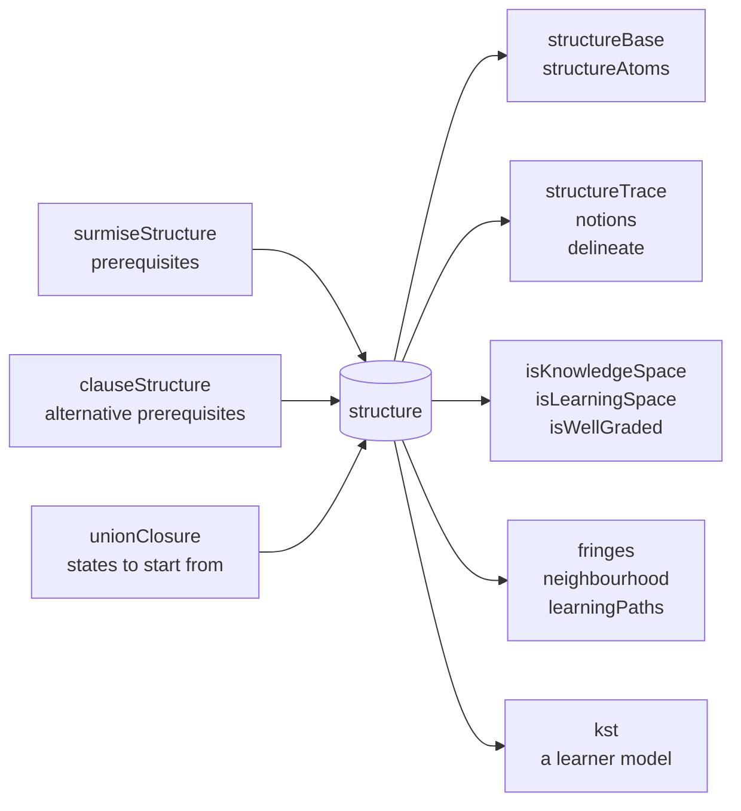

# Knowledge space theory

`@measurekit/knowledge-tracing/kst` models what a learner knows as a knowledge state: the set of skills, or items,
they master, out of the states a knowledge structure allows. It builds structures from prerequisites,
derives prerequisites from data, fits the basic local independence model (BLIM), and assesses learners
adaptively. Results are validated against the R packages kst, pks and
DAKS ([validation](validation.md#knowledge-space-theory)).

## Knowledge structures

A structure is plain data: `{ domain, states }`, the elements, skills or items, and each state's elements. It contains
the empty state and the whole domain.



| Function                                   | Returns                                                                                                           |
| ------------------------------------------ | ----------------------------------------------------------------------------------------------------------------- |
| `surmiseStructure(prerequisites, options)` | The quasi-ordinal space: every set that holds the prerequisites of each of its elements                           |
| `clauseStructure(clauses, options)`        | The space of elements that each need one of several sets of elements: alternative prerequisites                   |
| `unionClosure(domain, states, options)`    | The smallest knowledge space that holds the states: their unions, the empty state and the whole domain            |
| `isKnowledgeSpace(structure)`              | Whether the union of any two states is a state                                                                    |
| `isLearningSpace(structure)`               | Whether it is a knowledge space whose every state can be learned one element at a time                            |
| `isWellGraded(structure)`                  | Whether any two states are joined by states that each differ from the next by one element, as many as they differ |
| `fringes(structure, state)`                | `{ inner, outer }`: the elements last learned, and those ready to learn                                           |
| `neighbourhood(structure, state, options)` | The states that differ from a state by at least one and at most `distance` elements                               |
| `learningPaths(structure, options)`        | The orders in which the whole domain is learned from the empty state, one element at a step                       |
| `structureBase(structure)`                 | The base of a knowledge space: its states that are no union of other states                                       |
| `structureAtoms(structure, element)`       | The atoms of an element: the smallest states that hold it                                                         |
| `structureTrace(structure, elements)`      | The structure that its states leave on some elements                                                              |
| `notions(structure)`                       | The classes of elements that are in the same states                                                               |
| `delineate(structure, qMatrix)`            | The item structure of a skill structure: an item is in a state when all its skills are                            |

```ts
import { fringes, isLearningSpace, surmiseStructure } from "@measurekit/knowledge-tracing/kst";

const structure = surmiseStructure({ add: [], subtract: ["add"], multiply: ["add"], divide: ["subtract", "multiply"] });
structure.states;
// [[], ["add"], ["add", "subtract"], ["add", "multiply"], ["add", "subtract", "multiply"],
//  ["add", "subtract", "multiply", "divide"]]
isLearningSpace(structure); // true
fringes(structure, ["add", "subtract"]); // { inner: ["subtract"], outer: ["multiply"] }
```

`prerequisites` has every element as a key, with its prerequisites; theirs are implied. Elements that require each
other are learned together, so their space is not a learning space. States are ordered by size, then by the domain's
order. The Q-matrix of `delineate` has the shape of `eventLog`'s and of `@measurekit/psychometrics`.

`surmiseStructure` and `delineate` return frozen structures, which the functions above and `kst` trust. A structure from
elsewhere, such as JSON from storage, is checked in full each time a function takes it, in time proportional to its
states ([memory and time](storage.md#memory-and-time)). `kst` checks its structure when it builds the model, not at each
call of the model.

A learner's state holds a probability for each knowledge state, so `surmiseStructure`, `clauseStructure` and
`unionClosure` stop at `maxStates`, default `10000`, with a `DataError` that suggests splitting the domain into units,
such as chapters, with a structure each. Independent elements multiply the states: 14 independent skills give 16,384.

### Alternative prerequisites

`clauseStructure` takes each element's clauses, the sets of elements any one of which lets a learner learn it:
`{ c: [["a"], ["b", "d"]] }` lets a learner who has a, or has both b and d, learn c. An element with no clauses, or
with an empty clause, needs nothing.

```ts
import { clauseStructure, isLearningSpace, learningPaths } from "@measurekit/knowledge-tracing/kst";

const space = clauseStructure({ a: [], b: [], c: [["a"], ["b", "d"]], d: [["a"]] });
space.states.length; // 10
isLearningSpace(space); // true
learningPaths(space).length; // 8
```

The states grow one element at a time from the empty state, so every state can be learned element by element and the
result is a learning space. An element that no order of clauses reaches, such as one in a cycle, throws, naming it.
`surmiseStructure` has one clause for each element, and learns elements that require each other together; with clauses
they cannot be learned.

### Closure, base and atoms

A knowledge space is closed under union, so its base, the states that are no union of others, holds all of it: `unionClosure(domain, structureBase(space))`
gives the space back. `structureAtoms` lists the smallest states that hold an element, which are the ways a learner can
come to know it.

| Function        | Limit                                                                                                                                   |
| --------------- | --------------------------------------------------------------------------------------------------------------------------------------- |
| `structureBase` | Throws for a structure that is not a knowledge space                                                                                    |
| `learningPaths` | `maxPaths`, default `10000`: the paths of independent elements grow as a factorial, and more throw a `DataError` that suggests the base |
| `isWellGraded`  | Compares every pair of states, so takes time quadratic in their number, as `isKnowledgeSpace` does                                      |
| `neighbourhood` | `distance`, default `1`: states that add or lose one element                                                                            |

A learning path is a maximal chain of states in which each state adds one element to the one before. In a well-graded
structure every maximal chain is one. A structure that is not well-graded can have chains with a step of several
elements, which are not paths here, and may have no path at all.

## The model

`kst(options)` is a learner model on a structure: the basic local independence model (Doignon and Falmagne, 1999).
A learner is in one knowledge state K, with probability π(K) in the population. Given K, answers are independent: an
item that K masters is answered correctly with probability 1 - slip, β, the careless error; one it does not, with
probability guess, η, the lucky guess. Outcomes between 0 and 1 count as partial credit.

| Option          | Default           | Meaning                                                                                                       |
| --------------- | ----------------- | ------------------------------------------------------------------------------------------------------------- |
| `structure`     | required          | The knowledge structure                                                                                       |
| `over`          | `"skills"`        | `"skills"`: a state masters an item when it holds all the attempt's skills; `"items"`: when it holds the item |
| `method`        | `"ml"`            | `"ml"`, maximum likelihood by EM; `"md"`, minimum discrepancy                                                 |
| `tolerance`     | `1e-8`            | The change of the log-likelihood at which EM stops                                                            |
| `maxIterations` | `10000`           | The most EM iterations                                                                                        |
| `parameters`    | equal π, no items | `{ probabilities, items: { [item]: { guess, slip } } }`, π in the structure's order                           |

## Fitting

`fit(log)` estimates π and each item's guess and slip from the log, starting from the model's parameters, and from
guess and slip 0.1 for items without, as pks.

- `"ml"`: EM. Each learner's events, all of them, inform the posterior of their state; π is the mean posterior, slip
  the expected wrong answers where the state masters the item over the answers there, and guess the expected right
  answers where it does not over the answers there. The log-likelihood is the marginal one, the states summed over;
  `aic` and `bic` count k = states - 1 + 2 items.
- `"md"`: minimum discrepancy, in one pass (Heller and Wickelmaier, 2013). Each learner is spread evenly over the
  states that need the fewest careless errors and lucky guesses to give their answers, and the parameters are those
  states' frequencies and the errors they need. `aic` and `bic` are `null`.

Both keep guess and slip 1e-6 from 0 and 1, as pks's `blim`, so every outcome keeps a positive probability. Some
rates cannot be estimated (Stefanutti et al., 2012): when every state with an item added is a state, as for an item
without prerequisites, its guess trades off with π, and when every state with it removed is, as for an item nothing
requires, its slip does. Their estimates depend on the start; the fit's predictions do not. Learners
with the same answers are computed once. An EM iteration takes time proportional to the learners with different
answers, the items and the states: on 2,000 learners and 40 items, about 0.07 s with 385 states and 1 s with 5,896.
The fit's states and predictions are those of online inference with the fitted parameters.

## Events without an outcome

An event with `outcome: null`, such as a lesson, leaves the probabilities of the states as they were and needs no
parameters for its item. A fit, `iita` and the item count k of `aic` and `bic` read the events with an outcome only: a
lesson is never an item, and an item met only through events without an outcome has no response pattern. `bic` takes n as
the number of events with an outcome. A fit throws `DataError` for a log with none.

## Online and adaptive assessment

A learner's state is `{ learner, probabilities }`, a probability per knowledge state, in the structure's order:
about 22 bytes of JSON per knowledge state. `update` applies Bayes' rule to an answer; `predict` is the probability of
a correct answer; `mastery(state, element)` the probability that the learner's state holds a skill or an item.

| Member                                           | Returns                                                                                                                                                                    |
| ------------------------------------------------ | -------------------------------------------------------------------------------------------------------------------------------------------------------------------------- |
| `mostLikelyState(state)`                         | `{ state, probability }`: the most probable knowledge state, the first on ties                                                                                             |
| `nextQuestion(state, candidates, { threshold })` | The candidate whose mastery is nearest 0.5, the half-split rule; `null` once the most likely state's probability reaches `threshold`, default `0.9`, or without candidates |

This is the stochastic assessment procedure of Falmagne and Doignon (1988), with Bayes' rule as the updating rule:

```ts
import { fringes, kst, surmiseStructure } from "@measurekit/knowledge-tracing/kst";

const structure = surmiseStructure({ add: [], subtract: ["add"], multiply: ["add"], divide: ["subtract", "multiply"] });
const rates = { guess: 0.1, slip: 0.1 };
const model = kst({
  structure,
  parameters: {
    probabilities: structure.states.map(() => 1 / 6),
    items: { q1: rates, q2: rates, q3: rates, q4: rates },
  },
});
const skills = { q1: ["add"], q2: ["subtract"], q3: ["multiply"], q4: ["divide"] };
let open = Object.entries(skills).map(([item, itemSkills]) => ({ learner: "ana", item, skills: itemSkills, time: 0 }));
const answers: Record<string, number> = { q1: 1, q2: 1, q3: 0, q4: 0 };
let ana = model.initialState("ana");
for (let question = model.nextQuestion(ana, open); question !== null; question = model.nextQuestion(ana, open)) {
  ana = model.update(ana, { ...question, outcome: answers[question.item] ?? 0 }); // asks q2, q3, q1, q4
  open = open.filter((candidate) => candidate !== question);
}
model.mostLikelyState(ana); // { state: ["add", "subtract"], probability: 0.794 }
fringes(structure, model.mostLikelyState(ana).state).outer; // ["multiply"]: what to practice next
```

Remove asked items from the candidates, or an uncertain item is asked again. The outer fringe of the most likely state
gives what the learner is ready to learn; its items are the candidates of [practice](practice.md#next-item)'s
`recommend`.

A learner's knowledge state is assumed constant: the probabilities narrow with every answer and do not follow learning,
and an item answered twice counts twice. For learners who change while they practice, use a model of learning, such as
[BKT](bkt.md) or [Elo](elo.md).

## Inductive item tree analysis

`iita(log, { version })` derives prerequisites between items from answers (Schrepp, 2003; Sargin and Ünlü, 2009).
Each learner's first outcome at each item is used; every learner must have answered every item, with outcomes 0 or 1.
It generates quasi-orders that admit more and more counterexamples b_ij, the learners who fail i but solve j, and
returns the one whose counterexamples best match those expected with one error rate:

| `version`               | Expected counterexamples                                                     |
| ----------------------- | ---------------------------------------------------------------------------- |
| `"minimized"` (default) | Corrected, with the error rate that minimizes `diff` (Ünlü and Sargin, 2010) |
| `"corrected"`           | Corrected for implications in the other direction (Sargin and Ünlü, 2009)    |
| `"original"`            | Schrepp's (2003)                                                             |

The result has `prerequisites`, `diff`, the mean squared difference of observed and expected counterexamples,
`errorRate` and `candidates`, every quasi-order with its fit. The quasi-orders and their order are DAKS's, which
resolves conflicting pairs in the order of the items. Pass `prerequisites` to `surmiseStructure` for the knowledge
space.

## References

- Cosyn, E., & Uzun, H. B. (2009). Note on two necessary and sufficient axioms for a well-graded knowledge space.
  Journal of Mathematical Psychology, 53(1), 40-42.
- Doignon, J.-P., & Falmagne, J.-C. (1999). Knowledge Spaces. Springer.
- Falmagne, J.-C., & Doignon, J.-P. (1988). A class of stochastic procedures for the assessment of knowledge. British
  Journal of Mathematical and Statistical Psychology, 41(1), 1-23.
- Falmagne, J.-C., & Doignon, J.-P. (2011). Learning Spaces. Springer.
- Heller, J., & Wickelmaier, F. (2013). Minimum discrepancy estimation in probabilistic knowledge structures.
  Electronic Notes in Discrete Mathematics, 42, 49-56.
- Sargin, A., & Ünlü, A. (2009). Inductive item tree analysis: Corrections, improvements, and comparisons.
  Mathematical Social Sciences, 58(3), 376-392.
- Schrepp, M. (2003). A method for the analysis of hierarchical dependencies between items of a questionnaire.
  Methods of Psychological Research Online, 8(3), 43-79.
- Stefanutti, L., Heller, J., Anselmi, P., & Robusto, E. (2012). Assessing the local identifiability of
  probabilistic knowledge structures. Behavior Research Methods, 44(4), 1197-1211.
- Ünlü, A., & Sargin, A. (2010). DAKS: An R package for data analysis methods in knowledge space theory. Journal of
  Statistical Software, 37(2), 1-31.
