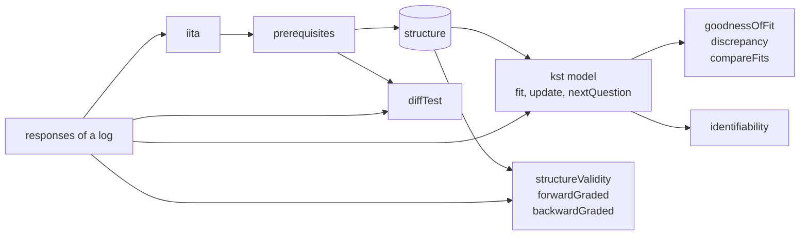
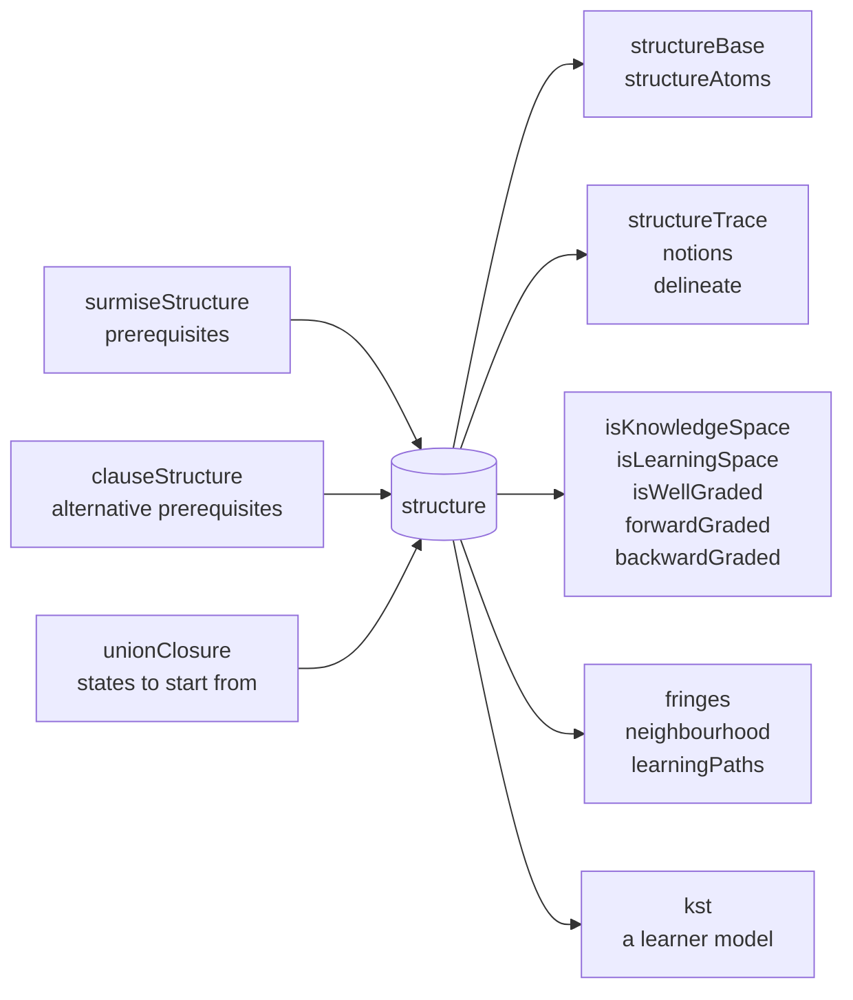
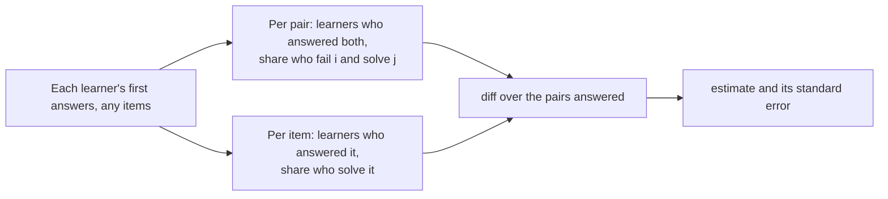

# Knowledge space theory

`@measurekit/knowledge-tracing/kst` models what a learner knows as a knowledge state: the set of skills, or items,
they master, out of the states a knowledge structure allows. It builds structures from prerequisites,
derives prerequisites from data, fits the basic local independence model (BLIM) with fixed and equal rates, tests its
fit and local identifiability, measures the validity of a structure and tests a surmise relation against responses, and
assesses learners adaptively. Results are validated against the R packages kst, pks and
DAKS ([validation](validation.md#knowledge-space-theory)).



## Quick start

Build the structure of four skills from their prerequisites, and read its states and the fringes of a state:

```ts
import { fringes, isLearningSpace, surmiseStructure } from "@measurekit/knowledge-tracing/kst";

const structure = surmiseStructure({ add: [], subtract: ["add"], multiply: ["add"], divide: ["subtract", "multiply"] });
structure.states;
// => [[], ["add"], ["add", "subtract"], ["add", "multiply"], ["add", "subtract", "multiply"],
//  ["add", "subtract", "multiply", "divide"]]
isLearningSpace(structure); // => true
fringes(structure, ["add", "subtract"]); // => { inner: ["subtract"], outer: ["multiply"] }
```

## Knowledge structures

A structure is plain data: `{ domain, states }`, the elements, skills or items, and each state's elements. It contains
the empty state and the whole domain.



| Function                                   | Returns                                                                                                           |
| ------------------------------------------ | ----------------------------------------------------------------------------------------------------------------- |
| `surmiseStructure(prerequisites, options)` | The quasi-ordinal space: every set that holds the prerequisites of each of its elements                           |
| `clauseStructure(clauses, options)`        | The space of elements that each need one of several sets of elements: alternative prerequisites                   |
| `unionClosure(domain, states, options)`    | The smallest knowledge space that holds the states: their unions, the empty state and the whole domain            |
| `isKnowledgeSpace(structure)`              | Whether the union of any two states is a state                                                                    |
| `isLearningSpace(structure)`               | Whether it is a knowledge space whose every state can be learned one element at a time                            |
| `isWellGraded(structure)`                  | Whether any two states are joined by states that each differ from the next by one element, as many as they differ |
| `forwardGraded(structure)`                 | For each element, whether adding it to any state leaves a state                                                   |
| `backwardGraded(structure)`                | For each element, whether removing it from any state leaves a state                                               |
| `fringes(structure, state)`                | `{ inner, outer }`: the elements last learned, and those ready to learn                                           |
| `neighbourhood(structure, state, options)` | The states that differ from a state by at least one and at most `distance` elements                               |
| `learningPaths(structure, options)`        | The orders in which the whole domain is learned from the empty state, one element at a step                       |
| `structureBase(structure)`                 | The base of a knowledge space: its states that are no union of other states                                       |
| `structureAtoms(structure, element)`       | The atoms of an element: the smallest states that hold it                                                         |
| `structureTrace(structure, elements)`      | The structure that its states leave on some elements                                                              |
| `notions(structure)`                       | The classes of elements that are in the same states                                                               |
| `delineate(structure, qMatrix)`            | The item structure of a skill structure: an item is in a state when all its skills are                            |

`prerequisites` has every element as a key, with its prerequisites; theirs are implied. Elements that require each
other are learned together, so their space is not a learning space. States are ordered by size, then by the domain's
order. The Q-matrix of `delineate` has the shape of `buildEventLog`'s and of `@measurekit/psychometrics`.

`surmiseStructure` and `delineate` return frozen structures, which the functions above and `kst` trust. A structure from
elsewhere, such as JSON from storage, is checked in full each time a function takes it, in time proportional to its
states ([memory and time](storage.md#memory-and-time)). `kst` checks its structure when it builds the model, not at each
call of the model.

A learner's state holds a probability for each knowledge state, so `surmiseStructure`, `clauseStructure` and
`unionClosure` stop at `maxStates`, default `10000`, with a `DataError` that suggests splitting the domain into units,
such as chapters, with a structure each. Independent elements multiply the states: 14 independent skills give 16,384.

### Alternative prerequisites

`clauseStructure` takes each element's clauses, the sets of elements any one of which lets a learner learn it:
`{ c: [["a"], ["b", "d"]] }` lets a learner who has a, or has both b and d, learn c. An element with no clauses, or
with an empty clause, needs nothing.

```ts continues
import { clauseStructure, isLearningSpace, learningPaths } from "@measurekit/knowledge-tracing/kst";

const space = clauseStructure({ a: [], b: [], c: [["a"], ["b", "d"]], d: [["a"]] });
space.states.length; // => 10
isLearningSpace(space); // => true
learningPaths(space).length; // => 8
```

The states grow one element at a time from the empty state, so every state can be learned element by element and the
result is a learning space. An element that no order of clauses reaches, such as one in a cycle, throws, naming it.
`surmiseStructure` has one clause for each element, and learns elements that require each other together; with clauses
they cannot be learned.

### Closure, base and atoms

A knowledge space is closed under union, so its base, the states that are no union of others, holds all of it: `unionClosure(domain, structureBase(space))`
gives the space back. `structureAtoms` lists the smallest states that hold an element, which are the ways a learner can
come to know it.

| Function        | Limit                                                                                                                                   |
| --------------- | --------------------------------------------------------------------------------------------------------------------------------------- |
| `structureBase` | Throws for a structure that is not a knowledge space                                                                                    |
| `learningPaths` | `maxPaths`, default `10000`: the paths of independent elements grow as a factorial, and more throw a `DataError` that suggests the base |
| `isWellGraded`  | Compares every pair of states, so takes time quadratic in their number, as `isKnowledgeSpace` does                                      |
| `neighbourhood` | `distance`, default `1`: states that add or lose one element                                                                            |

A learning path is a maximal chain of states in which each state adds one element to the one before. In a well-graded
structure every maximal chain is one. A structure that is not well-graded can have chains with a step of several
elements, which are not paths here, and may have no path at all.

## The model

`kst(structure, options)` is a learner model on a structure: the basic local independence model (Doignon and Falmagne,
1999). A learner is in one knowledge state K, with probability π(K) in the population. Given K, answers are independent:
an item that K masters is answered correctly with probability 1 - slip, β, the careless error; one it does not, with
probability guess, η, the lucky guess. Outcomes between 0 and 1 count as partial credit.

| Option          | Default           | Meaning                                                                                                                           |
| --------------- | ----------------- | --------------------------------------------------------------------------------------------------------------------------------- |
| `over`          | `"skills"`        | `"skills"`: a state masters an item when it holds all the attempt's skills; `"items"`: when it holds the item                     |
| `method`        | `"ml"`            | `"ml"`, maximum likelihood by EM; `"md"`, minimum discrepancy; `"mdml"`, maximum likelihood subject to it                         |
| `tolerance`     | `1e-8`            | The change of the log-likelihood at which EM stops                                                                                |
| `maxIterations` | `10000`           | The most EM iterations                                                                                                            |
| `parameters`    | equal π, no items | `{ probabilities, items: { [item]: { guess, slip } } }`, π in the structure's order                                               |
| `fixed`         | none              | `{ guess, slip }`, each an object of rates by item that a fit holds: [constraints](#constraints)                                  |
| `equal`         | none              | `{ guess, slip }`, each a list of groups of items that a fit gives one rate: [constraints](#constraints)                          |
| `posteriors`    | `false`           | Whether `fit` gives each learner's posterior over the states, `states`, at learners × states × 8 bytes, beside `mostLikelyStates` |

## Fitting

`fit(log)` estimates π and each item's guess and slip from the log, starting from the model's parameters, and from
guess and slip 0.1 for items without, as pks.

- `"ml"`: EM. Each learner's events, all of them, inform the posterior of their state; π is the mean posterior, slip
  the expected wrong answers where the state masters the item over the answers there, and guess the expected right
  answers where it does not over the answers there. The log-likelihood is the marginal one, the states summed over;
  `aic` and `bic` count k = states - 1 + one for each group of free slips + one for each group of free guesses, which
  is `states - 1 + 2 items` without constraints.
- `"md"`: minimum discrepancy, in one pass (Heller and Wickelmaier, 2013). Each learner is spread evenly over the
  states that need the fewest careless errors and lucky guesses to give their answers, and the parameters are those
  states' frequencies and the errors they need. `aic` and `bic` are `null`.
- `"mdml"`: EM in which each learner's posterior is spread over those states of least discrepancy only, weighted by
  their probability. It maximizes the likelihood of the nearest states, so its log-likelihood, that of the whole
  model at the estimates, is below that of `"ml"`. `aic` and `bic` are `null`.

Estimated rates stay 1e-6 from 0 and 1, as pks's `blim`, so every outcome keeps a positive probability. Some
rates cannot be estimated (Stefanutti et al., 2012): when every state with an item added is a state, as for an item
without prerequisites, its guess trades off with π, and when every state with it removed is, as for an item nothing
requires, its slip does. Their estimates depend on the start; the fit's predictions do not. Learners
with the same answers are computed once. An EM iteration takes time proportional to the learners with different
answers, the items and the states.
The fit's predictions are those of online inference with the fitted parameters. Its `mostLikelyStates` give each
learner's most likely state after the log with its probability, as pks's `predict` does unless asked for the
probabilities; with `posteriors: true`, `states` give each learner's posterior too, the state from which online
inference continues, at learners × states × 8 bytes: 1 GB for 12,500 learners over 10,000 states.

### Constraints

| Option                      | Meaning                                                                                                 |
| --------------------------- | ------------------------------------------------------------------------------------------------------- |
| `fixed.guess`, `fixed.slip` | An item's rate stays at the given value, from 0 to 1 and including both, which an estimate cannot reach |
| `equal.guess`, `equal.slip` | Groups of at least 2 items that share one estimate: the pooled expected errors over the pooled answers  |

```ts continues
import { kst } from "@measurekit/knowledge-tracing/kst";

kst(structure, {
  over: "items",
  fixed: { guess: { add: 0 }, slip: { divide: 0.05 } },
  equal: { slip: [["subtract", "multiply"]] },
});
```

An item has at most one constraint of each kind: it is in one group, and not in one while fixed. Every item named must
have an event with an outcome in the log. Fixed values are held by every method, the fixed parameters are not counted
in `aic` and `bic`, and a fit with a fixed rate of 0 gives probability 0 to the states that would need that error: the
nearest states of `"md"` and `"mdml"` leave them out, as pks's `betafix` and `etafix` do.

### Fit, comparison and identifiability

Each `KstFit` has the fields of any model's fit, and these:

| Field              | Value                                                                                                                                                                            |
| ------------------ | -------------------------------------------------------------------------------------------------------------------------------------------------------------------------------- |
| `goodnessOfFit`    | `{ g2, degreesOfFreedom, pValue }`: G² against the model that gives each response pattern its own probability; `null` unless every learner answered every item once, with 0 or 1 |
| `discrepancy`      | The mean number of items by which a learner's answers differ from the nearest state; `null` where `goodnessOfFit` is                                                             |
| `mostLikelyStates` | `{ [learner]: { state, probability } }`: each learner's most likely state after the log, the first on ties                                                                       |
| `states`           | `{ [learner]: { learner, probabilities } }`: each learner's posterior, with `posteriors: true`; absent without it                                                                |

The degrees of freedom are pks's: `min(2^items - 1, learners) - parameters` up to 16 items, and `min(patterns that
occur, learners) - parameters` above. They can reach 0 or below, and `pValue` is then `null`.

`compareFits(restricted, general)` tests a model against one it is nested in, fitted to the same learners, as pks's
`anova`: the difference of the G² and of the degrees of freedom, and the chi-square probability of the difference. It is
`null` when either fit has no `goodnessOfFit`, when the restricted fit has no more degrees of freedom, and when its G² is
the smaller.

`model.identifiability()` is the local identifiability of the model at its parameters (Stefanutti et al., 2012; Heller,
2017): the rank of the Jacobian of the probabilities of the 2^items response patterns, with a column for each free
parameter. `{ parameters, rank, identifiable }`: identifiable when the rank is the number of parameters, so that no
change of them leaves every pattern's probability as it was. Rates of items without parameters are at 0.1, and fixed
rates are not parameters. The model must be over items. Equal rates are refused, as no reference covers them.

```ts
import { buildEventLog } from "@measurekit/knowledge-tracing/data";
import { compareFits, kst, structureValidity, surmiseStructure } from "@measurekit/knowledge-tracing/kst";

const structure = surmiseStructure({ add: [], subtract: ["add"], multiply: ["add"], divide: ["subtract", "multiply"] });
// 44 learners answer the four items once: a string of 0 and 1 for the items in the domain's order, and how many gave it.
const counts = { "0000": 6, "1000": 8, "1100": 7, "1010": 5, "1110": 6, "1111": 9, "0100": 1, "0001": 1, "1001": 1 };
const answers = Object.entries(counts).flatMap(([pattern, count]) =>
  Array.from({ length: count }, (_, copy) => ({ pattern, copy })),
);
const log = buildEventLog(
  answers.flatMap(({ pattern }, learner) =>
    structure.domain.map((item, i) => ({
      learner: `l${learner}`,
      item,
      skills: [],
      time: i,
      outcome: Number(pattern[i]),
    })),
  ),
);

const free = kst(structure, { over: "items" }).fit(log);
free.goodnessOfFit; // => { g2: 2.535, degreesOfFreedom: 2, pValue: 0.282 }
free.discrepancy; // => 0.068
const partway = `l${answers.findIndex(({ pattern }) => pattern === "1100")}`;
free.mostLikelyStates[partway]; // => { state: ["add", "subtract"], probability: 0.816 }: a learner who answered 1100

const equal = kst(structure, { over: "items", equal: { guess: [structure.domain], slip: [structure.domain] } }).fit(
  log,
);
compareFits(equal, free); // => { g2: 1.460, degreesOfFreedom: 6, pValue: 0.962 }: one guess and one slip fit as well

free.model.identifiability(); // => { parameters: 13, rank: 11, identifiable: false }
const held = kst(structure, {
  over: "items",
  parameters: free.model.parameters,
  fixed: { guess: { add: 0.05 }, slip: { divide: 0.05 } },
});
held.identifiability(); // => { parameters: 11, rank: 11, identifiable: true }
```

The Jacobian has 2^items rows and one column for each parameter, so `identifiability` stops at `MAX_JACOBIAN_CELLS`, 10
million cells (80 MB): a chain of 12 items is far below it, and 20 items with 10,000 states would need 84 GB.

## Events without an outcome

An event with `outcome: null`, such as a lesson, leaves the probabilities of the states as they were and needs no
parameters for its item. A fit, `iita` and the item count k of `aic` and `bic` read the events with an outcome only: a
lesson is never an item, and an item met only through events without an outcome has no response pattern. `bic` takes n as
the number of events with an outcome. A fit throws `DataError` for a log with none.

## Online and adaptive assessment

A learner's state is `{ learner, probabilities }`, a probability per knowledge state, in the structure's order:
about 22 bytes of JSON per knowledge state. `update` applies Bayes' rule to an answer; `predict` is the probability of
a correct answer; `mastery(state, element)` the probability that the learner's state holds a skill or an item.

| Member                                           | Returns                                                                                                                                                                    |
| ------------------------------------------------ | -------------------------------------------------------------------------------------------------------------------------------------------------------------------------- |
| `mostLikelyState(state)`                         | `{ state, probability }`: the most probable knowledge state, the first on ties                                                                                             |
| `nextQuestion(state, candidates, { threshold })` | The candidate whose mastery is nearest 0.5, the half-split rule; `null` once the most likely state's probability reaches `threshold`, default `0.9`, or without candidates |

This is the stochastic assessment procedure of Falmagne and Doignon (1988), with Bayes' rule as the updating rule:

```ts continues
import { fringes, kst, surmiseStructure } from "@measurekit/knowledge-tracing/kst";

const structure = surmiseStructure({ add: [], subtract: ["add"], multiply: ["add"], divide: ["subtract", "multiply"] });
const rates = { guess: 0.1, slip: 0.1 };
const model = kst(structure, {
  parameters: {
    probabilities: structure.states.map(() => 1 / 6),
    items: { q1: rates, q2: rates, q3: rates, q4: rates },
  },
});
const skills = { q1: ["add"], q2: ["subtract"], q3: ["multiply"], q4: ["divide"] };
let open = Object.entries(skills).map(([item, itemSkills]) => ({ learner: "ana", item, skills: itemSkills, time: 0 }));
const answers: Record<string, number> = { q1: 1, q2: 1, q3: 0, q4: 0 };
let ana = model.initialState("ana");
const asked: string[] = [];
for (let question = model.nextQuestion(ana, open); question !== null; question = model.nextQuestion(ana, open)) {
  ana = model.update(ana, { ...question, outcome: answers[question.item] ?? 0 });
  asked.push(question.item);
  open = open.filter((candidate) => candidate !== question);
}
asked; // => ["q2", "q3", "q1", "q4"]
model.mostLikelyState(ana); // => { state: ["add", "subtract"], probability: 0.794 }
fringes(structure, model.mostLikelyState(ana).state).outer; // => ["multiply"]: what to practice next
```

Remove asked items from the candidates, or an uncertain item is asked again. The outer fringe of the most likely state
gives what the learner is ready to learn; its items are the candidates of [practice](practice.md#next-item)'s
`recommend`.

A learner's knowledge state is assumed constant: the probabilities narrow with every answer and do not follow learning,
and an item answered twice counts twice. For learners who change while they practice, use a model of learning, such as
[BKT](bkt.md) or [Elo](elo.md).

## Inductive item tree analysis

`iita(log, { version })` derives prerequisites between items from answers (Schrepp, 2003; Sargin and Ünlü, 2009).
Each learner's first outcome at each item is used; every learner must have answered every item, with outcomes 0 or 1.
It generates quasi-orders that admit more and more counterexamples b_ij, the learners who fail i but solve j, and
returns the one whose counterexamples best match those expected with one error rate:

| `version`               | Expected counterexamples                                                     |
| ----------------------- | ---------------------------------------------------------------------------- |
| `"minimized"` (default) | Corrected, with the error rate that minimizes `diff` (Ünlü and Sargin, 2010) |
| `"corrected"`           | Corrected for implications in the other direction (Sargin and Ünlü, 2009)    |
| `"original"`            | Schrepp's (2003)                                                             |

The result has `prerequisites`, `diff`, the mean squared difference of observed and expected counterexamples,
`errorRate` and `candidates`, every quasi-order with its fit. The quasi-orders and their order are DAKS's, which
resolves conflicting pairs in the order of the items. Pass `prerequisites` to `surmiseStructure` for the knowledge
space.

IITA's time grows faster than the items and the learners that its [limits](#limits) bound: each count of
counterexamples checks the pairs it adds against every item, pass after pass, until none breaks transitivity. DAKS's
`iita` finds the same quasi-orders. A host that runs IITA on logs from users runs it in a worker with a deadline, and
ends the worker when the deadline passes.

## Validity of a structure

`structureValidity(structure, log)` measures how well a structure agrees with learners' answers to its items, as kst's
`kvalidate`. The surmise relation of the structure orders i before j when every state that holds j holds i.

| Field                      | Value                                                                                                                                                 |
| -------------------------- | ----------------------------------------------------------------------------------------------------------------------------------------------------- |
| `gamma`                    | (concordant - discordant) / (concordant + discordant); `null` without ordered pairs                                                                   |
| `concordant`, `discordant` | Learners and ordered pairs where the prerequisite is solved and the other item is not, and the reverse                                                |
| `violationalCoefficient`   | discordant / (learners × ordered pairs); `null` without ordered pairs                                                                                 |
| `discrepancyIndex`         | The mean distance from a learner's answers to the nearest state                                                                                       |
| `distances`                | The number of learners at each distance to their nearest state                                                                                        |
| `distanceAgreement`        | The discrepancy index over the mean distance of all 2^items patterns to the nearest state; `null` above 20 elements, or when every pattern is a state |
| `solutionRates`            | The share of learners who solved each item, from 0 to 1 (`percent` of kvalidate over 100)                                                             |

```ts continues
structureValidity(structure, log).gamma; // => 0.862
structureValidity(structure, log).distances; // => { "0": 41, "1": 3 }
```

Each learner's first outcome at each item is used, every learner must have answered every item, with outcomes 0 or 1,
and the log's items must be the structure's domain.

## Testing a quasi order

`diffTest(log, prerequisites, options)` tests the fit measure `diff` of inductive item tree analysis for one quasi
order, or the difference of the measures of two (Ünlü and Sargin, 2010). The estimate is `diff` over the squared
number of learners. Its standard deviation is that of the delta method for the multinomial distribution of the response
patterns, so `z`, the p-value and the interval are asymptotic.

| Option        | Default       | Meaning                                                                                               |
| ------------- | ------------- | ----------------------------------------------------------------------------------------------------- |
| `alternative` | none          | A second quasi order, as `iita` returns it: the test is then of the difference of the two estimates   |
| `tail`        | `"two-sided"` | `"two-sided"`, `"less"` or `"greater"`: the estimate differs from `mean`, is below it, or is above it |
| `mean`        | `0`           | The estimate under the null hypothesis                                                                |
| `confidence`  | `0.95`        | The level of the interval, above 0 and below 1; one-sided for a `tail` of `"less"` or `"greater"`     |
| `version`     | `"minimized"` | `"minimized"` or `"corrected"`, as `iita`'s versions of the same names                                |

```ts continues
import { diffTest, iita } from "@measurekit/knowledge-tracing/kst";

const found = iita(log);
diffTest(log, found.prerequisites);
// => { estimate: 0.00140, z: 1.293, pValue: 0.196, interval: [-0.00072, 0.00352] }
const designed = { add: [], subtract: ["add"], multiply: ["add"], divide: ["subtract", "multiply"] };
diffTest(log, found.prerequisites, { alternative: designed }).pValue; // => 0.679
```

`prerequisites` has every item of the log as a key, and is closed under transitivity. The `interval` of a one-sided test
has an infinite end. `"greater"` is the probability of a statistic at least as large; DAKS's `z_test` returns the
probability of a smaller one, so values differ for one-sided tests.

### Incomplete patterns

Learners need not answer every item, as after an adaptive test, a placement or a booklet design. Each pair of items
counts the learners who answered both, each item's solution rate the learners who answered it, and a pair that no
learner answered both of leaves the mean of `diff`. The standard error is the delta method of the same estimate: the
root of the sum over learners of each one's squared influence, which weighs a learner's answers by the learners behind
each share. Complete patterns give DAKS's estimate and the variance above.



The shares are those of the population when whether a learner answered an item does not depend on the learner's
answers: missing completely at random, as in a booklet design or a probe drawn at random. An adaptive test that chooses
the next item by earlier answers makes the learners who answered a pair a selected group, and biases its shares.

### Testing one edge

An edge i ⊑ j is tested by the quasi order with it against the same order without it, with `tail: "greater"`: the
estimate is the first `diff` less the second, positive when the order fits worse with the edge, and a small p-value
rejects the edge. The error rate is one for the whole order, so the order needs more items than the edge's two: on two
items alone, the rate absorbs every counterexample. An edge that other edges imply through a third item cannot be
removed alone, as the prerequisites are closed under transitivity.

```ts continues
// Learners answered some items only; the edge from multiply to divide is tested within the designed order.
const sparse = buildEventLog(log.filter((_, k) => k % 7 !== 3));
const withEdge = { add: [], subtract: ["add"], multiply: ["add"], divide: ["subtract", "multiply"] };
const withoutEdge = { add: [], subtract: ["add"], multiply: ["add"], divide: ["subtract"] };
diffTest(sparse, withEdge, { alternative: withoutEdge, tail: "greater" }).pValue; // => 0.691: the order fits as well with the edge
```

The test of the difference of two orders is reliable where the test of one order against `mean` is not. The estimate of
one order is a sum of squared residuals: when the order fits closely they are small, and the delta method, which is
linear in them, misses their square. Over 300 bootstrap samples of the fixtures, the spread of the difference of two
orders was 0.92 to 1.24 times its standard error, and that of one order up to 2 times, with the bootstrap mean up to 3.4
standard errors above the estimate.

## Limits

| Limit                                                                                                        | Value                    | At the limit                                                                                                   |
| ------------------------------------------------------------------------------------------------------------ | ------------------------ | -------------------------------------------------------------------------------------------------------------- |
| States of a structure built by the module                                                                    | `maxStates`, `10000`     | `DataError` that suggests units: [alternative prerequisites](#alternative-prerequisites)                       |
| Learning paths                                                                                               | `maxPaths`, `10000`      | `DataError` that suggests `structureBase`                                                                      |
| Cells of the Jacobian of `identifiability`                                                                   | `1e7`                    | `DataError` that names the patterns and parameters: check a structure with fewer items or states, or fix rates |
| Elements for `distanceAgreement`                                                                             | `20`                     | `null`, as a table's statistic                                                                                 |
| Items of `iita`, `diffTest` and `structureValidity`; elements of `surmiseStructure`                          | `1000`                   | `DataError` that suggests units: their tables grow with the square of the elements                             |
| Cells of the candidates of `iita`: a prerequisite each, and 8 for each item                                  | 24 million, about 260 MB | `DataError`: analyze fewer items                                                                               |
| Cells of the masks of a model: a byte for each state and each set of skills, or item, that its attempts name | 2^28, 256 MB             | `DataError` that suggests a model for each unit                                                                |

## Errors

Invalid input throws `DataError` naming the value found; the limits above say what each limit throws.

| Error                                                                                                   | What to do                                                                                    |
| ------------------------------------------------------------------------------------------------------- | --------------------------------------------------------------------------------------------- |
| An item has a fixed rate and is in a group, or is in two groups                                         | Fix it or group it, in one group per kind                                                     |
| A rate or an item in `fixed` or `equal` is invalid, or the log has no event with an outcome at the item | Give rates from 0 to 1 and items with answers                                                 |
| `identifiability` of a model over skills, or with equal rates                                           | Create the model with `over: "items"`; remove `equal`, or fix the rates instead               |
| `structureValidity` of an incomplete table                                                              | Give every learner an answer of 0 or 1 to every item: the error names the first gap           |
| `diffTest` whose prerequisites have no implication whose two items a learner answered                   | Give learners probes of both items of an edge, or test it within a larger order               |
| `diffTest` with variance 0, or an item solved by no learner                                             | The estimate cannot be tested for identical learners or identical quasi orders; drop the item |

## Not included

| Not included                                                                              | Why                                                                                                                                                                                                     |
| ----------------------------------------------------------------------------------------- | ------------------------------------------------------------------------------------------------------------------------------------------------------------------------------------------------------- |
| Stochastic learning paths                                                                 | No reference: Falmagne and Doignon's chapter 12 treats them, but nothing runs the dynamic model.                                                                                                        |
| The simple learning model                                                                 | No reference: `pks::slm` is cross-sectional, so it does not move a learner's state.                                                                                                                     |
| QUERY                                                                                     | No reference: Falmagne and Doignon's chapters 15 and 16 treat it, and no package has it: not `kst`, `pks`, `DAKS`, `kstMatrix` or `CbKST`.                                                              |
| Domains of ALEKS size                                                                     | No reference: no package handles them; `kst` and `pks` enumerate states, as here. `maxStates` and units cover the large domains.                                                                        |
| `populationIita`                                                                          | Outside the sources: DAKS's `pop_iita` takes given rates and no data, a tool for studying IITA itself.                                                                                                  |
| IITA on incomplete patterns                                                               | No reference: MCAR-IITA (Steiner et al., 2026) is a conference paper whose code is not a released package; `diffTest` tests a quasi order on them.                                                      |
| A test of a quasi order when missing answers depend on the answers, as an adaptive test's | No reference: it needs a model of every item together, such as the basic local independence model of [the model](#the-model) fitted to the incomplete log, and no package tests a quasi order that way. |

## Differences from the references

| Reference                        | Difference                                                                                                                                                 |
| -------------------------------- | ---------------------------------------------------------------------------------------------------------------------------------------------------------- |
| `DAKS::z_test`                   | Its variance is not the delta-method variance of its estimate; `diffTest` follows the delta method. See [validation](validation.md#knowledge-space-theory) |
| `DAKS::z_test`, one-sided tests  | It returns the probability of a smaller statistic for `"greater"`; `diffTest` returns that of a larger one, R's meaning                                    |
| `DAKS::z_test`, two quasi orders | It adds the two variances; `diffTest` uses the variance of their difference, as both are fitted to the same learners                                       |
| `DAKS::z_test`, missing answers  | It refuses them; `diffTest` takes each pair from the learners who answered both                                                                            |
| `pks::blim`, above 16 items      | It renormalizes the probabilities of the patterns that occur before the log-likelihood; `kst` does not                                                     |
| `pks::jacobian`                  | It has a column for each rate, fixed or not, and takes the parameters from its arguments; `identifiability` drops fixed rates and takes the model's        |

## References

- Cosyn, E., & Uzun, H. B. (2009). Note on two necessary and sufficient axioms for a well-graded knowledge space.
  Journal of Mathematical Psychology, 53(1), 40-42.
- Doignon, J.-P., & Falmagne, J.-C. (1999). Knowledge Spaces. Springer.
- Falmagne, J.-C., & Doignon, J.-P. (1988). A class of stochastic procedures for the assessment of knowledge. British
  Journal of Mathematical and Statistical Psychology, 41(1), 1-23.
- Falmagne, J.-C., & Doignon, J.-P. (2011). Learning Spaces. Springer.
- Heller, J. (2017). Identifiability in probabilistic knowledge structures. Journal of Mathematical Psychology, 77,
  46-57.
- Heller, J., & Wickelmaier, F. (2013). Minimum discrepancy estimation in probabilistic knowledge structures.
  Electronic Notes in Discrete Mathematics, 42, 49-56.
- Little, R. J. A., & Rubin, D. B. (2019). Statistical analysis with missing data (3rd ed.). Wiley.
- Sargin, A., & Ünlü, A. (2009). Inductive item tree analysis: Corrections, improvements, and comparisons.
  Mathematical Social Sciences, 58(3), 376-392.
- Schrepp, M. (2003). A method for the analysis of hierarchical dependencies between items of a questionnaire.
  Methods of Psychological Research Online, 8(3), 43-79.
- Stefanutti, L., Heller, J., Anselmi, P., & Robusto, E. (2012). Assessing the local identifiability of
  probabilistic knowledge structures. Behavior Research Methods, 44(4), 1197-1211.
- Steiner, P., Badnarchuk, A., De Chiusole, D., Segedinac, M., Savić, G., Stefanutti, L., & Hochweber, J. (2026).
  MCAR-IITA: A procedure for identifying structures among items from incomplete data. Proceedings of the 19th
  International Conference on Educational Data Mining, 694-698.
- Ünlü, A., & Sargin, A. (2010). DAKS: An R package for data analysis methods in knowledge space theory. Journal of
  Statistical Software, 37(2), 1-31.
