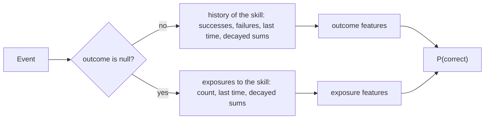

# Logistic models

`@measurekit/knowledge-tracing/logistic` fits logistic learner models: the additive factors model (AFM),
performance factors analysis (PFA) and models of the features of logistic knowledge tracing (LKT), with the exposure
features of instructional factors analysis. Learner proficiency is absent, a fixed effect per learner, or a random
intercept. Fits are validated against `glm`, `lme4::glmer` and LiblineaR, and the features against the LKT
package ([validation](validation.md#logistic-models)).



## The models

logit P(correct) = θ + Σ over the attempt's skills k of (β_k + Σ_f w_kf x_kf),

with θ the learner's proficiency, β_k the skill's intercept, and x_kf the features of the learner's history with skill
k before the attempt, each with a coefficient w_kf per skill. The skills' terms add up, as AFM, PFA and LKT define them:
an item of two skills gets both skills' intercepts and features.

| Factory             | Model                                                          | Features                | Default proficiency |
| ------------------- | -------------------------------------------------------------- | ----------------------- | ------------------- |
| `afm(options)`      | AFM (Cen, Koedinger and Junker, 2006): β_k + γ_k T_k           | `opportunities`         | `"fixed"`           |
| `pfa(options)`      | PFA (Pavlik, Cen and Koedinger, 2009): β_k + γ_k s_k + ρ_k f_k | `successes`, `failures` | `"none"`            |
| `logistic(options)` | Any of the features below                                      | `features`              | `"none"`            |

## Features

Each feature is computed before an attempt from the learner's earlier attempts at the skill: n attempts, s the sum of
their outcomes, f the sum of 1 - outcome. The decayed features weigh each attempt d times the next, so the most recent
counts fully; their prior is one success and one failure, decayed over every attempt.

| Feature                           | Value                                                                           | LKT                   |
| --------------------------------- | ------------------------------------------------------------------------------- | --------------------- |
| `"opportunities"`                 | n                                                                               | `lineafm`             |
| `"successes"`, `"failures"`       | s, f                                                                            | `linesuc`, `linefail` |
| `"logOpportunities"`              | ln(1 + n)                                                                       | `logafm`              |
| `"logSuccesses"`, `"logFailures"` | ln(1 + s), ln(1 + f)                                                            | `logsuc`, `logfail`   |
| `{ decayedOpportunities: d }`     | Σ dᵃ over the attempts, a the number of later attempts                          | `expdecafm`           |
| `{ decayedSuccesses: d }`         | S = Σ dᵃ y                                                                      | `expdecsuc`           |
| `{ decayedFailures: d }`          | F = Σ dᵃ (1 - y)                                                                | `expdecfail`          |
| `{ decayedProportion: d }`        | (dⁿ + S) / (dⁿ + S + dⁿ + F): 0.5 before any attempt                            | `propdec`             |
| `{ decayedLogit: d }`             | ln((dⁿ + S) / (dⁿ + F)): 0 before any attempt                                   | `logitdec`            |
| `{ recency: e }`                  | Δt⁻ᵉ, Δt the time since the last attempt; 0 at the first attempt and for Δt = 0 | `recency`             |

The exposure features read the events without an outcome at the skill, such as lessons, which instructional factors
analysis (Chi et al., 2011) counts apart from practice. They are 0 before any exposure.

| Feature                   | Value                                                                    |
| ------------------------- | ------------------------------------------------------------------------ |
| `"exposures"`             | m, the number of events without an outcome at the skill                  |
| `{ decayedExposures: d }` | Σ dᵃ over the exposures, a the number of later exposures                 |
| `{ recencyExposure: e }`  | Δt⁻ᵉ, Δt the time since the latest exposure; 0 before one and for Δt = 0 |

More of LKT's features, and the time-window counts of DAS3H. Time is in the units of the events' `time`; a feature that
reads `duration` needs it on every event, in those units.

| Feature                                                                         | Value                                                                                                                                                | LKT                                      |
| ------------------------------------------------------------------------------- | ---------------------------------------------------------------------------------------------------------------------------------------------------- | ---------------------------------------- |
| `"proportion"`                                                                  | s / n: 0.5 before any attempt                                                                                                                        | `prop`                                   |
| `"netSuccesses"`                                                                | s - f                                                                                                                                                | `linecomp`                               |
| `{ powerOpportunities: e }`                                                     | nᵉ, e above 0                                                                                                                                        | `powafm`                                 |
| `{ logit: g }`                                                                  | ln((g + s) / (g + f)), g above 0                                                                                                                     | `logit`, `par1 = (g - 0.1) / 30`         |
| `{ decayedProportionFailed: d }`                                                | S / (1 + d + ... + dⁿ⁺²): the proportion with three failed attempts before the first; 0 before any attempt                                           | `propdec2`                               |
| `{ recencySuccess: e }`, `{ recencyFailure: e }`                                | y Δt⁻ᵉ, (1 - y) Δt⁻ᵉ, y the outcome of the last attempt; 0 at the first attempt                                                                      | `recencysuc`, `recencyfail`              |
| `{ base: d }`, `{ baseSuccess: d }`, `{ baseFailure: d }`                       | ln(1 + n) A⁻ᵈ, with s and f in place of n; A the time since the first attempt, 0 at an age of 0                                                      | `base`, `basesuc`, `basefail`            |
| `{ basePractice: { decay, scale } }`, with `Success` and `Failure` forms        | As `base`, with the age A = P + scale (T - P): P the practice time since the first attempt, T the time since it                                      | `base2`, `base2suc`, `base2fail`         |
| `{ dash: τ }`, `{ dashSuccess: τ }`                                             | ln(1 + x), x a count that each attempt adds 1 to, or its outcome, and that decays by exp(-Δt / τ); τ above 0                                         | `dashafm`, `dashsuc`, `par1 = τ / 86400` |
| `{ ppe: { power, decay, spacing, weight } }`                                    | n^power T^-(decay + spacing S), T the mean age of the attempts weighted by age^-weight, S the mean of 1 / ln(gap + e) over the gaps between attempts | `ppe`, `par1` to `par4`                  |
| `{ windowOpportunities: w }`, `{ windowSuccesses: w }`, `{ windowFailures: w }` | ln(1 + the attempts, successes or failures in the last w units of time); w above 0, or `Infinity`                                                    | None: DAS3H (Choffin et al., 2019)       |

`basePractice` measures age in practice: P is the sum of the durations of the learner's events since the first attempt
at the skill, so a scale of 1 gives `base`, and a scale of 0 counts only practice. The features of `base` at an age of 0
or less give 0, as `recency` does, where LKT gives infinity.

| Rule            | Definition                                                                                                                                                                          |
| --------------- | ----------------------------------------------------------------------------------------------------------------------------------------------------------------------------------- |
| Parameters      | A decay d of the decayed features is above 0 and at most 1; an exponent, the decay of `base` and the parameters of `basePractice` and `ppe` are at least 0                          |
| `duration`      | `basePractice` needs it on every event, as the practice time adds them; a `DataError` names the event that lacks one                                                                |
| `ppe` and a tie | Where an earlier attempt is at the time of the current one its weight is infinite; the weighted age is then 1, as LKT's NaN falls back to                                           |
| State           | A skill's history gains a field only when a feature reads it: `previous`, `first`, `firstPractice`, `leaky`, and `times` with `outcomes`. See [storage](storage.md#memory-and-time) |
| Windows         | The state keeps the attempts that the largest window can still reach; with `Infinity`, or with `ppe`, it keeps all of them                                                          |

### The names of LKT

Every name of `computefeatures` in LKT 1.7.0, 49 in all, and what measurekit does with it.

| Names of LKT                                                                                                                                            | In measurekit                                                                                                 |
| ------------------------------------------------------------------------------------------------------------------------------------------------------- | ------------------------------------------------------------------------------------------------------------- |
| `lineafm`, `linesuc`, `linefail`, `logafm`, `logsuc`, `logfail`                                                                                         | `"opportunities"`, `"successes"`, `"failures"`, `"logOpportunities"`, `"logSuccesses"`, `"logFailures"`       |
| `expdecafm`, `expdecsuc`, `expdecfail`, `propdec`, `logitdec`, `recency`                                                                                | `decayedOpportunities`, `decayedSuccesses`, `decayedFailures`, `decayedProportion`, `decayedLogit`, `recency` |
| `prop`, `linecomp`, `powafm`, `logit`, `propdec2`                                                                                                       | `"proportion"`, `"netSuccesses"`, `powerOpportunities`, `logit`, `decayedProportionFailed`                    |
| `recencysuc`, `recencyfail`                                                                                                                             | `recencySuccess`, `recencyFailure`                                                                            |
| `base`, `basesuc`, `basefail`                                                                                                                           | `base`, `baseSuccess`, `baseFailure`                                                                          |
| `base2`, `base2suc`, `base2fail`                                                                                                                        | `basePractice`, `basePracticeSuccess`, `basePracticeFailure`                                                  |
| `dashafm`, `dashsuc`, `ppe`                                                                                                                             | `dash`, `dashSuccess`, `ppe`                                                                                  |
| `intercept`                                                                                                                                             | The intercept β_k of each skill, which every model has                                                        |
| `numer`                                                                                                                                                 | Not included: no feature reads the `covariates` of an event                                                   |
| `recencytest`, `recencystudy`                                                                                                                           | Not included: they read `previousstudy`, whose line is commented out in LKT 1.7.0                             |
| `base4`, `base5suc`, `base5fail`                                                                                                                        | Not included: their scaling is set by hand, such as `par4 * 10`; `ppe` covers the spacing effect              |
| `diffrelcor1`, `diffrelcor2`, `diffcor1`, `diffcor2`, `diffcorComp`, `diffincorComp`, `diffallComp`, `diffincor1`, `diffincor2`, `diffall1`, `diffall2` | Not included: they read other learners, so a state is not a function of a learner's own events                |
| `errordec`, `logitdecevol`, `baseratepropdec`                                                                                                           | Not included: they read an earlier model, or a parameter free for each item                                   |

Of the 49 names, 12 were covered before, 16 are added, 1 is the skill's intercept, and 20 are not included. The exposure features and the DAS3H windows are not LKT's.

## Online

```ts
import { logistic } from "@measurekit/knowledge-tracing/logistic";

const model = logistic({
  features: ["opportunities", { recency: 0.5 }],
  proficiency: "fixed",
  parameters: {
    skills: { fractions: { intercept: -0.4, coefficients: { opportunities: 0.15, "recency(0.5)": 0.8 } } },
    learners: { ana: 0.6, budi: -0.2 },
  },
});
const attempt = { learner: "ana", item: "q1", skills: ["fractions"], time: 100 };
const ana = model.update(model.initialState("ana"), { ...attempt, outcome: 1 });
model.predict(ana, { ...attempt, item: "q2", time: 104 }); // 0.68: θ 0.6, -0.4 + 0.15 × 1 + 0.8 × 4^-0.5
```

The state holds each skill's history: `successes`, `failures`, `last`, the time of the last attempt, and `decayed`, the
decayed successes and failures of each decay the features use, and the fields that the model's other features read
(`previous`, `first`, `firstPractice`, `leaky`, `times` and `outcomes`), with the learner's `practice` time. It is plain
data; the model checks it, and that it has what the model's features need. An attempt or event earlier than the learner's last attempt at one of its
skills throws `DataError`, as the time since it would be negative. Coefficients are keyed by the feature's label: its
name, with its parameter in parentheses. A skill without coefficients throws `DataError`. Every event needs at least one
skill; outcomes from 0 to 1 count as partial credit.

## References

- Cen, H., Koedinger, K., & Junker, B. (2006). Learning factors analysis: A general method for cognitive model
  evaluation and improvement. In Intelligent Tutoring Systems (ITS 2006).
- Chi, M., Koedinger, K. R., Gordon, G. J., Jordan, P., & VanLehn, K. (2011). Instructional factors analysis: A
  cognitive model for multiple instructional interventions. In Proceedings of the 4th International Conference on
  Educational Data Mining.
- Pavlik, P. I., Cen, H., & Koedinger, K. R. (2009). Performance factors analysis: A new alternative to knowledge
  tracing. In Artificial Intelligence in Education (AIED 2009).
- Pavlik, P. I., Eglington, L. G., & Harrell-Williams, L. M. (2021). Logistic knowledge tracing: A constrained
  framework for learner modeling. IEEE Transactions on Learning Technologies, 14(5), 624-639.
