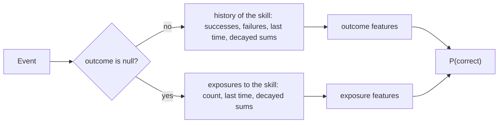
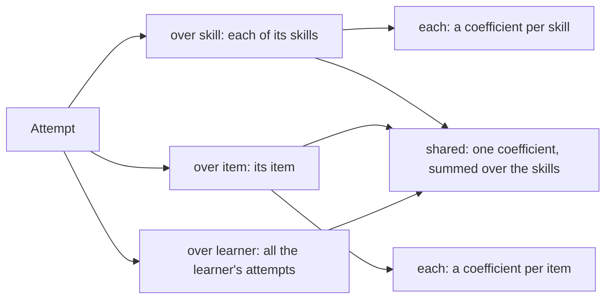
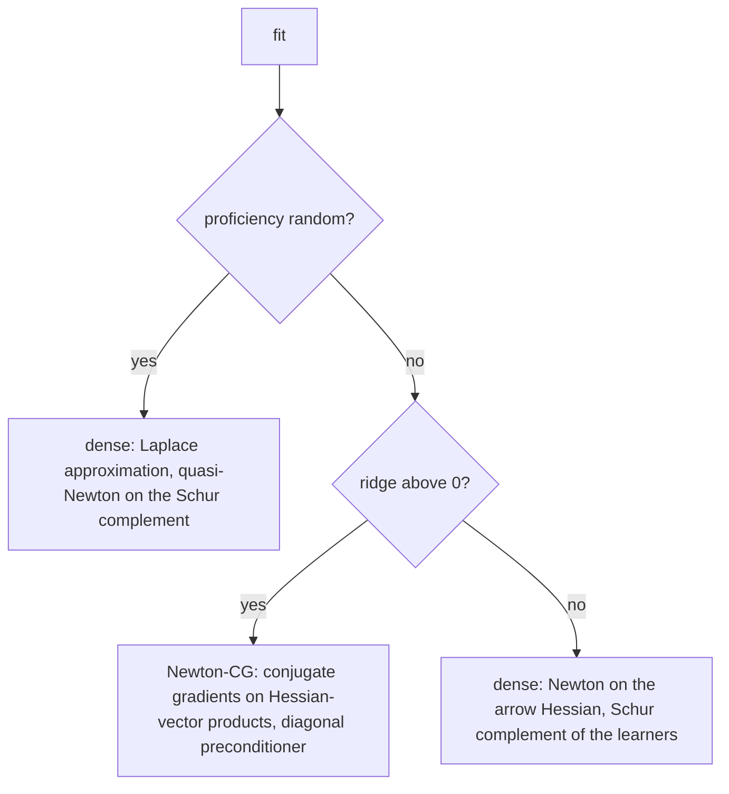

# Logistic models

`@measurekit/knowledge-tracing/logistic` fits logistic learner models: the additive factors model (AFM),
performance factors analysis (PFA) and models of the features of logistic knowledge tracing (LKT), with the exposure
features of instructional factors analysis. Intercepts and features count over skills, items or the learner, with a
coefficient for each skill or item or one for all, and covariates enter with one coefficient each, as Best-LR of Gervet
et al. (2020) has them. Learner proficiency is absent, a fixed effect per learner, or a random intercept. `fit` returns
standard errors, and `searchRates` estimates the decays and exponents of the features. Fits are validated against `glm`,
`lme4::glmer` and LiblineaR, and the features against the LKT package ([validation](validation.md#logistic-models)).



## Quick start

Predict a learner's next attempt at a skill from the features of their history, at given parameters:

```ts
import { logistic } from "@measurekit/knowledge-tracing/logistic";

const model = logistic({
  features: ["opportunities", { recency: 0.5 }],
  proficiency: "fixed",
  parameters: {
    skills: { fractions: { intercept: -0.4, coefficients: { opportunities: 0.15, "recency(0.5)": 0.8 } } },
    learners: { ana: 0.6, budi: -0.2 },
  },
});
const attempt = { learner: "ana", item: "q1", skills: ["fractions"], time: 100 };
const ana = model.update(model.initialState("ana"), { ...attempt, outcome: 1 });
model.predict(ana, { ...attempt, item: "q2", time: 104 }); // => 0.68: θ 0.6, -0.4 + 0.15 × 1 + 0.8 × 4^-0.5
```

## The models

logit P(correct) = θ + β_item + Σ over the attempt's skills k of (β_k + Σ_f w_kf x_kf) + Σ_g w_g x_g + Σ_c w_c z_c,

with θ the learner's proficiency, β_k and β_item the intercepts of the skill and of the item, x the features of the
learner's history before the attempt, and z the covariates of the attempt. A feature x_kf has a coefficient w_kf for
each skill; x_g has one coefficient w_g for all skills, items or learners. The skills' terms add up, as AFM, PFA and LKT
define them: an item of two skills gets both skills' intercepts and features.

| Factory             | Model                                                          | Features                | Default proficiency |
| ------------------- | -------------------------------------------------------------- | ----------------------- | ------------------- |
| `afm(options)`      | AFM (Cen, Koedinger and Junker, 2006): β_k + γ_k T_k           | `opportunities`         | `"fixed"`           |
| `pfa(options)`      | PFA (Pavlik, Cen and Koedinger, 2009): β_k + γ_k s_k + ρ_k f_k | `successes`, `failures` | `"none"`            |
| `logistic(options)` | Any of the features and terms below                            | `features`              | `"none"`            |

### Options

| Option           | Meaning                                                                                                                | Default     |
| ---------------- | ---------------------------------------------------------------------------------------------------------------------- | ----------- |
| `features`       | Features and terms: a feature on its own is a term over skills with a coefficient for each skill                       | `[]`        |
| `intercepts`     | `"skill"` and `"item"`: an intercept for each skill, and for each item; both need a ridge above 0                      | `["skill"]` |
| `covariates`     | Names of the numbers in each attempt's `covariates`, each with one coefficient; every attempt needs them               | `[]`        |
| `proficiency`    | `"none"`, `"fixed"` (a free θ per learner) or `"random"` (θ from N(0, σ²), the Laplace approximation of `lme4::glmer`) | `"none"`    |
| `ridge`          | λ of the penalty λ / 2 Σ b² over the coefficients and fixed proficiencies                                              | `0`         |
| `standardErrors` | Whether `fit` returns standard errors; a fit with a ridge has none                                                     | `false`     |
| `tolerance`      | The largest absolute gradient component at which a fit has converged                                                   | `1e-8`      |
| `maxIterations`  | The most iterations of a fit                                                                                           | `100`       |
| `parameters`     | The parameters to predict with                                                                                         | none        |

### Terms

A term is `{ feature, over, coefficient }`. The history that a feature reads counts the learner's earlier attempts at
the skills of the attempt (`over: "skill"`), at its item (`"item"`), or at any item (`"learner"`).



| `over`      | `coefficient: "each"` (default for skill and item)         | `coefficient: "shared"` (default for learner)                                |
| ----------- | ---------------------------------------------------------- | ---------------------------------------------------------------------------- |
| `"skill"`   | `skills[k].coefficients[label]`, as AFM, PFA and LKT's `$` | `shared["skill:label"]`: LKT's component without `$`, summed over the skills |
| `"item"`    | `items[i].coefficients[label]`                             | `shared["item:label"]`                                                       |
| `"learner"` | Not allowed: a slope for each learner is a random slope    | `shared["learner:label"]`                                                    |

The exposure features read the exposures to a skill, so they can only be over skills. Covariates are `shared["covariate:name"]`.

```ts
import { logistic } from "@measurekit/knowledge-tracing/logistic";

// Best-LR, as Gervet et al. (2020) print it
const bestLr = logistic({
  proficiency: "fixed",
  intercepts: ["skill", "item"],
  ridge: 1,
  features: [
    "logSuccesses",
    "logFailures",
    { feature: "logSuccesses", over: "learner" },
    { feature: "logFailures", over: "learner" },
  ],
});
```

| Rule                               | Behavior                                                                                                                                                                      |
| ---------------------------------- | ----------------------------------------------------------------------------------------------------------------------------------------------------------------------------- |
| Skill and item intercepts together | Need a ridge above 0: items nest in skills, so without one the pair adds nothing to predictions                                                                               |
| An item the fit did not see        | Intercept 0 and coefficients 0. A skill the fit did not see throws, when the model has a term for skills                                                                      |
| Fixed proficiency without a ridge  | θ is fixed by a mean of 0 in each set of learners and skills (or items, with item intercepts alone) that share none, where all events of the set have the same number of them |
| Parameters                         | `skills[k].intercept` is 0 for a model without skill intercepts; `items` and `shared` are present only when the model has them                                                |
| State                              | `items` and `overall` histories are kept only when a term reads them, with only the fields that its features read                                                             |

### Solvers



| Path                  | Cost of a step                                    | Limit                                                                                      |
| --------------------- | ------------------------------------------------- | ------------------------------------------------------------------------------------------ |
| Ridge, fixed or no θ  | Passes over the events, however many coefficients | None                                                                                       |
| No ridge, or random θ | The cube of the coefficients                      | `MAX_DENSE_COEFFICIENTS` = 5,000 coefficients; above it, a `DataError` says to add a ridge |

Best-LR on assist12 has 53,086 items: a dense matrix of that many coefficients takes 22 GB, so the ridge path never forms it.

### Standard errors

With `standardErrors: true`, `fit` returns the square roots of the diagonal of the inverse Hessian at the estimates, in the
shape of the parameters: skills, items, shared coefficients, and with fixed proficiency the learners. The variance of an
outcome is the binomial p (1 - p), also for outcomes between 0 and 1, as `glm` has it. Fixed proficiencies are centered by
a mean of 0 in each set, and their errors and the coefficients' are those of the centered estimates, as sum contrasts give.
A random intercept has the errors of the coefficients only, the inverse Schur complement that `vcov(glmer, use.hessian =
FALSE)` is; `learnerSd` has none. `standardErrors` is `null` unless asked, with a ridge, and where the information is
singular: features that are linear combinations of each other, or a coefficient that no event uses.

## Features

Each feature is computed before an attempt from the learner's earlier attempts at the skill: n attempts, s the sum of
their outcomes, f the sum of 1 - outcome. The decayed features weigh each attempt d times the next, so the most recent
counts fully; their prior is one success and one failure, decayed over every attempt.

| Feature                           | Value                                                                           | LKT                   |
| --------------------------------- | ------------------------------------------------------------------------------- | --------------------- |
| `"opportunities"`                 | n                                                                               | `lineafm`             |
| `"successes"`, `"failures"`       | s, f                                                                            | `linesuc`, `linefail` |
| `"logOpportunities"`              | ln(1 + n)                                                                       | `logafm`              |
| `"logSuccesses"`, `"logFailures"` | ln(1 + s), ln(1 + f)                                                            | `logsuc`, `logfail`   |
| `{ decayedOpportunities: d }`     | Σ dᵃ over the attempts, a the number of later attempts                          | `expdecafm`           |
| `{ decayedSuccesses: d }`         | S = Σ dᵃ y                                                                      | `expdecsuc`           |
| `{ decayedFailures: d }`          | F = Σ dᵃ (1 - y)                                                                | `expdecfail`          |
| `{ decayedProportion: d }`        | (dⁿ + S) / (dⁿ + S + dⁿ + F): 0.5 before any attempt                            | `propdec`             |
| `{ decayedLogit: d }`             | ln((dⁿ + S) / (dⁿ + F)): 0 before any attempt                                   | `logitdec`            |
| `{ recency: e }`                  | Δt⁻ᵉ, Δt the time since the last attempt; 0 at the first attempt and for Δt = 0 | `recency`             |

The exposure features read the events without an outcome at the skill, such as lessons, which instructional factors
analysis (Chi et al., 2011) counts apart from practice. They are 0 before any exposure.

| Feature                   | Value                                                                    |
| ------------------------- | ------------------------------------------------------------------------ |
| `"exposures"`             | m, the number of events without an outcome at the skill                  |
| `{ decayedExposures: d }` | Σ dᵃ over the exposures, a the number of later exposures                 |
| `{ recencyExposure: e }`  | Δt⁻ᵉ, Δt the time since the latest exposure; 0 before one and for Δt = 0 |

More of LKT's features, and the time-window counts of DAS3H. Time is in the units of the events' `time`; a feature that
reads `duration` needs it on every event, in those units.

| Feature                                                                         | Value                                                                                                                                                | LKT                                      |
| ------------------------------------------------------------------------------- | ---------------------------------------------------------------------------------------------------------------------------------------------------- | ---------------------------------------- |
| `"proportion"`                                                                  | s / n: 0.5 before any attempt                                                                                                                        | `prop`                                   |
| `"netSuccesses"`                                                                | s - f                                                                                                                                                | `linecomp`                               |
| `{ powerOpportunities: e }`                                                     | nᵉ, e above 0                                                                                                                                        | `powafm`                                 |
| `{ logit: g }`                                                                  | ln((g + s) / (g + f)), g above 0                                                                                                                     | `logit`, `par1 = (g - 0.1) / 30`         |
| `{ decayedProportionFailed: d }`                                                | S / (1 + d + ... + dⁿ⁺²): the proportion with three failed attempts before the first; 0 before any attempt                                           | `propdec2`                               |
| `{ recencySuccess: e }`, `{ recencyFailure: e }`                                | y Δt⁻ᵉ, (1 - y) Δt⁻ᵉ, y the outcome of the last attempt; 0 at the first attempt                                                                      | `recencysuc`, `recencyfail`              |
| `{ base: d }`, `{ baseSuccess: d }`, `{ baseFailure: d }`                       | ln(1 + n) A⁻ᵈ, with s and f in place of n; A the time since the first attempt, 0 at an age of 0                                                      | `base`, `basesuc`, `basefail`            |
| `{ basePractice: { decay, scale } }`, with `Success` and `Failure` forms        | As `base`, with the age A = P + scale (T - P): P the practice time since the first attempt, T the time since it                                      | `base2`, `base2suc`, `base2fail`         |
| `{ dash: τ }`, `{ dashSuccess: τ }`                                             | ln(1 + x), x a count that each attempt adds 1 to, or its outcome, and that decays by exp(-Δt / τ); τ above 0                                         | `dashafm`, `dashsuc`, `par1 = τ / 86400` |
| `{ ppe: { power, decay, spacing, weight } }`                                    | n^power T^-(decay + spacing S), T the mean age of the attempts weighted by age^-weight, S the mean of 1 / ln(gap + e) over the gaps between attempts | `ppe`, `par1` to `par4`                  |
| `{ windowOpportunities: w }`, `{ windowSuccesses: w }`, `{ windowFailures: w }` | ln(1 + the attempts, successes or failures in the last w units of time); w above 0, or `Infinity`                                                    | None: DAS3H (Choffin et al., 2019)       |

`basePractice` measures age in practice: P is the sum of the durations of the learner's events since the first attempt
at the skill, so a scale of 1 gives `base`, and a scale of 0 counts only practice. The features of `base` at an age of 0
or less give 0, as `recency` does, where LKT gives infinity.

| Rule            | Definition                                                                                                                                                                          |
| --------------- | ----------------------------------------------------------------------------------------------------------------------------------------------------------------------------------- |
| Parameters      | A decay d of the decayed features is above 0 and at most 1; an exponent, the decay of `base` and the parameters of `basePractice` and `ppe` are at least 0                          |
| `duration`      | `basePractice` needs it on every event, as the practice time adds them; a `DataError` names the event that lacks one                                                                |
| `ppe` and a tie | Where an earlier attempt is at the time of the current one its weight is infinite; the weighted age is then 1, as LKT's NaN falls back to                                           |
| State           | A skill's history gains a field only when a feature reads it: `previous`, `first`, `firstPractice`, `leaky`, and `times` with `outcomes`. See [storage](storage.md#memory-and-time) |
| Windows         | The state keeps the attempts that the largest window can still reach; with `Infinity`, or with `ppe`, it keeps all of them                                                          |

### The names of LKT

Every name of `computefeatures` in LKT 1.7.0, 49 in all, and what measurekit does with it.

| Names of LKT                                                                                                                                            | In measurekit                                                                                                 |
| ------------------------------------------------------------------------------------------------------------------------------------------------------- | ------------------------------------------------------------------------------------------------------------- |
| `lineafm`, `linesuc`, `linefail`, `logafm`, `logsuc`, `logfail`                                                                                         | `"opportunities"`, `"successes"`, `"failures"`, `"logOpportunities"`, `"logSuccesses"`, `"logFailures"`       |
| `expdecafm`, `expdecsuc`, `expdecfail`, `propdec`, `logitdec`, `recency`                                                                                | `decayedOpportunities`, `decayedSuccesses`, `decayedFailures`, `decayedProportion`, `decayedLogit`, `recency` |
| `prop`, `linecomp`, `powafm`, `logit`, `propdec2`                                                                                                       | `"proportion"`, `"netSuccesses"`, `powerOpportunities`, `logit`, `decayedProportionFailed`                    |
| `recencysuc`, `recencyfail`                                                                                                                             | `recencySuccess`, `recencyFailure`                                                                            |
| `base`, `basesuc`, `basefail`                                                                                                                           | `base`, `baseSuccess`, `baseFailure`                                                                          |
| `base2`, `base2suc`, `base2fail`                                                                                                                        | `basePractice`, `basePracticeSuccess`, `basePracticeFailure`                                                  |
| `dashafm`, `dashsuc`, `ppe`                                                                                                                             | `dash`, `dashSuccess`, `ppe`                                                                                  |
| `intercept`                                                                                                                                             | The intercept of each skill or item: the option `intercepts`                                                  |
| `numer`                                                                                                                                                 | A covariate: the option `covariates`, one coefficient for each name                                           |
| `recencytest`, `recencystudy`                                                                                                                           | [Not included](#not-included)                                                                                 |
| `base4`, `base5suc`, `base5fail`                                                                                                                        | [Not included](#not-included)                                                                                 |
| `diffrelcor1`, `diffrelcor2`, `diffcor1`, `diffcor2`, `diffcorComp`, `diffincorComp`, `diffallComp`, `diffincor1`, `diffincor2`, `diffall1`, `diffall2` | [Not included](#not-included)                                                                                 |
| `errordec`, `logitdecevol`, `baseratepropdec`                                                                                                           | [Not included](#not-included)                                                                                 |

Of the 49 names, 28 are features, `intercept` and `numer` are the intercepts and covariates, and 19 are not included. The
exposure features and the DAS3H windows are not LKT's. LKT's components map to the terms: a feature over `"skill"` or
`"item"` with a coefficient for each is a component with `$`, one with a shared coefficient is a component without it.

## Estimating the rates of the features

The decays and exponents of the features are given, or estimated by `searchRates` as LKT's `seedpars` does: the rates
that maximize the log-likelihood of the log, found by BFGS over the rates mapped to the whole line. Each trial fits the
model to the log: the line search fits it at each length it tries, and the gradient, by central differences, fits it
twice for each rate at the length the line search accepts, as `optim` calls `gr`. A fit that does not converge, at a
length or in the gradient there, is a failed trial that the line search steps back from.

```ts
import type { EventLog } from "@measurekit/knowledge-tracing/data";
import { logistic, searchRates } from "@measurekit/knowledge-tracing/logistic";

/** Finds the decay of the proportion of successes and the exponent of the recency that fit a log best. */
export function bestRates(log: EventLog) {
  const found = searchRates(
    (rates) => logistic({ features: [{ decayedProportion: rates[0] ?? 0 }, { recency: rates[1] ?? 0 }] }),
    log,
    { start: [0.5, 0.5], lower: [0.05, 0.01], upper: [1, 3] },
  );
  return { rates: found.rates, model: found.fit.model };
}
```

| Option           | Meaning                                                                                    | Default |
| ---------------- | ------------------------------------------------------------------------------------------ | ------- |
| `start`          | The rates to start from, each strictly between its bounds: one for each rate `build` takes | none    |
| `lower`, `upper` | The bounds of each rate                                                                    | none    |
| `tolerance`      | The largest absolute gradient component, over the rates mapped to the line, at convergence | `1e-6`  |
| `maxIterations`  | The most iterations                                                                        | `100`   |

Each trial fits the model, and a gradient takes two fits for each rate, so the cost is the cost of a fit times the trials.
The result may be a local optimum: the log-likelihood in the rates need not have one maximum, so a search from another
start can end elsewhere. A fit that does not converge counts as a failed trial and the search steps back from it; a search
that ends on failed trials has not converged, and one whose start does not converge returns it with `converged: false`. An
error that `build` or the fit throws ends the search. Rates that a feature does not identify, such as the decay of a
proportion that changes little with it, scatter from log to log; the recency exponent is poorly identified when learners
return at once, since Δt⁻ᵉ grows without bound as Δt falls.

## Online

The [quick start](#quick-start) is online use, at given parameters.

The state holds each skill's history: `successes`, `failures`, `last`, the time of the last attempt, and `decayed`, the
decayed successes and failures of each decay the features use, and the fields that the model's other features read
(`previous`, `first`, `firstPractice`, `leaky`, `times` and `outcomes`), with the learner's `practice` time, and for terms
over items and the learner, the same histories in `items`, by item id, and `overall`. It is plain data; the model checks it,
and that it has what the model's features need. An attempt or event earlier than the learner's last attempt at one of its
skills throws `DataError`, as the time since it would be negative. Coefficients are keyed by the feature's label: its
name, with its parameter in parentheses. A skill without coefficients throws `DataError`. Every event needs at least one
skill; outcomes from 0 to 1 count as partial credit.

## Errors

| `DataError` when                                                                                        | What to do                                                                                     |
| ------------------------------------------------------------------------------------------------------- | ---------------------------------------------------------------------------------------------- |
| `intercepts` has both kinds and `ridge` is 0                                                            | Add a ridge, or keep one kind                                                                  |
| A term over the learner has `coefficient: "each"`                                                       | Use `"shared"`: a slope for each learner is a random-slope model, which this module leaves out |
| An exposure feature is over items or the learner                                                        | Count exposures over skills                                                                    |
| A fit has more than 5,000 coefficients without a ridge, or with random θ                                | Add a ridge and use `"none"` or `"fixed"` proficiency; a ridge has no standard errors          |
| An event with an outcome, or an attempt to predict, lacks a covariate                                   | Give every attempt each name of `covariates`                                                   |
| A model with shared coefficients has no `shared` parameters when it predicts                            | Fit it, or pass `parameters` with `shared`                                                     |
| An attempt is earlier than the learner's last attempt at a skill, item or any item that a term reads    | Give the attempts in time order                                                                |
| A feature's value is not finite, such as `recency` with a large exponent at a short time apart          | Lower the exponent or decay, or give times in larger units                                     |
| `searchRates` gets bounds of the wrong length, a start outside them, or a `build` that returns no model | Pass one start, lower and upper bound for each rate `build` takes                              |

## Not included

| Not included                                             | Why                                                                                                                                        |
| -------------------------------------------------------- | ------------------------------------------------------------------------------------------------------------------------------------------ |
| Random slopes per learner                                | No fit: `lme4` fits them, and a solver for random slopes would change the numerics that every logistic model shares. iAFM users stay in R. |
| `base4` of LKT                                           | Outside the sources: its scaling is set by hand, such as `par4 * 10`; `ppe` covers the spacing effect.                                     |
| `base5suc` of LKT                                        | Outside the sources: its scaling is set by hand, such as `par4 * 10`; `ppe` covers the spacing effect.                                     |
| `base5fail` of LKT                                       | Outside the sources: its scaling is set by hand, such as `par4 * 10`; `ppe` covers the spacing effect.                                     |
| The `diff` features of LKT (`diffrelcor1` to `diffall2`) | No fit: they read other learners, so a state is not a function of a learner's own events.                                                  |
| `errordec` of LKT                                        | No fit: it reads an earlier model, so a state is not a function of a learner's own events.                                                 |
| `logitdecevol` of LKT                                    | No fit: it reads an earlier model, or a parameter free for each item, so a state is not a function of a learner's own events.              |
| `baseratepropdec` of LKT                                 | No fit: it reads an earlier model, or a parameter free for each item, so a state is not a function of a learner's own events.              |
| `recencytest` of LKT                                     | No reference: it reads `previousstudy`, whose line is commented out in LKT 1.7.0.                                                          |
| `recencystudy` of LKT                                    | No reference: it reads `previousstudy`, whose line is commented out in LKT 1.7.0.                                                          |

## Differences from the references

| Quantity             | Reference                              | Here                                                                                                                     |
| -------------------- | -------------------------------------- | ------------------------------------------------------------------------------------------------------------------------ |
| Ridge fits           | LiblineaR stops at a relative gradient | Newton-CG stops at a gradient of `tolerance` in every component, 1e-8 by default, so the minimum is reached more exactly |
| Singular information | `glm` gives `NA` to an aliased column  | `standardErrors` is `null`, as one number for a coefficient would not tell which is aliased                              |
| Fixed proficiency    | `glm` drops an aliased column          | θ has a mean of 0 in each set, and the errors are those of the centered estimates, as sum contrasts give                 |
| Estimated rates      | LKT's `seedpars` fits with a penalty   | `searchRates` maximizes the log-likelihood, so its rates differ from LKT's in the second decimal                         |

## References

- Cen, H., Koedinger, K., & Junker, B. (2006). Learning factors analysis: A general method for cognitive model
  evaluation and improvement. In Intelligent Tutoring Systems (ITS 2006).
- Chi, M., Koedinger, K. R., Gordon, G. J., Jordan, P., & VanLehn, K. (2011). Instructional factors analysis: A
  cognitive model for multiple instructional interventions. In Proceedings of the 4th International Conference on
  Educational Data Mining.
- Gervet, T., Koedinger, K., Schneider, J., & Mitchell, T. (2020). When is deep learning the best approach to knowledge
  tracing? Journal of Educational Data Mining, 12(3), 31-54.
- Pavlik, P. I., Cen, H., & Koedinger, K. R. (2009). Performance factors analysis: A new alternative to knowledge
  tracing. In Artificial Intelligence in Education (AIED 2009).
- Pavlik, P. I., Eglington, L. G., & Harrell-Williams, L. M. (2021). Logistic knowledge tracing: A constrained
  framework for learner modeling. IEEE Transactions on Learning Technologies, 14(5), 624-639.
