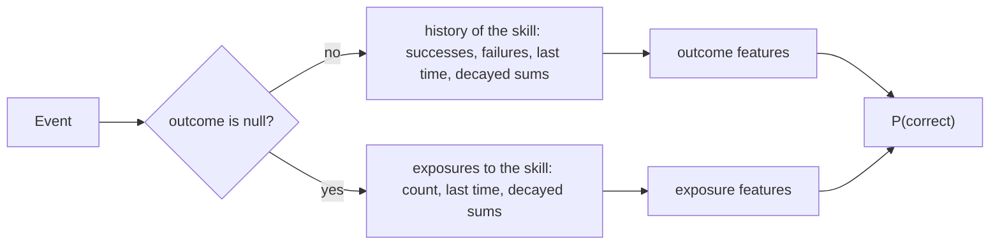

# Logistic models

`@measurekit/knowledge-tracing/logistic` fits logistic learner models: the additive factors model (AFM),
performance factors analysis (PFA) and models of the features of logistic knowledge tracing (LKT), with the exposure
features of instructional factors analysis. Learner proficiency is absent, a fixed effect per learner, or a random
intercept. Fits are validated against `glm`, `lme4::glmer` and LiblineaR, and the features against the LKT
package ([validation](validation.md#logistic-models)).



## The models

logit P(correct) = θ + Σ over the attempt's skills k of (β_k + Σ_f w_kf x_kf),

with θ the learner's proficiency, β_k the skill's intercept, and x_kf the features of the learner's history with skill
k before the attempt, each with a coefficient w_kf per skill. The skills' terms add up, as AFM, PFA and LKT define them:
an item of two skills gets both skills' intercepts and features.

| Factory             | Model                                                          | Features                | Default proficiency |
| ------------------- | -------------------------------------------------------------- | ----------------------- | ------------------- |
| `afm(options)`      | AFM (Cen, Koedinger and Junker, 2006): β_k + γ_k T_k           | `opportunities`         | `"fixed"`           |
| `pfa(options)`      | PFA (Pavlik, Cen and Koedinger, 2009): β_k + γ_k s_k + ρ_k f_k | `successes`, `failures` | `"none"`            |
| `logistic(options)` | Any of the features below                                      | `features`              | `"none"`            |

## Features

Each feature is computed before an attempt from the learner's earlier attempts at the skill: n attempts, s the sum of
their outcomes, f the sum of 1 - outcome. The decayed features weigh each attempt d times the next, so the most recent
counts fully; their prior is one success and one failure, decayed over every attempt.

| Feature                           | Value                                                                           | LKT                   |
| --------------------------------- | ------------------------------------------------------------------------------- | --------------------- |
| `"opportunities"`                 | n                                                                               | `lineafm`             |
| `"successes"`, `"failures"`       | s, f                                                                            | `linesuc`, `linefail` |
| `"logOpportunities"`              | ln(1 + n)                                                                       | `logafm`              |
| `"logSuccesses"`, `"logFailures"` | ln(1 + s), ln(1 + f)                                                            | `logsuc`, `logfail`   |
| `{ decayedOpportunities: d }`     | Σ dᵃ over the attempts, a the number of later attempts                          | `expdecafm`           |
| `{ decayedSuccesses: d }`         | S = Σ dᵃ y                                                                      | `expdecsuc`           |
| `{ decayedFailures: d }`          | F = Σ dᵃ (1 - y)                                                                | `expdecfail`          |
| `{ decayedProportion: d }`        | (dⁿ + S) / (dⁿ + S + dⁿ + F): 0.5 before any attempt                            | `propdec`             |
| `{ decayedLogit: d }`             | ln((dⁿ + S) / (dⁿ + F)): 0 before any attempt                                   | `logitdec`            |
| `{ recency: e }`                  | Δt⁻ᵉ, Δt the time since the last attempt; 0 at the first attempt and for Δt = 0 | `recency`             |

The exposure features read the events without an outcome at the skill, such as lessons, which instructional factors
analysis (Chi et al., 2011) counts apart from practice. They are 0 before any exposure.

| Feature                   | Value                                                                    |
| ------------------------- | ------------------------------------------------------------------------ |
| `"exposures"`             | m, the number of events without an outcome at the skill                  |
| `{ decayedExposures: d }` | Σ dᵃ over the exposures, a the number of later exposures                 |
| `{ recencyExposure: e }`  | Δt⁻ᵉ, Δt the time since the latest exposure; 0 before one and for Δt = 0 |

LKT's `recencytest` and `recencystudy` switch on the previous row and are not reproduced.

A decay d is above 0 and at most 1; an exponent e is at least 0. Decays and exponents are given, not estimated: compare
candidates by [cross-validation](evaluate.md#model-comparison). The time unit only rescales a recency coefficient.
LKT's `logitdec` looks at a learner's last 61 attempts at a skill; `decayedLogit` at all of them, the earlier
ones weighing d⁶¹ times less.

## Events without an outcome

- **History.** The history of outcomes, the state's `skills`, is as it would be without these events: removing them
  leaves every outcome feature as it was, so a skill first met through a lesson has no outcome history and its
  `recency` is 0.
- **Exposures.** A model with an exposure feature records each such event in the state's `exposures`, by skill, with the
  count, the time of the latest and the decayed sums of its features; the field is absent until the first. A model
  without an exposure feature leaves its states as they were.
- **Fitting.** The rows of the design are the events with an outcome, and `aic` and `bic` count them. A skill met only
  through events without an outcome has no coefficients, and `predict` for it throws `DataError`.
- **Order.** An attempt earlier than the learner's latest exposure to one of its skills throws `DataError`, as for an
  attempt at the skill.
- **Skills.** An event without an outcome and without skills changes nothing.

## Options

| Option          | Default  | Meaning                                                                       |
| --------------- | -------- | ----------------------------------------------------------------------------- |
| `features`      | none     | The features above; `afm` and `pfa` set them                                  |
| `proficiency`   | `"none"` | θ: `"none"`, `"fixed"` (a free θ per learner) or `"random"` (θ from N(0, σ²)) |
| `ridge`         | `0`      | λ of the penalty λ / 2 Σ b² over the coefficients and fixed proficiencies     |
| `tolerance`     | `1e-8`   | The largest absolute gradient component at which the fit has converged        |
| `maxIterations` | `100`    | The most iterations of the fit                                                |
| `parameters`    | none     | The parameters to predict with                                                |

## Proficiency

- **Fixed.** θ is a free parameter per learner, estimated with the rest. Learners connect through the skills they share.
  In each set of connected learners whose events all have the same number m of skills, as one each, raising every θ by c
  and lowering every intercept of the set's skills by c / m changes no prediction; `fit` reports each set's θ with mean
  0, and `aic` and `bic` count one parameter less per set. θ of learners in different sets, as two cohorts with no skill
  in common, are not comparable. A learner whose outcomes are all correct or all wrong has no finite θ: the fit stops
  where the gradient reaches the tolerance, with a large θ. A ridge or a random intercept keeps it finite.
- **Random.** θ ~ N(0, σ²), with σ estimated by maximizing the Laplace approximation of the marginal likelihood over
  the coefficients and σ, as `lme4::glmer(nAGQ = 1)` does; each learner's θ is their conditional mode.
  `parameters.learnerSd` is σ.
- **Learners absent from the fit** have the mean θ of the fitted learners with fixed proficiency, 0 when every event has
  one skill, and 0, the population mean, with a random intercept. Their θ is not updated online.

## Ridge

`ridge: λ` minimizes -ln L + λ / 2 Σ b² over the coefficients and fixed proficiencies. LKT fits with LiblineaR, which
minimizes ½ Σ b² + C × (-ln L): the same estimates as λ = 1 / C, `ridge: 1 / 512` for LKT's default cost. With a ridge,
`aic` and `bic` are `null`, as the penalized estimates have fewer degrees of freedom than k counts.

## Fitting

`fit(log)` builds one row per event and fits it by Newton's method (iteratively reweighted least squares), from 0. With
proficiency, the Hessian is an arrow: diagonal in the learners, with a dense block of the skills' coefficients. Each
step solves it by the Schur complement of the learners' block, so time and memory grow linearly with learners and
events, and as the cube of the coefficients. A random intercept starts from the penalized fit at σ = 1, then takes
quasi-Newton steps on the Laplace approximation with its exact gradient. Where features are linear combinations of
others, as successes and failures with opportunities, the Schur complement is singular; a step then adds a small
multiple of the identity to it, so the fit converges to the likelihood without them, though their coefficients are not
determined, and `aic` and `bic` count every column.

```ts
import { createRandom } from "@measurekit/knowledge-tracing";
import { eventLog } from "@measurekit/knowledge-tracing/data";
import { afm } from "@measurekit/knowledge-tracing/logistic";

const random = createRandom(1);
const events = Array.from({ length: 30 }, (_, learner) =>
  Array.from({ length: 8 }, (_, attempt) => ({
    learner: `l${learner}`,
    item: `q${1 + (attempt % 4)}`,
    time: learner * 10 + attempt,
    outcome: random.uniform() < 0.3 + 0.08 * attempt ? 1 : 0,
  })),
).flat();
const qMatrix = { q1: ["fractions"], q2: ["fractions"], q3: ["decimals"], q4: ["decimals"] };
const log = eventLog(events, { qMatrix });
const fit = afm({ proficiency: "random" }).fit(log);
fit.model.parameters; // { skills: { fractions: { intercept, coefficients: { opportunities } }, decimals }, learners, learnerSd }
```

| Fit field                 | Meaning                                                                                           |
| ------------------------- | ------------------------------------------------------------------------------------------------- |
| `logLikelihood`           | Σ y ln p + (1 - y) ln(1 - p) at the estimates; with a random intercept, the Laplace approximation |
| `aic`, `bic`              | k: the coefficients, plus the learners less one when their mean is fixed at 0, or plus σ          |
| `converged`, `iterations` | Whether the gradient reached the tolerance, and the Newton or quasi-Newton iterations             |

The log-likelihood without random intercepts is concave, so the estimates do not depend on a start. The parameters of
a fit cover the skills and learners of the log. A feature that is 0 on every event keeps the coefficient 0. On 1M events
of 50,000 learners and 200 skills, AFM fits in about 5 s with fixed proficiency or a random intercept
([storage](storage.md#memory-and-time)).

## Online

```ts
import { logistic } from "@measurekit/knowledge-tracing/logistic";

const model = logistic({
  features: ["opportunities", { recency: 0.5 }],
  proficiency: "fixed",
  parameters: {
    skills: { fractions: { intercept: -0.4, coefficients: { opportunities: 0.15, "recency(0.5)": 0.8 } } },
    learners: { ana: 0.6, budi: -0.2 },
  },
});
const attempt = { learner: "ana", item: "q1", skills: ["fractions"], time: 100 };
const ana = model.update(model.initialState("ana"), { ...attempt, outcome: 1 });
model.predict(ana, { ...attempt, item: "q2", time: 104 }); // 0.68: θ 0.6, -0.4 + 0.15 × 1 + 0.8 × 4^-0.5
```

The state holds each skill's history: `successes`, `failures`, `last`, the time of the last attempt, and `decayed`, the
decayed successes and failures of each decay the features use. It is plain data; the model checks it, and that it has
the decayed counts of the model's decays. An attempt or event earlier than the learner's last attempt at one of its
skills throws `DataError`, as the time since it would be negative. Coefficients are keyed by the feature's label: its
name, with its parameter in parentheses. A skill without coefficients throws `DataError`. Every event needs at least one
skill; outcomes from 0 to 1 count as partial credit.

## References

- Cen, H., Koedinger, K., & Junker, B. (2006). Learning factors analysis: A general method for cognitive model
  evaluation and improvement. In Intelligent Tutoring Systems (ITS 2006).
- Chi, M., Koedinger, K. R., Gordon, G. J., Jordan, P., & VanLehn, K. (2011). Instructional factors analysis: A
  cognitive model for multiple instructional interventions. In Proceedings of the 4th International Conference on
  Educational Data Mining.
- Pavlik, P. I., Cen, H., & Koedinger, K. R. (2009). Performance factors analysis: A new alternative to knowledge
  tracing. In Artificial Intelligence in Education (AIED 2009).
- Pavlik, P. I., Eglington, L. G., & Harrell-Williams, L. M. (2021). Logistic knowledge tracing: A constrained
  framework for learner modeling. IEEE Transactions on Learning Technologies, 14(5), 624-639.
