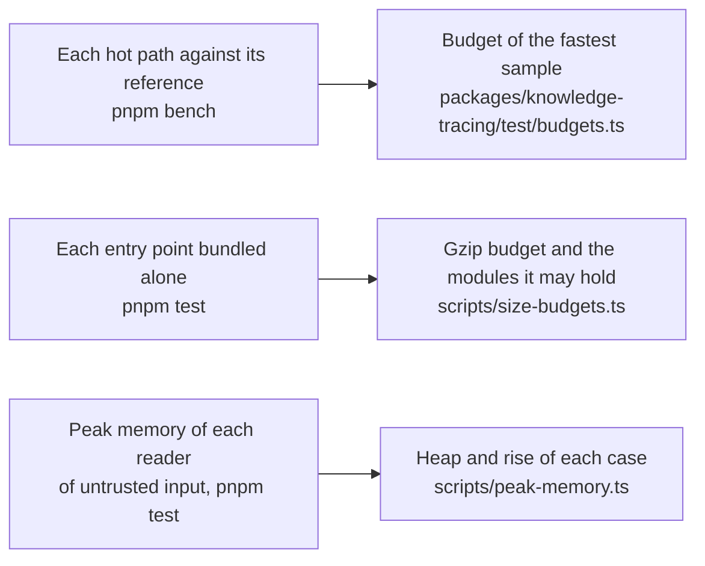
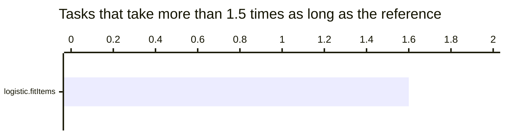
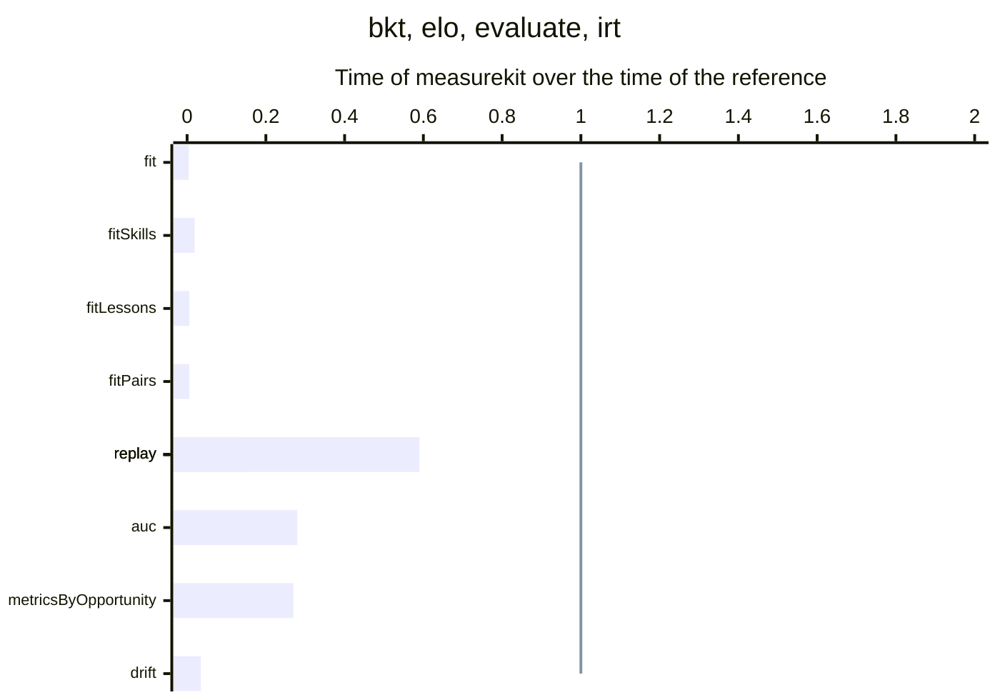
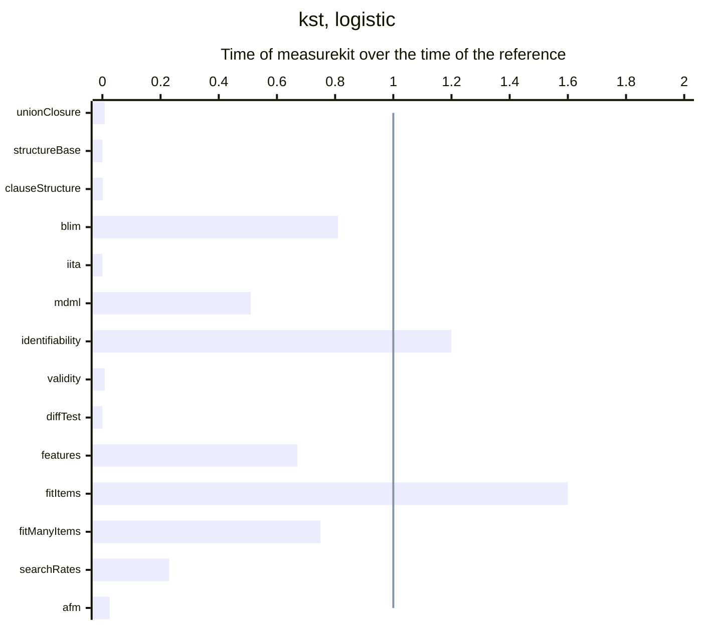

# Performance of knowledge-tracing

What the hot paths of `@measurekit/knowledge-tracing` cost against their references, how much each entry point adds to a
bundle, and the memory that each reader of untrusted input needs on its worst input. A budget holds each number and
fails a gate of CI: `pnpm bench` for the time, `pnpm test` for the size and the memory.

## Speed

Each benchmark times the hot path of each module against pyBKT, or the R package that its [validation](validation.md)
uses, on the same data, with one thread. The ratio is the time of measurekit over the time of the reference: above 1,
measurekit is slower, and above 1.5 the row is in bold. A benchmark fails `pnpm bench` when its fastest sample is above
its budget in `packages/knowledge-tracing/test/budgets.ts`: five times the fastest sample of the CI runner, rounded up
to one significant digit, as STANDARDS.md section 11 sets every budget. How each side is timed, how the budgets were
measured and how to refresh this page are in [validation](../../validation/README.md#benchmarks).

<!-- charts -->

### Where measurekit is slower

A bar above the line takes longer than the reference.

### Every task

<!-- /charts -->

### Results

<!-- tables -->

Measured on Apple M5 with 10 cores, 16 GB of memory, Node.js 26.8.1 and R version 4.6.1 (2026-06-24).

| Task                                                                                                                                  | Size                                             | measurekit (ms) | Reference                                 | Reference (ms) |     Ratio |
| ------------------------------------------------------------------------------------------------------------------------------------- | ------------------------------------------------ | --------------: | ----------------------------------------- | -------------: | --------: |
| Fit of the skills of a log by EM from five starts                                                                                     | 20,000 attempts of 200 learners at 5 skills      |            64.0 | pyBKT 1.4.3 `Model.fit`                   |         15,248 |   0.0042× |
| Fit of the skills of a log by EM from five starts, each learner at 20 of many skills                                                  | 20,000 attempts of 500 learners at 400 skills    |             433 | pyBKT 1.4.3 `Model.fit`                   |         22,659 |    0.019× |
| Fit of the skills of a log by EM from five starts, a fifth of its attempts without an outcome                                         | 20,000 attempts of 200 learners at 5 skills      |             104 | pyBKT 1.4.3 `Model.fit`, correct = -1     |         18,297 |   0.0057× |
| Fit of the skills of a log by EM from five starts, learn and forget rates by pair of items                                            | 20,000 attempts of 200 learners at 5 skills      |             147 | pyBKT 1.4.3 `Model.fit(multipair = True)` |         26,031 |   0.0056× |
| Replay of the log through the fitted model, a prediction and an update for each attempt                                               | 20,000 attempts of 200 learners at 5 skills      |            11.7 | pyBKT 1.4.3 `Model.predict`               |            491 |    0.024× |
| Replay of a log through the learner-item Elo model                                                                                    | 100,000 attempts of 2,000 learners at 400 items  |            17.9 | base R, a loop over the attempts          |           30.5 |     0.59× |
| The area under the ROC curve                                                                                                          | 100,000 predictions                              |            9.09 | pROC 1.19.1 `auc(roc(direction = "<"))`   |           32.0 |     0.28× |
| The AUC, RMSE, log-loss and accuracy of the predictions                                                                               | 100,000 predictions                              |            13.9 | none                                      |                |           |
| The metrics of predictions by opportunity, over all skills and for each skill                                                         | 50,000 events of 2,000 learners at 5 skills      |            17.9 | pROC 1.19.1 `auc(roc(direction = "<"))`   |           66.0 |     0.27× |
| Replay of the responses of learners, the grid posterior of the ability updated after each                                             | 2,000 learners, 40 responses each                |             272 | mirt 1.48 `fscores(method = "EAP")`       |          1,777 |     0.15× |
| Replay of the responses of learners, the posterior advanced by drift and updated after each                                           | 200 learners, 40 responses each, 241 points      |             199 | base R, the forward pass in logs          |          5,642 |    0.035× |
| Closure under union of the 12 atoms of a space                                                                                        | 12 elements, 125 states                          |           0.090 | kst 0.5.6 `kspace`                        |           11.6 |   0.0078× |
| Base of a space                                                                                                                       | 12 elements, 125 states                          |           0.059 | kst 0.5.6 `kbase`                         |          1,614 | 0.000037× |
| Space of clauses, by enumeration of the subsets in base R                                                                             | 12 elements, 4096 subsets                        |           0.369 | base R `expand.grid` and `apply`          |            338 |   0.0011× |
| Quasi-ordinal space of a cycle of prerequisites, each element requiring the next                                                      | 1,000 elements                                   |            10.4 | none                                      |                |           |
| Fit of the basic local independence model of a chain of 12 items by EM                                                                | 1,000 persons, 12 items, 13 states               |            20.6 | pks 0.8.0 `blim`                          |           25.5 |     0.81× |
| Inductive item tree analysis of the responses                                                                                         | 1,000 persons, 12 items                          |            1.13 | DAKS 2.1.3 `iita(v = 1)`                  |         73,057 | 0.000015× |
| Fit of the basic local independence model of a chain of 12 items by minimum discrepancy maximum likelihood                            | 1,000 persons, 12 items, 13 states               |            58.4 | pks 0.8.0 `blim(method = "MDML")`         |            115 |     0.51× |
| Rank of the Jacobian of the pattern probabilities of the model of a chain of 12 items                                                 | 12 items, 13 states, 36 parameters               |            12.7 | pks 0.8.0 `jacobian` and `qr`             |           10.8 |      1.2× |
| Validity of the chain against the responses: gamma, violational coefficient, solution rates, discrepancy index and distance agreement | 1,000 persons, 12 items, 13 states               |            1.09 | kst 0.5.6 `kvalidate`                     |            136 |    0.008× |
| Test of the fit of the chain of 6 items to the responses                                                                              | 1,000 persons, 6 items                           |           0.481 | DAKS 2.1.3 `z_test(v = 1)`                |          1,850 |  0.00026× |
| Test of one edge of the chain of 12 items, on responses with 3 in 10 missing                                                          | 1,000 persons, 12 items                          |            1.55 | none                                      |                |           |
| The 16 features of LKT's other names, before each event                                                                               | 1,941 events of 17 learners, 16 features         |            38.5 | LKT 1.7.0 `computefeatures`               |           57.0 |     0.67× |
| **Fit with an intercept for each skill and item, a proficiency for each learner and a ridge of 1**                                    | 20,000 events of 200 learners at 1,000 items     |            38.9 | LiblineaR 2.10.26 `LiblineaR(type = 0)`   |           24.5 |  **1.6×** |
| Fit with an intercept for each skill and item, a proficiency for each learner and a ridge of 1                                        | 150,000 events of 3,000 learners at 49,546 items |             286 | LiblineaR 2.10.26 `LiblineaR(type = 0)`   |            381 |     0.75× |
| Search for the decay of a proportion of successes and the exponent of a recency                                                       | 3,600 events of 60 learners at 4 skills, 2 rates |             149 | LKT 1.7.0 `LKT(seedpars = c(0.5, 0.5))`   |            643 |     0.23× |
| Fit of the additive factors model by maximum likelihood                                                                               | 20,000 attempts of 200 learners at 5 skills      |            10.7 | base R `glm`, binomial family             |            426 |    0.025× |
| The candidates ranked by their distance to the band of success of a learner                                                           | 500 candidate items, an Elo model                |           0.044 | none                                      |                |           |
| A log built from and checked for events                                                                                               | 100,000 events                                   |            14.3 | none                                      |                |           |

- Fit of the skills of a log by EM from five starts, each learner at 20 of many skills: pyBKT stops a start when the log-likelihood changes by at most 0.005, or after 100 iterations, and measurekit at 1e-6 or 500, so measurekit runs more iterations: a median of 38 for a skill's best start, and 4 of the 400 skills reach 500.
- Replay of the responses of learners, the grid posterior of the ability updated after each: mirt scores each of the 40 prefixes of the responses from the first; measurekit updates the posterior by the one response and predicts it. A scoring of the final patterns alone takes a fortieth of the time.
- Space of clauses, by enumeration of the subsets in base R: no package takes clauses.
- Fit of the basic local independence model of a chain of 12 items by minimum discrepancy maximum likelihood: pks and measurekit both stop within 1e-9 of the maximum: pks when no parameter changes by more than 1e-8, after 330 iterations, and measurekit when the log-likelihood changes by at most 1e-8, after 331. At pks's tolerance of 1e-4 it stops after 41 iterations, 2.5e-3 from the maximum.
- Rank of the Jacobian of the pattern probabilities of the model of a chain of 12 items: pks's `jacobian` takes 10 ms and `qr` 1 ms, measurekit's Jacobian 5 ms and its rank 10 ms: the rank orthogonalizes each column twice by Gram-Schmidt in JavaScript, where `qr` runs Householder reflections in compiled Fortran.
- The 16 features of LKT's other names, before each event: measurekit replays the log once with every feature in one model.
- Fit with an intercept for each skill and item, a proficiency for each learner and a ridge of 1: the time of the reference includes the features and the design from the events, as measurekit's does; both stop at the gradient that LiblineaR reaches at epsilon 0.0001 (0.0074 at 1,000 items, 0.22 at 50,000), where measurekit takes 1.6 and 0.75 times as long: its solver is JavaScript, each Hessian-vector product taking 3.5 times as long as the same loop in C, and its features and design take 0.7 and 0.4 times as long as the reference's; at its default gradient of 1e-8 it takes 1.7 times as long as at these.
- Search for the decay of a proportion of successes and the exponent of a recency: each fit of the search is one of LiblineaR in LKT and one of Newton's method in measurekit.
- Fit of the additive factors model by maximum likelihood: the proficiency of a learner is a fixed effect, as measurekit's default is none.

<!-- /tables -->

## Size

Each entry point bundled alone, as a host's bundler makes it: minified with esbuild and code splitting on, `export *` of
the entry, core from its sources. The bytes and the modules are those of the entry chunk and the chunks it imports
statically, which load with it; a module that a dynamic `import()` loads later is a chunk of its own and is not counted.
The modules each holds are those the import rules of [AGENTS.md](../../AGENTS.md#dependencies) allow it. Every package
declares `sideEffects: false`, so a named import from the root of the library holds only what that name needs, such as
`bkt` from `@measurekit/knowledge-tracing`.

| Entry point                              | Minified (bytes) | Gzip (bytes) | Modules it holds besides its own      |
| ---------------------------------------- | ---------------: | -----------: | ------------------------------------- |
| `@measurekit/knowledge-tracing`          |          145,441 |       49,337 | every module of the package, and core |
| `@measurekit/knowledge-tracing/bkt`      |           25,716 |        9,163 | core, data, math                      |
| `@measurekit/knowledge-tracing/data`     |            6,177 |        2,414 | core, math                            |
| `@measurekit/knowledge-tracing/elo`      |            7,175 |        2,507 | core, data, math                      |
| `@measurekit/knowledge-tracing/evaluate` |           17,666 |        6,481 | core, data, math, model               |
| `@measurekit/knowledge-tracing/irt`      |           14,517 |        5,652 | core, data, math                      |
| `@measurekit/knowledge-tracing/kst`      |           47,128 |       16,705 | core, data, math                      |
| `@measurekit/knowledge-tracing/logistic` |           50,060 |       16,496 | core, data, math, model               |
| `@measurekit/knowledge-tracing/practice` |            6,689 |        2,501 | core, data, model                     |
| `@measurekit/knowledge-tracing/sim`      |            4,834 |        1,820 | core, data, model                     |

`scripts/test/entry-sizes.test.ts`, which `pnpm test --project scripts` runs without a build, bundles each entry point
and fails when it takes more than its budget after gzip, or holds a module that its budget in `scripts/size-budgets.ts`
does not list. A budget is 1.25 times the size measured after gzip, rounded up to the next 500 bytes. `node
scripts/entry-sizes.ts` prints the sizes; the table gives them on Node.js 22, the version of the runner, and the gzip of
Node.js 26 is up to 1.2 percent less.

## Memory

What each reader of untrusted input adds to the peak resident memory of a Node.js process, on its worst inputs within
the limits of [SECURITY.md](../../SECURITY.md): the peak of a process that parses the input from JSON and reads it, less
the peak of the same process that parses it and does not, the median of three pairs run one after the other. Each reader
grows in proportion to its input, but for the analyses of the relations between the elements of a knowledge structure,
whose limits bound them.

| Reader                       | Input                                                          | JSON (MB) | Peak added (MB) |
| ---------------------------- | -------------------------------------------------------------- | --------- | --------------- |
| `buildEventLog`              | 1,000,000 events of 1,000 learners and 1,000 items             | 72        | 79              |
| `buildEventLog`              | 1,000,000 events, each of its own learner, item and skill      | 82        | 171             |
| `bkt` with stored parameters | 100,000 skills                                                 | 6.6       | 56              |
| `kst` with a structure       | 10,000 states of 64 items                                      | 1.9       | 1               |
| `iita`                       | 1,000,000 events, each of its own learner and item             | 77        | 270             |
| `iita`                       | 1,000 items, 276 learners: 24 candidates of 23.9 million cells | 19        | 259             |
| `diffTest`                   | 1,000 items, 200 learners                                      | 14        | 38              |
| `structureValidity`          | 1,000 items, 200 learners, a chain                             | 14        | 42              |
| `surmiseStructure`           | 1,000 elements, 12 free and a class of 988: 8,192 states       | 0.02      | 138             |
| `kst`, its masks             | 4,096 sets of 16 skills, 65,536 states                         | 0.33      | 173             |

A log takes at most about twice the bytes of its JSON, and stored BKT parameters about 9 times. The analyses of
knowledge structures take up to about 260 MB within their limits: IITA's candidates from 19 MB of responses, and the
masks of a model from a few hundred kilobytes of sets of skills.

`scripts/test/peak-memory.test.ts`, which `pnpm test --project scripts` runs without a build, measures the readers of
`scripts/peak-memory.ts`, the worst rows of the tables of each library, from the sources, each in a pair of child
processes whose heap is bounded, as STANDARDS.md section 7 asks: twice the least heap in which the reading ended on
Node.js 22, 24 and 26, rounded up to 16 MiB, so that a reading that keeps more alive at once fails, whenever the
collector runs and however busy the machine is. The test fails too when a reading adds more than its budget to the peak:
twice the largest rise measured on Node.js 22 and 24, on macOS and on Linux, rounded up to 10 MB, which bounds what the
heap does not hold, the buffers of typed arrays. `node scripts/peak-memory.ts` prints the rises, the median of three
pairs, with a heap of 8 GiB, as a host's process collects later than a bounded one, and `node scripts/peak-memory.ts
--heap` the least heap of each reading.
