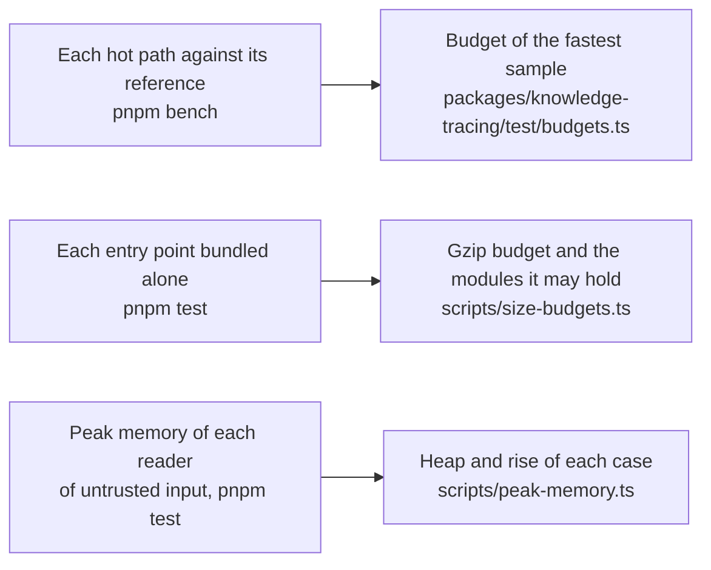

# Performance of knowledge-tracing

How the speed of the hot paths of `@measurekit/knowledge-tracing` is guarded against their references, how much each
entry point adds to a bundle, and the memory that each reader of untrusted input needs on its worst input.

## Speed

Each hot path of each module has a benchmark in `packages/knowledge-tracing/test/*.bench.ts` that times it against pyBKT, or
the R package that its [validation](validation.md) uses, on the same data, and the `bench` job of CI holds each one to a
budget in `packages/knowledge-tracing/test/budgets.ts`. The docs publish no measured time: it differs on every machine and
goes stale with each change. How each side is timed, how the budgets are set and how a user times the references on their
machine are in the [method](../../validation/README.md#benchmarks).

## Size

Each entry point bundled alone with esbuild ([method](../../validation/README.md#sizes-and-peak-memory)). Every package
declares `sideEffects: false`, so a named import holds only what that name needs.

| Entry point                              | Minified (bytes) | Gzip (bytes) | Modules it holds besides its own |
| ---------------------------------------- | ---------------: | -----------: | -------------------------------- |
| `@measurekit/knowledge-tracing`          |            2,572 |        1,355 | core                             |
| `@measurekit/knowledge-tracing/bkt`      |           26,192 |        9,325 | core, data, math                 |
| `@measurekit/knowledge-tracing/data`     |            6,343 |        2,465 | core                             |
| `@measurekit/knowledge-tracing/elo`      |            7,269 |        2,541 | core, data, math                 |
| `@measurekit/knowledge-tracing/evaluate` |           18,103 |        6,611 | core, data, math, model          |
| `@measurekit/knowledge-tracing/irt`      |           15,658 |        5,986 | core, data, math                 |
| `@measurekit/knowledge-tracing/kst`      |           48,903 |       17,672 | core, data, math                 |
| `@measurekit/knowledge-tracing/logistic` |           50,319 |       16,571 | core, data, math, model          |
| `@measurekit/knowledge-tracing/practice` |            6,712 |        2,482 | core, data, model                |
| `@measurekit/knowledge-tracing/sim`      |            5,046 |        1,879 | core, data, model                |

## Memory

What each reader of untrusted input adds to the peak resident memory of a Node.js process, on its worst inputs within
the limits of [SECURITY.md](../../SECURITY.md) ([method](../../validation/README.md#sizes-and-peak-memory)). Each reader
grows in proportion to its input, but for the analyses of the relations between the elements of a knowledge structure,
whose limits bound them.

| Reader                       | Input                                                                | JSON (MB) | Peak added (MB) |
| ---------------------------- | -------------------------------------------------------------------- | --------- | --------------- |
| `buildEventLog`              | 1,000,000 events of 1,000 learners and 1,000 items                   | 67        | 76              |
| `buildEventLog`              | 1,000,000 events, each of its own learner, item and skill            | 82        | 12              |
| `bkt` with stored parameters | 100,000 skills                                                       | 6.6       | 22              |
| `kst` with a structure       | 10,000 states of 64 items                                            | 1.8       | 1               |
| `iita`                       | 1,000,000 events, each of its own learner and item, which it refuses | 73        | 100             |
| `iita`                       | 1,000 items, 276 learners: 24 candidates of 23.9 million cells       | 18        | 237             |
| `diffTest`                   | 1,000 items, 200 learners, a chain, from their log                   | 13        | 26              |
| `structureValidity`          | 1,000 items, 200 learners, a chain, from their log and structure     | 13        | 4               |
| `surmiseStructure`           | 1,000 elements, 12 free and a class of 988: 8,192 states             | 0.02      | 101             |
| `kst`, its masks             | 4,096 sets of 16 skills, 65,536 states                               | 0.33      | 240             |

A log takes at most about 1.2 times the bytes of its JSON, and stored BKT parameters about 3 times. The analyses of
knowledge structures take up to about 240 MB within their limits: IITA's candidates from 18 MB of responses, and the
masks of a model from a few hundred kilobytes of sets of skills.
