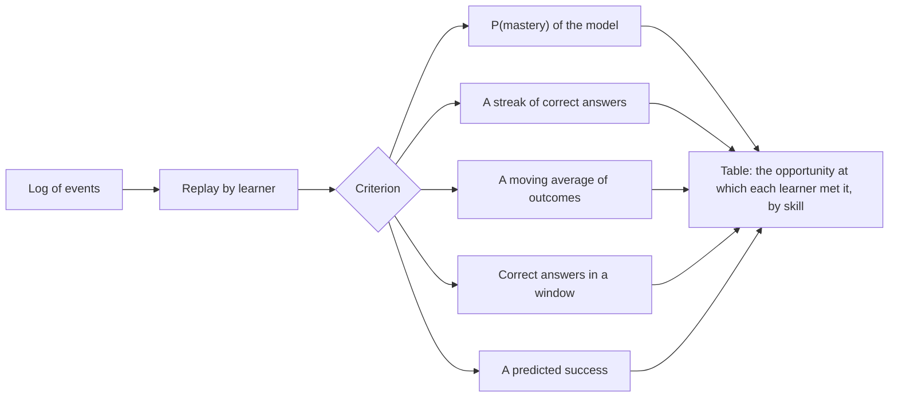

# Practice

`@measurekit/knowledge-tracing/practice` chooses what a learner practices next and decides when a skill is mastered.
It works with any model through the `LearnerModel` interface, including models written outside the package.

## Next item

`recommend(model, state, candidates, { band })` predicts each candidate attempt and ranks them: those predicted inside
the band first, nearest its middle first, then the others, nearest the band first. Ties keep the candidates' order.

```ts
import { elo } from "@measurekit/knowledge-tracing/elo";
import { recommend } from "@measurekit/knowledge-tracing/practice";

const model = elo({
  parameters: {
    items: {
      q1: { difficulty: -2.5, count: 40 },
      q2: { difficulty: -1.1, count: 40 },
      q3: { difficulty: 0.3, count: 40 },
    },
  },
});
const ana = model.initialState("ana");
const candidates = ["q1", "q2", "q3"].map((item) => ({ learner: "ana", item, skills: [], time: 1 }));
recommend(model, ana, candidates);
// [{ attempt: q2, prediction: 0.750 }, { attempt: q1, prediction: 0.924 }, { attempt: q3, prediction: 0.426 }]
```

| Option | Default        | Meaning                                  |
| ------ | -------------- | ---------------------------------------- |
| `band` | `[0.65, 0.85]` | The band of predicted success to aim for |

The default's middle, 0.75, is the success rate that adaptive practice of facts targets (Papoušek, Pelánek and
Stanislav, 2014), and its upper end the 85% accuracy at which learning is fastest in Wilson et al.'s (2019) analysis.
Filter the candidates before ranking: to the skills not yet mastered, to items not seen today, or to the outer fringe of
a learner's knowledge state ([KST](kst.md#online-and-adaptive-assessment)). A prediction is the expected outcome, so a
polytomous item ranks by its expected score.

## Mastery



| Criterion                                     | Online                                                       | Over a log                                        |
| --------------------------------------------- | ------------------------------------------------------------ | ------------------------------------------------- |
| P(mastery) ≥ threshold, default `0.95`        | `model.mastery(state, skill) >= 0.95`                        | `thresholdMastery(model, log, { threshold })`     |
| `length` correct in a row, default `3`        | keep a run per skill: `outcome === 1 ? run + 1 : 0`          | `streakMastery(log, { length })`                  |
| Moving average m ≥ threshold                  | `m = decay * m + (1 - decay) * outcome`, from 0              | `movingAverageMastery(log, { decay, threshold })` |
| `correct` of the last `window` outcomes are 1 | keep the last `window` outcomes per skill                    | `windowMastery(log, { correct, window })`         |
| Predicted success ≥ threshold                 | `model.predict(state, attempt) >= threshold` after the event | `predictedMastery(model, log, { threshold })`     |

| Criterion              | Needs                                                      | Options                                                                                   |
| ---------------------- | ---------------------------------------------------------- | ----------------------------------------------------------------------------------------- |
| `thresholdMastery`     | A model that defines mastery                               | `threshold`, default `0.95`                                                               |
| `streakMastery`        | Nothing                                                    | `length`, default `3`                                                                     |
| `movingAverageMastery` | Nothing                                                    | `decay` from 0 to 1 and `threshold` from 0 to 1, both required                            |
| `windowMastery`        | Nothing                                                    | `window`, a positive integer, and `correct`, an integer from 1 to `window`, both required |
| `predictedMastery`     | Any learner model; every event with an outcome has a skill | `threshold` from 0 to 1, required                                                         |

The threshold criterion needs a model that defines mastery, as [BKT](bkt.md#mastery) and [KST](kst.md#the-model); 0.95
is Corbett and Anderson's (1994). Three correct in a row is the rule of ASSISTments' skill builders. Only an outcome of
1 extends a run or counts in a window. The moving average takes an outcome as it is, so partial credit moves it by
part of the distance; Pelánek and Řihák (2017) recommend it, and its values depend on the domain, so a decay and a
threshold are required, as are those of the window. A window has the outcomes so far where there are fewer than
`window`, so a window of `k` correct in `k` is a streak of `k`.

`predictedMastery` serves models without a `mastery`, such as logistic models and Elo: after each event with an outcome
it asks the model for P(correct) of the same attempt, with its state updated by the outcome, and credits a prediction at
or above the threshold to each skill of the attempt. A threshold of 0.95 is out of reach for a model whose slip is above
0.05, so it does not mean what the threshold of `thresholdMastery` means, and is required. Every event with an outcome
needs a skill, as the table is by skill.

An event without an outcome, such as a lesson, is no opportunity. A streak, a moving average and a window are left as they
are by it, and the criteria that read a model test it only after events with an outcome, though the model is updated by the
lesson, so a lesson alone never records mastery.

Over a log, every criterion returns, for each learner and each skill they practiced, the opportunity after which it was
first met, 1 being the first attempt at the skill, or `null` if the log ends before:

```ts
import { bkt } from "@measurekit/knowledge-tracing/bkt";
import { eventLog } from "@measurekit/knowledge-tracing/data";
import { logistic } from "@measurekit/knowledge-tracing/logistic";
import {
  movingAverageMastery,
  predictedMastery,
  streakMastery,
  thresholdMastery,
  windowMastery,
} from "@measurekit/knowledge-tracing/practice";

const attempt = (learner: string, item: string, skill: string, time: number, outcome: number) => ({
  learner,
  item,
  skills: [skill],
  time,
  outcome,
});
const log = eventLog([
  attempt("ana", "f1", "fractions", 1, 0),
  attempt("ana", "f2", "fractions", 2, 1),
  attempt("ana", "f3", "fractions", 3, 1),
  attempt("ana", "d1", "decimals", 4, 0),
  attempt("ana", "f1", "fractions", 5, 1),
  attempt("budi", "d1", "decimals", 6, 1),
]);
const model = bkt({
  parameters: {
    skills: {
      fractions: { prior: 0.3, learn: 0.2, forget: 0, guess: 0.2, slip: 0.1 },
      decimals: { prior: 0.5, learn: 0.15, forget: 0, guess: 0.25, slip: 0.1 },
    },
  },
});
streakMastery(log); // { ana: { fractions: 4, decimals: null }, budi: { decimals: null } }
thresholdMastery(model, log); // { ana: { fractions: 4, decimals: null }, budi: { decimals: null } }
movingAverageMastery(log, { decay: 0.5, threshold: 0.75 }); // { ana: { fractions: 3, decimals: null }, budi: { decimals: null } }
windowMastery(log, { correct: 2, window: 3 }); // { ana: { fractions: 3, decimals: null }, budi: { decimals: null } }

// A logistic model has no mastery: the criterion is a predicted success of 0.7.
const performance = logistic({
  features: ["successes", "failures"],
  parameters: {
    skills: {
      fractions: { intercept: -0.5, coefficients: { successes: 0.5, failures: 0.1 } },
      decimals: { intercept: 0, coefficients: { successes: 0.5, failures: 0.1 } },
    },
  },
});
predictedMastery(performance, log, { threshold: 0.7 }); // { ana: { fractions: 4, decimals: null }, budi: { decimals: null } }
```

Comparing the opportunities of criteria on the same log shows how much practice each asks for (Pelánek and Řihák, 2017). `thresholdMastery` updates each learner from the model's initial state, with the model's parameters as given.

## Time to mastery

Where a closed form exists:

- BKT: `opportunitiesToMastery(state, skill, { threshold })`, the attempts after which P(L) is expected to reach the
  threshold ([BKT](bkt.md#mastery)).
- A run of correct answers: `opportunitiesToStreak(p, { length, run })`, the expected number of further attempts until
  `length` correct in a row from a current run, if each attempt is correct with probability p: (p⁻ⁿ - p⁻ʳ) / (1 - p).
  Defaults: `length` `3`, `run` `0`. It is `Infinity` at p = 0 and where the count exceeds the largest double. Take p
  from `model.predict`; a learner who improves needs fewer.

Elo, logistic models and IRT have none: their prediction after an attempt depends on its outcome.

## Spaced repetition

`recommend` and the mastery criteria decide what a learner practices and when it is mastered; a spaced
repetition scheduler, as [ts-fsrs](https://github.com/open-spaced-repetition/ts-fsrs), decides when to review what
was mastered. `@measurekit/knowledge-tracing` does not depend on it. Once a skill or fact is mastered, give it a
card and grade each review by its outcome:

```ts
import { DefaultScheduler, Rating } from "ts-fsrs"; // ts-fsrs 6, Node.js 24 or later

const scheduler = await DefaultScheduler({ desiredRetention: 0.9 });
let card = scheduler.newCard({ now: new Date() });
// At each review:
const grade = outcome === 1 ? Rating.Good : outcome > 0 ? Rating.Hard : Rating.Again;
card = scheduler.review({ card, grade, now: new Date() }).card; // card.dueAt: the next review
```

Store the card beside the learner's state; a failed review can send the skill back to practice.

## References

- Corbett, A. T., & Anderson, J. R. (1994). Knowledge tracing: Modeling the acquisition of procedural knowledge. User
  Modeling and User-Adapted Interaction, 4(4), 253-278.
- Heffernan, N. T., & Heffernan, C. L. (2014). The ASSISTments ecosystem. International Journal of Artificial
  Intelligence in Education, 24(4), 470-497.
- Papoušek, J., Pelánek, R., & Stanislav, V. (2014). Adaptive practice of facts in domains with varied prior knowledge.
  In Proceedings of the 7th International Conference on Educational Data Mining.
- Pelánek, R., & Řihák, J. (2017). Experimental analysis of mastery learning criteria. In Proceedings of the 25th
  Conference on User Modeling, Adaptation and Personalization.
- Wilson, R. C., Shenhav, A., Straccia, M., & Cohen, J. D. (2019). The eighty five percent rule for optimal learning.
  Nature Communications, 10, 4646.
