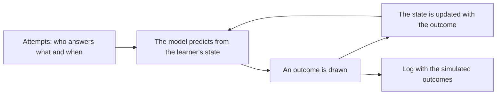

# Simulation

`@measurekit/knowledge-tracing/sim` draws outcomes from a learner model, seeded, to check what a fit recovers
before collecting data, to plan how many learners a fit needs, or to test an app with realistic logs.



`simulate(model, attempts, random)` takes the attempts, who answers what and when, and returns `{ log, states }`. In
time order, each attempt is correct with the probability the model predicts from the learner's state, and the state
is updated with the drawn outcome. Outcomes are 0 or 1.

An attempt with `observe: false` (default `true`), such as a lesson, draws nothing: the event has `outcome: null`, and
the model is updated with it, so a lesson can teach the simulated learner. Attempts may carry a `resource` for the
learn and forget rates of a lesson.

```ts
import { bkt } from "@measurekit/knowledge-tracing/bkt";
import { createRandom } from "@measurekit/knowledge-tracing";
import { simulate } from "@measurekit/knowledge-tracing/sim";

const truth = { fractions: { prior: 0.3, learn: 0.15, forget: 0, guess: 0.2, slip: 0.1 } };
const attempts = Array.from({ length: 500 }, (_, learner) =>
  Array.from({ length: 10 }, (_, k) => ({
    learner: `l${learner}`,
    item: `q${k}`,
    skills: ["fractions"],
    time: learner * 10 + k,
  })),
).flat();
const { log } = simulate(bkt({ parameters: { skills: truth } }), attempts, createRandom(42));
bkt().fit(log).model.parameters.skills.fractions;
// { prior: 0.253, learn: 0.146, forget: 0, guess: 0.203, slip: 0.094 }
```

For BKT, logistic models, IRT and KST, the prediction is the probability of a correct answer given the learner's
earlier outcomes, so `simulate` draws from the model itself, the latent knowledge along with the outcomes. A known
truth for each learner is part of the model:

| Learners                     | Model                                                                                      |
| ---------------------------- | ------------------------------------------------------------------------------------------ |
| BKT with given rates         | `bkt({ parameters })`                                                                      |
| AFM or PFA with known θ      | `afm({ parameters: { skills, learners } })`, θ by learner                                  |
| Rasch learners, for Elo      | `logistic({ proficiency: "fixed", parameters })` with one skill per item, its intercept -d |
| A known IRT ability θ        | `irt({ parameters, prior: { mean: θ, sd: 1e-3 } })`, one model per learner                 |
| A population of IRT learners | `irt({ parameters, prior })`: θ is drawn from the prior                                    |
| A known knowledge state      | `kst({ structure, parameters })` with π 1 at that state                                    |
| A population of KST learners | `kst({ structure, parameters })`: the state is drawn from π                                |

Elo is an estimator, not a model of how answers arise: simulating from Elo follows its own updates. A prediction of a
polytomous IRT item is its expected score, so simulate such items with their category probabilities instead.
[Validation](validation.md#simulation-recovery) lists what each family recovers from simulated learners.

## Errors

Invalid input throws `DataError` naming the value found.

| Error                                                    | What to do                                                                |
| -------------------------------------------------------- | ------------------------------------------------------------------------- |
| The model is not a learner model                         | Pass a model made by `elo`, `bkt`, `logistic`, `irt` or `kst`             |
| The attempts are not a non-empty array of attempts       | Give at least one attempt, with a learner, an item, skills and a time     |
| The model rejects an attempt, or predicts outside 0 to 1 | Give attempts the model can predict, for example with the skills it knows |
