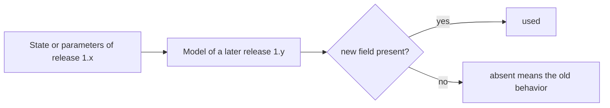

# Storing learner states

How an app backed by a database uses `@measurekit/knowledge-tracing`: what it stores, what an answer reads and
writes, how it refits models, and how much memory a fit takes.

## What to store

| Data             | Form                                                                                                                                                                                          | Written                          |
| ---------------- | --------------------------------------------------------------------------------------------------------------------------------------------------------------------------------------------- | -------------------------------- |
| Learner states   | One JSON value per learner and model: tens of bytes per skill; for IRT about 3.5 KB, whatever the number of answers; for KST about 22 bytes per knowledge state                               | At every answer                  |
| Model parameters | JSON: Elo's item ratings and IRT's items one row per item; BKT's and logistic models' one row per skill, and a logistic model's θ one per learner; KST's structure and π, with a row per item | At every refit; Elo items online |
| Events           | An append-only log: learner, item, skills, time, outcome (`null` for a learning opportunity), resource, hints, duration, attempt number                                                       | At every answer                  |

States and parameters are plain data, which model methods check when they read them, so they need no schema beyond
JSON. The event log is the record of what happened; models are fitted from it and can always be rebuilt from it.

## Stored states across versions

A state or parameters stored by a 1.x release stay readable by every later 1.x release. A new field is optional, and its
absence means the old behavior. A change that cannot be optional is a major version.



| Field                                                                                    | When it is absent                                                                                                                          |
| ---------------------------------------------------------------------------------------- | ------------------------------------------------------------------------------------------------------------------------------------------ |
| `exposures` of a logistic state                                                          | The learner has no exposures: events without an outcome have not reached a skill of the model                                              |
| `practice` of a logistic state                                                           | The learner has spent no time on events: no feature reads durations                                                                        |
| `previous`, `first`, `firstPractice`, `leaky`, `times`, `outcomes` of a logistic history | The skill's features do not read it; a model whose features do reads such a state as missing it, and throws `DataError` naming the field   |
| `items`, `overall` of a logistic state                                                   | No term reads the learner's history with an item, or with all items: the learner has none                                                  |
| `items`, `shared` of logistic parameters                                                 | The model has no item intercepts or coefficients for each item, or no coefficient shared across skills, items or learners and no covariate |

A fixture of states and parameters of each model, written by the build before the first release, is read by a test at
every build, and no build regenerates it.

## At answer time

An answer reads the learner's state and the parameters of the item at hand, builds the model from them, and writes the
state and the event back. It never reads the log. A model built from a few rows costs as little as the rows: an Elo
model of one item is built and updated at the cost of its one row, and a model of thousands of items at the cost of thousands.

```ts
import { bkt } from "@measurekit/knowledge-tracing/bkt";
import { elo } from "@measurekit/knowledge-tracing/elo";

// The rows as a database returns them.
const learnerRow = { learner: "ana", ability: 0.3, count: 12, skills: {} };
const itemRow = { difficulty: -0.4, count: 25 };
const stateRow = { learner: "ana", skills: { fractions: 0.6 } };
const fractionsRow = { prior: 0.3, learn: 0.2, forget: 0, guess: 0.2, slip: 0.1 };

// Elo: the learner's row and the item's row.
const model = elo({ parameters: { items: { q7: itemRow } } });
const event = { learner: "ana", item: "q7", skills: [], time: Date.now(), outcome: 1 };
const state = model.update(learnerRow, event); // => { learner: "ana", ability: 0.51, count: 13, skills: {} }: the learner's row
const item = model.updateItem(learnerRow, event); // => { difficulty: -0.55, count: 26 }: the item's row

// BKT: the learner's row and the rows of the item's skills.
const tracer = bkt({ parameters: { skills: { fractions: fractionsRow } } });
const next = tracer.update(stateRow, {
  learner: "ana",
  item: "q7",
  skills: ["fractions"],
  time: Date.now(),
  outcome: 1,
}); // => { learner: "ana", skills: { fractions: 0.9 } }: the learner's row
```

A logistic model takes the rows of the item's skills and, with fixed proficiency, the learner's θ; an IRT model the
item's row, as `irt({ items: { q7: itemRow } })`.

Updating a learner costs about ten times as much with IRT as with BKT, and the IRT model costs more still to build. A
call checks what it reads of a state, the entries of the attempt's skills, and `predict` and `mastery` take the same time
at any number of skills; `update` returns a new state, a copy of its records, which takes time that grows with the skills.
Pass the rows of the event's skills, as above, and an update costs the same at any number of skills. A
KST update takes time proportional to the knowledge states. A KST model
needs its whole structure and π; cache it between answers. With BKT, or Elo without online item updates, parameters
change only at refits, so an app can cache them.

## Refits

IRT's item parameters come from a calibration, as those of `@measurekit/psychometrics`, not from the log:
recalibrate when the item bank changes, and keep learners' states, which stay on the calibration's scale only while
it is linked to the previous one. Other refits run offline, on a schedule, from the log: on a recent time window, or
on a sample of learners when the log is large. A refit writes new parameters; learner states continue from where
they are. To rebase states on the new parameters, take them from the fit, `fit.states`, for the learners whose
whole history the fitted log holds; a KST model gives them when built with `posteriors: true`.

Elo's `fit` replays the log in time order, a logistic model's learner proficiency ties every skill of a learner
together, and a KST state spans the structure's skills, so these take the log of all skills at once. BKT's skills are
independent, so its fit can be split.

### Fitting BKT skill by skill

A BKT fit to the events of one skill gives that skill exactly the parameters a fit to the whole log gives it, and the
parameters of separate fits merge by spreading. To fit a log too large for memory, query one skill's events at a time,
with that skill as their only skill:

```ts
import { bkt, type BktParameters } from "@measurekit/knowledge-tracing/bkt";
import { buildEventLog } from "@measurekit/knowledge-tracing/data";

const skills = ["fractions", "decimals"];
// Stands in for a database query that returns the events of a skill, in any order.
async function loadEvents(skill: string) {
  return Array.from({ length: 40 }, (_, i) => ({
    learner: `l${i % 10}`,
    item: `${skill}-${i % 4}`,
    skills: [skill, "other"],
    time: i,
    outcome: (i * 7) % 3 === 0 ? 0 : 1,
  }));
}

let parameters: BktParameters = { skills: {} };
for (const skill of skills) {
  const events = await loadEvents(skill);
  // An event with several skills keeps only this one.
  const log = buildEventLog(events.map((event) => ({ ...event, skills: [skill] })));
  const fit = bkt({ forgetting: true }).fit(log);
  parameters = { skills: { ...parameters.skills, ...fit.model.parameters.skills } };
}
```

Each skill's random starts come from a generator seeded with `seed`, so the result does not depend on the order of the
skills, and skills can be fitted in parallel processes.

## Memory and time

Orders of magnitude on Node.js, for logs of 5,000 items and 200 skills: 1M events of 50,000 learners, and 5M events of
100,000 learners. Memory is the peak resident memory of the process, the input included.

| Operation                  | 1M events                     | 5M events |
| -------------------------- | ----------------------------- | --------- |
| `buildEventLog`            | 0.4 GB of heap with the input |           |
| Elo `fit`                  |                               | 1.8 GB    |
| BKT `fit`                  |                               | 2.4 GB    |
| AFM `fit`, fixed or random | 0.9 GB                        | 2.5 GB    |
| IRT `fit`, a replay        |                               | 2 GB      |

Without a ridge, a logistic fit grows linearly with events and with learners, with the square of the skills each learner
practices, which the Schur complement of the learners couples, and with the cube of the coefficients, up to 5,000 of them:
the 5M log has 50 attempts per learner against 20. With a ridge, the fit solves by conjugate gradients on passes over the
events, so its memory is that of the design: 50,000 items with a proficiency for each of 3,000 learners and 150,000
events fit with it. A BKT fit of 1M events runs an EM iteration over them for each of 5 starts of up to 100 iterations;
fitting skill by skill bounds its memory by the largest skill. Above a few million events, fit on a window or a sample, or skill by skill
for BKT.

A logistic state is tens of bytes per skill, and grows only with the features that read more: terms over items add the same
bytes for each item the learner practiced, and terms over the learner for the learner once. The `ppe` feature reads the
time of every attempt, so a skill's history holds all of them, 16 bytes of JSON for each; the window features keep the
attempts that the largest window reaches, and all of them with a window of `Infinity`. A prediction of `ppe` takes time
proportional to the attempts at the skill, and a fit of a log, to the square of the attempts of a learner at a skill.

A KST fit takes time proportional to the learners with different answers, the items and the knowledge states, and keeps
one learner's posterior at a time, unless `posteriors` asks the fit for each of them. Near the default limit, with about 9,000
states over 40 items, a learner's state is about 200 KB of JSON and a `fit` of 2,000 learners and 40 items, by 5 EM iterations
or by MD, takes about 0.6 GB. `isLearningSpace` compares every pair of states, so its time grows with the square of their
number, and `fringes` of a structure from storage checks it, which costs more than `fringes` of a structure the library built.
