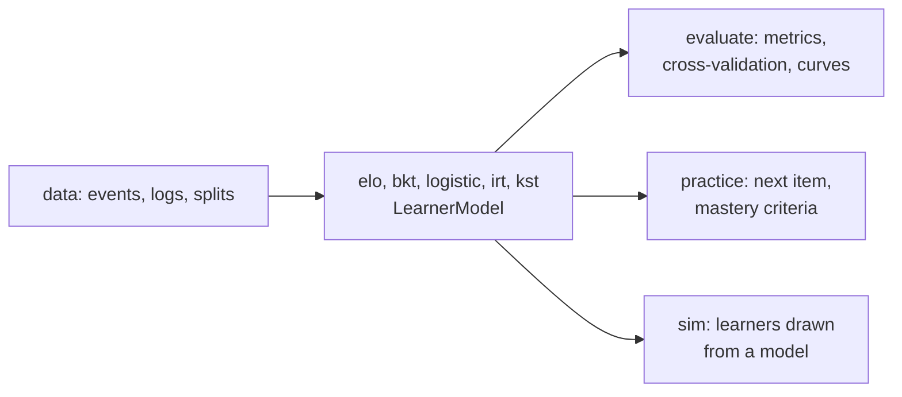

# What knowledge-tracing supports

What each module of `@measurekit/knowledge-tracing` builds, the references its tests compare it with, and where it lists
what it leaves out. Every model implements one interface, `LearnerModel`, whose states and parameters are plain JSON
([architecture](architecture.md)); each guide's Not included table gives the reason for each method it leaves out, and the
architecture's the deep models that need a tensor runtime.

| Module                  | Builds                                                                                                                                                      | References                                       | Leaves out                               |
| ----------------------- | ----------------------------------------------------------------------------------------------------------------------------------------------------------- | ------------------------------------------------ | ---------------------------------------- |
| [data](data.md)         | Event logs with Q-matrices and events without an outcome, first attempts, splits by learner, item and time                                                  | base R                                           | [Not included](data.md#not-included)     |
| [bkt](bkt.md)           | Bayesian knowledge tracing with forgetting, item guess and slip, resource and pair learning, prior groups, fixed rates and bounds, mastery                  | pyBKT, base R                                    | [Not included](bkt.md#not-included)      |
| [logistic](logistic.md) | AFM, PFA, the features of LKT and DAS3H, intercepts of skills and items, covariates, no, fixed or random proficiency, a ridge, the search of rates          | `glm`, lme4, LiblineaR, LKT                      | [Not included](logistic.md#not-included) |
| [elo](elo.md)           | Learner-item Elo with Pelánek's uncertainty function, and concept-specific Elo                                                                              | Its equations written out in R, a recovery study | [Not included](elo.md#not-included)      |
| [irt](irt.md)           | Online EAP and MAP ability and the posterior of θ from calibrated items of seven models, with a drift of θ over time                                        | mirt, base R                                     | [Not included](irt.md#not-included)      |
| [kst](kst.md)           | Knowledge structures and spaces, their bases, fringes and learning paths, the BLIM by ML, MD and MDML, adaptive assessment, IITA and tests of a quasi order | kst, pks, DAKS                                   | [Not included](kst.md#not-included)      |
| [evaluate](evaluate.md) | AUC, RMSE, log-loss, accuracy, R², kappa, calibration, cross-validation, a paired test between models, learning curves with their power laws and categories | pROC, irr, base R, DataShop's rules              | [Not included](evaluate.md#not-included) |
| [practice](practice.md) | The next item by predicted success, streak, threshold, moving-average, window and predicted mastery criteria                                                | base R replays                                   | [Not included](practice.md#not-included) |
| [sim](sim.md)           | Outcomes drawn from any learner model, seeded, with lessons that draw none                                                                                  | Seeded recovery of each family                   | [Not included](sim.md#not-included)      |

Every model uses no platform API, so it runs in browsers as well as on Node.js, Deno, Bun and workerd; `compat/` runs a BKT
fit on the last four and compares its results with Node.js's.
