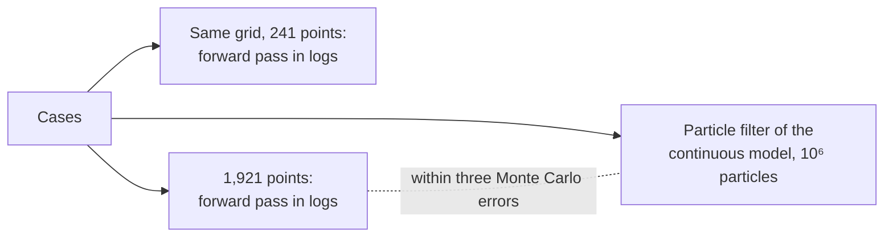

# Validation of knowledge-tracing

Every statistic of `@measurekit/knowledge-tracing` is compared with a reference: a function of an R or Python
package, or a computation written out in the scripts. Bayesian knowledge tracing is compared with pyBKT; logistic
models with `glm`, lme4, LiblineaR and the LKT package; IRT ability estimates with mirt; knowledge space theory
with kst, pks and DAKS. The Elo models have no package of record, so their equations are written out in R.
Simulations check that Elo and BKT recover the parameters they simulate. Scripts
in [`validation/`](../../validation/README.md) run the references and write the inputs and expected results as
JSON fixtures to `packages/knowledge-tracing/test/fixtures/`. The tests compare the results with the fixtures. CI
runs only the TypeScript tests; R and Python run when fixtures change.

## References

Fixtures were generated with R 4.6.1, pROC 1.19.1, irr 0.85, lme4 2.1.0, LiblineaR 2.10-26, LKT 1.7.0, mirt 1.48, kst 0.5.6, pks
0.8.0, DAKS 2.1.3, sets 1.0-25, numDeriv 2016.8-1.1 and jsonlite 2.0.0, and Python 3.12.14 with pyBKT 1.4.3, NumPy 1.26.4, pandas 2.3.3 and
scikit-learn 1.7.2.

| Quantity                                                                       | Reference                                                                                   |
| ------------------------------------------------------------------------------ | ------------------------------------------------------------------------------------------- |
| AUC                                                                            | `pROC::auc` of `roc(levels = c(0, 1), direction = "<")`                                     |
| RMSE, log-loss, accuracy                                                       | Base R, written out in `validation/knowledge-tracing/evaluate.R`                            |
| Log-loss of predictions within ε of 0 or 1                                     | Base R, clipped to [ε, 1 - ε] as scikit-learn's `log_loss`, which agrees within 2e-15       |
| Calibration bins                                                               | Base R: `cut(right = FALSE, include.lowest = TRUE)` at the bounds `(0:K) / K`               |
| Learning curves                                                                | Base R: opportunities by `ave(seq_along)` per learner and skill, error rates by opportunity |
| Normal quantile, logistic function                                             | `qnorm`, `plogis`                                                                           |
| Forward-backward: log-likelihood, state and transition posteriors, predictions | Base R: enumeration of every path of hidden states, not the forward-backward recursion      |
| Logistic regression coefficients and log-likelihood                            | `glm(family = binomial)`, `epsilon = 1e-14`; for outcomes in [0, 1] as well                 |
| Elo predictions, abilities, skill abilities, difficulties and log-likelihood   | Base R: the update equations written out and replayed event by event                        |
| Held-out predictions of cross-validation                                       | Base R: a replay of the training events, then the test learners' events in time order       |
| Time splits                                                                    | Base R: the block boundaries written out                                                    |
| R² of predictions                                                              | Base R: 1 - Σ(y - p)² / Σ(y - ȳ)²                                                           |
| Kappa of the predictions above 0.5                                             | `irr::kappa2` on the predictions above 0.5 and the outcomes                                 |
| Test between models                                                            | `t.test(paired = TRUE)` of the two models' mean losses per learner                          |
| Cross-validation with skills new to a test block                               | Base R: a replay of a model written out, leaving out the events of unseen skills            |
| Metrics by opportunity                                                         | `pROC::auc` and base R by opportunity and skill                                             |
| Power law of a learning curve                                                  | `lm(log(errorRate) ~ log(opportunity), weights = count)`                                    |
| Categories of a learning curve                                                 | DataShop's rules, written out from its help page, version 11.4.0                            |

The Elo script also checks its first update against the values derived by hand: from 0 and 0, P = 0.5 and U(0) = 1,
so a correct answer raises the learner's ability to 0.5 and lowers the item's difficulty to -0.5, exactly.

## Bayesian knowledge tracing

`validation/knowledge-tracing/bkt.py` runs pyBKT's own functions: `data_helper.convert_data` builds its
data, `predict_onestep.run` predicts at fixed parameters, and `EM_fit.run` and `M_step.run` fit, in EM_fit's loop,
which the script runs itself to keep the expected counts of the last M-step; it checks that its estimates
equal `EM_fit.EM_fit`'s. The options map to pyBKT as follows:

| Option                                           | pyBKT                                                                                                                                            |
| ------------------------------------------------ | ------------------------------------------------------------------------------------------------------------------------------------------------ |
| `forgetting: true`                               | `forgets = True`                                                                                                                                 |
| `itemGuessSlip: true`                            | `multigs`, on the item column                                                                                                                    |
| `resourceLearning: true`                         | `multilearn`, on the resource column                                                                                                             |
| `pairLearning: true`                             | `multipair`, on the resource column: 17 resources for 4 items, `Default` first                                                                   |
| `fixed`                                          | `fixed` of `EM_fit` and `M_step`: arrays of `learns`, or `guesses` with `slips`, a negative entry leaving a class free                           |
| `priorGroups`                                    | `multiprior`, on a group column: pyBKT's prior is 0, and a group's prior is the learn rate of a phantom step before each learner's first attempt |
| `restarts`, `seed`, `tolerance`, `maxIterations` | `num_fits`, `seed`, `tol`, `maxiter`                                                                                                             |

| Quantity                                                                             | Reference                                                                                 |
| ------------------------------------------------------------------------------------ | ----------------------------------------------------------------------------------------- |
| P(correct) and P(L) before each event at fixed parameters, 7 configurations          | `predict_onestep.run`; for an event with two skills, the mean of its two rows' P(correct) |
| Parameters, log-likelihood and iterations of EM from a given start, 6 configurations | `EM_fit` from the same start, to a change of the log-likelihood of 1e-9                   |
| A skill's rates pooled over its items or groups                                      | The expected counts of pyBKT's last M-step                                                |
| The optimum reached from random starts                                               | pyBKT's starts: `random_model_uni` with seed 42, 5 fits, to a change of 1e-6              |
| The log-likelihood at the true parameters of the recovery data                       | `predict_onestep.run`                                                                     |
| Opportunities to mastery                                                             | Python: P(L) ← P(L) (1 - P(F)) + (1 - P(L)) P(T) iterated until it reaches the threshold  |

pyBKT combines `multiprior` with neither `multigs` nor `multilearn`: it allows one of `multiprior` and `multilearn`,
and with `multigs` its data misaligns, as the phantom steps enter the outcomes but not the item classes. Prior groups
with item rates are therefore checked at fixed parameters by predicting each group with pyBKT's prior set to the
group's; their fit has no reference beyond its parts.

From the same start, the EM of `bkt` takes the same number of iterations as pyBKT's and reaches its estimates
within 6e-16. From random starts, both reach the same optimum for every skill of the practice log as the given starts,
within 1.4e-6 in log-likelihood, where EM stops at a change of 1e-6. No start reached another local optimum.

The fit of each skill in `skills` has pyBKT's number of iterations and its log-likelihood within 7e-13, and the number of the
skill's events with an outcome. The fit of a log equals the fit of each skill's events alone, and, with one skill in every
event, the log-likelihoods of the skills add up to that of the log within 1e-9.

**Events without an outcome.** `bkt.py` also runs pyBKT on a log in which an event of a lesson is `correct = -1`, pyBKT's
no response, with `multilearn` on the resource column and `multigs` on the item column. A learner's P(L) before every
event at fixed parameters, P(correct) before every event with an outcome, and EM from a given start are compared, in
three configurations: lessons and practice with rates of their own, the same with forgetting, and one learn rate. EM
takes the same number of iterations as pyBKT's.

| Quantity                                                                 | Reference                                                            |
| ------------------------------------------------------------------------ | -------------------------------------------------------------------- |
| P(L) and P(correct) at fixed parameters with `correct = -1`              | `predict_onestep.run`                                                |
| Parameters, log-likelihood and iterations of EM with `correct = -1`      | `EM_fit` from the same start, to a change of the log-likelihood 1e-9 |
| The rates of a lesson and of practice recovered from a seeded simulation | The true rates, to 0.05, and P(L0) to 0.1                            |

**Fixed rates, pairs and bounds.** `bkt.py` also fits with a skill's learn rate held, with its guess and slip held, and
with the lesson's learn rate held while practice's is estimated, and fits and predicts a log with the 17 resources of
`multipair`; each takes pyBKT's number of iterations. pyBKT has no bounds, so `bkt-bounds.R` maximizes the forward
likelihood by `optim(method = "L-BFGS-B")` within the bounds of four cases, each with a bound that binds, and `bkt` runs EM
to a change of 1e-10.

| Quantity                                                   | Reference                                                                   |
| ---------------------------------------------------------- | --------------------------------------------------------------------------- |
| Parameters, log-likelihood and iterations with fixed rates | `EM_fit` with `fixed`, from the same start                                  |
| P(L) and P(correct) with pairs, and EM with pairs          | `predict_onestep.run` and `EM_fit` on `multipair` data                      |
| The estimates within bounds, and the log-likelihood        | The maximum of the forward likelihood by L-BFGS-B, from a start inside them |

pyBKT gives a lesson a guess and slip class of its own, which no count reaches; `bkt` gives a lesson none. A resource that
no outcome follows in a sequence has no rate in `bkt`, where pyBKT keeps its start; the log avoids it.

Several results of pyBKT are not references, and the fixtures avoid them:

- **A learner's only attempt at a skill.** pyBKT adds a sequence's last emission counts inside its backward loop, which
  a sequence of one attempt skips, so such an attempt does not inform P(G) and P(S). `bkt` counts it.
- **Rates without data.** pyBKT sets P(T) = 1 for an item never followed by an attempt and P(G) = P(S) = 0.5 for a
  class without expected counts. `bkt` keeps such a rate's value, and an item without rates of its own uses its skill's.
- **Outcomes of probability 0.** pyBKT treats a guess or slip of 0 as a probability of 1. `bkt` throws `DataError`
  for an outcome given parameters make impossible, and its EM keeps P(G) and P(S) at least 2⁻⁵² from 0 and 1. On the
  practice log, where pyBKT drives some items' P(S) to 1e-101, the estimates still agree within 6e-16.

## Logistic models

`validation/knowledge-tracing/logistic.R` checks the features against the LKT package and the fits against `glm`,
lme4 and LiblineaR:

| Quantity                                                                | Reference                                                                                                              |
| ----------------------------------------------------------------------- | ---------------------------------------------------------------------------------------------------------------------- |
| Every feature before every attempt                                      | LKT's computed columns on its sample data, with the features written out in base R, which agree within 1e-12           |
| AFM, PFA and LKT features with no, fixed or one-skill fixed proficiency | `glm(family = binomial)`, `epsilon = 1e-14`, the score checked below 1e-9                                              |
| AFM and PFA with a random intercept                                     | The maximum of lme4's Laplace approximation, as `glmer(nAGQ = 1)` defines it, written out in base R                    |
| Ridge fits                                                              | `LiblineaR(type = 0, cost = 512)`, the L2-regularized logistic regression LKT uses, then Newton steps on its objective |

`validation/knowledge-tracing/lkt-features.R` checks the features of LKT's other names, 16 of the 49 in
[the logistic guide](logistic.md#the-names-of-lkt), against `computefeatures` of LKT 1.7.0, and the time-window counts of
DAS3H against base R, on LKT's sample with seeded times. The sample has no clock, so each learner's events get the
practice time before them, as LKT's own, plus seeded gaps away of nothing, a minute, an hour, a day or three days, and
their durations are those of the sample, 1 second at least:

| Feature                                                    | Reference                                                    | Tolerance | Largest difference |
| ---------------------------------------------------------- | ------------------------------------------------------------ | --------- | ------------------ |
| Every feature of LKT's other names, before every event     | `LKT:::computefeatures`: its columns of `prop` to `ppe`      | 1e-10     | 2.2e-16            |
| `windowOpportunities`, `windowSuccesses`, `windowFailures` | Base R: a count of the learner's earlier events at the skill | 1e-12     | 2.2e-16            |

`validation/knowledge-tracing/logistic-terms.R` checks terms beyond the skill and the standard errors, on a seeded log of
60 learners at 24 items of 6 skills with a covariate. Fixed proficiency with every event having the same number of
intercepts (item intercepts alone, or one skill per event) is fitted with sum contrasts for the learners, whose mean is
0 as `fit` reports them:

| Quantity                                                                           | Reference                                                                                                                        | Tolerance     | Largest difference |
| ---------------------------------------------------------------------------------- | -------------------------------------------------------------------------------------------------------------------------------- | ------------- | ------------------ |
| Item intercepts, shared coefficients, terms over items and the learner, covariates | `glm(family = binomial)`, `epsilon = 1e-14`; the score checked below 1e-9                                                        | 1e-8 absolute | 1.3e-9             |
| Best-LR and a coefficient for each item, with a ridge                              | `LiblineaR(type = 0)` at the cost 1 / ridge, then Newton steps on its objective; the gap to LiblineaR's own stop is recorded     | 1e-6 absolute | 3.2e-10            |
| Item intercepts and a covariate with a random intercept                            | The maximum of lme4's Laplace approximation, written out in base R, as above                                                     | 1e-5 absolute | 1.3e-8             |
| Standard errors, no or fixed proficiency                                           | `summary(glm)`, the error of the last sum-contrast learner from the others'                                                      | 1e-6 relative | 2.8e-7             |
| Standard errors, random intercept                                                  | The inverse Schur complement written out in base R, equal to `vcov(glmer, use.hessian = FALSE)` at glmer's estimates within 1e-4 | 1e-6 relative | 1.5e-9             |

`validation/knowledge-tracing/rate-search.R` simulates a log of 60 learners with 60 events each at 4 skills, written out in
base R: the decayed proportion of successes with decay 0.6 and the recency of the last attempt with exponent 0.4. It writes the
features for any two rates, fits the intercepts and slopes of each skill by `glm` at a tight tolerance, and maximizes the
log-likelihood over the rates with `optim(method = "L-BFGS-B")` on central differences, then Newton steps to a gradient
below 1e-6; a search from another start and a grid of 340 points reach the same maximum. `LKT` with `seedpars`, which
the benchmark of the search runs, finds 0.703 and 0.403 on the same log, in the second decimal of 0.705 and 0.425, as its
fits are penalized and stop at epsilon 1e-4.

| Quantity                      | Reference                    | Tolerance     | Largest difference |
| ----------------------------- | ---------------------------- | ------------- | ------------------ |
| Estimated decay and exponent  | `optim` over `glm`, as above | 1e-3 absolute | 9e-10              |
| Log-likelihood at the maximum | The same                     | 1e-4 absolute | 1e-11              |

A recovery test simulates eight logs of 2,000 events, 50 learners of 40 attempts, from the model at decay 0.6 and exponent
0.4, with gaps of at least 5 units, and every search must converge. The script fits 20 logs of the same design with `optim`
over `glm`: the decay spreads with an SD of 0.13 and the exponent with one of 0.90, often at a bound, so a log of this size
identifies the decay and not the exponent of a recency. The test asks the mean of the eight decays to be within three
standard errors of 0.6, and each exponent to stay within its bounds. A simulation with gaps near 0 and a stronger recency
leaves the exponent at the bound of 3 in some logs: the likelihood rises with the exponent as Δt⁻ᵉ grows for short gaps.

The seeded times give no age of 0 and no tie, where LKT returns infinity and NaN; the tests check measurekit's values at
those edges by hand. The features map to LKT's names in [the logistic guide](logistic.md#features). With every event of one skill, glm
drops a skill's intercept; the script moves the intercepts so that the learners' mean proficiency is 0, as `fit`
reports it, which changes no prediction.

**lme4.** The written-out Laplace approximation equals `logLik(glmer(nAGQ = 1))` within 3e-10 at glmer's estimates,
and lme4's deviance function at the maximum. lme4 solves its inner problem to about 1e-7, and its optimizer stops
short of the maximum: the maximum's log-likelihood is higher by 3.2e-6 for AFM and 9.5e-7 for PFA, its σ differs by
6.9e-5 and 2.8e-7. So the reference is the maximum, found by `nlminb` and Newton steps on central differences of the
exact approximation, to a gradient below 1e-6; `fit` reaches it within 7e-9.

**LiblineaR.** LiblineaR stops on a gradient norm relative to the start's, which left weakly penalized directions
1.1e-5 short of the minimum on the sample; Newton steps on the same objective finish it, and `fit` matches the minimum.

**LKT's own fit** of AFM on the sample, `LKT(features = c("intercept", "intercept", "lineafm$"))`, differs from
`afm({ ridge: 1 / 512 })` by up to 0.0073 in a prediction, and its log-likelihood is -691.0597 against -691.0168. LKT's
formula leaves out the first learner's column, 302 columns against 303 in `afm`, and the ridge is not invariant to that
choice: LiblineaR on LKT's columns, run to the same tight tolerance, still differs by 0.0071 and gives -691.0554. The
rest is LKT's stopping tolerance, `epsilon = 1e-4`.

**Exposure features.** `validation/knowledge-tracing/exposures.R` simulates a log in which lessons raise the probability of
a correct answer, writes the exposure features of every event from their definitions in base R, and fits them with
`glm(family = binomial)`, `epsilon = 1e-14`, the score checked below 1e-9. The test computes the features from the learner's
state, and fits the model to the log with its lessons.

## Attempt metadata

`validation/knowledge-tracing/data.R` simulates a log with events without an outcome, hints and attempt numbers, and
computes the first attempts in base R by DataShop's convention, with and without the attempt number and for each value
of `hinted`. The test compares the events kept and their outcomes exactly.

`validation/knowledge-tracing/data-rows.py` simulates the rows of an ASSISTments export and of a DataShop export, with
steps that have two skills and steps that have none, and runs pyBKT's `data_helper.convert_data` on them, splitting the
skills of a DataShop step into one row each as pyBKT takes them. The fixture holds the outcomes of each learner at each
skill, in order. The test of the [recipe for the rows of an export](data.md#recipe-the-rows-of-an-export) maps the rows
to events and compares the sequences exactly.

## Item response theory

`validation/knowledge-tracing/irt.R` writes out the posterior of θ on the grid and its exact mode, for 10
learners answering 12 items one at a time: 1PL to 4PL, graded response and generalized partial credit items,
with outcomes simulated from N(0, 1) abilities and, for two learners, every response in the top or the lowest
category, `set.seed(20261029)`.

| Quantity                                       | Reference                                                                                                             |
| ---------------------------------------------- | --------------------------------------------------------------------------------------------------------------------- |
| EAP and its standard error after each response | The grid posterior written out in base R; `mirt::fscores(method = "EAP", quadpts = 61, theta_lim = c(-6, 6))`         |
| MAP and its standard error after each response | `uniroot` on the log-posterior's derivative by the complex step, to 1e-15; the curvature by central differences of it |
| Predictions and the marginal log-likelihood    | The grid posterior written out in base R                                                                              |
| A prior of mean 0.5 and sd 1.5 on 41 points    | The same, in base R                                                                                                   |

mirt holds the items' parameters fixed, converted to its slope-intercept form. Its EAP equals the written-out
posterior within 1.3e-15. Its MAP stops at its optimizer's tolerance, 2e-6 from the exact mode, with a standard error
3.7e-5 from the exact curvature, so the exact mode is the reference. mirt's default grid differs slightly from 61
points over ±6, by up to 2.5e-8 in EAP; the script sets it.

`irt.R nominal` does the same for a test with nominal response items, mirt's `nominal` item type: 10 learners
answering 8 items, 4 of them nominal, with 3 to 5 categories, centered as mirt reports them, with a category whose slope
lies between others', and in the slope-intercept form `a_1 = c_1 = 0`; and a 2PL, a 3PL, a graded and a GPCM item,
`set.seed(20261104)`. mirt's EAP equals the written-out posterior within 1.3e-15 and its standard error within 6.7e-16;
its MAP is 1.8e-6 from the exact mode. The tests hold the same tolerances as for the other items: 1e-10 for EAP, its
standard error, the predictions and the log-likelihood, 1e-5 for MAP and 1e-4 for its standard error.

### Drift

`validation/knowledge-tracing/irt.R drift` runs learners through the chain of `drift` in base R, at 0.02 a week on a
clock in milliseconds, with each outcome drawn from a 2PL item: the ordinary patterns, the steady rise and the
reversals of the [guide](irt.md#drift), 26 cases with 3 seeds of each pattern and rise. No package filters an IRT
posterior with drift, so the references are written out:

| Check                                                  | Reference                                                                                                                                                                                                                                        | Tolerance                                                                                                                                                    |
| ------------------------------------------------------ | ------------------------------------------------------------------------------------------------------------------------------------------------------------------------------------------------------------------------------------------------ | ------------------------------------------------------------------------------------------------------------------------------------------------------------ |
| The chain, deep tails included                         | The same grid: a forward pass in logs with the kernel e^-t I_d(t), the positive series of I_d in logs with `lgamma`, checked against `besselI(expon.scaled = TRUE)` to 1e-11, summed over the images of the reflecting ends within 4 × 241 cells | Mean and SD at 10 points through each case and the forward log-likelihood 1e-9; mean and SD 1e-3 once the final mode sank below -744.4, where exp underflows |
| Filtering against the continuous model                 | The same pass on 1,921 points, the kernel cut where it falls below 1e-300                                                                                                                                                                        | The tolerances per number of points in the [guide](irt.md#drift), after the last event                                                                       |
| A reversal at a = 2 and at a = 3                       | The same                                                                                                                                                                                                                                         | Mean after the last event 0.03 at 481 points and 0.07 at 961, while at 241 the posterior SD is under 3 spacings                                              |
| One scenario by simulation                             | A bootstrap particle filter of 10 × 10⁵ particles, 5 items a week for 26 weeks                                                                                                                                                                   | Three Monte Carlo errors, for the 1,921 points in R and for 241 points in the test                                                                           |
| Variance added by pure drift, from a second to 4 weeks | The closed form, variance Δt / per                                                                                                                                                                                                               | 1e-6 of the due variance                                                                                                                                     |
| Composition                                            | Two gaps against one, and 60 one-minute gaps against an hour                                                                                                                                                                                     | 1e-12 in each weight of the posterior                                                                                                                        |
| Mass                                                   | The step's mass before and after, at up to 10¹² jumps                                                                                                                                                                                            | 1e-11 relative                                                                                                                                               |

The lower bound matches the pass in logs to 5e-14 while no grid point the posterior ends at underflowed, and to 6.4e-5
on the deepest case, 300 failed then 600 correct at a = 3, where a point's bound recovers less than the pass. The thresholds per number of points were fixed as the worst measured times 1.5, rounded
up, before these cases were run. The reversals of the guide's second table, measured against 1,921 points, rest on a
reference that is itself still moving there: on 3,841 points, the hourly reversal ends 0.034 lower and the reversal at
a = 3 0.014 lower, and the others within 0.002.

Two wrong steps fail these tests. A Gaussian kernel sampled on the grid adds almost none of the due variance at short
gaps, and fails the variance, composition and both pass comparisons. Uniformization with a floor of the smallest
double on the density gives a false fat tail, and fails the same-grid comparison by 3.0 in the mean of the reversal at
a = 2.

## Knowledge space theory

`validation/knowledge-tracing/kst.R` runs kst, pks and DAKS on their example data and on data simulated by
DAKS's `simu`, with `set.seed(20261029)`:

| Quantity                                                                     | Reference                                                                                                                                                 |
| ---------------------------------------------------------------------------- | --------------------------------------------------------------------------------------------------------------------------------------------------------- |
| Quasi-ordinal spaces of 6 surmise relations                                  | `DAKS::imp2state`, and every subset closed under the relation, enumerated in base R                                                                       |
| Knowledge spaces, learning spaces, inner and outer fringes                   | `kst::kstructure_is_kspace`, `kfringe_inner`, `kfringe_outer`; `pks::is.downgradable`, checked against `kstructure_is_wellgraded` on the small structures |
| Delineation by a Q-matrix                                                    | `pks::delineate`, the conjunctive model                                                                                                                   |
| BLIM by maximum likelihood and minimum discrepancy                           | `pks::blim(method = "ML" or "MD", tol = 1e-13)` on `DoignonFalmagne7` and the `chess` data, `dst1`                                                        |
| IITA: selection sets, `diff` of each quasi-order, the choice, the error rate | `DAKS::ind_gen` and `iita(v = 1, 2, 3)` on `pisa` and 3 simulated data sets                                                                               |
| Adaptive assessment                                                          | The half-split question and Bayes' rule written out in base R; `kst::kassess` without errors                                                              |

`validation/knowledge-tracing/kst-structure.R` runs kst's structure functions on the same example data, on 2 quasi-ordinal spaces
and on 8 random families of states, and writes the clause fixtures, with `set.seed(20261029)`:

| Quantity                               | Reference                                                                                                                                                    | Tolerance |
| -------------------------------------- | ------------------------------------------------------------------------------------------------------------------------------------------------------------ | --------- |
| Base of a space; atoms of each element | `kst::kbase`, which throws for a structure that is not a space, and `katoms`                                                                                 | Exact     |
| Neighbourhoods at distance 1, 2 and 3  | `kst::kneighbourhood`, `knneighbourhood`                                                                                                                     | Exact     |
| Well-gradedness                        | `kst::kstructure_is_wellgraded`, checked in the script against the definition by a search for tight paths in base R, on every structure of at most 30 states | Exact     |
| Learning paths                         | `kst::lpath`: the chains whose steps each add one element, as orders of elements                                                                             | Exact     |
| Traces; notions                        | `kst::ktrace`, `knotions`                                                                                                                                    | Exact     |
| Closure under union                    | `kst::kspace`, on 8 families of generators                                                                                                                   | Exact     |
| Spaces from clauses                    | Base R enumeration of the subsets of 15 clause systems, and `kst::kspace` of the `kbase` of each, which gives the same space                                 | Exact     |

Results are sets of states, compared without regard to order. kst's `lpath` returns every maximal chain of the inclusion
order, including chains with a step of several elements, which `learningPaths` leaves out. `katoms` matches an element's
name as a pattern, so for ids that another id contains it returns wrong atoms; the fixtures use ids that no other contains.

A learning space is a well-graded knowledge space, equivalently one in which every non-empty state has an element
whose removal leaves a state (Cosyn and Uzun, 2009); kst's well-gradedness test is slow on the chess structure,
so pks's `is.downgradable` is the reference there.

**pks.** pks keeps guess and slip at least 1e-6 from 0: on `DoignonFalmagne7` its estimates of η for items a and b are
1e-6, where the likelihood rises as they fall to 0, by 2.9e-5 in log-likelihood. `kst` keeps the same bound, and then
reaches pks's estimates within 1.3e-7 by ML and 1.4e-17 by MD.

**DAKS.** The papers describe the selection set as excluding pairs that cause an intransitivity, without saying which
pair of a conflicting two goes. DAKS checks the pairs in the order of the items and drops each at once, so later pairs
are checked against the pairs still in; `iita` does the same and reproduces DAKS's selection sets on `pisa` and 40 more
simulated data sets. DAKS also leaves out quasi-orders without implications.

`validation/knowledge-tracing/kst-diagnostics.R` runs pks, kst and DAKS for the constraints and diagnostics, with
`set.seed(20261029)`:

| Quantity                                                            | Reference                                                                                                                                                     | Tolerance                                                               |
| ------------------------------------------------------------------- | ------------------------------------------------------------------------------------------------------------------------------------------------------------- | ----------------------------------------------------------------------- |
| BLIM with fixed rates, equal rates and both, by ML, MD and MDML     | `pks::blim(betafix, etafix, betaequal, etaequal, method, tol = 1e-13)` on `DoignonFalmagne7` and `chess` `dst1`: 12 cases                                     | π, guess, slip: 1e-6 by ML and MDML, 1e-12 by MD                        |
| Log-likelihood, G², its degrees of freedom and p-value, discrepancy | `loglik`, `goodness.of.fit` and `discrepancy` of the same fits                                                                                                | 1e-8 by ML, 1e-10 by MD, 1e-4 by MDML; degrees exact; discrepancy 1e-12 |
| Comparing fits                                                      | `anova(blim1, blim2)` for equal rates against free rates, on both data sets                                                                                   | G² and p-value 1e-8, degrees exact                                      |
| Recovery of one slip and one guess                                  | 20 seeded sets of 400 learners on a chain of 6 items, slip 0.1 and guess 0.05, fitted by `blim` with `betaequal` and `etaequal`                               | 1e-6 against pks; means within 0.01 of the truth                        |
| Local identifiability                                               | `qr(pks::jacobian(...)[, free])$rank` at random parameters, without the columns of fixed rates: 7 structures, `chess` included                                | Exact                                                                   |
| Forward and backward gradedness                                     | `pks::is.forward.graded`, `is.backward.graded` on 4 example structures and 12 random families                                                                 | Exact                                                                   |
| Validity of a structure                                             | `kst::kvalidate` with `gamma`, `VC`, `percent` and `DI` on 6 structures; `DA` by `kvalidate` up to 8 items, and in base R, checked against it, for the others | Counts exact; the rest 1e-12                                            |
| Test of a quasi order: estimate, z, p-value of each tail, interval  | The delta method in base R, 32 cases: 4 data sets, both versions, one quasi order or two, 2 means; the estimate is also `DAKS::z_test`'s `diff_value`         | Estimate 1e-12 relative to DAKS; the rest 1e-6 relative                 |
| The same on incomplete patterns                                     | Base R: the pairwise shares and numDeriv's derivatives over a weight for each learner, 24 cases: 3 data sets (below)                                          | The same                                                                |

The estimates of the constrained fits differ from pks's by at most 1.4e-7 by ML, 9.8e-8 by MDML and 1.4e-17 by MD. An MDML
fit maximizes the likelihood of the states of least discrepancy only, so the log-likelihood of the whole model at its
estimates changes at first order with them: it differs from pks's by 1.0e-5, against 2.5e-11 by ML. The recovery means
are 0.1004 and 0.0495. Gamma, the violational coefficient and the counts of validity equal those of kvalidate; the discrepancy
index and the distance agreement differ by 1.1e-16. The test of a quasi order differs from the delta method by 4.1e-15 in
the estimate, 6.0e-11 in z and 1.2e-8 in the p-value; on incomplete patterns by 5.8e-15, 8.7e-10 and 1.3e-7, relative.

**The test on incomplete patterns.** DAKS takes complete patterns only, so `validation/knowledge-tracing/kst-incomplete.R`
writes the estimate out in base R as a function of a weight for each learner: each pair's share of the learners who
answered both, each item's solution rate among those who answered it, and the mean over the pairs that some learner
answered both of, with the minimized error rate found again at each weight. Its variance is the sum of the squared
derivatives with respect to the weights, which numDeriv's `grad` takes. On complete pisa the script asserts the estimate
of `DAKS::z_test` and the variance of the delta method over the patterns above, within 1e-6. The data: pisa with 20% of
the responses missing completely at random; 300 learners of 7 simulated items in two booklets that share five, so two
items are never answered together, with 15% more missing; and complete pisa. Each has its IITA quasi order and, as the
alternative, the same order without one covering pair: the test of one edge. Over 300 bootstrap samples, the spread of
the test of one edge was 0.92 to 1.24 times its standard error on every data set of both fixtures, complete or not, and
the test checks the booklets within 15%; the spread of one quasi order's estimate was up to 2 times its standard error,
as the guide says.

**pks, above 16 items.** For more than 16 items, `blim` renormalizes the probabilities of the patterns that occur before it computes the
log-likelihood and G²; `kst` computes them from the whole model. The degrees of freedom are pks's in both cases. For an
MDML fit pks stops when its parameters change by at most `tol`; `kst` when the log-likelihood of the restricted model does.

**DAKS's `z_test`.** It reports the estimate `diff / n²`, which `diffTest` reproduces. Its variance, from `DAKS:::variance`, is
not the delta-method variance of that estimate: on the 16 comparisons of the fixture it is between 0.39 and 7.3 times the
variance by central differences of the estimate over the probabilities of the patterns, which `diffTest` matches. Four
lines of `variance` account for it: the sums `tmp1` and `tmp2` of the derivative of the error rate are set once and not for
each pattern; the corrected error rate divides by the number of items where the number of learners belongs; the gradient
of a pair that is related in neither direction leaves out the patterns that solve the first item and fail the second; and the
derivative of the corrected error rate adds a term that is subtracted. With those four lines changed, which the script does
to a copy and checks, the variance equals the delta-method one to 1.2e-10 relative on the 8 comparisons of one quasi order.
`z_test` also adds the variances of two quasi orders, which are fitted to the same learners, where `diffTest` takes the
variance of their difference, and it returns the probability of a smaller statistic for `"greater"` and of a larger one
for `"less"`, the reverse of R's convention, which `diffTest` follows.

## Mastery criteria

No package has mastery criteria over a log, so `validation/knowledge-tracing/practice.R` replays each in base R on a seeded
log of 1,500 events of 15 learners at 4 skills, with items of one or two skills, outcomes of 0 and 1, 10% of 0.5 and 8%
lessons with no outcome. Each table gives, by learner and skill, the opportunity after which the criterion was first met:

| Criterion                                               | Reference                                                                                                                    | Tolerance |
| ------------------------------------------------------- | ---------------------------------------------------------------------------------------------------------------------------- | --------- |
| `streakMastery`, lengths 3 and 5                        | Base R: a run per learner and skill                                                                                          | Exact     |
| `movingAverageMastery`, three decay and threshold pairs | Base R: m ← d m + (1 - d) y                                                                                                  | Exact     |
| `windowMastery`, four windows                           | Base R: `sum(tail(c(past, y), window)) >= correct`                                                                           | Exact     |
| `predictedMastery`, thresholds 0.8, 0.9 and 0.95        | Base R: the performance factors analysis `plogis(Σ over the skills of β + 0.06 s + 0.01 f)` of the attempt after its outcome | Exact     |

The tables are opportunities, integers, so they are compared for equality; each has learners and skills that meet the
criterion and others that do not. The tests add the identities that a window of `k` correct in `k` is a streak of `k`,
and that a stricter criterion is met no earlier.

## Simulation recovery

**Elo.** R's generator differs from `createRandom`, so the study is simulated in R and replayed in both. 400
learners with abilities drawn from N(0, 1) answer all of 60 Rasch items with difficulties drawn from N(0, 1), in
random order, starting at random times so that their events interleave: 24,000 events, `set.seed(20261029)`. A
replay through Elo with the default uncertainty function must recover the simulated values, at thresholds fixed
before the simulation was first run:

| Estimate          | Required Pearson correlation with the simulated values | Found |
| ----------------- | ------------------------------------------------------ | ----- |
| Learner abilities | at least 0.85                                          | 0.937 |
| Item difficulties | at least 0.95                                          | 0.985 |

The R script stops when a threshold is missed; the test checks the replay by `elo` against R's and the same thresholds.

**BKT.** 1,000 learners answer 10 items of each of two skills under the standard model, simulated by NumPy with
`default_rng(20261029)`: 20,000 events. A fit with the default options must recover the parameters, at thresholds fixed
before the simulation was first run:

| Requirement                                           | Found                        |
| ----------------------------------------------------- | ---------------------------- |
| Every P(L0) within 0.1 of the simulated value         | Largest error 0.017          |
| Every P(T), P(G) and P(S) within 0.05                 | Largest error 0.014          |
| A log-likelihood at least that at the true parameters | -10868.34, against -10870.62 |

**`simulate`.** `test/sim.test.ts` simulates learners with `simulate` from `createRandom(20261029)` and fits
each family to them, at thresholds fixed before the first run:

| Family        | Learners                                                      | Requirement                                                                                                  | Found               |
| ------------- | ------------------------------------------------------------- | ------------------------------------------------------------------------------------------------------------ | ------------------- |
| BKT           | 800 learners, 24 attempts at 2 skills                         | P(L0) within 0.1; P(T), P(G), P(S) within 0.05                                                               | 0.021; 0.044        |
| AFM, fixed θ  | 300 learners, θ from N(0, 0.8²), 30 attempts at 4 skills      | intercepts within 0.25, slopes within 0.05, θ correlation at least 0.8                                       | 0.131, 0.025, 0.882 |
| AFM, random θ | The same                                                      | σ within 0.15 of 0.8                                                                                         | 0.814               |
| Elo           | 300 Rasch learners on 40 items, simulated as a logistic model | ability correlation at least 0.85, difficulty at least 0.95                                                  | 0.868, 0.982        |
| IRT           | 200 learners of known θ on 30 2PL and 3PL items               | EAP correlation at least 0.9                                                                                 | 0.946               |
| BLIM          | 40,000 learners, 8 items, 29 states                           | identifiable guesses and slips within 0.05; log-likelihood at least the truth's                              | 0.0097              |
| Assessment    | 500 learners drawn from the BLIM                              | share whose most likely state is true within 3 standard errors, 0.067, of the mean probability of that state | 0.540 against 0.526 |

**BLIM.** Only identifiable rates are required. An item without prerequisites, which every state can add, has a guess
the BLIM cannot tell from the state probabilities, and an item nothing requires has such a slip (Stefanutti et al.,
2012); one item's guess missed by 0.065 with 4,000 learners and still with 40,000.

**Assessment.** The requirement is agreement with the procedure's own posterior, not recovery of the true state: 8 items
with errors up to 0.2 do not reach a posterior of 0.9 among 29 states, so the procedure finds the true state for 52% of
learners, when its posterior expects 51%.

## Properties

Properties that hold for any input are tested with fast-check:

- predictions and P(L) are probabilities from 0 to 1, and metrics are finite;
- AUC is unchanged by increasing transformations of the predictions;
- kappa is within -1 and 1, and R² is at most 1;
- the power law recovers the scale and exponent of an exact power law, whatever the counts;
- `update` and `updateItem` never change the state, the event or the model they are given;
- learner states and item ratings stored as JSON continue exactly as the originals;
- running `update` and `updateItem` after every event equals a replay by `fit`;
- seeded random numbers, permutations and splits reproduce; splits by learner and item partition the log, and splits
  by time never train on events at or after those they test;
- an IRT learner's EAP rises after a correct answer to a dichotomous item and falls after a wrong one;
- the expected attempts to a streak satisfy their recurrence, E_r = 1 + p E_(r+1) + (1 - p) E_0;
- IRT states stay finite, and predictions from 0 to 1, for items of discrimination up to 60 and difficulty from -6 to
  6, and every outcome, after a JSON round trip at every step;
- removing the events without an outcome from a log changes no parameter, state, log-likelihood or prediction at the
  events with an outcome, for Elo, IRT, KST and logistic models without exposure features;
- the forward-backward posteriors of 800 correct and 400 incorrect answers, where P(unknown) underflows to 0, equal
  those computed in log space within 1e-10.

On a Baum-Welch fit, EM never lowers the log-likelihood and reports the log-likelihood of the parameters it returns. BKT
fitted skill by skill gives the parameters of the fit to the whole log, and its fit's predictions and states are those
of online inference with the fitted parameters.
Edge cases are tested against defined results: an empty log, one learner, a single event, events out of time order,
items missing from the Q-matrix, skills and items no model has seen, skills a learner has not practiced, outcomes all
correct or all wrong, certain predictions, and BKT parameters at their bounds.

## Datasets

| Fixture                         | Data                                                                                                                                                                                                         | Covers                                                                                                                                  |
| ------------------------------- | ------------------------------------------------------------------------------------------------------------------------------------------------------------------------------------------------------------ | --------------------------------------------------------------------------------------------------------------------------------------- |
| `math-functions.json`           | 18 probabilities from 1e-300 to 1 - 1e-10, 13 points from -30 to 30                                                                                                                                          | Tails of the normal quantile and the logistic function                                                                                  |
| `math-forward-backward.json`    | `set.seed(20261029)`: a knowledge tracing sequence of 7 steps, a 3-state sequence of 6, a single step                                                                                                        | Transitions that change by step, forgetting, one step                                                                                   |
| `math-logistic-regression.json` | `set.seed(20261029)`: 800 rows, skill indicators, attempts and skill slopes                                                                                                                                  | 0/1 outcomes and outcomes in [0, 1]                                                                                                     |
| `data-rows.json`                | `RandomState(20261029)`: 9 learners of 14 steps at 4 skills, 30% of the steps with two skills, 3 with none                                                                                                   | Steps with two skills and with none, hints counted as incorrect, ties of the skills of one attempt                                      |
| `data-first-attempts.json`      | `set.seed(20261031)`: 40 learners, 24 events each at 8 items, 15% without an outcome, with hints; with and without the attempt number                                                                        | DataShop's first attempts; a first attempt with hints kept, counted incorrect or `null`                                                 |
| `evaluate-metrics.json`         | A textbook case of 4; 400 predictions rounded to 0.01; 150 partial credit outcomes; 10 predictions of 0, 1 and within 1e-16 of them                                                                          | Ties, predictions of 0.5 and on bin bounds, partial credit, certain predictions right and wrong                                         |
| `evaluate-learning-curve.json`  | 30 learners, 15 events each on 12 items and 4 skills, some items with two skills                                                                                                                             | Multiple skills per event, predicted error rates                                                                                        |
| `evaluate-agreement.json`       | The cases above, a mean-outcome and a worse-than-mean prediction, outcomes all equal, one class predicted                                                                                                    | R² below 0, kappa -1, 0 and undefined                                                                                                   |
| `evaluate-comparison.json`      | `set.seed(20261029)`: 40 learners of 8 to 12 events, 7% lessons; folds by learner and two of three folds by item                                                                                             | A learner in several test folds, events of a learner left untested                                                                      |
| `evaluate-unseen.json`          | `set.seed(20261029)`: 24 learners meet 4 skills in turn, 5 to 8 events each, with review items; 4 folds by time                                                                                              | Test blocks with skills the training log lacks, a skipped event leaving its learner's state                                             |
| `evaluate-opportunity.json`     | `set.seed(20261029)`: 40 learners of 8 to 14 events on 12 items of 4 skills, 6% lessons, 5% of the rest without a prediction                                                                                 | Opportunities with one class, learner and skill pairs below the minimum                                                                 |
| `evaluate-curves.json`          | The curves above and 9 built to the cases; 8 sets of DataShop's thresholds                                                                                                                                   | Zero error rates, two points, a flat and a rising curve, every category                                                                 |
| `elo-worked.json`               | 8 events of 2 learners: learner-item Elo with the default and a constant K; concept-specific Elo                                                                                                             | Multiple skills, partial credit, events without skills, starting ratings                                                                |
| `elo-holdout.json`              | 36 events of 6 learners on 4 items, times with ties; folds by learner, item and time                                                                                                                         | Training events before, between and after test events                                                                                   |
| `elo-recovery.json`             | The simulation above                                                                                                                                                                                         | Recovery, a replay of 24,000 events                                                                                                     |
| `bkt-practice.json`             | `default_rng(20261029)`: 40 learners in two prior groups, 20 attempts each at 9 items of 3 skills, one item with two skills                                                                                  | Every extension at fixed parameters and in EM; random starts                                                                            |
| `bkt-skills.json`               | pyBKT's EM_fit for each skill of `bkt-practice.json` alone: iterations and log-likelihood; the rows of the skill                                                                                             | Every extension's configuration, three skills                                                                                           |
| `bkt-recovery.json`             | The simulation above                                                                                                                                                                                         | Recovery, 20,000 events                                                                                                                 |
| `bkt-opportunities.json`        | 14 cases of P(L), P(T), P(F) and threshold                                                                                                                                                                   | Forgetting, P(T) + P(F) ≥ 1, limits below the threshold                                                                                 |
| `bkt-lessons.json`              | `default_rng(20261030)`: 150 learners of 14 steps at one skill, 30% of the steps lessons with no outcome and the rest attempts at 3 items; a prior of 0.3, learn and forget rates of lessons and of practice | Lessons as resources with `correct = -1`, item guess and slip; inference at fixed parameters, EM from matched starts                    |
| `bkt-fixed.json`                | pyBKT's `fixed` on the log of `bkt-practice.json`, a skill's learn rate held at 0.12, then its guess and slip at 0.25 and 0.08; on the log of `bkt-lessons.json`, the lesson's learn rate held at 0.3        | The rates named stay and the others are estimated, to pyBKT's iterations                                                                |
| `bkt-pairs.json`                | `default_rng(20261031)`: 120 learners of 12 steps at one skill, each step at one of 4 items; the rates after an attempt depend on the item before it and its own, and a first attempt has its own            | `multipair`: 17 resources, the 16 pairs and the first attempt; inference at fixed parameters, EM from a matched start                   |
| `bkt-bounds.json`               | `set.seed(20261102)`: 300 learners of 10 attempts at one skill, P(L0) 0.3, P(T) 0.2, P(F) 0.04, P(G) 0.35, P(S) 0.12                                                                                         | Four cases with a bound that binds: guess and slip capped; learn capped; forget capped; prior floored and guess capped, with forgetting |
| `logistic-lkt.json`             | LKT's `samplelkt`: 1941 attempts of 17 learners at 143 skills, times from the durations                                                                                                                      | Every feature; ridge fits of AFM and PFA                                                                                                |
| `practice-mastery.json`         | `set.seed(20261029)`: 1500 events of 15 learners at 4 skills, items of 1 or 2 skills, 8% lessons, 10% outcomes of 0.5; the tables of 12 criteria                                                             | Skills never mastered, lessons, partial credit, events of two skills                                                                    |
| `logistic-lkt-features.json`    | LKT's `samplelkt` with seeded times: 1941 events of 17 learners with their durations; 16 features of LKT and 3 windows                                                                                       | Events at the same time not reached, gaps of 0 to 3 days                                                                                |
| `logistic-glm.json`             | `set.seed(20261029)`: 80 learners, 40 attempts each at 14 items of 5 skills, 4 items of two skills                                                                                                           | Fixed, one-skill fixed, no and random proficiency                                                                                       |
| `logistic-terms.json`           | `set.seed(20261101)`: 60 learners, 36 events each at 24 items of 6 skills, 6 items of two skills, a covariate                                                                                                | Item intercepts, shared coefficients, terms over items and the learner, standard errors                                                 |
| `logistic-rates.json`           | `set.seed(20261102)`: 60 learners, 60 events each at 4 skills; the rates by `optim` over `glm`                                                                                                               | A maximum inside the bounds, reached from two starts                                                                                    |
| `logistic-exposures.json`       | `set.seed(20261030)`: 60 learners, 36 events each at one of 2 skills, 30% of them lessons                                                                                                                    | Exposures, decayed exposures (0.7) and recency (0.5) of events without an outcome; `glm`'s coefficients                                 |
| `irt-abilities.json`            | The learners above                                                                                                                                                                                           | Every item model, extreme patterns, a shifted prior and a coarser grid                                                                  |
| `irt-nominal.json`              | `set.seed(20261104)`: 10 learners answering 8 items, 4 of them nominal beside items of the other models; mirt's `nominal` type, `fscores` with the parameters fixed                                          | Centered slopes, a category whose slope lies between others', the slope-intercept form; the posterior at 61 points                      |
| `irt-drift.json`                | The chain of `drift` at 0.02 a week: 26 cases of 2PL answers, the ordinary patterns, the steady rise and the reversals, 3 seeds of each; for the particle filter, 5 items a week for 26 weeks                | The posterior at 241 and at 1,921 points, and by a particle filter of 10⁶ particles; 10 checkpoints a case                              |
| `kst-structures.json`           | 6 surmise relations; pks's `DoignonFalmagne7` and `chess` `dst1`, a space with a gap, a structure that is not a space; a map of 5 items to 4 skills                                                          | Equivalent elements, spaces that are not learning spaces                                                                                |
| `kst-structure-tools.json`      | The 6 structures above and 8 random families of states; 8 families of generators of a closure                                                                                                                | Spaces with a gap, structures that are not spaces, no path                                                                              |
| `kst-structure-clauses.json`    | 15 clause systems of 2 to 7 elements, with the spaces that enumeration gives                                                                                                                                 | Cycles, an element that is its own clause, empty clauses                                                                                |
| `kst-blim.json`                 | `DoignonFalmagne7`: 1000 learners, 5 items, 9 states; `chess`: 92 learners, 16 items, 57 states                                                                                                              | Rates at the bound, states of probability 0                                                                                             |
| `kst-iita.json`                 | DAKS's `pisa`: 340 learners, 5 items; 3 sets of 300 learners and 7 items from `simu`                                                                                                                         | Every version, selection sets with conflicting pairs                                                                                    |
| `kst-assessment.json`           | Every state of `DoignonFalmagne7` as the true one, answers drawn with pks's ML estimates                                                                                                                     | Stopping at 0.8, questions asked again                                                                                                  |
| `kst-blim-constraints.json`     | `DoignonFalmagne7` and `chess` `dst1` with fixed and equal rates by ML, MD and MDML, 2 comparisons; 20 seeded sets of a chain of 6 items                                                                     | Rates fixed at 0, groups of rates, a fit with no degrees of freedom to spare                                                            |
| `kst-identifiability.json`      | 7 structures at random parameters, with and without fixed rates                                                                                                                                              | A single rate fixed at each end, structures with every subset                                                                           |
| `kst-graded.json`               | 4 example structures and 12 random families of states                                                                                                                                                        | Elements at which a structure is graded in neither or both directions                                                                   |
| `kst-validity.json`             | `DoignonFalmagne7`, `chess` with 2 structures, a simulated quasi order, a chain the data do not follow, all subsets                                                                                          | No ordered pair, perfect fit                                                                                                            |
| `kst-diff-test.json`            | `pisa` and 3 sets of 300 learners and 7 items from `simu`: both versions, one quasi order or two, 2 means                                                                                                    | Quasi orders that differ in direction, a mean other than 0                                                                              |
| `kst-diff-test-incomplete.json` | `pisa` with 20% missing, 7 simulated items in two booklets with 15% more missing, complete `pisa`: both versions                                                                                             | A pair never answered together; the test of one edge                                                                                    |

## Tolerances

| Quantity                                                             | Tolerance                      | Largest difference found       |
| -------------------------------------------------------------------- | ------------------------------ | ------------------------------ |
| Normal quantile and logistic function                                | 1e-14 relative                 | 3e-16                          |
| Forward-backward quantities                                          | 1e-12 absolute                 | 9e-16                          |
| Logistic regression coefficients and log-likelihood                  | 1e-10 absolute                 | 2e-13                          |
| Metrics, calibration bins, learning curves                           | 1e-12 absolute                 | 3e-16                          |
| R² and kappa                                                         | 1e-12 absolute                 | 2e-15                          |
| Test between models                                                  | 1e-9 absolute                  | 3e-15                          |
| Cross-validation with skills new to a test block                     | 1e-12 absolute                 | 4e-16                          |
| Metrics by opportunity                                               | 1e-12 absolute                 | 3e-16                          |
| Power laws of learning curves                                        | 1e-10 absolute                 | 4e-16                          |
| Elo predictions, estimates and log-likelihood                        | 1e-12 absolute                 | 2e-15                          |
| Held-out Elo predictions                                             | 1e-12 absolute                 | 1e-16                          |
| BKT P(correct) and P(L) at fixed parameters                          | 1e-13 absolute                 | 2.3e-14                        |
| BKT parameters and log-likelihood fitted from a given start          | 1e-8 absolute                  | 6.8e-13                        |
| BKT P(L) and P(correct) at fixed parameters, with `correct = -1`     | 1e-13 absolute                 | 9.3e-15                        |
| BKT parameters and log-likelihood from a given start, `correct = -1` | 1e-8 absolute                  | 9.1e-13                        |
| BKT with fixed rates or pairs, from a given start                    | 1e-8 absolute                  | 8e-13                          |
| BKT rates within bounds, against L-BFGS-B                            | 1e-4 absolute                  | 9.8e-6                         |
| BKT log-likelihood within bounds                                     | 1e-6 absolute                  | 2e-7                           |
| Logistic features against LKT                                        | 1e-12 absolute                 | 9e-16                          |
| Exposure features against base R                                     | 1e-12 absolute                 | 0                              |
| Exposure coefficients and log-likelihood against glm                 | 1e-8 absolute                  | 1.8e-14                        |
| Logistic coefficients, proficiencies and log-likelihood against glm  | 1e-8 absolute                  | 5.4e-10                        |
| Ridge coefficients and proficiencies                                 | 1e-6 absolute                  | 3.4e-9                         |
| Random-intercept coefficients, σ and modes                           | 1e-5 absolute                  | 7.3e-9                         |
| Random-intercept log-likelihood                                      | 1e-6 absolute                  | 4.3e-12                        |
| Terms beyond the skill against glm, lme4 and LiblineaR               | 1e-8, 1e-5, 1e-6 absolute      | 1.3e-9, 1.3e-8, 3.2e-10        |
| Logistic standard errors against `summary(glm)` and lme4             | 1e-6 relative                  | 2.8e-7                         |
| Estimated rates and their log-likelihood                             | 1e-3, 1e-4 absolute            | 9e-10, 1e-11                   |
| IRT EAP, its standard error, predictions and log-likelihood          | 1e-10 absolute                 | 2.2e-15                        |
| IRT MAP, at the default grid spacing 0.2, × (spacing / 0.2)⁵         | 1e-5 absolute                  | 3.1e-7; 2.1e-5 at spacing 0.45 |
| IRT MAP standard error, × (spacing / 0.2)⁴                           | 1e-4 absolute                  | 2.5e-6; 1.3e-4 at spacing 0.45 |
| BLIM parameters by ML against pks                                    | 1e-6 absolute                  | 1.3e-7                         |
| BLIM log-likelihood by ML                                            | 1e-8 absolute                  | 2.8e-11                        |
| BLIM by MD, the assessment's posteriors                              | 1e-12 absolute                 | 4.5e-13                        |
| IITA `diff` and error rate                                           | 1e-10 relative, 1e-12 absolute | 1.7e-15, 6.9e-17               |
| Constrained BLIM by ML and MDML against pks                          | 1e-6 absolute                  | 1.4e-7                         |
| Constrained BLIM by MD                                               | 1e-12 absolute                 | 1.4e-17                        |
| Log-likelihood and G² of a constrained fit: ML, MD, MDML             | 1e-8, 1e-10, 1e-4 absolute     | 5.2e-11, 3.2e-12, 2.1e-5       |
| Validity of a structure                                              | 1e-12 absolute                 | 1.1e-16                        |
| Test of a quasi order against the delta method                       | 1e-6 relative                  | 1.2e-8                         |

glm stops when the deviance changes by less than 1e-14 relative, the Newton steps of the logistic models when
no gradient component exceeds 1e-10. The logistic fits' tolerances allow for the references' stopping rules, with
the references finished as described above. pks stops when the parameters change by at most its `tol` and `kst` when
the log-likelihood does, so the BLIM's ML estimates agree within the distance EM leaves to its fixed point. IRT's
MAP interpolates between grid points, with an error of the fifth power of the spacing, so its tolerance scales with
it: at spacing 0.45 the mode differs from the exact one by up to 2.1e-5, above the tolerance at the default spacing.
Elo and the metrics repeat R's arithmetic; the differences come from the last bit of `exp` and from R's `mean`,
which sums in extended precision. Fixtures store 17 significant digits, so they reproduce R's doubles exactly.

## Regenerating fixtures

[validation/README.md](../../validation/README.md) lists the scripts, the R packages and the Python environment they
need. Update the versions above when they change. A new statistic needs a reference in an R or Python script, a
fixture, a test that loads it, and a row in the tables above. `stored-state.json` is the one fixture no script writes:
it holds the states and parameters of each model that the build before the first release wrote, and a test checks that
every build reads them as before. It is never regenerated ([storage](storage.md#stored-states-across-versions)).
