# Performance

## Ratios

<!-- charts -->

### Where measurekit is slower

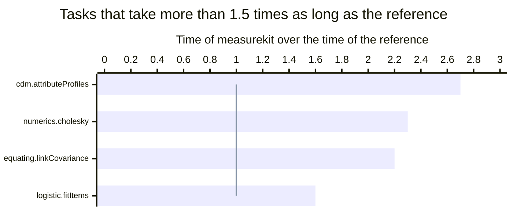

A bar above the line takes longer than the reference, and md stands for multidimensional.

### Every task

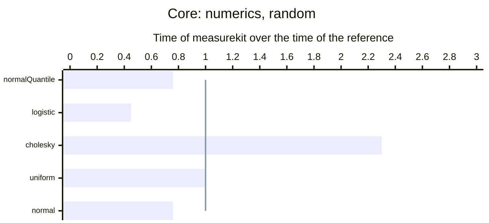

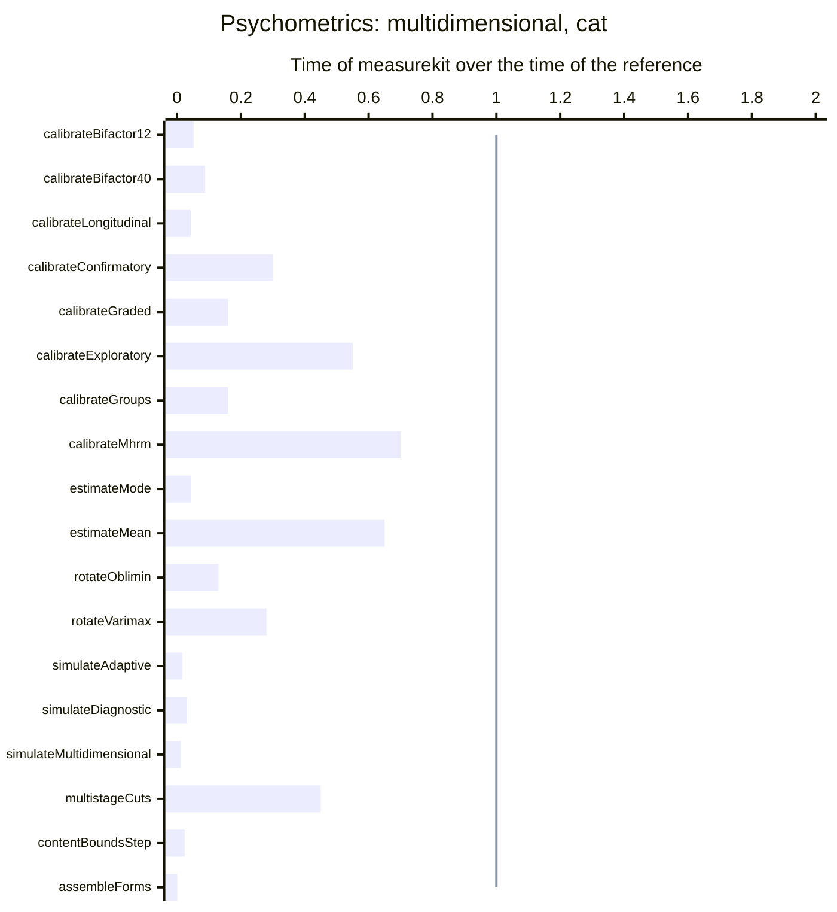

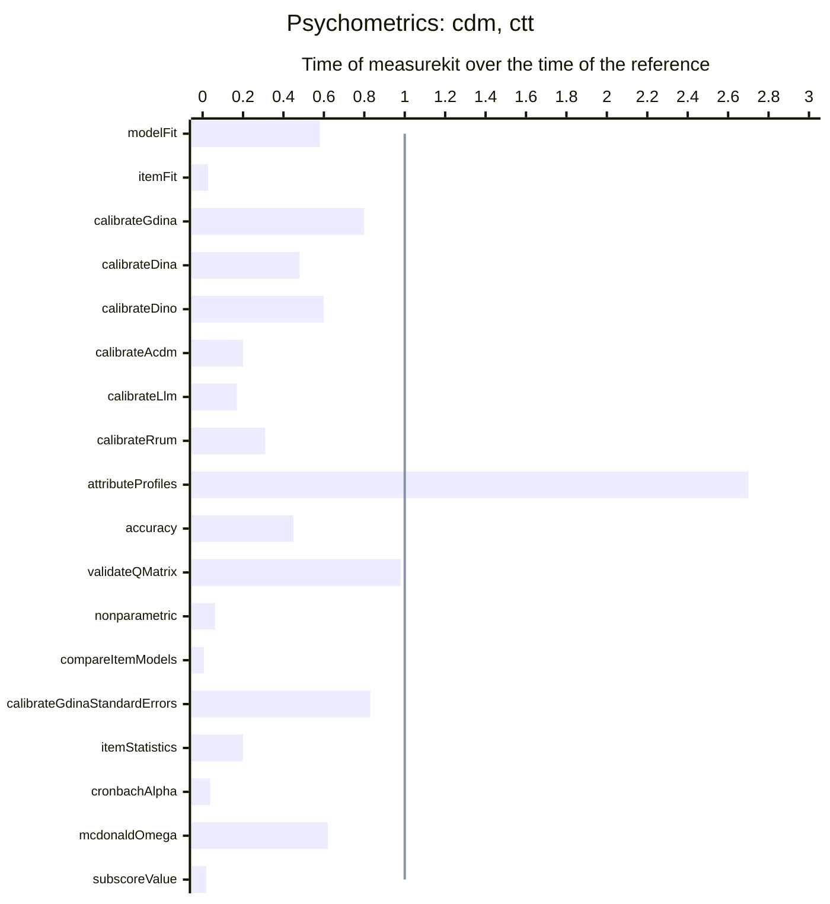

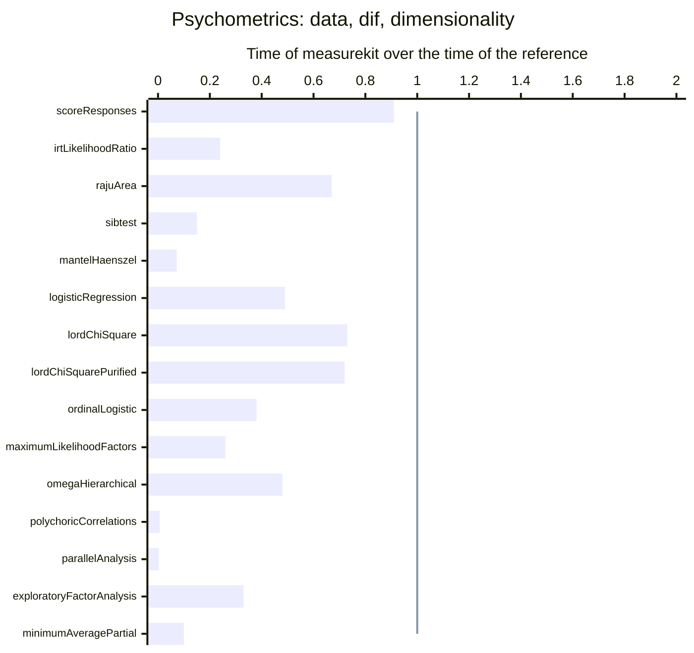

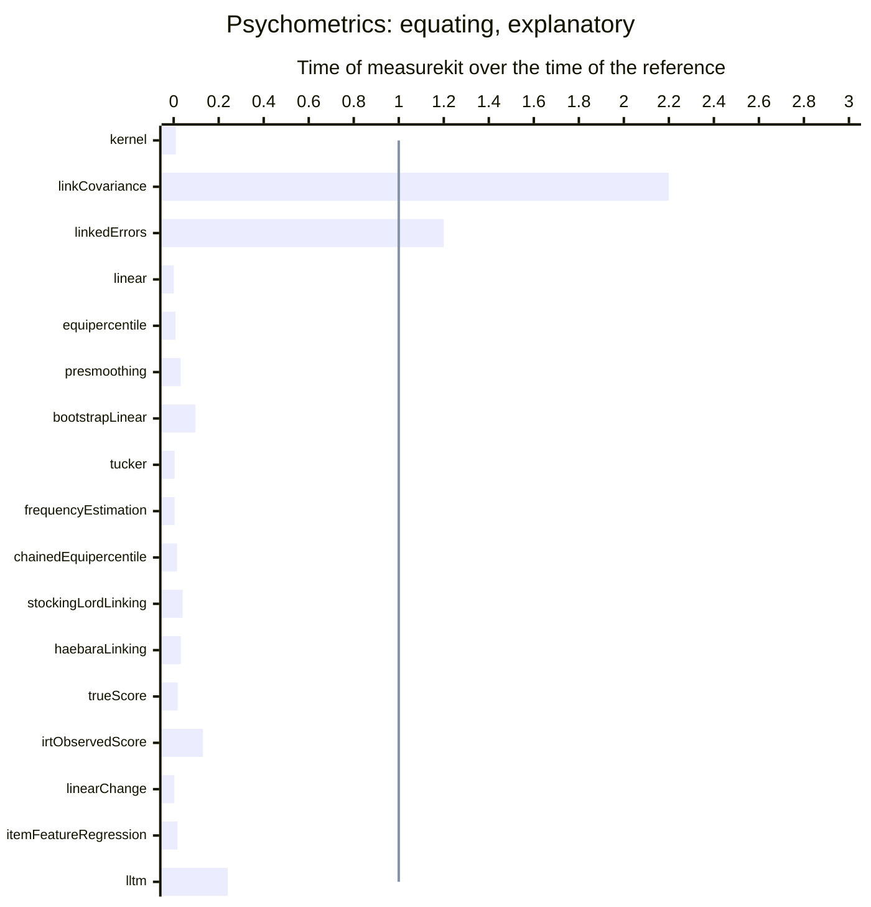

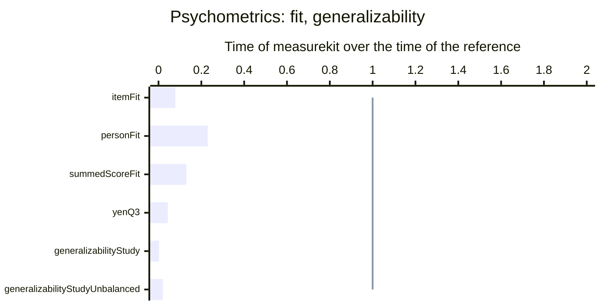

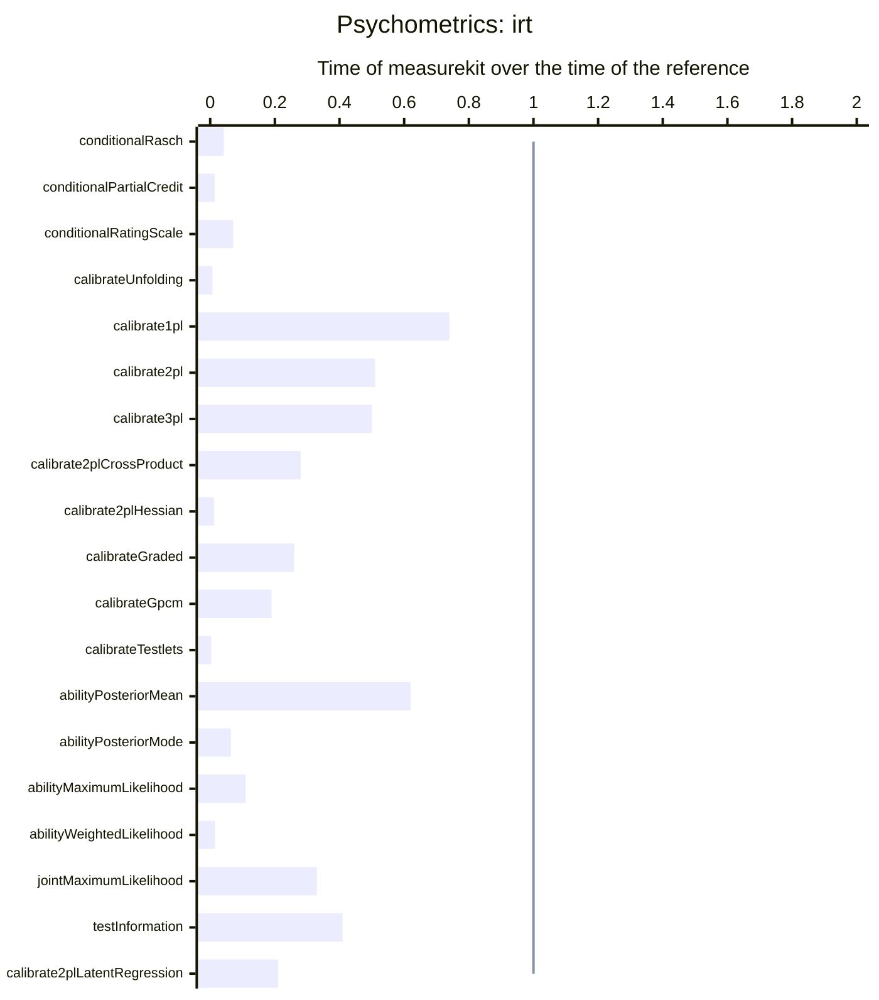

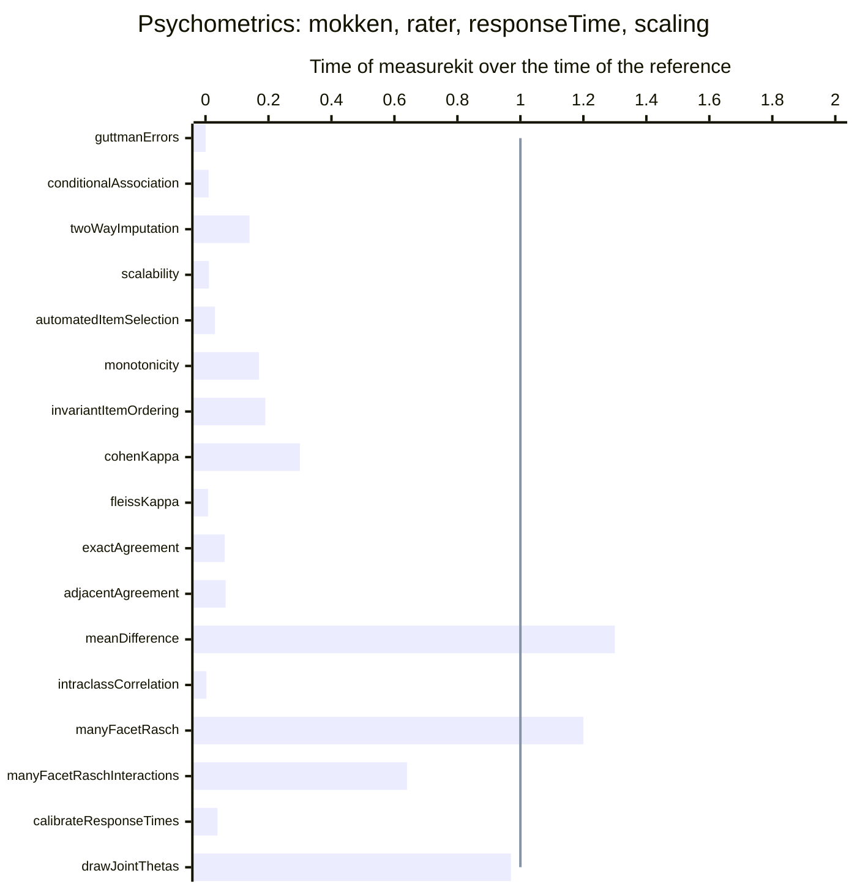

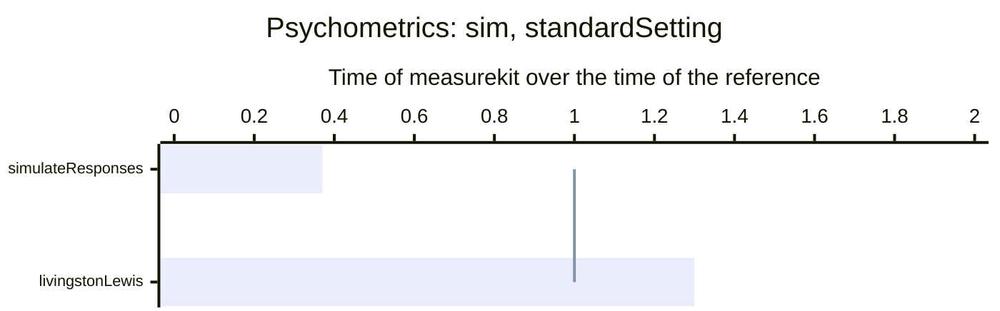

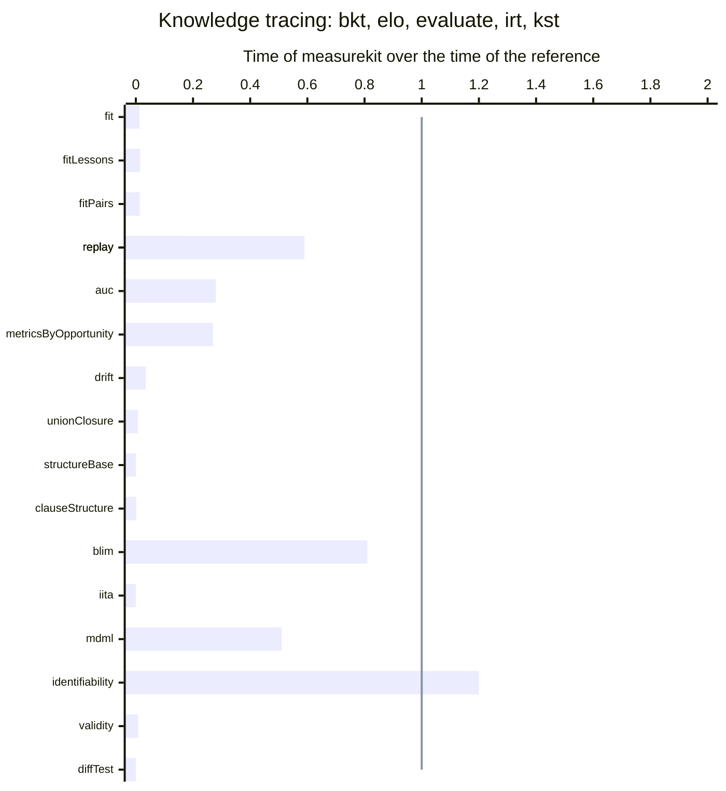

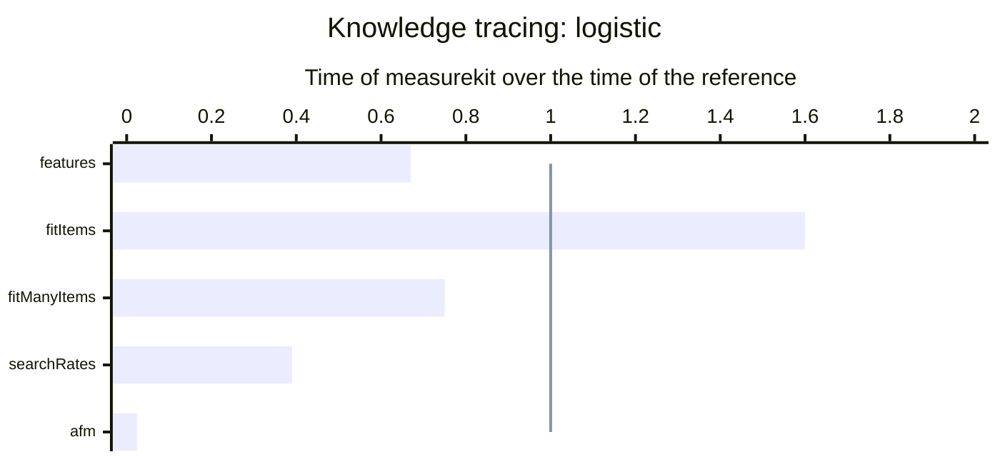

<!-- /charts -->

## Results

<!-- tables -->

Measured on Apple M5 with 10 cores, 16 GB of memory, Node.js 26.8.1 and R version 4.6.1 (2026-06-24).

### Core

| Task                       | Size                              | measurekit (ms) | Reference            | Reference (ms) |    Ratio |
| -------------------------- | --------------------------------- | --------------: | -------------------- | -------------: | -------: |
| Normal quantile function   | 1,000,000 probabilities           |            4.16 | stats 4.6.1 `qnorm`  |           5.44 |    0.76× |
| Logistic function          | 1,000,000 points                  |            2.37 | stats 4.6.1 `plogis` |           5.22 |    0.45× |
| **Cholesky factorization** | A correlation matrix of order 200 |           0.267 | base 4.6.1 `chol`    |          0.118 | **2.3×** |
| Uniform draws              | 1,000,000 draws                   |            3.09 | stats 4.6.1 `runif`  |           3.00 |       1× |
| Normal draws               | 1,000,000 draws                   |            8.84 | stats 4.6.1 `rnorm`  |           11.6 |    0.76× |

- Cholesky factorization: R's LAPACK calls OpenBLAS, whose kernels add and multiply two doubles per instruction and fuse each pair; JavaScript has neither. measurekit's loops share their reads across a block of 4 rows and 3 columns, and the same loops in C compiled without vector instructions or fused multiply-add take 0.77 times as long as measurekit's and, compiled with both, 0.48 times as long.

### Psychometrics

| Task                                                                                                             | Size                                                                                                         | measurekit (ms) | Reference                                                                                                 | Reference (ms) |    Ratio |
| ---------------------------------------------------------------------------------------------------------------- | ------------------------------------------------------------------------------------------------------------ | --------------: | --------------------------------------------------------------------------------------------------------- | -------------: | -------: |
| Calibration of a bifactor 2PL by EM with dimension reduction                                                     | 2,000 persons, 12 items, 3 specific dimensions                                                               |            60.9 | mirt 1.48 `bfactor(quadpts = 31)`                                                                         |          1,174 |   0.052× |
| Calibration of a bifactor 2PL by EM with dimension reduction                                                     | 2,000 persons, 40 items, 4 specific dimensions                                                               |             354 | mirt 1.48 `bfactor(quadpts = 31)`                                                                         |          4,032 |   0.088× |
| Simulation of adaptive tests by maximum information and the posterior mean                                       | 200 persons, a pool of 500 3PL items, 30 items each                                                          |             185 | catR 3.17 `randomCAT`                                                                                     |         10,999 |   0.017× |
| Simulation of adaptive tests that select testlets as units, by their mean information                            | 200 persons, a pool of 500 3PL items with 400 in testlets of 4, 30 items each                                |             193 | none                                                                                                      |                |          |
| Simulation of diagnostic adaptive tests by the G-DINA discrimination index                                       | 200 persons, a pool of 20 items over 4 attributes, 10 items each                                             |            11.8 | cdcatR 1.0.7 `cdcat`                                                                                      |            376 |   0.031× |
| Simulation of multidimensional adaptive tests by the determinant of the information                              | 100 persons, a pool of 200 two-dimensional items, 20 items each                                              |            58.2 | mirtCAT 1.14 `mirtCAT(criteria = "Drule")`                                                                |          5,014 |   0.012× |
| Routing cuts of a multistage panel by maximum information                                                        | a panel of 1-3-3-3 modules of 20 items, from a pool of 500 3PL items                                         |            1.81 | stats 4.6.1 `uniroot on the information curves`                                                           |           4.00 |    0.45× |
| One item selection under content bounds, by the information at the estimate                                      | a pool of 1000 3PL items in 12 content areas, a test of 30 items after 12                                    |           0.128 | mirtCAT 1.14 `findNextItem(objective = computeCriteria(criteria = "MI"))` with lpSolve's `lp`             |           5.33 |   0.024× |
| Assembly of parallel forms with enemies, by weighted deviations in rotation                                      | 4 forms of 40 items from a pool of 1000 3PL items in 5 content areas, with 30 pairs of enemies and 3 targets |            10.4 | highs 1.15.1.1 `highs_solve`                                                                              |         10,013 |   0.001× |
| M2 with its RMSEA and SRMSR of a G-DINA calibration                                                              | 1,000 persons, 20 items, 4 attributes                                                                        |            9.44 | GDINA 2.13.2 `modelfit`                                                                                   |           16.4 |    0.58× |
| The fit statistics of each item of a G-DINA calibration                                                          | 1,000 persons, 20 items, 4 attributes                                                                        |            2.19 | GDINA 2.13.2 `itemfit`                                                                                    |           80.0 |   0.027× |
| Calibration of the G-DINA model by EM                                                                            | 1,000 persons, 20 items, 4 attributes                                                                        |            76.8 | GDINA 2.13.2 `GDINA(model = "GDINA")`                                                                     |           96.0 |     0.8× |
| Calibration of the DINA model by EM                                                                              | 1,000 persons, 20 items, 4 attributes                                                                        |            18.5 | GDINA 2.13.2 `GDINA(model = "DINA")`                                                                      |           39.0 |    0.48× |
| Calibration of the DINO model by EM                                                                              | 1,000 persons, 20 items, 4 attributes                                                                        |            80.8 | GDINA 2.13.2 `GDINA(model = "DINO")`                                                                      |            134 |     0.6× |
| Calibration of the A-CDM model by EM                                                                             | 1,000 persons, 20 items, 4 attributes                                                                        |            23.0 | GDINA 2.13.2 `GDINA(model = "ACDM")`                                                                      |            118 |     0.2× |
| Calibration of the LLM model by EM                                                                               | 1,000 persons, 20 items, 4 attributes                                                                        |            29.0 | GDINA 2.13.2 `GDINA(model = "LLM")`                                                                       |            167 |    0.17× |
| Calibration of the R-RUM model by EM                                                                             | 1,000 persons, 20 items, 4 attributes                                                                        |            30.5 | GDINA 2.13.2 `GDINA(model = "RRUM")`                                                                      |           98.0 |    0.31× |
| **Posterior profiles of the persons of a calibration**                                                           | 1,000 persons, 20 items, 4 attributes                                                                        |           0.378 | GDINA 2.13.2 `personparm(what = "EAP")`                                                                   |          0.140 | **2.7×** |
| Accuracy and consistency of the classification                                                                   | 1,000 persons, 20 items, 4 attributes                                                                        |           0.472 | GDINA 2.13.2 `CA`                                                                                         |           1.04 |    0.45× |
| Validation of the Q-matrix by the proportion of variance accounted for                                           | 1,000 persons, 20 items, 4 attributes                                                                        |            2.65 | GDINA 2.13.2 `Qval(method = "PVAF")`                                                                      |           2.71 |    0.98× |
| Nonparametric classification by the Hamming distance                                                             | 1,000 persons, 20 items, 4 attributes                                                                        |            1.24 | NPCD 1.0.11 `AlphaNP`                                                                                     |           20.0 |   0.062× |
| Wald tests of the DINA, DINO, A-CDM, LLM and R-RUM against the G-DINA, for each item with two or more attributes | 1,000 persons, 20 items, 4 attributes                                                                        |           0.162 | GDINA 2.13.2 `modelcomp(method = "Wald")`                                                                 |           25.0 |  0.0065× |
| Calibration of the G-DINA model by EM, with the covariance of its success probabilities                          | 1,000 persons, 20 items, 4 attributes                                                                        |            82.4 | GDINA 2.13.2 `GDINA(model = "GDINA"), extract("catprob.cov", SE.type = 2)`                                |           99.0 |    0.83× |
| Item difficulty, discrimination and the statistics of the items                                                  | 3,000 persons, 50 items                                                                                      |            9.64 | psych 2.6.9 `alpha`                                                                                       |           48.0 |     0.2× |
| Cronbach's alpha                                                                                                 | 3,000 persons, 50 items                                                                                      |            1.74 | psych 2.6.9 `alpha`                                                                                       |           47.5 |   0.037× |
| McDonald's omega total of one factor                                                                             | 3,000 persons, 20 items                                                                                      |            4.96 | psych 2.6.9 `omega(nfactors = 1)`                                                                         |           8.00 |    0.62× |
| The value of five subscores of ten items over the total score                                                    | 3,000 persons, 50 items                                                                                      |            2.08 | subscore 3.3 `CTTsub`                                                                                     |            113 |   0.018× |
| Scoring of the choices of persons against a key                                                                  | 2,000 persons, 50 items of 4 options                                                                         |           0.656 | base 4.6.1 `t(t(choices) == key)`                                                                         |          0.718 |    0.91× |
| The likelihood-ratio test of every item, against the model with all items equal                                  | 2,000 persons in two groups, 15 items                                                                        |           1,586 | mirt 1.48 `multipleGroup, DIF(scheme = "drop")`                                                           |          6,592 |    0.24× |
| Raju's signed and unsigned areas of every item, with both groups calibrated by the 2PL                           | 2,000 persons in two groups, 15 items                                                                        |             319 | difR 6.1.0 `difRaju`                                                                                      |            474 |    0.67× |
| SIBTEST of every item, matched on the other items                                                                | 2,000 persons in two groups, 15 items                                                                        |            10.3 | difR 6.1.0 `difSIBTEST`                                                                                   |           69.0 |    0.15× |
| The Mantel-Haenszel test of every item                                                                           | 2,000 persons in two groups, 30 items                                                                        |            5.96 | difR 6.1.0 `difMH`                                                                                        |           83.0 |   0.072× |
| Logistic regression for uniform and nonuniform DIF of every item                                                 | 2,000 persons in two groups, 30 items                                                                        |            40.5 | difR 6.1.0 `difLogistic`                                                                                  |           83.0 |    0.49× |
| Lord's chi-square of every item, with both groups calibrated by the 2PL                                          | 2,000 persons in two groups, 30 items                                                                        |             676 | difR 6.1.0 `difLord`                                                                                      |            922 |    0.73× |
| Lord's chi-square of every item, purified until two rounds flag the same items                                   | 2,000 persons in two groups, 30 items                                                                        |             676 | difR 6.1.0 `difLord, purify = TRUE`                                                                       |            938 |    0.72× |
| Ordinal logistic regression of every item                                                                        | 1,000 persons in two groups, 10 items of 4 categories                                                        |            33.2 | rms 8.2.0 `lrm, three models for an item`                                                                 |           87.0 |    0.38× |
| Five factors by maximum likelihood with oblimin rotation, and their fit                                          | 2,800 persons, 25 items of 6 categories                                                                      |            17.5 | psych 2.6.9 `fa(nfactors = 5, fm = "ml", rotate = "oblimin")`                                             |           67.0 |    0.26× |
| Omega hierarchical and total from five group factors by minimum residuals                                        | 2,800 persons, 25 items of 6 categories                                                                      |            16.3 | psych 2.6.9 `omega(nfactors = 5, fm = "minres")`                                                          |           34.0 |    0.48× |
| Polychoric correlations of every pair of items                                                                   | 2,800 persons, 25 items of 6 categories                                                                      |            9.53 | psych 2.6.9 `polychoric`                                                                                  |          1,490 |  0.0064× |
| Parallel analysis of components and factors from polychoric correlations, 20 data sets                           | 2,800 persons, 25 items of 6 categories                                                                      |             100 | psych 2.6.9 `fa.parallel(cor = "poly")`                                                                   |         31,037 |  0.0032× |
| Five factors by minimum residuals with oblimin rotation, from Pearson correlations                               | 2,800 persons, 25 items of 6 categories                                                                      |            10.6 | psych 2.6.9 `fa(nfactors = 5, fm = "minres", rotate = "oblimin")`                                         |           32.0 |    0.33× |
| Velicer's minimum average partial test of 8 components, from Pearson correlations                                | 2,800 persons, 25 items of 6 categories                                                                      |            8.97 | psych 2.6.9 `VSS(n = 8)`                                                                                  |           90.0 |     0.1× |
| Kernel equating with its standard errors, from log-linear fits of degree 3                                       | 41 scores, two forms                                                                                         |            1.59 | kequate 1.6.4 `kequate("EG")`                                                                             |            162 |  0.0098× |
| **The link of a chain of three forms by Haebara's method, with its covariance**                                  | 3 forms of 20 items                                                                                          |            34.0 | equateIRT 2.5.2 `alldirec, chainec`                                                                       |           15.3 | **2.2×** |
| The standard errors of true-score equating through a mean-mean link                                              | 2 forms of 20 items                                                                                          |            14.5 | equateIRT 2.5.2 `score(se = TRUE)`                                                                        |           12.0 |     1.2× |
| Linear equating, random groups                                                                                   | 4,329 and 4,152 persons, 40 items                                                                            |           0.000 | equate 2.0.9 `equate(type = "linear")`                                                                    |          0.400 | 0.00083× |
| Equipercentile equating, random groups                                                                           | 4,329 and 4,152 persons, 40 items                                                                            |           0.002 | equate 2.0.9 `equate(type = "equipercentile")`                                                            |          0.280 |   0.008× |
| Log-linear presmoothing of a score distribution, degree 3                                                        | 41 scores                                                                                                    |           0.020 | equate 2.0.9 `presmoothing(smoothmethod = "loglinear")`                                                   |          0.660 |   0.031× |
| Standard errors of the linear equating by 100 bootstrap replications                                             | 4,329 and 4,152 persons, 40 items                                                                            |            23.3 | equate 2.0.9 `bootstrap`                                                                                  |            241 |   0.097× |
| Tucker linear equating, nonequivalent groups                                                                     | 1,655 and 1,638 persons, 36 items, an anchor of 12                                                           |           0.006 | equate 2.0.9 `equate(method = "tucker")`                                                                  |           1.29 |  0.0044× |
| Frequency estimation equipercentile equating                                                                     | 1,655 and 1,638 persons, 36 items, an anchor of 12                                                           |           0.008 | equate 2.0.9 `equate(method = "frequency estimation")`                                                    |           1.96 |  0.0039× |
| Chained equipercentile equating                                                                                  | 1,655 and 1,638 persons, 36 items, an anchor of 12                                                           |           0.010 | equate 2.0.9 `equate(method = "chained")`                                                                 |          0.680 |   0.015× |
| Stocking-Lord linking of the common items                                                                        | Two forms of 3PL items that share 10                                                                         |           0.059 | equateIRT 2.5.2 `direc(method = "Stocking-Lord")`                                                         |           1.50 |    0.04× |
| Haebara linking of the common items                                                                              | Two forms of 3PL items that share 10                                                                         |           0.054 | equateIRT 2.5.2 `direc(method = "Haebara")`                                                               |           1.68 |   0.032× |
| IRT true score equating of the linked forms                                                                      | Two forms of 3PL items that share 10                                                                         |           0.047 | equateIRT 2.5.2 `score(method = "TSE")`                                                                   |           2.67 |   0.018× |
| IRT observed score equating of the linked forms                                                                  | Two forms of 3PL items that share 10                                                                         |           0.274 | equateIRT 2.5.2 `score(method = "OSE")`                                                                   |           2.08 |    0.13× |
| The linear logistic model of change: a trend and a group effect on each item                                     | 2,000 persons, 8 items, 2 occasions, 2 groups                                                                |           0.857 | eRm 1.0.10 `LLRA`                                                                                         |            274 |  0.0031× |
| Regression of item difficulties on three features by REML                                                        | 300 items, 3 features                                                                                        |           0.318 | metafor 5.2.1 `rma(method = "REML")`                                                                      |           18.5 |   0.017× |
| The linear logistic test model: the effects of three features on difficulty, by EM                               | 1,000 persons, 20 items, 3 features                                                                          |            67.7 | mirt 1.48 `mirt(itemtype = "Rasch", itemdesign), Oakes standard errors`                                   |            283 |    0.24× |
| Infit and outfit of the items                                                                                    | 2,000 persons, 40 items                                                                                      |            1.70 | mirt 1.48 `itemfit(fit_stats = "infit")`                                                                  |           21.5 |   0.079× |
| Infit, outfit and the standardized log-likelihood of the persons                                                 | 2,000 persons, 40 items                                                                                      |            4.05 | mirt 1.48 `personfit`                                                                                     |           17.3 |    0.23× |
| The summed-score statistic S-X2 of the items                                                                     | 2,000 persons, 40 items                                                                                      |            5.06 | mirt 1.48 `itemfit(fit_stats = "S_X2")`                                                                   |           38.0 |    0.13× |
| Yen's Q3 of every pair of items                                                                                  | 2,000 persons, 40 items                                                                                      |            5.28 | mirt 1.48 `residuals(type = "Q3")`                                                                        |            121 |   0.044× |
| Variance components of a fully crossed design of three facets                                                    | 200 persons, 10 items, 4 raters: 8,000 scores                                                                |            1.97 | lme4 2.1.0 `lmer, six random effects, REML`                                                               |            764 |  0.0026× |
| Variance components of a design of three facets with a quarter of the scores missing, by Henderson's Method 1    | 200 persons, 10 items, 4 raters: 6,058 scores                                                                |            2.54 | base 4.6.1 `method_one, Henderson's Method 1`                                                             |            123 |   0.021× |
| The Rasch model by conditional maximum likelihood                                                                | 2,000 persons, 15 items                                                                                      |            3.81 | eRm 1.0.10 `RM`                                                                                           |           91.0 |   0.042× |
| The partial credit model by conditional maximum likelihood                                                       | 1,500 persons, 8 items of 4 categories                                                                       |            3.19 | eRm 1.0.10 `PCM`                                                                                          |            230 |   0.014× |
| The rating scale model by conditional maximum likelihood                                                         | 1,500 persons, 8 items of 4 categories                                                                       |            3.61 | eRm 1.0.10 `RSM`                                                                                          |           50.5 |   0.071× |
| Calibration of the generalized graded unfolding model                                                            | 2,000 persons, 15 items of 4 categories                                                                      |             274 | mirt 1.48 `mirt(itemtype = "ggum")`                                                                       |         39,232 |   0.007× |
| Calibration of the one-parameter model by EM                                                                     | 2,000 persons, 40 dichotomous items                                                                          |            75.3 | mirt 1.48 `mirt(itemtype = "Rasch")`                                                                      |            102 |    0.74× |
| Calibration of the two-parameter model by EM                                                                     | 2,000 persons, 40 dichotomous items                                                                          |            94.6 | mirt 1.48 `mirt(itemtype = "2PL")`                                                                        |            187 |    0.51× |
| Calibration of the three-parameter model by EM                                                                   | 2,000 persons, 40 dichotomous items                                                                          |             570 | mirt 1.48 `mirt(itemtype = "3PL")`                                                                        |          1,145 |     0.5× |
| The two-parameter model with cross-product standard errors                                                       | 2,000 persons, 40 dichotomous items                                                                          |             113 | mirt 1.48 `mirt(SE.type = "crossprod")`                                                                   |            401 |    0.28× |
| The two-parameter model with standard errors from the Hessian                                                    | 500 persons, 20 items                                                                                        |            85.2 | mirt 1.48 `mirt(SE.type = "Richardson")`                                                                  |          6,825 |   0.012× |
| Calibration of the graded response model by EM                                                                   | 1,500 persons, 20 items of 5 categories                                                                      |            45.7 | mirt 1.48 `mirt(itemtype = "graded")`                                                                     |            173 |    0.26× |
| Calibration of the generalized partial credit model by EM                                                        | 1,500 persons, 20 items of 5 categories                                                                      |            70.9 | mirt 1.48 `mirt(itemtype = "gpcm")`                                                                       |            375 |    0.19× |
| Calibration of the testlet model by EM                                                                           | 1,000 persons, 6 testlets of 5 items                                                                         |            54.9 | mirt 1.48 `bfactor`                                                                                       |         17,934 |  0.0031× |
| Ability by the posterior mean                                                                                    | 2,000 persons, the 40 items of the calibration                                                               |            21.3 | mirt 1.48 `fscores(method = "EAP")`                                                                       |           34.5 |    0.62× |
| Ability by the posterior mode                                                                                    | 2,000 persons, the 40 items of the calibration                                                               |            66.1 | mirt 1.48 `fscores(method = "MAP")`                                                                       |          1,035 |   0.064× |
| Ability by maximum likelihood                                                                                    | 2,000 persons, the 40 items of the calibration                                                               |            66.0 | mirt 1.48 `fscores(method = "ML")`                                                                        |            616 |    0.11× |
| Ability by weighted likelihood                                                                                   | 2,000 persons, the 40 items of the calibration                                                               |             123 | mirt 1.48 `fscores(method = "WLE")`                                                                       |          8,172 |   0.015× |
| Joint maximum likelihood calibration of the Rasch model                                                          | 2,000 persons, 40 items                                                                                      |            8.98 | TAM 4.3.25 `tam.jml`                                                                                      |           27.0 |    0.33× |
| The posterior mean of the ability given each summed score                                                        | 40 items                                                                                                     |           0.178 | none                                                                                                      |                |          |
| Information of a test at 121 values of theta                                                                     | 40 items                                                                                                     |           0.597 | mirt 1.48 `testinfo`                                                                                      |           1.44 |    0.41× |
| Calibration of the two-parameter model with a latent regression by EM                                            | 2,000 persons, 40 dichotomous items                                                                          |             121 | mirt 1.48 `mirt(itemtype = "2PL", covdata, formula = ~ x)`                                                |            583 |    0.21× |
| The Guttman errors of every person                                                                               | 433 persons, 20 items of 5 categories                                                                        |           0.468 | mokken 3.1.2 `check.errors`                                                                               |            860 | 0.00054× |
| The W1, W2 and W3 indices of conditional association                                                             | 433 persons, 20 items of 5 categories                                                                        |            36.7 | mokken 3.1.2 `check.ca(Windex = TRUE)`                                                                    |          3,495 |    0.01× |
| Two-way imputation of the missing responses                                                                      | 433 persons, 20 items of 5 categories, one in ten missing                                                    |           0.361 | mokken 3.1.2 `twoway`                                                                                     |           2.53 |    0.14× |
| Scalability coefficients with standard errors                                                                    | 433 persons, 20 items of 5 categories                                                                        |            2.13 | mokken 3.1.2 `coefH(se = TRUE)`                                                                           |            192 |   0.011× |
| Automated item selection into Mokken scales                                                                      | 433 persons, 20 items of 5 categories                                                                        |           0.923 | mokken 3.1.2 `aisp`                                                                                       |           31.0 |    0.03× |
| The check of monotonicity of every item                                                                          | 433 persons, 20 items of 5 categories                                                                        |            1.89 | mokken 3.1.2 `check.monotonicity`                                                                         |           10.8 |    0.17× |
| The check of invariant item ordering, with selection of items                                                    | 433 persons, 20 items of 5 categories                                                                        |            12.4 | mokken 3.1.2 `check.iio(method = "MIIO")`                                                                 |           65.0 |    0.19× |
| Calibration of a trait over three occasions by EM                                                                | 1,000 persons, 3 occasions of 10 items                                                                       |           2,011 | mirt 1.48 `mirt(model, constrain, quadpts = 21)`                                                          |         46,897 |   0.043× |
| Calibration of a confirmatory two-dimensional 2PL by EM                                                          | 1,000 persons, 24 items, 2 correlated dimensions                                                             |             222 | mirt 1.48 `mirt(model, quadpts = 31)`                                                                     |            744 |     0.3× |
| Calibration of a confirmatory two-dimensional graded model by EM                                                 | 1,000 persons, 20 items of 4 categories, 2 correlated dimensions                                             |             278 | mirt 1.48 `mirt(itemtype = "graded", quadpts = 31)`                                                       |          1,789 |    0.16× |
| Calibration of an exploratory two-dimensional 2PL by EM                                                          | 1,000 persons, 20 items, 2 dimensions                                                                        |           1,566 | mirt 1.48 `mirt(data, 2, quadpts = 31)`                                                                   |          2,864 |    0.55× |
| Calibration of a confirmatory two-dimensional 2PL in two groups by EM                                            | 1,000 persons in 2 groups, 24 items, 2 correlated dimensions                                                 |             339 | mirt 1.48 `multipleGroup(invariance = c("slopes", "intercepts", "free_means", "free_var"), quadpts = 31)` |          2,168 |    0.16× |
| Calibration of a five-dimensional graded model by Metropolis-Hastings Robbins-Monro                              | 800 persons, 25 items of 6 categories, 5 correlated dimensions                                               |          10,844 | mirt 1.48 `mirt(method = "MHRM")`                                                                         |         15,487 |     0.7× |
| Abilities by the posterior mode, in two dimensions                                                               | 1,000 persons, 24 items                                                                                      |            33.9 | mirt 1.48 `fscores(method = "MAP")`                                                                       |            746 |   0.045× |
| Abilities by the posterior mean, in two dimensions                                                               | 1,000 persons, 24 items                                                                                      |            31.1 | mirt 1.48 `fscores(method = "EAP")`                                                                       |           47.5 |    0.65× |
| Oblimin rotation of the loadings of a calibration                                                                | 20 items, 2 dimensions                                                                                       |           0.029 | GPArotation 2026.8.2 `oblimin`                                                                            |          0.220 |    0.13× |
| Varimax rotation of the loadings of a calibration                                                                | 20 items, 2 dimensions                                                                                       |           0.022 | GPArotation 2026.8.2 `Varimax`                                                                            |          0.077 |    0.28× |
| Cohen's kappa of two raters                                                                                      | 2,000 subjects, 5 categories                                                                                 |           0.073 | irr 0.85 `kappa2`                                                                                         |          0.240 |     0.3× |
| Fleiss' kappa of five raters                                                                                     | 500 subjects, 5 raters, 5 categories                                                                         |           0.065 | irr 0.85 `kappam.fleiss`                                                                                  |           8.00 |  0.0081× |
| The share of subjects on whom five raters agree exactly                                                          | 500 subjects, 5 raters, 5 categories                                                                         |           0.021 | irr 0.85 `agree(tolerance = 0)`                                                                           |          0.348 |   0.061× |
| The share of subjects whose ratings are within one category                                                      | 500 subjects, 5 raters, 5 categories                                                                         |           0.022 | irr 0.85 `agree(tolerance = 1)`                                                                           |          0.348 |   0.064× |
| The standardized mean difference of two raters                                                                   | 2,000 subjects, 2 raters                                                                                     |           0.203 | effsize 0.8.1 `cohen.d`                                                                                   |          0.152 |     1.3× |
| The six intraclass correlations of four raters                                                                   | 200 subjects, 4 raters                                                                                       |           0.016 | psych 2.6.9 `ICC`                                                                                         |           5.50 |  0.0029× |
| The many-facet Rasch model of items and raters, with standard errors                                             | 200 persons, 10 items, 4 raters: 8,000 scores                                                                |            55.6 | TAM 4.3.25 `tam.mml.mfr(formulaA = ~ item + rater + step)`                                                |           45.0 |     1.2× |
| The many-facet Rasch model of items and raters with their interaction, with standard errors                      | 150 persons, 8 items, 3 raters: 3,600 scores                                                                 |            41.6 | TAM 4.3.25 `tam.mml.mfr(formulaA = ~ item + rater + item:rater + step)`                                   |           65.0 |    0.64× |
| The lognormal model of the response times                                                                        | 1,000 persons, 20 items                                                                                      |            6.04 | nlme 3.1.169 `lme(logtime ~ 0 + item, random = ~ 1                                                        |       person)` |      161 | 0.038× |
| The joint model of speed and accuracy, with the 2PL                                                              | 1,000 persons, 20 items                                                                                      |             476 | none                                                                                                      |                |          |
| Speed of each person given the times of the items                                                                | 1,000 persons, 20 items                                                                                      |           0.961 | none                                                                                                      |                |          |
| Joint draws of theta from separate posteriors by a Gaussian copula                                               | 2,000 draws, 6 posteriors of 241 nodes                                                                       |           0.648 | mvtnorm 1.4.2 `rmvnorm(method = "eigen")`                                                                 |          0.667 |    0.97× |
| A conversion table of the posterior mean of theta given each summed score                                        | 40 items                                                                                                     |           0.304 | none                                                                                                      |                |          |
| A conversion table of the theta of each summed true score                                                        | 40 items                                                                                                     |           0.508 | none                                                                                                      |                |          |
| The cut score of a bookmark in an ordered item booklet                                                           | 40 items                                                                                                     |           0.029 | none                                                                                                      |                |          |
| Accuracy and consistency of the classification by two cuts                                                       | 2,000 persons                                                                                                |           0.326 | none                                                                                                      |                |          |
| Conversion of 2PL items to mirt's slope-intercept form                                                           | 10,000 items                                                                                                 |            1.16 | none                                                                                                      |                |          |
| Conversion of 2PL items to mirt's IRT form                                                                       | 10,000 items                                                                                                 |            1.21 | none                                                                                                      |                |          |
| Simulation of the abilities of persons and their responses to 2PL items                                          | 2,000 persons, 40 items                                                                                      |            2.21 | mirt 1.48 `simdata(itemtype = "dich")`                                                                    |           6.00 |    0.37× |
| Livingston and Lewis's accuracy and consistency by one cut                                                       | 3,000 scores of 40 items                                                                                     |           0.490 | betafunctions 2.0.0 `LL.CA`                                                                               |          0.364 |     1.3× |

- Simulation of adaptive tests that select testlets as units, by their mean information: catR has no testlets, so no reference does this task.
- Assembly of parallel forms with enemies, by weighted deviations in rotation: highs finds the forms whose largest gap from the target is smallest (minimax), to its limit of 10 seconds..
- The fit statistics of each item of a G-DINA calibration: itemfit's expected values come from a simulation of persons, and measurekit's are exact sums over the profiles.
- Posterior profiles of the persons of a calibration: personparm multiplies the log posterior that the fit stored by the profiles, which is work of the fit; measurekit's calibration holds no posterior, so it computes each person's from the responses, and returns the posterior, the probability of each attribute and the MAP and EAP profiles. The same computation in R, with matrix products, takes 0.69 ms.
- Wald tests of the DINA, DINO, A-CDM, LLM and R-RUM against the G-DINA, for each item with two or more attributes: modelcomp computes the covariance of the success probabilities of the fit again for each item; measurekit's comes with its calibration, which cdm.calibrateGdinaStandardErrors times.
- Raju's signed and unsigned areas of every item, with both groups calibrated by the 2PL: difRaju calibrates by ltm's marginal maximum likelihood, and measurekit by EM.
- Five factors by maximum likelihood with oblimin rotation, and their fit: fa also computes factor scores' statistics and other fit indices, which measurekit leaves out.
- Omega hierarchical and total from five group factors by minimum residuals: omega also computes the fit of the general factor and of the group factors, which measurekit leaves out.
- Five factors by minimum residuals with oblimin rotation, from Pearson correlations: fa also computes fit statistics, and this task leaves them out.
- Velicer's minimum average partial test of 8 components, from Pearson correlations: VSS also fits 8 factor solutions with their very simple structure and fit statistics, which this task leaves out.
- The link of a chain of three forms by Haebara's method, with its covariance: alldirec links each pair of forms both ways, twice the links of the chain, as chainec takes no other list; equateIRT differentiates the links analytically, and measurekit, for items of any model, by central differences, which minimize a link twice for each parameter of a common item.
- The Rasch model by conditional maximum likelihood: eRm maximizes with nlm, which stops on its own criteria, and measurekit by Newton's method to a change of 1e-6.
- The partial credit model by conditional maximum likelihood: eRm maximizes with nlm, which stops on its own criteria, and measurekit by Newton's method to a change of 1e-6.
- The rating scale model by conditional maximum likelihood: eRm maximizes with nlm, which stops on its own criteria, and measurekit by Newton's method to a change of 1e-6.
- Calibration of the generalized graded unfolding model: measurekit fits in the GGUM package's three stages from its starts, and mirt from its own starts.
- The W1, W2 and W3 indices of conditional association: check.ca removes the item with the most flags and runs again until none is flagged, and measurekit runs its first pass.
- Calibration of a trait over three occasions by EM: the occasions are dimensions, and the items of each occasion are columns tied by constrain.
- Calibration of an exploratory two-dimensional 2PL by EM: mirt stops at its limit of 500 cycles when it has not converged.
- Calibration of a five-dimensional graded model by Metropolis-Hastings Robbins-Monro: both draw the abilities, so the time depends on the seed; mirt runs with one.
- The lognormal model of the response times: measurekit also estimates the item discriminations.
- Joint draws of theta from separate posteriors by a Gaussian copula: the posteriors' distribution functions are inverted by base R's approx.

### Knowledge tracing

| Task                                                                                                                                  | Size                                             | measurekit (ms) | Reference                                 | Reference (ms) |     Ratio |
| ------------------------------------------------------------------------------------------------------------------------------------- | ------------------------------------------------ | --------------: | ----------------------------------------- | -------------: | --------: |
| Fit of the skills of a log by EM from five starts                                                                                     | 20,000 attempts of 200 learners at 5 skills      |             137 | pyBKT 1.4.3 `Model.fit`                   |         10,224 |    0.013× |
| Fit of the skills of a log by EM from five starts, a fifth of its attempts without an outcome                                         | 20,000 attempts of 200 learners at 5 skills      |             203 | pyBKT 1.4.3 `Model.fit`, correct = -1     |         13,588 |    0.015× |
| Fit of the skills of a log by EM from five starts, learn and forget rates by pair of items                                            | 20,000 attempts of 200 learners at 5 skills      |             301 | pyBKT 1.4.3 `Model.fit(multipair = True)` |         20,991 |    0.014× |
| Replay of the log through the fitted model, a prediction and an update for each attempt                                               | 20,000 attempts of 200 learners at 5 skills      |            8.32 | pyBKT 1.4.3 `Model.predict`               |            288 |    0.029× |
| Replay of a log through the learner-item Elo model                                                                                    | 100,000 attempts of 2,000 learners at 400 items  |            17.9 | base R, a loop over the attempts          |           30.5 |     0.59× |
| The area under the ROC curve                                                                                                          | 100,000 predictions                              |            9.09 | pROC 1.19.1 `auc(roc(direction = "<"))`   |           32.0 |     0.28× |
| The AUC, RMSE, log-loss and accuracy of the predictions                                                                               | 100,000 predictions                              |            13.9 | none                                      |                |           |
| The metrics of predictions by opportunity, over all skills and for each skill                                                         | 50,000 events of 2,000 learners at 5 skills      |            17.9 | pROC 1.19.1 `auc(roc(direction = "<"))`   |           66.0 |     0.27× |
| Replay of the responses of learners, the grid posterior of the ability updated after each                                             | 2,000 learners, 40 responses each                |             272 | mirt 1.48 `fscores(method = "EAP")`       |          1,777 |     0.15× |
| Replay of the responses of learners, the posterior advanced by drift and updated after each                                           | 200 learners, 40 responses each, 241 points      |             199 | base R, the forward pass in logs          |          5,642 |    0.035× |
| Closure under union of the 12 atoms of a space                                                                                        | 12 elements, 125 states                          |           0.090 | kst 0.5.6 `kspace`                        |           11.6 |   0.0078× |
| Base of a space                                                                                                                       | 12 elements, 125 states                          |           0.059 | kst 0.5.6 `kbase`                         |          1,614 | 0.000037× |
| Space of clauses, by enumeration of the subsets in base R                                                                             | 12 elements, 4096 subsets                        |           0.369 | base R `expand.grid` and `apply`          |            338 |   0.0011× |
| Fit of the basic local independence model of a chain of 12 items by EM                                                                | 1,000 persons, 12 items, 13 states               |            20.6 | pks 0.8.0 `blim`                          |           25.5 |     0.81× |
| Inductive item tree analysis of the responses                                                                                         | 1,000 persons, 12 items                          |            1.13 | DAKS 2.1.3 `iita(v = 1)`                  |         73,057 | 0.000015× |
| Fit of the basic local independence model of a chain of 12 items by minimum discrepancy maximum likelihood                            | 1,000 persons, 12 items, 13 states               |            58.4 | pks 0.8.0 `blim(method = "MDML")`         |            115 |     0.51× |
| Rank of the Jacobian of the pattern probabilities of the model of a chain of 12 items                                                 | 12 items, 13 states, 36 parameters               |            12.7 | pks 0.8.0 `jacobian` and `qr`             |           10.8 |      1.2× |
| Validity of the chain against the responses: gamma, violational coefficient, solution rates, discrepancy index and distance agreement | 1,000 persons, 12 items, 13 states               |            1.09 | kst 0.5.6 `kvalidate`                     |            136 |    0.008× |
| Test of the fit of the chain of 6 items to the responses                                                                              | 1,000 persons, 6 items                           |           0.481 | DAKS 2.1.3 `z_test(v = 1)`                |          1,850 |  0.00026× |
| The 16 features of LKT's other names, before each event                                                                               | 1,941 events of 17 learners, 16 features         |            38.5 | LKT 1.7.0 `computefeatures`               |           57.0 |     0.67× |
| **Fit with an intercept for each skill and item, a proficiency for each learner and a ridge of 1**                                    | 20,000 events of 200 learners at 1,000 items     |            38.9 | LiblineaR 2.10.26 `LiblineaR(type = 0)`   |           24.5 |  **1.6×** |
| Fit with an intercept for each skill and item, a proficiency for each learner and a ridge of 1                                        | 150,000 events of 3,000 learners at 49,546 items |             286 | LiblineaR 2.10.26 `LiblineaR(type = 0)`   |            381 |     0.75× |
| Search for the decay of a proportion of successes and the exponent of a recency                                                       | 3,600 events of 60 learners at 4 skills, 2 rates |             177 | LKT 1.7.0 `LKT(seedpars = c(0.5, 0.5))`   |            454 |     0.39× |
| Fit of the additive factors model by maximum likelihood                                                                               | 20,000 attempts of 200 learners at 5 skills      |            10.7 | base R `glm`, binomial family             |            426 |    0.025× |
| The candidates ranked by their distance to the band of success of a learner                                                           | 500 candidate items, an Elo model                |           0.044 | none                                      |                |           |
| A log built from and checked for events                                                                                               | 100,000 events                                   |            14.3 | none                                      |                |           |

- Replay of the responses of learners, the grid posterior of the ability updated after each: mirt scores each of the 40 prefixes of the responses from the first; measurekit updates the posterior by the one response and predicts it. A scoring of the final patterns alone takes a fortieth of the time.
- Space of clauses, by enumeration of the subsets in base R: no package takes clauses.
- Fit of the basic local independence model of a chain of 12 items by minimum discrepancy maximum likelihood: pks and measurekit both stop within 1e-9 of the maximum: pks when no parameter changes by more than 1e-8, after 330 iterations, and measurekit when the log-likelihood changes by at most 1e-8, after 331. At pks's tolerance of 1e-4 it stops after 41 iterations, 2.5e-3 from the maximum.
- Rank of the Jacobian of the pattern probabilities of the model of a chain of 12 items: pks's `jacobian` takes 10 ms and `qr` 1 ms, measurekit's Jacobian 5 ms and its rank 10 ms: the rank orthogonalizes each column twice by Gram-Schmidt in JavaScript, where `qr` runs LINPACK's Householder in Fortran.
- The 16 features of LKT's other names, before each event: measurekit replays the log once with every feature in one model.
- Fit with an intercept for each skill and item, a proficiency for each learner and a ridge of 1: the time of the reference includes the features and the design from the events, as measurekit's does; both stop at the gradient that LiblineaR reaches at epsilon 0.0001 (0.0074 at 1,000 items, 0.22 at 50,000), where measurekit takes 1.6 and 0.75 times as long: its solver is JavaScript, each Hessian-vector product taking 3.5 times as long as the same loop in C, and its features and design take 0.7 and 0.4 times as long as the reference's; at its default gradient of 1e-8 it takes 1.7 times as long as at these.
- Search for the decay of a proportion of successes and the exponent of a recency: each fit of the search is one of LiblineaR in LKT and one of Newton's method in measurekit.
- Fit of the additive factors model by maximum likelihood: the proficiency of a learner is a fixed effect, as measurekit's default is none.

<!-- /tables -->

## Iterations

The iterations that each EM calibration of the tables needed to reach its tolerance, on the data of the benchmark. A ratio
of times is the product of a ratio of iterations and a ratio of the time of one. The one-parameter to the generalized partial
credit calibrations, the multidimensional ones, the many-facet Rasch model and the linear logistic test model of
measurekit extrapolate EM with SQUAREM, as mirt does with Ramsay's method; the others run plain EM. Every EM iteration
counts, those that follow an extrapolation included. EM stops when an iteration changes no parameter by more than the
tolerance, which leaves the estimates some distance from the maximum, more where EM contracts slowly. Extrapolated, they
stop closer to it than plain EM does, by up to about 1e-3 at the default tolerance (the confirmatory 2PL is 1.3e-4 from
the maximum, was 4.8e-4); at a tolerance of 1e-8 both are at it.

| Calibration                         | measurekit | Reference |
| ----------------------------------- | ---------: | --------: |
| One-parameter model                 |         10 |         9 |
| Two-parameter model                 |         13 |        19 |
| Three-parameter model               |         81 |       183 |
| Graded response model               |         12 |        11 |
| Generalized partial credit model    |         19 |        37 |
| Confirmatory two-dimensional 2PL    |         12 |        24 |
| Confirmatory two-dimensional graded |         12 |        43 |
| Exploratory two-dimensional 2PL     |        100 |       135 |
| G-DINA                              |        187 |       184 |
| DINA                                |         44 |        45 |
| DINO                                |        195 |       231 |
| A-CDM                               |         40 |        33 |
| LLM                                 |         52 |        61 |
| R-RUM                               |         53 |        27 |

## Method

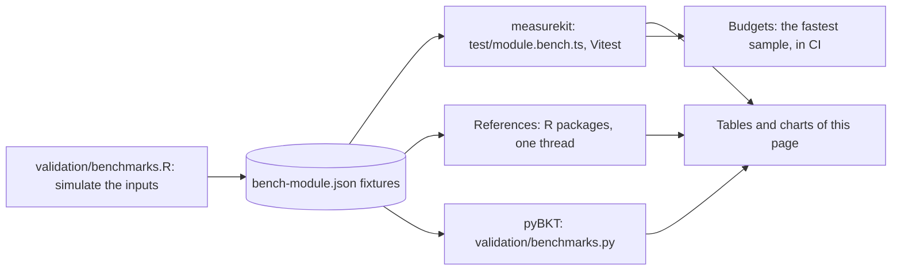

Each benchmark times the hot path of a module, and the same task on the same data in the reference implementation that the
[validation](psychometrics/validation.md) uses: an R package, base R where no package does the task, or pyBKT. The ratio is
the time of measurekit over the time of the reference, so a ratio above 1 means that measurekit is slower. A ratio above
1.5 is in bold in the tables.

| Part       | How                                                                                                                                                                                                                                                                                                                                                                                                                                                                                                            |
| ---------- | -------------------------------------------------------------------------------------------------------------------------------------------------------------------------------------------------------------------------------------------------------------------------------------------------------------------------------------------------------------------------------------------------------------------------------------------------------------------------------------------------------------- |
| Data       | `validation/benchmarks.R` simulates the inputs with a fixed seed, or takes a public dataset, and writes them to `packages/<package>/test/fixtures/bench-<module>.json`. measurekit and its reference read the same data.                                                                                                                                                                                                                                                                                       |
| measurekit | `packages/<package>/test/<module>.bench.ts`, run by Vitest on Node.js with one thread, against the build of the package, which `pnpm bench` makes first: Vitest's module runner turns each import of a source file into a getter that the compiler cannot inline, so that it times a call of a small function several times as slow as it is for a user. A benchmark takes at least 10 samples, or 5 when it takes a second or more, after a warm-up. The tables give the median of the medians of three runs. |
| References | `validation/benchmarks/<package>/<module>.R`, run with one thread: `OPENBLAS_NUM_THREADS=1` and `OMP_NUM_THREADS=1` set R's BLAS. A task takes 15 samples under a second, 7 under 15 seconds, 3 under a minute and 2 above, after one call to warm up.                                                                                                                                                                                                                                                         |
| pyBKT      | `validation/benchmarks.py`, on the log of `bench-bkt.json`, with its processes off. It times what R does not.                                                                                                                                                                                                                                                                                                                                                                                                  |
| Settings   | A reference runs with the settings that make its work that of measurekit: the same quadrature, convergence tolerance and starts. The notes under a table name where they differ.                                                                                                                                                                                                                                                                                                                               |
| Order      | On a machine shared with other work, the runs of measurekit and of its reference alternate, three of each, so that the load falls on both; the times are the medians of the three.                                                                                                                                                                                                                                                                                                                             |
| Ratio      | The median of measurekit over the median of the reference.                                                                                                                                                                                                                                                                                                                                                                                                                                                     |

An EM calibration stops when its estimates stop changing, so two programs that agree on the criterion can need different
numbers of iterations: the ratio is that of the time to the same answer, not of one iteration. The ability estimators and the
replays compare the work for each person, and the notes say where the reference does less.

## Running

```bash
pnpm install
OPENBLAS_NUM_THREADS=1 OMP_NUM_THREADS=1 Rscript validation/benchmarks.R               # the inputs and the references
validation/knowledge-tracing/.venv/bin/python validation/benchmarks.py                  # pyBKT
pnpm bench                                                                              # measurekit, against the budgets
```

`Rscript validation/benchmarks.R irt mokken` runs the modules named, and `knowledge-tracing/irt` one module of a package.
To refresh the charts and tables, run each package with the JSON reporter three times, with the run number in the name of the
file, after a run of the references each time, whose `results/r.json` is copied to `results/r-1.json` and so on, then
`Rscript validation/benchmarks.R table`, which takes the median of the runs of each side:

```bash
pnpm --filter @measurekit/core bench --reporter json --outputFile validation/benchmarks/results/measurekit-core-1.json
pnpm --filter @measurekit/psychometrics bench --reporter json --outputFile validation/benchmarks/results/measurekit-psychometrics-1.json
pnpm --filter @measurekit/knowledge-tracing bench --reporter json --outputFile validation/benchmarks/results/measurekit-knowledge-tracing-1.json
Rscript validation/benchmarks.R table
```

## Budgets

A benchmark fails when its fastest sample is above its budget, which is in `packages/<package>/test/budgets.ts`. The fastest
sample is the least affected by the other work of a shared machine. The budget of a time is five times the median, over the
last runs of the `bench` job, of the fastest sample that the CI runner took, rounded up to one significant digit. The sample
is the runner's, because the gate runs there: the runner took a median of 2.5 times as long as a laptop with an Apple M5 and
up to 6 times as long (`numerics.logistic`), so a budget holds on a machine up to about five times slower than the runner,
and on a slower one only the ratios to the references apply. The factor allows for the noise of a shared runner, whose
fastest samples of one benchmark differed by a median of 1.9 times and by up to 3.2 times between runs; every budget stands at
least 2.9 times above the slowest of those samples. It is far below the cost of the changes that the budgets exist to catch.
A benchmark that the runner has not taken yet has five times its fastest sample on the laptop, times the median ratio of the
runner's fastest samples to the laptop's for the other benchmarks of its module, rounded up to one significant digit. A budget
changes only with the reason in the commit that changes it.

## Sizes

Each entry point bundled alone, as a host's bundler makes it: minified with esbuild, `export *` of the entry, core from
its sources. The modules each holds are those the import rules of [AGENTS.md](../AGENTS.md#dependencies) allow it, so
that importing one module never pulls in the others; a module of a library is a folder of its `src/`, or `checks` and
`model` for the files of those names. Every package declares `sideEffects: false`, so a named import from the root of a
library holds only what that name needs: `cronbachAlpha` from `@measurekit/psychometrics` bundles to 3.3 KB, with
`ctt`, `data`, `math` and core.

| Entry point                                  | Minified (bytes) | Gzip (bytes) | Modules it holds besides its own                          |
| -------------------------------------------- | ---------------: | -----------: | --------------------------------------------------------- |
| `@measurekit/core`                           |           12,787 |        5,248 | nothing                                                   |
| `@measurekit/psychometrics`                  |          507,268 |      169,201 | every module of the package, and core                     |
| `@measurekit/psychometrics/cat`              |           69,853 |       23,249 | core, cdm, checks, data, irt, math, multidimensional, sim |
| `@measurekit/psychometrics/cdm`              |           42,831 |       15,628 | core, checks, data, irt, math                             |
| `@measurekit/psychometrics/change`           |            5,281 |        2,257 | core, checks                                              |
| `@measurekit/psychometrics/ctt`              |           21,428 |        8,203 | core, data, math                                          |
| `@measurekit/psychometrics/data`             |            6,272 |        2,219 | core                                                      |
| `@measurekit/psychometrics/dif`              |           83,401 |       28,802 | core, data, equating, irt, math                           |
| `@measurekit/psychometrics/dimensionality`   |           37,903 |       14,058 | core, data, math                                          |
| `@measurekit/psychometrics/equating`         |           58,620 |       19,917 | core, checks, irt, math                                   |
| `@measurekit/psychometrics/explanatory`      |           48,842 |       17,086 | core, data, irt, math                                     |
| `@measurekit/psychometrics/fit`              |           63,163 |       22,188 | core, checks, data, irt, math                             |
| `@measurekit/psychometrics/generalizability` |           14,695 |        5,440 | core, data, math                                          |
| `@measurekit/psychometrics/irt`              |           80,271 |       27,117 | core, checks, data, math                                  |
| `@measurekit/psychometrics/mokken`           |           32,073 |       11,889 | core, data, math                                          |
| `@measurekit/psychometrics/multidimensional` |          125,459 |       40,746 | core, checks, data, irt, math                             |
| `@measurekit/psychometrics/parameterization` |           18,215 |        5,933 | core, irt, multidimensional                               |
| `@measurekit/psychometrics/rater`            |           52,620 |       18,078 | core, checks, data, fit, irt, math                        |
| `@measurekit/psychometrics/response-time`    |           54,265 |       18,395 | core, checks, data, irt, math                             |
| `@measurekit/psychometrics/scaling`          |           30,799 |       11,439 | core, checks, equating, irt, math                         |
| `@measurekit/psychometrics/sim`              |           20,369 |        6,826 | core, cdm, checks, data, irt, multidimensional            |
| `@measurekit/psychometrics/standard-setting` |           28,233 |       10,711 | core, checks, equating, irt, math                         |
| `@measurekit/knowledge-tracing`              |          136,189 |       46,040 | every module of the package, and core                     |
| `@measurekit/knowledge-tracing/bkt`          |           22,982 |        8,198 | core, data, math                                          |
| `@measurekit/knowledge-tracing/data`         |            5,625 |        2,230 | core, math                                                |
| `@measurekit/knowledge-tracing/elo`          |            6,482 |        2,274 | core, data, math                                          |
| `@measurekit/knowledge-tracing/evaluate`     |           16,480 |        6,007 | core, data, math, model                                   |
| `@measurekit/knowledge-tracing/irt`          |           13,728 |        5,380 | core, data, math                                          |
| `@measurekit/knowledge-tracing/kst`          |           42,314 |       15,045 | core, data, math                                          |
| `@measurekit/knowledge-tracing/logistic`     |           48,569 |       16,030 | core, data, math, model                                   |
| `@measurekit/knowledge-tracing/practice`     |            6,043 |        2,260 | core, data, model                                         |
| `@measurekit/knowledge-tracing/sim`          |            4,356 |        1,621 | core, data, model                                         |

`scripts/test/entry-sizes.test.ts`, which `pnpm test --project scripts` runs without a build, bundles each entry point
and fails when it takes more than its budget after gzip, or holds a module that its budget in `scripts/size-budgets.ts`
does not list, or when a named import from the root of a library holds more than the subpath of its module. A budget is
1.25 times the size measured after gzip, rounded up to the next 500 bytes. `node scripts/entry-sizes.ts` prints this
table.

## Peak memory

What each reader of untrusted input adds to the peak resident memory of a Node.js process, on its worst inputs within
the limits of [SECURITY.md](../SECURITY.md): the peak of a process that parses the input from JSON and reads it, less
the peak of the same process that parses it and does not, the median of three pairs run one after the other. Each reader
grows in proportion to its input, but for the designs of cognitive diagnosis, whose limits bound them.

| Reader                        | Input                                                     | JSON (MB) | Peak added (MB)             |
| ----------------------------- | --------------------------------------------------------- | --------: | --------------------------- |
| `responseMatrix`              | 1,000 persons, 1,000 items                                |       1.9 | below the peak of the parse |
| `responseMatrix`              | 1 person, 1,000,000 items, with the ids it gives them     |       1.9 | 86                          |
| `responseMatrix`              | 1,000,000 persons, 1 item, with the ids it gives them     |       3.8 | 94                          |
| `responseMatrix` with `times` | 1,000 persons, 1,000 items                                |       4.6 | 49                          |
| `responseMatrixFromColumns`   | 1,000 persons, 1,000 items                                |       1.9 | 23                          |
| `responseRecords`             | 1,000,000 records of 1,000 persons and 1,000 items        |        43 | 106                         |
| `responseRecords`             | 1,000,000 records, each of its own person and item        |        48 | 421                         |
| `scoreResponses`              | 1,000 persons, 1,000 items of 4 options                   |       3.8 | 8                           |
| `qMatrixIdentifiability`      | A Q-matrix of 100,000 items of 20 attributes              |        12 | 62                          |
| `calibrateCdm`                | 20 items of one of 20 attributes, two persons             |    0.0004 | 1,030                       |
| `calibrateCdm`                | 64 items of one of 20 attributes, the most items × 2^K    |    0.0013 | 1,900 to 2,000 by model     |
| `calibrateCdm`                | 64 items, one of 19 attributes and 63 of 13               |    0.0056 | 1,000 to 1,200 by model     |
| `eventLog`                    | 1,000,000 events of 1,000 learners and 1,000 items        |        72 | 79                          |
| `eventLog`                    | 1,000,000 events, each of its own learner, item and skill |        82 | 171                         |
| `bkt` with stored parameters  | 100,000 skills                                            |       6.6 | 56                          |
| `kst` with a structure        | 10,000 states of 64 items                                 |       1.9 | 1                           |

A reader of a matrix or a log takes at most about 50 times the bytes of its JSON, where it names a million items or
persons itself, and 2 to 9 times where the input names them. A design of cognitive diagnosis takes up to 2 GB from a
few hundred bytes, which its limits stop there; a host that takes Q-matrices from users sets a lower limit where it
cannot spare that.
