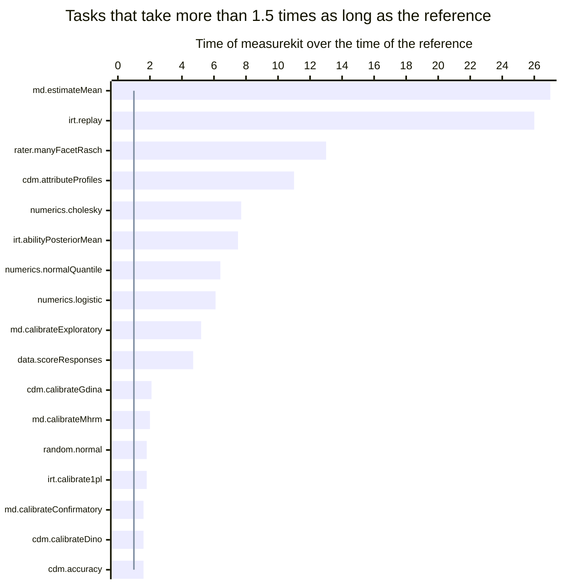
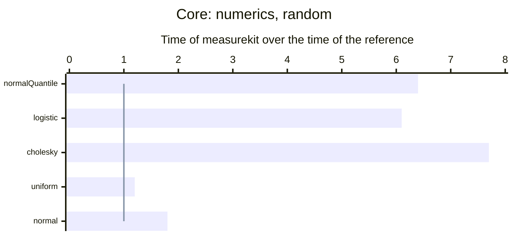
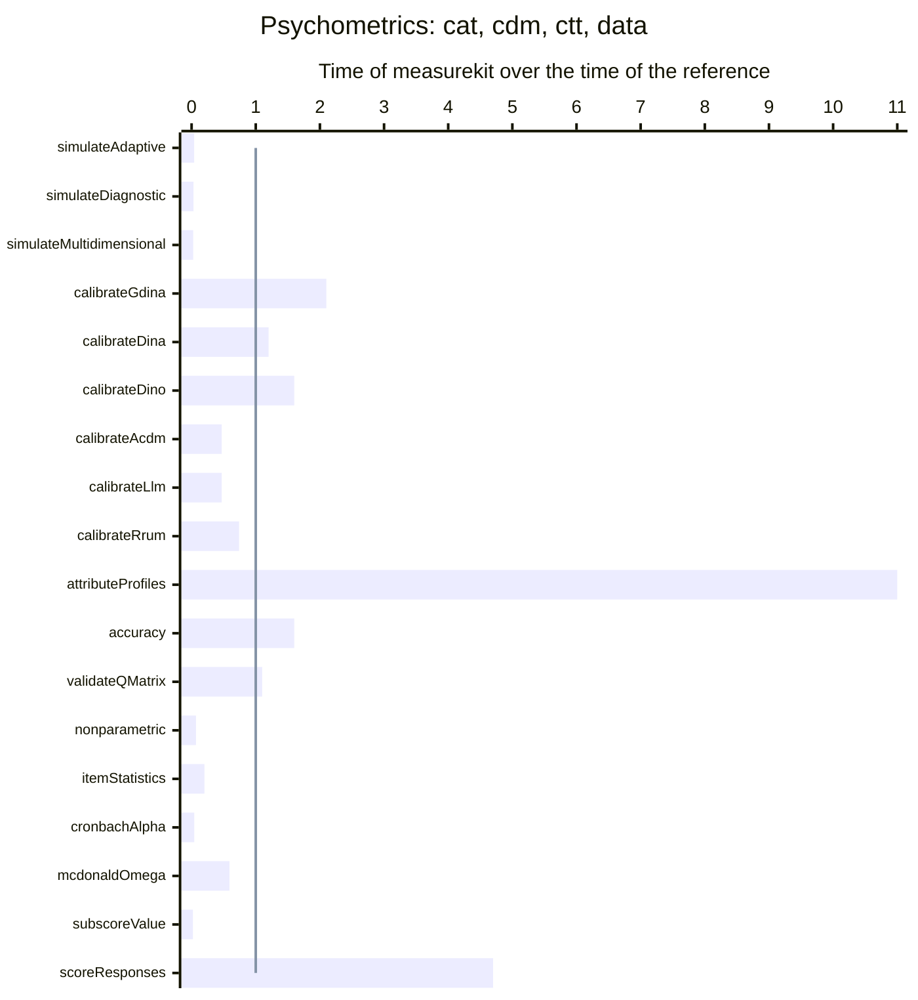
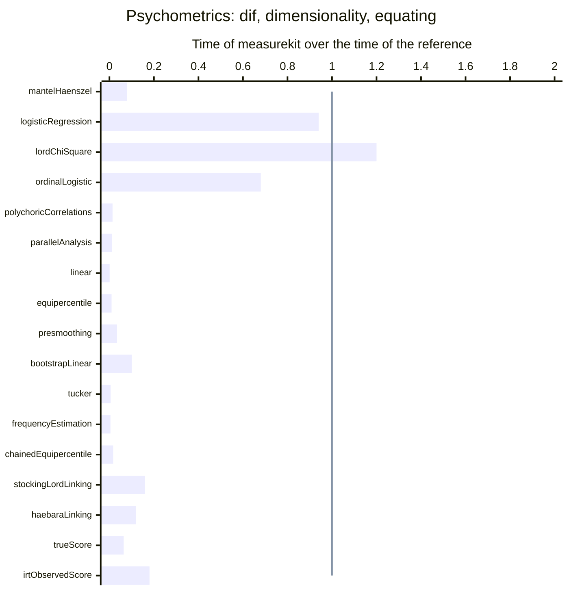
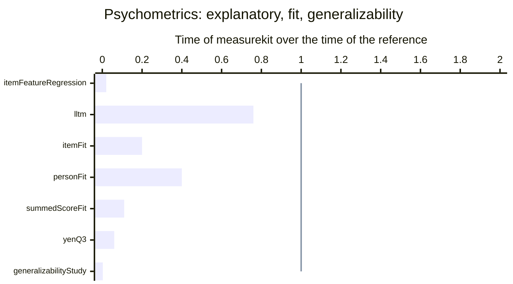
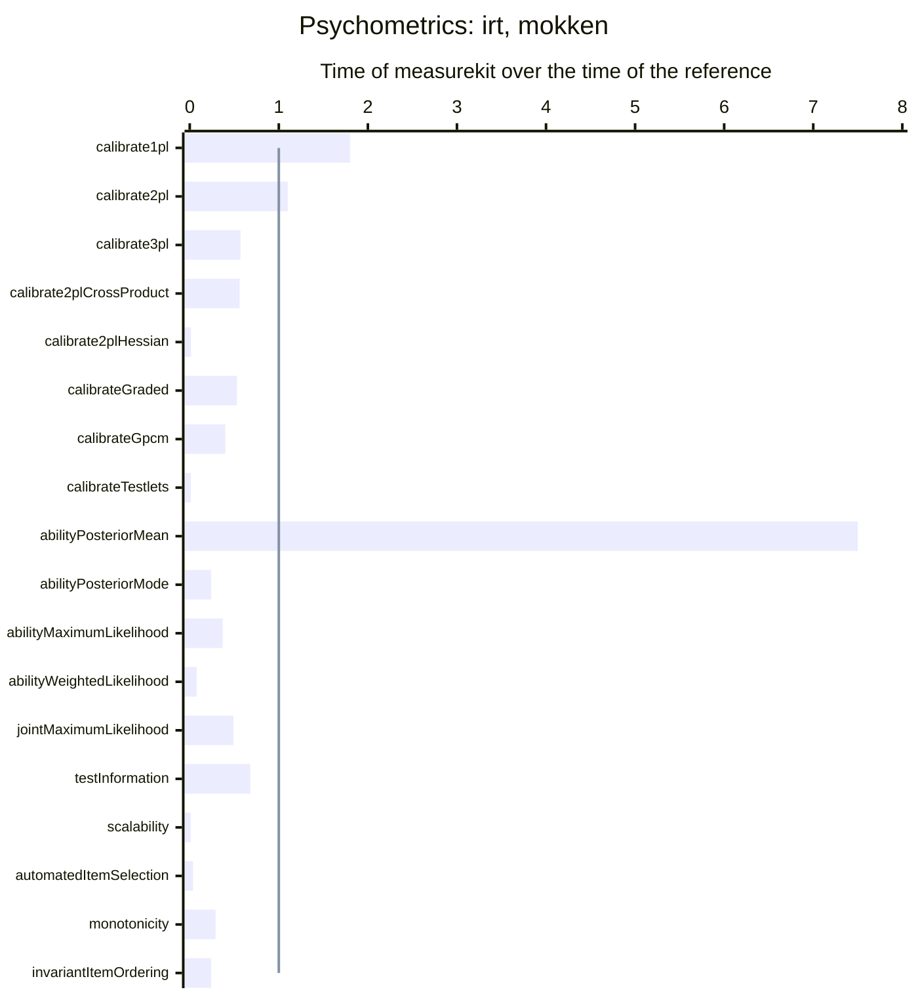
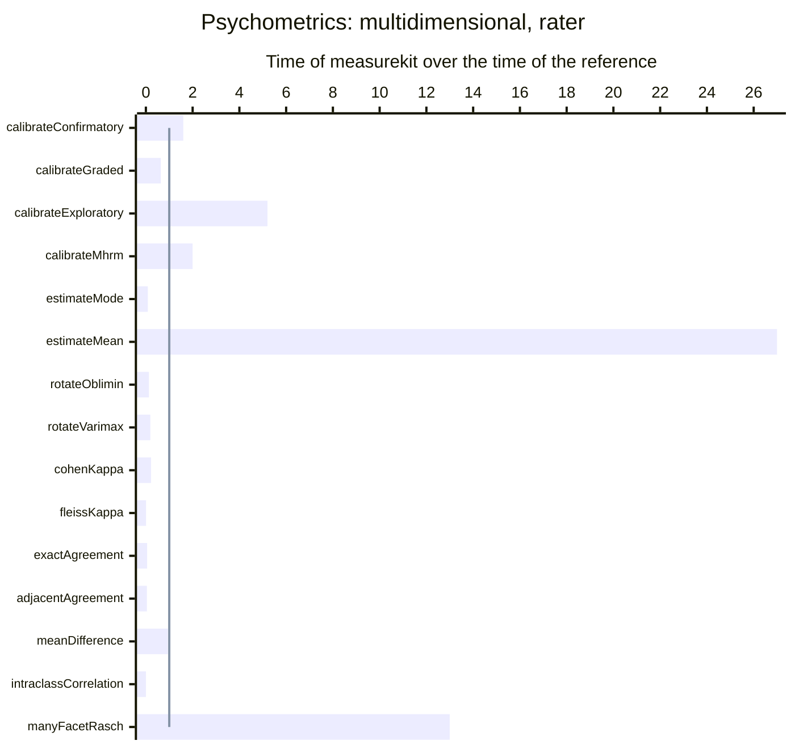
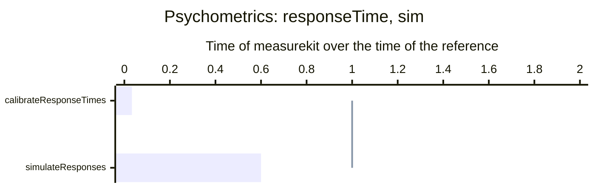
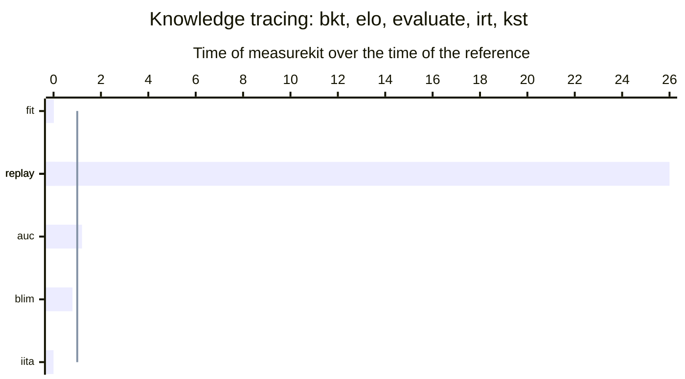
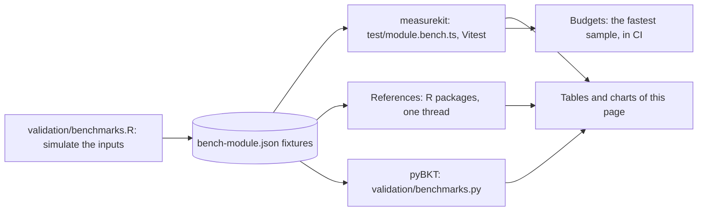

# Performance

## Ratios

<!-- charts -->

### Where measurekit is slower



A bar above the line takes longer than the reference, and md stands for multidimensional.

### Every task


















<!-- /charts -->

## Results

<!-- tables -->

Measured on Apple M5 with 10 cores, 16 GB of memory, Node.js 26.8.1 and R version 4.6.1 (2026-06-24).

### Core

| Task                         | Size                              | measurekit (ms) | Reference            | Reference (ms) |    Ratio |
| ---------------------------- | --------------------------------- | --------------: | -------------------- | -------------: | -------: |
| **Normal quantile function** | 1,000,000 probabilities           |            32.7 | stats 4.6.1 `qnorm`  |           5.12 | **6.4×** |
| **Logistic function**        | 1,000,000 points                  |            32.5 | stats 4.6.1 `plogis` |           5.30 | **6.1×** |
| **Cholesky factorization**   | A correlation matrix of order 200 |           0.907 | base 4.6.1 `chol`    |          0.118 | **7.7×** |
| Uniform draws                | 1,000,000 draws                   |            3.78 | stats 4.6.1 `runif`  |           3.24 |     1.2× |
| **Normal draws**             | 1,000,000 draws                   |            21.6 | stats 4.6.1 `rnorm`  |           12.0 | **1.8×** |

### Psychometrics

| Task                                                                                    | Size                                                                          | measurekit (ms) | Reference                                                               | Reference (ms) |    Ratio |
| --------------------------------------------------------------------------------------- | ----------------------------------------------------------------------------- | --------------: | ----------------------------------------------------------------------- | -------------: | -------: |
| Simulation of adaptive tests by maximum information and the posterior mean              | 200 persons, a pool of 500 3PL items, 30 items each                           |             524 | catR 3.17 `randomCAT`                                                   |         13,157 |    0.04× |
| Simulation of adaptive tests that select testlets as units, by their mean information   | 200 persons, a pool of 500 3PL items with 400 in testlets of 4, 30 items each |             499 | none                                                                    |                |          |
| Simulation of diagnostic adaptive tests by the G-DINA discrimination index              | 200 persons, a pool of 20 items over 4 attributes, 10 items each              |            13.5 | cdcatR 1.0.7 `cdcat`                                                    |            455 |    0.03× |
| Simulation of multidimensional adaptive tests by the determinant of the information     | 100 persons, a pool of 200 two-dimensional items, 20 items each               |             132 | mirtCAT 1.14 `mirtCAT(criteria = "Drule")`                              |          5,360 |   0.025× |
| **Calibration of the G-DINA model by EM**                                               | 1,000 persons, 20 items, 4 attributes                                         |             224 | GDINA 2.13.2 `GDINA(model = "GDINA")`                                   |            106 | **2.1×** |
| Calibration of the DINA model by EM                                                     | 1,000 persons, 20 items, 4 attributes                                         |            53.5 | GDINA 2.13.2 `GDINA(model = "DINA")`                                    |           43.0 |     1.2× |
| **Calibration of the DINO model by EM**                                                 | 1,000 persons, 20 items, 4 attributes                                         |             233 | GDINA 2.13.2 `GDINA(model = "DINO")`                                    |            145 | **1.6×** |
| Calibration of the A-CDM model by EM                                                    | 1,000 persons, 20 items, 4 attributes                                         |            63.5 | GDINA 2.13.2 `GDINA(model = "ACDM")`                                    |            135 |    0.47× |
| Calibration of the LLM model by EM                                                      | 1,000 persons, 20 items, 4 attributes                                         |            88.3 | GDINA 2.13.2 `GDINA(model = "LLM")`                                     |            188 |    0.47× |
| Calibration of the R-RUM model by EM                                                    | 1,000 persons, 20 items, 4 attributes                                         |            83.7 | GDINA 2.13.2 `GDINA(model = "RRUM")`                                    |            113 |    0.74× |
| **Posterior profiles of the persons of a calibration**                                  | 1,000 persons, 20 items, 4 attributes                                         |            1.72 | GDINA 2.13.2 `personparm(what = "EAP")`                                 |          0.154 |  **11×** |
| **Accuracy and consistency of the classification**                                      | 1,000 persons, 20 items, 4 attributes                                         |            1.87 | GDINA 2.13.2 `CA`                                                       |           1.20 | **1.6×** |
| Validation of the Q-matrix by the proportion of variance accounted for                  | 1,000 persons, 20 items, 4 attributes                                         |            3.45 | GDINA 2.13.2 `Qval(method = "PVAF")`                                    |           3.27 |     1.1× |
| Nonparametric classification by the Hamming distance                                    | 1,000 persons, 20 items, 4 attributes                                         |            1.61 | NPCD 1.0.11 `AlphaNP`                                                   |           23.5 |   0.068× |
| Item difficulty, discrimination and the statistics of the items                         | 3,000 persons, 50 items                                                       |            11.3 | psych 2.6.9 `alpha`                                                     |           56.0 |     0.2× |
| Cronbach's alpha                                                                        | 3,000 persons, 50 items                                                       |            2.21 | psych 2.6.9 `alpha`                                                     |           54.0 |   0.041× |
| McDonald's omega total of one factor                                                    | 3,000 persons, 20 items                                                       |            5.66 | psych 2.6.9 `omega(nfactors = 1)`                                       |           9.67 |    0.59× |
| The value of five subscores of ten items over the total score                           | 3,000 persons, 50 items                                                       |            2.59 | subscore 3.3 `CTTsub`                                                   |            128 |    0.02× |
| **Scoring of the choices of persons against a key**                                     | 2,000 persons, 50 items of 4 options                                          |            3.97 | base 4.6.1 `t(t(choices) == key)`                                       |          0.846 | **4.7×** |
| The Mantel-Haenszel test of every item                                                  | 2,000 persons in two groups, 30 items                                         |            7.48 | difR 6.1.0 `difMH`                                                      |           95.0 |   0.079× |
| Logistic regression for uniform and nonuniform DIF of every item                        | 2,000 persons in two groups, 30 items                                         |            84.2 | difR 6.1.0 `difLogistic`                                                |           90.0 |    0.94× |
| Lord's chi-square of every item, with both groups calibrated by the 2PL                 | 2,000 persons in two groups, 30 items                                         |           1,125 | difR 6.1.0 `difLord`                                                    |            959 |     1.2× |
| Ordinal logistic regression of every item                                               | 1,000 persons in two groups, 10 items of 4 categories                         |            62.0 | rms 8.2.0 `lrm, three models for an item`                               |           91.0 |    0.68× |
| Polychoric correlations of every pair of items                                          | 2,800 persons, 25 items of 6 categories                                       |            21.4 | psych 2.6.9 `polychoric`                                                |          1,567 |   0.014× |
| Parallel analysis of components and factors from polychoric correlations, 20 data sets  | 2,800 persons, 25 items of 6 categories                                       |             325 | psych 2.6.9 `fa.parallel(cor = "poly")`                                 |         29,180 |   0.011× |
| Linear equating, random groups                                                          | 4,329 and 4,152 persons, 40 items                                             |           0.000 | equate 2.0.9 `equate(type = "linear")`                                  |          0.440 | 0.00095× |
| Equipercentile equating, random groups                                                  | 4,329 and 4,152 persons, 40 items                                             |           0.003 | equate 2.0.9 `equate(type = "equipercentile")`                          |          0.275 |  0.0097× |
| Log-linear presmoothing of a score distribution, degree 3                               | 41 scores                                                                     |           0.025 | equate 2.0.9 `presmoothing(smoothmethod = "loglinear")`                 |          0.727 |   0.034× |
| Standard errors of the linear equating by 100 bootstrap replications                    | 4,329 and 4,152 persons, 40 items                                             |            27.4 | equate 2.0.9 `bootstrap`                                                |            267 |     0.1× |
| Tucker linear equating, nonequivalent groups                                            | 1,655 and 1,638 persons, 36 items, an anchor of 12                            |           0.008 | equate 2.0.9 `equate(method = "tucker")`                                |           1.46 |  0.0053× |
| Frequency estimation equipercentile equating                                            | 1,655 and 1,638 persons, 36 items, an anchor of 12                            |           0.010 | equate 2.0.9 `equate(method = "frequency estimation")`                  |           2.24 |  0.0047× |
| Chained equipercentile equating                                                         | 1,655 and 1,638 persons, 36 items, an anchor of 12                            |           0.013 | equate 2.0.9 `equate(method = "chained")`                               |          0.765 |   0.017× |
| Stocking-Lord linking of the common items                                               | Two forms of 3PL items that share 10                                          |           0.258 | equateIRT 2.5.2 `direc(method = "Stocking-Lord")`                       |           1.60 |    0.16× |
| Haebara linking of the common items                                                     | Two forms of 3PL items that share 10                                          |           0.204 | equateIRT 2.5.2 `direc(method = "Haebara")`                             |           1.72 |    0.12× |
| IRT true score equating of the linked forms                                             | Two forms of 3PL items that share 10                                          |           0.191 | equateIRT 2.5.2 `score(method = "TSE")`                                 |           3.00 |   0.064× |
| IRT observed score equating of the linked forms                                         | Two forms of 3PL items that share 10                                          |           0.469 | equateIRT 2.5.2 `score(method = "OSE")`                                 |           2.65 |    0.18× |
| Regression of item difficulties on three features by REML                               | 300 items, 3 features                                                         |           0.431 | metafor 5.2.1 `rma(method = "REML")`                                    |           22.0 |    0.02× |
| The linear logistic test model: the effects of three features on difficulty, by EM      | 1,000 persons, 20 items, 3 features                                           |             243 | mirt 1.48 `mirt(itemtype = "Rasch", itemdesign), Oakes standard errors` |            319 |    0.76× |
| Infit and outfit of the items                                                           | 2,000 persons, 40 items                                                       |            6.01 | mirt 1.48 `itemfit(fit_stats = "infit")`                                |           29.5 |     0.2× |
| Infit, outfit and the standardized log-likelihood of the persons                        | 2,000 persons, 40 items                                                       |            8.99 | mirt 1.48 `personfit`                                                   |           22.7 |     0.4× |
| The summed-score statistic S-X2 of the items                                            | 2,000 persons, 40 items                                                       |            6.38 | mirt 1.48 `itemfit(fit_stats = "S_X2")`                                 |           58.0 |    0.11× |
| Yen's Q3 of every pair of items                                                         | 2,000 persons, 40 items                                                       |            9.71 | mirt 1.48 `residuals(type = "Q3")`                                      |            161 |    0.06× |
| Variance components of a fully crossed design of three facets                           | 200 persons, 10 items, 4 raters: 8,000 scores                                 |            2.64 | lme4 2.1.0 `lmer, six random effects, REML`                             |            982 |  0.0027× |
| **Calibration of the one-parameter model by EM**                                        | 2,000 persons, 40 dichotomous items                                           |             221 | mirt 1.48 `mirt(itemtype = "Rasch")`                                    |            126 | **1.8×** |
| Calibration of the two-parameter model by EM                                            | 2,000 persons, 40 dichotomous items                                           |             251 | mirt 1.48 `mirt(itemtype = "2PL")`                                      |            227 |     1.1× |
| Calibration of the three-parameter model by EM                                          | 2,000 persons, 40 dichotomous items                                           |             829 | mirt 1.48 `mirt(itemtype = "3PL")`                                      |          1,451 |    0.57× |
| The two-parameter model with cross-product standard errors                              | 2,000 persons, 40 dichotomous items                                           |             271 | mirt 1.48 `mirt(SE.type = "crossprod")`                                 |            483 |    0.56× |
| The two-parameter model with standard errors from the Hessian                           | 500 persons, 20 items                                                         |             123 | mirt 1.48 `mirt(SE.type = "Richardson")`                                |          8,900 |   0.014× |
| Calibration of the graded response model by EM                                          | 1,500 persons, 20 items of 5 categories                                       |             113 | mirt 1.48 `mirt(itemtype = "graded")`                                   |            212 |    0.53× |
| Calibration of the generalized partial credit model by EM                               | 1,500 persons, 20 items of 5 categories                                       |             189 | mirt 1.48 `mirt(itemtype = "gpcm")`                                     |            474 |     0.4× |
| Calibration of the testlet model by EM                                                  | 1,000 persons, 6 testlets of 5 items                                          |             363 | mirt 1.48 `bfactor`                                                     |         28,733 |   0.013× |
| **Ability by the posterior mean**                                                       | 2,000 persons, the 40 items of the calibration                                |             302 | mirt 1.48 `fscores(method = "EAP")`                                     |           40.0 | **7.5×** |
| Ability by the posterior mode                                                           | 2,000 persons, the 40 items of the calibration                                |             331 | mirt 1.48 `fscores(method = "MAP")`                                     |          1,403 |    0.24× |
| Ability by maximum likelihood                                                           | 2,000 persons, the 40 items of the calibration                                |             331 | mirt 1.48 `fscores(method = "ML")`                                      |            893 |    0.37× |
| Ability by weighted likelihood                                                          | 2,000 persons, the 40 items of the calibration                                |             783 | mirt 1.48 `fscores(method = "WLE")`                                     |         10,035 |   0.078× |
| Joint maximum likelihood calibration of the Rasch model                                 | 2,000 persons, 40 items                                                       |            12.0 | TAM 4.3.25 `tam.jml`                                                    |           24.5 |    0.49× |
| The posterior mean of the ability given each summed score                               | 40 items                                                                      |           0.254 | none                                                                    |                |          |
| Information of a test at 121 values of theta                                            | 40 items                                                                      |           0.962 | mirt 1.48 `testinfo`                                                    |           1.41 |    0.68× |
| Scalability coefficients with standard errors                                           | 433 persons, 20 items of 5 categories                                         |            2.48 | mokken 3.1.2 `coefH(se = TRUE)`                                         |            204 |   0.012× |
| Automated item selection into Mokken scales                                             | 433 persons, 20 items of 5 categories                                         |            1.06 | mokken 3.1.2 `aisp`                                                     |           29.0 |   0.037× |
| The check of monotonicity of every item                                                 | 433 persons, 20 items of 5 categories                                         |            3.21 | mokken 3.1.2 `check.monotonicity`                                       |           11.0 |    0.29× |
| The check of invariant item ordering, with selection of items                           | 433 persons, 20 items of 5 categories                                         |            16.5 | mokken 3.1.2 `check.iio(method = "MIIO")`                               |           68.0 |    0.24× |
| **Calibration of a confirmatory two-dimensional 2PL by EM**                             | 1,000 persons, 24 items, 2 correlated dimensions                              |           1,324 | mirt 1.48 `mirt(model, quadpts = 31)`                                   |            807 | **1.6×** |
| Calibration of a confirmatory two-dimensional graded model by EM                        | 1,000 persons, 20 items of 4 categories, 2 correlated dimensions              |           1,213 | mirt 1.48 `mirt(itemtype = "graded", quadpts = 31)`                     |          1,902 |    0.64× |
| **Calibration of an exploratory two-dimensional 2PL by EM**                             | 1,000 persons, 20 items, 2 dimensions                                         |          16,305 | mirt 1.48 `mirt(data, 2, quadpts = 31)`                                 |          3,136 | **5.2×** |
| **Calibration of a five-dimensional graded model by Metropolis-Hastings Robbins-Monro** | 800 persons, 25 items of 6 categories, 5 correlated dimensions                |          41,128 | mirt 1.48 `mirt(method = "MHRM")`                                       |         20,823 |   **2×** |
| Abilities by the posterior mode, in two dimensions                                      | 1,000 persons, 24 items                                                       |            84.0 | mirt 1.48 `fscores(method = "MAP")`                                     |          1,016 |   0.083× |
| **Abilities by the posterior mean, in two dimensions**                                  | 1,000 persons, 24 items                                                       |           1,704 | mirt 1.48 `fscores(method = "EAP")`                                     |           64.0 |  **27×** |
| Oblimin rotation of the loadings of a calibration                                       | 20 items, 2 dimensions                                                        |           0.037 | GPArotation 2026.8.2 `oblimin`                                          |          0.294 |    0.13× |
| Varimax rotation of the loadings of a calibration                                       | 20 items, 2 dimensions                                                        |           0.029 | GPArotation 2026.8.2 `Varimax`                                          |          0.154 |    0.19× |
| Cohen's kappa of two raters                                                             | 2,000 subjects, 5 categories                                                  |           0.061 | irr 0.85 `kappa2`                                                       |          0.280 |    0.22× |
| Fleiss' kappa of five raters                                                            | 500 subjects, 5 raters, 5 categories                                          |           0.077 | irr 0.85 `kappam.fleiss`                                                |           9.17 |  0.0084× |
| The share of subjects on whom five raters agree exactly                                 | 500 subjects, 5 raters, 5 categories                                          |           0.024 | irr 0.85 `agree(tolerance = 0)`                                         |          0.458 |   0.053× |
| The share of subjects whose ratings are within one category                             | 500 subjects, 5 raters, 5 categories                                          |           0.026 | irr 0.85 `agree(tolerance = 1)`                                         |          0.569 |   0.045× |
| The standardized mean difference of two raters                                          | 2,000 subjects, 2 raters                                                      |           0.222 | effsize 0.8.1 `cohen.d`                                                 |          0.235 |    0.94× |
| The six intraclass correlations of four raters                                          | 200 subjects, 4 raters                                                        |           0.018 | psych 2.6.9 `ICC`                                                       |           7.75 |  0.0023× |
| **The many-facet Rasch model of items and raters, with standard errors**                | 200 persons, 10 items, 4 raters: 8,000 scores                                 |             740 | TAM 4.3.25 `tam.mml.mfr(formulaA = ~ item + rater + step)`              |           58.0 |  **13×** |
| The lognormal model of the response times                                               | 1,000 persons, 20 items                                                       |            7.72 | nlme 3.1.169 `lme(logtime ~ 0 + item, random = ~ 1                      |       person)` |      232 | 0.033× |
| The joint model of speed and accuracy, with the 2PL                                     | 1,000 persons, 20 items                                                       |             662 | none                                                                    |                |          |
| Speed of each person given the times of the items                                       | 1,000 persons, 20 items                                                       |            1.47 | none                                                                    |                |          |
| A conversion table of the posterior mean of theta given each summed score               | 40 items                                                                      |           0.462 | none                                                                    |                |          |
| A conversion table of the theta of each summed true score                               | 40 items                                                                      |            1.30 | none                                                                    |                |          |
| The cut score of a bookmark in an ordered item booklet                                  | 40 items                                                                      |           0.046 | none                                                                    |                |          |
| Accuracy and consistency of the classification by two cuts                              | 2,000 persons                                                                 |           0.509 | none                                                                    |                |          |
| Conversion of 2PL items to mirt's slope-intercept form                                  | 10,000 items                                                                  |            2.04 | none                                                                    |                |          |
| Conversion of 2PL items to mirt's IRT form                                              | 10,000 items                                                                  |            1.93 | none                                                                    |                |          |
| Simulation of the abilities of persons and their responses to 2PL items                 | 2,000 persons, 40 items                                                       |            4.71 | mirt 1.48 `simdata(itemtype = "dich")`                                  |           7.80 |     0.6× |

- Simulation of adaptive tests that select testlets as units, by their mean information: catR has no testlets, so no reference does this task.
- Calibration of an exploratory two-dimensional 2PL by EM: mirt stops at its limit of 500 cycles when it has not converged.
- Calibration of a five-dimensional graded model by Metropolis-Hastings Robbins-Monro: both draw the abilities, so the time depends on the seed; mirt runs with one.
- The lognormal model of the response times: measurekit also estimates the item discriminations.

### Knowledge tracing

| Task                                                                                          | Size                                            | measurekit (ms) | Reference                               | Reference (ms) |     Ratio |
| --------------------------------------------------------------------------------------------- | ----------------------------------------------- | --------------: | --------------------------------------- | -------------: | --------: |
| Fit of the skills of a log by EM from five starts                                             | 20,000 attempts of 200 learners at 5 skills     |             172 | pyBKT 1.4.3 `Model.fit`                 |         13,502 |    0.013× |
| Replay of the log through the fitted model, a prediction and an update for each attempt       | 20,000 attempts of 200 learners at 5 skills     |            17.7 | pyBKT 1.4.3 `Model.predict`             |            363 |    0.049× |
| Replay of a log through the learner-item Elo model                                            | 100,000 attempts of 2,000 learners at 400 items |            41.3 | base R, a loop over the attempts        |           49.5 |     0.83× |
| The area under the ROC curve                                                                  | 100,000 predictions                             |            29.5 | pROC 1.19.1 `auc(roc(direction = "<"))` |           24.5 |      1.2× |
| The AUC, RMSE, log-loss and accuracy of the predictions                                       | 100,000 predictions                             |            34.8 | none                                    |                |           |
| **Replay of the responses of learners, the grid posterior of the ability updated after each** | 2,000 learners, 40 responses each               |           1,143 | mirt 1.48 `fscores(method = "EAP")`     |           44.0 |   **26×** |
| Fit of the basic local independence model of a chain of 12 items by EM                        | 1,000 persons, 12 items, 13 states              |            28.5 | pks 0.8.0 `blim`                        |           35.5 |      0.8× |
| Inductive item tree analysis of the responses                                                 | 1,000 persons, 12 items                         |            2.13 | DAKS 2.1.3 `iita(v = 1)`                |         83,190 | 0.000026× |
| Fit of the additive factors model by maximum likelihood                                       | 20,000 attempts of 200 learners at 5 skills     |            26.8 | base R `glm`, binomial family           |            555 |    0.048× |
| The candidates ranked by their distance to the band of success of a learner                   | 500 candidate items, an Elo model               |           0.136 | none                                    |                |           |
| A log built from and checked for events                                                       | 100,000 events                                  |            22.1 | none                                    |                |           |

- Replay of the responses of learners, the grid posterior of the ability updated after each: mirt scores each pattern once; measurekit updates the posterior after every response.
- Fit of the additive factors model by maximum likelihood: the proficiency of a learner is a fixed effect, as measurekit's default is none.

<!-- /tables -->

## Iterations

The iterations that each EM calibration of the tables needed to reach its tolerance, on the data of the benchmark. A ratio
of times is the product of a ratio of iterations and a ratio of the time of one.

| Calibration                         | measurekit | Reference |
| ----------------------------------- | ---------: | --------: |
| One-parameter model                 |         25 |         9 |
| Two-parameter model                 |         29 |        19 |
| Three-parameter model               |         90 |       183 |
| Graded response model               |         22 |        11 |
| Generalized partial credit model    |         41 |        37 |
| Confirmatory two-dimensional 2PL    |         23 |        24 |
| Confirmatory two-dimensional graded |         22 |        43 |
| Exploratory two-dimensional 2PL     |        442 |       135 |
| G-DINA                              |        187 |       184 |
| DINA                                |         44 |        45 |
| DINO                                |        195 |       231 |
| A-CDM                               |         40 |        33 |
| LLM                                 |         52 |        61 |
| R-RUM                               |         53 |        27 |

## Method



Each benchmark times the hot path of a module, and the same task on the same data in the reference implementation that the
[validation](psychometrics/validation.md) uses: an R package, base R where no package does the task, or pyBKT. The ratio is
the time of measurekit over the time of the reference, so a ratio above 1 means that measurekit is slower. A ratio above
1.5 is in bold in the tables.

| Part       | How                                                                                                                                                                                                                                                    |
| ---------- | ------------------------------------------------------------------------------------------------------------------------------------------------------------------------------------------------------------------------------------------------------ |
| Data       | `validation/benchmarks.R` simulates the inputs with a fixed seed, or takes a public dataset, and writes them to `packages/<package>/test/fixtures/bench-<module>.json`. measurekit and its reference read the same data.                               |
| measurekit | `packages/<package>/test/<module>.bench.ts`, run by Vitest on Node.js with one thread. A benchmark takes at least 10 samples, or 5 when it takes a second or more, after a warm-up. The tables give the median of the medians of three runs.           |
| References | `validation/benchmarks/<package>/<module>.R`, run with one thread: `OPENBLAS_NUM_THREADS=1` and `OMP_NUM_THREADS=1` set R's BLAS. A task takes 15 samples under a second, 7 under 15 seconds, 3 under a minute and 2 above, after one call to warm up. |
| pyBKT      | `validation/benchmarks.py`, on the log of `bench-bkt.json`, with its processes off. It times what R does not.                                                                                                                                          |
| Settings   | A reference runs with the settings that make its work that of measurekit: the same quadrature, convergence tolerance and starts. The notes under a table name where they differ.                                                                       |
| Ratio      | The median of measurekit over the median of the reference.                                                                                                                                                                                             |

An EM calibration stops when its estimates stop changing, so two programs that agree on the criterion can need different
numbers of iterations: the ratio is that of the time to the same answer, not of one iteration. The ability estimators and the
replays compare the work for each person, and the notes say where the reference does less.

## Running

```bash
pnpm install
OPENBLAS_NUM_THREADS=1 OMP_NUM_THREADS=1 Rscript validation/benchmarks.R               # the inputs and the references
validation/knowledge-tracing/.venv/bin/python validation/benchmarks.py                  # pyBKT
pnpm bench                                                                              # measurekit, against the budgets
```

`Rscript validation/benchmarks.R irt mokken` runs the modules named, and `knowledge-tracing/irt` one module of a package.
To refresh the charts and tables, run each package with the JSON reporter three times, with the run number in the name of the
file, then `Rscript validation/benchmarks.R table`:

```bash
pnpm --filter @measurekit/core bench --reporter json --outputFile validation/benchmarks/results/measurekit-core-1.json
pnpm --filter @measurekit/psychometrics bench --reporter json --outputFile validation/benchmarks/results/measurekit-psychometrics-1.json
pnpm --filter @measurekit/knowledge-tracing bench --reporter json --outputFile validation/benchmarks/results/measurekit-knowledge-tracing-1.json
Rscript validation/benchmarks.R table
```

## Budgets

A benchmark fails when its fastest sample is above its budget, which is in `packages/<package>/test/budgets.ts`. The fastest
sample is the least affected by the other work of a shared machine. The budget of a time is five times the median of the
fastest samples of three runs, rounded up to one significant digit. The factor allows for CI hardware two to three times
slower than the laptop, and for noise; it is far below the cost of the changes that the budgets exist to catch. The `bench`
job of the CI workflow runs the benchmarks on every change. A budget changes only with the reason in the commit that
changes it.
