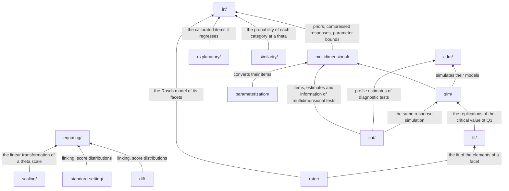

# Architecture of psychometrics

## Principles

The [principles of core](../core/architecture.md#principles) hold for psychometrics: correct first, portable,
deterministic, data in and data out, defined results, and complete at the first version. It adds:

- **Labels.** Labels are string unions with documented, configurable thresholds, never localized text.
- **Defined results.** A model, rule, estimator or random number generator that is not an object or function of its
  interface is refused, as is a field that a record of settings does not have, such as a prior or a quadrature. Records of
  data, such as items and a calibration's testlets, may carry fields of their own.
- **Extensible.** Where methods have alternatives, such as models or estimators, they are interfaces, and built-ins
  implement the same interfaces as user code.

## Sources

A capability is built by the [rule of core](../core/architecture.md#sources). The sources of each module:

| Module             | Sources                                                                                                                                                                                                                                                                                            | Covers                                                                                                          |
| ------------------ | -------------------------------------------------------------------------------------------------------------------------------------------------------------------------------------------------------------------------------------------------------------------------------------------------- | --------------------------------------------------------------------------------------------------------------- |
| `ctt`              | [McDonald (1999)](https://doi.org/10.4324/9781410601087); [Thissen and Wainer (2001)](https://doi.org/10.4324/9781410604729-16); [Sinharay, Puhan and Haberman (2011)](https://doi.org/10.1111/j.1745-3992.2011.00208.x)                                                                           | Reliability and item analysis; scoring and augmented scores; subscores                                          |
| `dimensionality`   | [Reckase (2009)](https://doi.org/10.1007/978-0-387-89976-3), chapter 7; [Fabrigar et al. (1999)](https://doi.org/10.1037/1082-989X.4.3.272)                                                                                                                                                        | The structure of test data; factor analysis                                                                     |
| `irt`              | [van der Linden (2016)](https://doi.org/10.1201/9781315374512), Models; [van der Linden (2017)](https://doi.org/10.1201/b19166), Statistical Tools; [Lord (1980)](https://doi.org/10.4324/9780203056615); [van der Linden (2017)](https://doi.org/10.1201/9781315117430), Applications, chapter 14 | Unidimensional models, estimation, tests of the model; survey weights and plausible values                      |
| `multidimensional` | [Reckase (2009)](https://doi.org/10.1007/978-0-387-89976-3), chapters 4, 6, 8, 9; [van der Linden (2016)](https://doi.org/10.1201/9781315374512), Models; [Andersen (1985)](https://doi.org/10.1007/BF02294143)                                                                                    | Models, estimation, rotation, linking; two-tier, covariates and multiple groups; repeated testings              |
| `cat`              | [van der Linden and Glas (2010)](https://doi.org/10.1007/978-0-387-85461-8); [Magis, Yan and von Davier (2017)](https://doi.org/10.1007/978-3-319-69218-0); [Reckase (2009)](https://doi.org/10.1007/978-0-387-89976-3), chapter 10                                                                | Adaptive and multistage testing, multidimensional selection                                                     |
| `cdm`              | [von Davier and Lee (2019)](https://doi.org/10.1007/978-3-030-05584-4), chapters 7, 13, 15, 16, 29                                                                                                                                                                                                 | G-DINA, item fit, adaptive diagnosis, identifiability, the GDINA package                                        |
| `fit`              | [van der Linden (2017)](https://doi.org/10.1201/b19166), Statistical Tools; [van der Linden (2017)](https://doi.org/10.1201/9781315117430), Applications, chapter 6                                                                                                                                | Tests of model fit; person fit                                                                                  |
| `dif`              | [Holland and Wainer (1993)](https://doi.org/10.4324/9780203357811); [Penfield and Camilli (2006)](https://doi.org/10.1016/S0169-7161(06)26005-X); [Lord (1980)](https://doi.org/10.4324/9780203056615-20), "Study of item bias"                                                                    | DIF methods; Lord's chi-square and its purification                                                             |
| `equating`         | [Kolen and Brennan (2014)](https://doi.org/10.1007/978-1-4939-0317-7), chapters 1 to 8; [Brennan et al. (2009)](https://education.uiowa.edu/casma/computer-programs), Equating Recipes; [González and Wiberg (2017)](https://doi.org/10.1007/978-3-319-51824-4)                                    | Designs, smoothing, linear, equipercentile and IRT methods, kernel, errors                                      |
| `scaling`          | [Kolen and Brennan (2014)](https://doi.org/10.1007/978-1-4939-0317-7), chapters 9 and 10                                                                                                                                                                                                           | Score scales, linking, vertical scaling                                                                         |
| `standard-setting` | [Cizek and Bunch (2007)](https://doi.org/10.4135/9781412985918); [Cizek (2013)](https://doi.org/10.4324/9781410600264); [Livingston and Lewis (1995)](https://doi.org/10.1111/j.1745-3984.1995.tb00462.x); [McKinley and Norcini (2014)](https://doi.org/10.3109/0142159X.2013.853119)             | Methods of setting cut scores, also of OSCEs; the accuracy and consistency of classifications                   |
| `explanatory`      | [De Boeck and Wilson (2004)](https://doi.org/10.1007/978-1-4757-3990-9), chapters 5 to 7; [Fischer and Molenaar (1995)](https://doi.org/10.1007/978-1-4612-4230-7)                                                                                                                                 | Person regression, item predictors; linear logistic models, for dichotomous and polytomous items and for change |
| `change`           | [Cronbach and Furby (1970)](https://doi.org/10.1037/h0029382); [Jacobson and Truax (1991)](https://doi.org/10.1037/0022-006X.59.1.12)                                                                                                                                                              | Measuring change; reliable change                                                                               |
| `mokken`           | [Sijtsma and Molenaar (2002)](https://doi.org/10.4135/9781412984676); [Sijtsma and van der Ark (2017)](https://doi.org/10.1111/bmsp.12078)                                                                                                                                                         | The method and its ten steps                                                                                    |
| `generalizability` | [Brennan (2001)](https://doi.org/10.1007/978-1-4757-3456-0), chapters 1 to 12                                                                                                                                                                                                                      | Balanced and unbalanced univariate designs in chapters 1 to 8; multivariate designs in 9 to 12                  |
| `rater`            | [Eckes (2023)](https://doi.org/10.3726/b20875); Myford and Wolfe (2003, 2004); [Williamson, Xi and Breyer (2012)](https://doi.org/10.1111/j.1745-3992.2011.00223.x)                                                                                                                                | Many-facet models, facet interactions, rater effects; the evaluation of automated scores                        |
| `response-time`    | [van der Linden (2016)](https://doi.org/10.1201/9781315374512), Models; [De Boeck and Jeon (2019)](https://doi.org/10.3389/fpsyg.2019.00102)                                                                                                                                                       | Lognormal and hierarchical models; the overview of the field                                                    |
| `similarity`       | [Cizek and Wollack (2017)](https://doi.org/10.4324/9781315743097), chapters 2 and 3; [Sotaridona (2003)](https://ris.utwente.nl/ws/files/6072637/thesis_Sotaridona.pdf)                                                                                                                            | Answer copying and similarity of pairs of persons, and the pairs to compare                                     |

`data`, `math`, `sim` and `parameterization` have no list of their own: they follow what the other modules need.

## Modules

Each module is a folder of `packages/psychometrics/src/` with an `index.ts` that lists its public API.
[AGENTS.md](../../AGENTS.md#layout) shows the layout of the repository and
the [README](../../packages/psychometrics/README.md#api) the contents of each module. The package exports `.` and one
subpath per module, `@measurekit/psychometrics/<module>`; each public name has one entry, its module's subpath. `.` holds
only what the modules share and core owns, which no module re-exports, so that a user does not import core
([AGENTS.md](../../AGENTS.md#deviations-from-the-standards)); the README's API table lists its names. `math/` is not
exported.

## Dependencies between modules

Modules form layers; a module imports only from lower layers, never from its own or a higher one.

| Layer | Modules                                                                                   |
| ----- | ----------------------------------------------------------------------------------------- |
| 1     | `@measurekit/core`, `checks.ts`                                                           |
| 2     | `math/`, `data/`                                                                          |
| 3     | `ctt/`, `change/`, `irt/`, `dimensionality/`, `generalizability/`, `mokken/`              |
| 4     | `cdm/`, `equating/`, `response-time/`, `explanatory/`, `multidimensional/`, `similarity/` |
| 5     | `sim/`, `dif/`, `standard-setting/`, `scaling/`, `parameterization/`                      |
| 6     | `fit/`, `cat/`                                                                            |
| 7     | `rater/`                                                                                  |

Every module of layers 4 to 7 also builds on `irt/`; the analysis modules of layer 3 (`ctt/`, `change/`, `irt/`,
`dimensionality/`, `generalizability/` and `mokken/`) build on `data/` and `math/` or on nothing, not on each other.
[AGENTS.md](../../AGENTS.md#dependencies) lists the imports each module may use; Biome enforces them, the absence of
Node modules and platform globals in `src/`, and that code outside `packages/` imports `@measurekit/psychometrics` by
name.

## Numerics

The [numerics of core](../core/architecture.md#numerics) hold, and:

- Scores are integers, so sums are exact: covariances come from Σxy, Σx and Σy of the values less the first of each,
  so that scores far from 0, such as near 1e8, do not cancel; a variance is exactly 0 when the values are equal, and no
  statistic depends on the order of persons. Zero-variance checks compare with 0.
- Calibration estimates bounded parameters on an unbounded scale (logit between two bounds), so the optimizers work
  without constraints.
- Calibration stores the answered responses by person, with each response's item index, whether the input is a matrix
  or records: memory and E-step time grow with the responses. Each item's log-probabilities at the nodes sit in one
  array, so a response adds its column with a fixed stride.

### Why the numerics are written here

`math/` holds the numerics that this library alone needs: the eigendecomposition of a symmetric matrix by Householder's
reduction to a tridiagonal matrix and the implicit QL algorithm, as EISPACK's tred2 and imtql2, quadrature, rotation, the
minimum residual fit, Newton's method and the noncentral chi-square. Of them, `ml-matrix` 6.15.1 covers the
eigendecomposition, beside the singular value decomposition. The numerics both libraries share are in
`@measurekit/core`, whose [README](../../packages/core/README.md#why-the-numerics-are-written-here) says why `ml-matrix`
and `@stdlib` are not used for them.

The method makes the difference, not the library: the cyclic Jacobi method gives small eigenvalues to their relative
accuracy, which no analysis here needs, and takes several times as long as the QL method, whose eigenvalues are exact to
rounding relative to the largest, as LAPACK's are. Written in `math/`, with no dependency, the QL method takes about three
quarters of the time of `ml-matrix`'s on the same matrices, and adds 16 MB to the peak at 1,000 items, the most that the
analyses of a matrix of items take. Base R's `eigen`, LAPACK's dsyevr through OpenBLAS, is faster above about 100 items and
takes the eigenvectors too: it reduces the matrix in blocks by native kernels, and finds the eigenvectors of the
tridiagonal matrix by MRRR, in a time that grows with the square of its order, where the rotations of the QL method take
half of its time. A caller that reads the eigenvalues alone, as parallel analysis and the check of smoothing do, skips
the eigenvectors, in a fifth of the time at 1,000 items.
