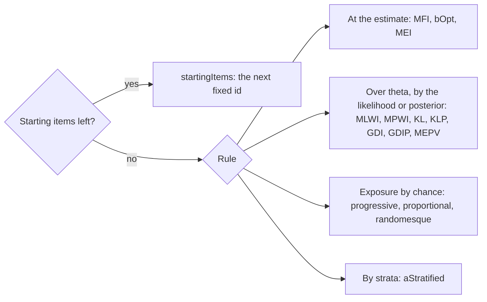
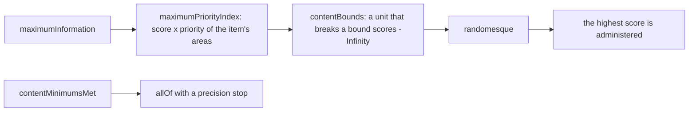
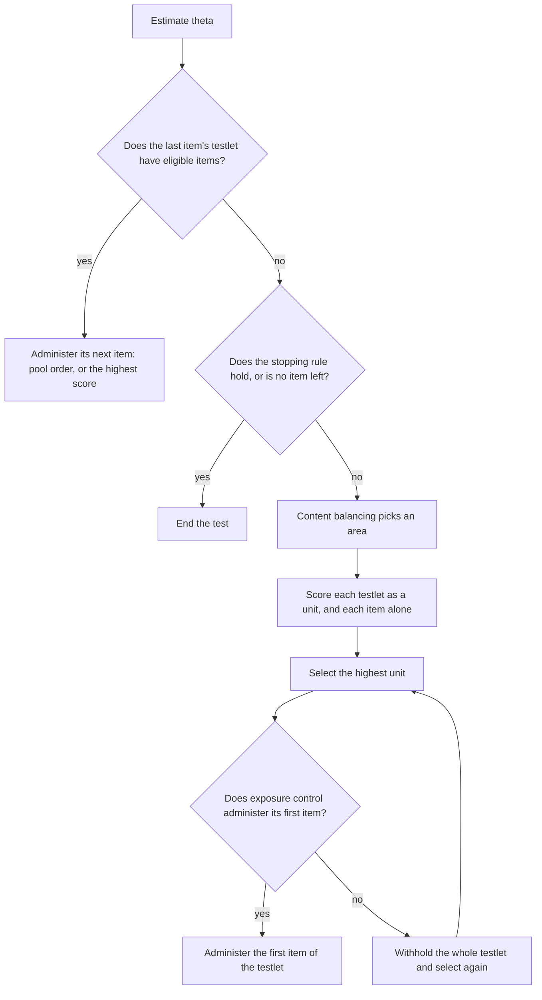
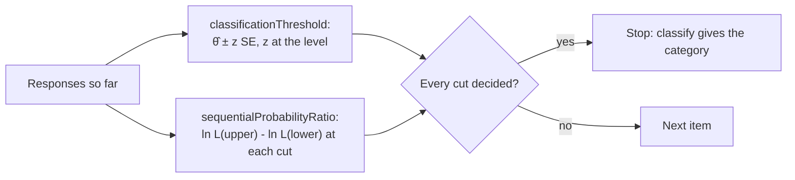
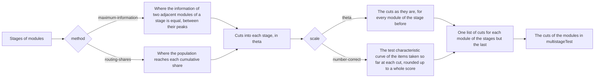
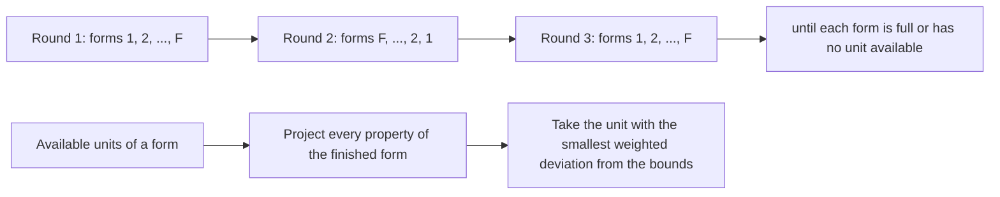

# Adaptive and multistage testing

`@measurekit/psychometrics/cat` runs computerized adaptive tests (CAT) and multistage tests (MST) on items of any [IRT
model](irt.md), adaptive tests that classify a person's attribute profile with the items of a [cognitive diagnosis
model](cdm.md), and adaptive tests that estimate a vector of thetas with [multidimensional](multidimensional.md) items,
derives the routing cuts of multistage panels, simulates them, calibrates their exposure control and assembles fixed
forms. Item selection, ability estimates, content balancing and stopping decisions are validated against catR step by
step; content bounds against a replay in base R and mirtCAT's shadow test; diagnostic tests against a replay of every rule written out in base R and against cdcatR; multidimensional tests
against a replay in base R and against mirtCAT; testlets against a replay in base R and mirtCAT's ordered groups;
routing cuts against root finders in base R ([validation](validation.md)).

## Adaptive tests

`adaptiveTest(options)` returns a test with two functions, `start` and `answer`. Each returns a new state and leaves
the one it was given unchanged.

```ts
import { createRandom } from "@measurekit/psychometrics";
import {
  adaptiveTest,
  allOf,
  anyOf,
  kullbackLeibler,
  standardErrorThreshold,
  testLength,
  untilMixed,
} from "@measurekit/psychometrics/cat";
import {
  generalizedPartialCredit,
  posteriorMeanEstimate,
  threeParameterLogistic,
  weightedLikelihoodEstimate,
} from "@measurekit/psychometrics/irt";

const pool = [
  { id: "q1", model: threeParameterLogistic, parameters: { a: 1.2, b: -1, c: 0.2, d: 1 }, contentAreas: ["algebra"] },
  {
    id: "q2",
    model: threeParameterLogistic,
    parameters: { a: 0.9, b: -0.2, c: 0.15, d: 1 },
    contentAreas: ["algebra"],
  },
  { id: "q3", model: threeParameterLogistic, parameters: { a: 1.5, b: 0.4, c: 0.2, d: 1 }, contentAreas: ["algebra"] },
  {
    id: "q4",
    model: threeParameterLogistic,
    parameters: { a: 1.1, b: 1.2, c: 0.25, d: 1 },
    contentAreas: ["geometry"],
  },
  { id: "q5", model: generalizedPartialCredit, parameters: { a: 1, b: [-0.8, 0.5] }, contentAreas: ["geometry"] },
  {
    id: "q6",
    model: generalizedPartialCredit,
    parameters: { a: 1.3, b: [-0.2, 0.9, 1.6] },
    contentAreas: ["geometry"],
  },
];
const test = adaptiveTest({
  pool,
  selection: kullbackLeibler,
  estimator: untilMixed(posteriorMeanEstimate, weightedLikelihoodEstimate),
  stopping: anyOf(testLength(5), allOf(testLength(3), standardErrorThreshold(0.5))),
  contentTargets: { algebra: 0.6, geometry: 0.4 },
});

const answers: Record<string, number> = { q1: 1, q2: 1, q3: 0, q4: 0, q5: 2, q6: 1 };
const random = createRandom(42);
let state = test.start(random); // { items: [], responses: [], withheld: [], estimate, next: "q6" }
while (state.next !== null) state = test.answer(state, answers[state.next] ?? 0, random);
state.estimate; // { theta, standardError }
```

| Option           | Default                 | Meaning                                                                                             |
| ---------------- | ----------------------- | --------------------------------------------------------------------------------------------------- |
| `pool`           | required                | Items `{ id, model, parameters }`, with an optional `contentAreas`, `testlet` and `exposure`.       |
| `stopping`       | required                | A [stopping rule](#stopping-rules).                                                                 |
| `selection`      | `maximumInformation`    | An [item selection rule](#item-selection).                                                          |
| `estimator`      | `posteriorMeanEstimate` | An [estimator](#estimators).                                                                        |
| `contentTargets` | none                    | Target proportions by content area, for [content balancing](#content-balancing). Need not sum to 1. |
| `enemies`        | none                    | [Enemy sets](#enemy-sets): arrays of ids of items that must not appear in one test.                 |
| `withinTestlet`  | `"in-order"`            | The order of the items of a [testlet](#testlets): `"in-order"` or `"adaptive"`.                     |

A calibration's `items` are a valid pool. Ids must be unique. Before each item, the first included, the test:

1. estimates theta from the responses so far with `estimator`;
2. ends, with `next: null`, when `stopping` holds or no item is left: an item is left unless administered, withheld or
   an enemy of an administered item;
3. restricts the eligible items to one content area, with `contentTargets`;
4. scores the eligible items with `selection` and selects the highest, the first in pool order on ties; the test ends
   if `selection` scores every eligible item `-Infinity`;
5. administers it with probability `exposure`, or withholds it for the rest of the test and selects again.

With [testlets](#testlets), the items of a testlet that has begun follow one after another, without steps 2, 3 and 5.

### State

| Field       | Meaning                                                               |
| ----------- | --------------------------------------------------------------------- |
| `items`     | Ids of the administered items, in order                               |
| `responses` | The responses to them                                                 |
| `estimate`  | `{ theta, standardError }` from the responses                         |
| `withheld`  | Ids of items exposure control withheld; they are not administered     |
| `next`      | The id of the item to administer next, `null` when the test has ended |

The state is plain data. A server stores it as JSON between requests and passes it back to `answer`, which checks
it: its fields, its ids, that no item is administered or withheld twice, that no two administered items are enemies,
and every response. Randomness comes only from the `Random` passed to each call, so a generator seeded per
person and call reproduces a test.

### Estimators

An `AbilityEstimator`, from `@measurekit/psychometrics/irt`, is a
function `(items, responses) => { theta, standardError }`: one of
`maximumLikelihoodEstimate`, `weightedLikelihoodEstimate`, `posteriorModeEstimate` and
`posteriorMeanEstimate` ([IRT](irt.md#ability-estimation)), or one with
options, `(items, responses) => posteriorModeEstimate(items, responses, { prior: { mean: 0, sd: 1.5 } })`.

`untilMixed(initial, mixed)` uses `initial` until one response is above its item's lowest category and one below its
highest, and `mixed` after: before that, the ML estimate is an end of the theta range. The test estimates before the
first response too, where ML and WLE throw, so they need `untilMixed`.

### Item selection

A rule scores every eligible item; the test selects the highest score. Rules that take options are functions that
return the rule; the others are rules.



| Rule                                    | Score                                                                                    | catR                            |
| --------------------------------------- | ---------------------------------------------------------------------------------------- | ------------------------------- |
| `maximumInformation`                    | Fisher information at θ̂                                                                  | `MFI`                           |
| `closestDifficulty`                     | -\|b - θ̂\|, b the item's difficulty or mean threshold                                    | `bOpt`                          |
| `expectedInformation(options)`          | Σ_k P_k(θ̂) I_k(θ̂_k), θ̂_k the estimate after the response k                               | `MEI`                           |
| `likelihoodWeightedInformation`         | ∫ L(θ) I(θ) dθ, L the likelihood of the responses so far                                 | `MLWI`                          |
| `posteriorWeightedInformation(options)` | ∫ L(θ) π(θ) I(θ) dθ, π the prior's density                                               | `MPWI`                          |
| `kullbackLeibler`                       | ∫ L(θ) Σ_k P_k(θ̂) ln(P_k(θ̂) / P_k(θ)) dθ                                                 | `KL`                            |
| `posteriorKullbackLeibler(options)`     | ∫ L(θ) π(θ) Σ_k P_k(θ̂) ln(P_k(θ̂) / P_k(θ)) dθ                                            | `KLP`                           |
| `discriminationIndex`                   | The variance of P(θ) over theta, weighted by L; items of two categories                  | `GDI`                           |
| `posteriorDiscriminationIndex(options)` | The variance of P(θ) over theta, weighted by L π; items of two categories                | `GDIP`                          |
| `expectedPosteriorVariance(options)`    | -Σ_k P_k(θ̂) Var(θ \| the responses and k)                                                | `MEPV`                          |
| `progressive(options)`                  | w I(θ̂) + (1 - w) U max I, U uniform, w from 0 at the first item to 1 at the last planned | `progressive`                   |
| `proportional(options)`                 | Drawn with probability ∝ I(θ̂)^(Q w)                                                      | `proportional`                  |
| `aStratified(lengths)`                  | -\|θ_max - θ̂\| in the scheduled stratum, θ_max where the item's information is largest   | `thOpt` in `aStratified` strata |
| `randomesque(rule, count)`              | A uniform draw for the `count` items `rule` scores highest, `-Infinity` for the others   | the `randomesque` count         |
| `startingItems(ids, rule)`              | The first eligible of `ids` for the first `ids.length` selections, then `rule`           | `startItems(fixItems)`          |

Every rule works for items of any model, through the model's methods, but `closestDifficulty`, which needs a `b`, and the
discrimination indices, which take items of two categories as catR does; each throws `DataError` at the first selection
that scores such an item.

```ts
import { createRandom } from "@measurekit/psychometrics";
import {
  adaptiveTest,
  expectedInformation,
  posteriorWeightedInformation,
  progressive,
  startingItems,
  testLength,
} from "@measurekit/psychometrics/cat";
import { posteriorModeEstimate, twoParameterLogistic } from "@measurekit/psychometrics/irt";

const pool = Array.from({ length: 12 }, (_, i) => ({
  id: `q${i + 1}`,
  model: twoParameterLogistic,
  parameters: { a: 0.8 + (i % 4) * 0.3, b: -1.5 + (i * 3) / 11, c: 0, d: 1 },
}));
const stopping = testLength(6);
const fixed = adaptiveTest({ pool, stopping, selection: startingItems(["q6", "q7"], posteriorWeightedInformation()) });
const expected = adaptiveTest({ pool, stopping, selection: expectedInformation(), estimator: posteriorModeEstimate });
const random = adaptiveTest({ pool, stopping, selection: progressive({ length: 6 }) });
fixed.start(createRandom(1)).next; // "q6"
expected.start(createRandom(1)).next; // "q8": the most information expected after its response
random.start(createRandom(1)).next; // "q12", at random: the weight of information is 0 at the first item
```

| Option of the rules                       | Default                 | Meaning                                                                     |
| ----------------------------------------- | ----------------------- | --------------------------------------------------------------------------- |
| `prior` of the posterior rules            | `{ mean: 0, sd: 1 }`    | The normal prior π of MPWI, KLP, GDIP and MEPV                              |
| `estimator` of `expectedInformation`      | `posteriorModeEstimate` | The estimate θ̂_k after each possible response; it must estimate any pattern |
| `information` of `expectedInformation`    | `"observed"`            | `"observed"`, (P'_k / P_k)² - P''_k / P_k of the response k, or `"fisher"`  |
| `length` of `progressive`, `proportional` | required                | The planned length Q of the test                                            |
| `acceleration`                            | `1`                     | t of the weight w = Σ_(i ≤ k) i^t / Σ_(i < Q) i^t after k items             |

- **The grid.** MLWI, MPWI, KL, KLP and MEPV integrate by the trapezoid rule on 33 points from -4 to 4, catR's default
  `parInt`; GDI and GDIP take a weighted sum on the same points, as catR does. The likelihood, times the prior's density
  for the posterior rules, is scaled to a maximum of 1 on them, which leaves the order of the items unchanged and keeps
  the weights from underflowing.
- **MEI** calls the estimator once for each category of each eligible item, so a pool of 300 items of four categories
  costs 1,200 estimates per selection. Its default, the MAP estimate, exists for every pattern; an ML estimator needs
  `untilMixed`.
- **MEPV** scores minus the expected variance, so the highest score is the smallest variance. The variance of the
  posterior after each response is that of catR's `eapEst` and `eapSem` on the grid.
- **bOpt** takes `b` of a logistic item, the mean of the thresholds `b` of a graded or partial credit item, and `b` plus
  the mean of the `steps` of a rating scale item. For the 1PL and 2PL it selects as maximum information does.
- **Progressive and proportional** (Revuelta and Ponsoda, 1998; Barrada et al., 2008) spread the early items over the
  pool and select by information late in the test. The weight w is 0 at the first item, Σ_(i ≤ k) i^t / Σ_(i < Q) i^t
  after k items, and 1 from the last planned item on. Progressive draws one uniform number per eligible item;
  proportional draws an item with probability ∝ I(θ̂)^(Q w) by an exponential race, each eligible item scored Q w ln I -
  ln(-ln(1 - U)), so that a score is still all a rule writes. Both draw from `context.random`, in pool order.
- **Starting items** replace catR's `startItems(fixItems)`: the first `ids.length` selections each take the first id
  that is eligible, scored 0 with every other item `-Infinity`; an id administered, withheld or an enemy of an
  administered item is skipped, and a selection with none eligible follows the rule. An id the pool does not have throws
  at the first selection.
- **a-stratified** (Chang and Ying, 1999) splits the pool into `lengths.length` strata of equal size by each item's
  maximum information: the first `lengths[0]` items come from the least informative stratum, the next `lengths[1]`
  from the next, and the last stratum after them. For the 1PL and 2PL, the maximum information is a² / 4 at θ = b, so
  the strata are Chang and Ying's by a and the match is on b; for other models this is maximum information
  stratification (Barrada et al., 2006). A stratum without eligible items passes to the next one, after the last to
  the nearest earlier one. Peaks are searched from -6 to 6. Strata are computed once per pool array, so a pool must
  not change after its first use.
- **Randomesque** (Kingsbury and Zara, 1989) draws from `context.random`. It wraps any rule:
  `randomesque(aStratified([5, 5, 10]), 3)`.

A custom rule implements `ItemSelectionRule`. `scores(context, out)` writes a score to `out[i]` for each eligible
item `i`; `-Infinity` excludes an item. The test ends when a rule excludes every eligible item.

| Context field  | Meaning                                              |
| -------------- | ---------------------------------------------------- |
| `pool`         | The pool                                             |
| `administered` | Pool indices of the administered items, in order     |
| `responses`    | The responses to them                                |
| `estimate`     | The current `{ theta, standardError }`               |
| `eligible`     | A `Uint8Array`, 1 for each item that may be selected |
| `random`       | The `Random` of the call                             |

```ts
import type { ItemSelectionRule } from "@measurekit/psychometrics/cat";

/** catR's random criterion: any eligible item, with equal probability. */
export const randomSelection: ItemSelectionRule = {
  scores({ eligible, random }, out) {
    eligible.forEach((flag, i) => {
      if (flag === 1) out[i] = random.uniform();
    });
  },
};
```

### Content balancing

With `contentTargets`, every pool item needs exactly one of their areas among its `contentAreas`; its other areas are
not counted. Before each item, Kingsbury and Zara's rule picks an
area, as catR's `cbControl` does: an area without administered items, at random among several; otherwise the area
whose administered proportion falls furthest below its target, at random among ties. Only areas with eligible items
are picked. Selection then considers that area's items only. To hold a minimum and a maximum number of items in each of
several areas instead, use [content bounds](#content-bounds), not both.

### Content bounds

`contentBounds` keeps a test within a minimum and a maximum number of items in each content area, for any selection rule.
`maximumPriorityIndex` orders the items by how near their areas are to their bounds, and `contentMinimumsMet` keeps a stop
on precision from coming before the minimums. An item is in any number of areas, such as a domain and an item type: list
them in its `contentAreas`.



| Export                                            | Kind           | Does                                                                                         |
| ------------------------------------------------- | -------------- | -------------------------------------------------------------------------------------------- |
| `contentBounds(rule, constraints, length)`        | selection rule | Scores like `rule`, except `-Infinity` for each unit that breaks a bound. Works for any rule |
| `maximumPriorityIndex(rule, constraints, length)` | selection rule | Multiplies the scores of `rule`, which are at least 0, by the priority of each item's areas  |
| `contentMinimumsMet(constraints)`                 | stopping rule  | Stops once every minimum is met; compose it with `allOf`                                     |

| Argument      | Default  | Meaning                                                                                                                    |
| ------------- | -------- | -------------------------------------------------------------------------------------------------------------------------- |
| `rule`        | required | The rule that scores the items                                                                                             |
| `constraints` | required | `{ area, minimum, maximum, weight }` for each area: counts as integers from 0, one constraint for each area, `weight` is 1 |
| `length`      | required | The most items a test may have, a positive integer                                                                         |

A unit is an item, or a [testlet](#testlets) that has not begun, which the test administers whole. With `length` L, t items
given, x of them in an area and a of the unit's items in it, `contentBounds` keeps a unit that passes these steps, in order:

| Step      | A unit passes when                                                                                                                                                                                                                                                                                                                                                                          |
| --------- | ------------------------------------------------------------------------------------------------------------------------------------------------------------------------------------------------------------------------------------------------------------------------------------------------------------------------------------------------------------------------------------------- |
| Fit       | t + its items ≤ L                                                                                                                                                                                                                                                                                                                                                                           |
| Maximum   | x + a ≤ the maximum, for each area                                                                                                                                                                                                                                                                                                                                                          |
| Minimums  | The items still needed, the sum over the areas of max(0, minimum - x - a), are at most the places left, L - t - its items. Where they are more, as with items in two areas, a greedy cover decides: the places take eligible items of the kinds, the sets of areas, whose areas have the most items still needed, each breaking no maximum, and the unit passes if that meets every minimum |
| None safe | If no unit passes, the units that fit and keep every maximum and fill the most needs pass. If there are none, every item scores `-Infinity`: the test ends                                                                                                                                                                                                                                  |

The testlet in progress passes, as its items follow without a selection. The filter works on kinds of items, so a step costs
little at any pool size.

`maximumPriorityIndex` is the index of Cheng and Chang, with the one-phase form for both bounds of Su: an item's score is
multiplied by `weight x f1 x f2` of each area it is in, with `f1` = (maximum - x) / maximum, the share of the maximum left,
and `f2` = ((L - minimum) - (t - x)) / (L - minimum), the share of the items outside the area that can still be given. The
factor is the weight alone once `f2` is 0 or less, and `f1` is 0 for a maximum of 0. It orders the items and holds no
bound: an item outside an area that is needed can still win, so wrap it in `contentBounds`. The index differs from the
filter alone only where three or more areas compete. With two areas and exact bounds `f` is equal for both at every step,
so the test is the filter's; with three or more it spreads the areas, as a shorter longest run of one area shows. A rule
that scores below 0, such as `aStratified` and `shannonEntropy`, goes to `contentBounds` alone.

```ts
import { createRandom } from "@measurekit/psychometrics";
import {
  adaptiveTest,
  allOf,
  anyOf,
  contentBounds,
  contentMinimumsMet,
  maximumInformation,
  maximumPriorityIndex,
  randomesque,
  standardErrorThreshold,
  testLength,
} from "@measurekit/psychometrics/cat";
import { twoParameterLogistic } from "@measurekit/psychometrics/irt";
import { simulateItems } from "@measurekit/psychometrics/sim";

const domains = ["algebra", "geometry", "number"];
const types = ["recall", "apply"];
const pool = simulateItems(twoParameterLogistic, 120, createRandom(4)).map((item, i) => ({
  ...item,
  id: `q${i + 1}`,
  contentAreas: [domains[i % 3], types[Math.floor(i / 3) % 2]],
}));
const constraints = [
  { area: "algebra", minimum: 8, maximum: 12 },
  { area: "geometry", minimum: 8, maximum: 12 },
  { area: "number", minimum: 8, maximum: 12 },
  { area: "recall", minimum: 12, maximum: 18 },
  { area: "apply", minimum: 12, maximum: 18 },
];
const test = adaptiveTest({
  pool,
  selection: randomesque(contentBounds(maximumPriorityIndex(maximumInformation, constraints, 30), constraints, 30), 3),
  stopping: anyOf(testLength(30), allOf(standardErrorThreshold(0.3), contentMinimumsMet(constraints))),
});
const random = createRandom(7);
let state = test.start(random);
while (state.next !== null) state = test.answer(state, random.uniform() < 0.6 ? 1 : 0, random);
state.items.length; // 30
// The counts of the items in algebra, geometry, number, recall and apply: 10, 9, 11, 12 and 18.
```

| Situation                                                                                                                                         | Result                                                                      |
| ------------------------------------------------------------------------------------------------------------------------------------------------- | --------------------------------------------------------------------------- |
| Invalid bounds, a bound that is not an integer from 0, an area twice, `length` not a positive integer                                             | `DataError` when the rule is made                                           |
| An item whose `contentAreas` is not an array of distinct non-empty strings                                                                        | `DataError` at the first selection                                          |
| A finite score below 0 in `maximumPriorityIndex`                                                                                                  | `DataError`: the index is a product; give the rule to `contentBounds` alone |
| An area with fewer pool items than its minimum, a minimum above `length`, or minimums that sum above `length` when no item is in two of the areas | `DataError` at the first selection, so that a host finds it at `start`      |
| Minimums that sum above `length` where an item is in two areas                                                                                    | No error: the cover decides at each step                                    |
| Exposure control or enemies leave a minimum out of reach                                                                                          | The test goes on within the maximums; the counts are in `state.items`       |
| No unit within the maximums                                                                                                                       | `next: null`: a shorter test                                                |

Where the areas share no item, a pool with enough items in each area meets every minimum. With items in several areas the
cover is a heuristic that can miss a completion that exists: in 4 of 12,000 blueprints of 6 to 12 items built from a
hidden feasible form on 60 items in 12 to 24 cells, and in none of 6,000 on pools of 300. Check the counts in
`state.items` against the blueprint. The first selection reads the areas of each pool array once and keeps them, so a pool
must not change after its first use. `contentBounds` keeps `-Infinity` where `rule` gave it, and a stop on `length` is the
host's: `anyOf(testLength(L), ...)`, as in the sample.

### Enemy sets

`enemies` lists sets of item ids that must not appear in one test, such as items that give away each other's answers or
share a stimulus. Once an item of a set is administered, the other items of the set are not eligible. An item may be in
several sets. A withheld item does not exclude its enemies, as it was not administered.

### Testlets

A testlet is a set of items administered together, such as the questions on one reading passage or the parts of a data
set. Give its items the same `testlet`, a non-empty string; an item without one is administered alone. The test
selects a testlet as a unit, and then administers its items.



The selection rule scores a testlet by the mean of the scores it gives the testlet's eligible items, leaving out those it
scores `-Infinity`; a testlet with none scores `-Infinity`. A testlet competes with single items by that mean, not by
its best item. The score goes to the testlet's first item to be administered, and the other items score `-Infinity`
for that step. Every rule works this way, `kullbackLeibler`, `aStratified`, `randomesque` and your own included. The
first item to be administered is the first eligible one in pool order, whatever its own score, or with `"adaptive"`
the one the rule scores highest among the eligible items, the first in pool order on ties.

| Option or field | Default      | Meaning                                                                       |
| --------------- | ------------ | ----------------------------------------------------------------------------- |
| `testlet`       | none         | On a pool item: the id of its testlet, a non-empty string; equal ids, one set |
| `withinTestlet` | `"in-order"` | The order of a testlet's items: `"in-order"` or `"adaptive"`                  |

- `"in-order"` administers the items in pool order, as a passage lists its questions.
- `"adaptive"` administers each next item the one `selection` scores highest among the testlet's remaining items at the
  current estimate: the first in pool order on ties, and when none scores above `-Infinity`.

Once the first item is administered, the testlet's other eligible items follow before anything else. The controls act
at the first item and at the others as follows.

| Control           | At the first item of a testlet                       | At the other items                                 |
| ----------------- | ---------------------------------------------------- | -------------------------------------------------- |
| Item selection    | Scores the testlet as a unit                         | Pool order, or the highest score with `"adaptive"` |
| Stopping rule     | Checked: the test ends, or begins the testlet        | Not checked: the test ends after the testlet       |
| Content balancing | Picks the area of the testlet                        | Not applied                                        |
| Exposure control  | The first item's `exposure` decides for the testlet  | Not applied: `exposure` is unused, no random draw  |
| Enemy sets        | Enemies of administered items are not in the testlet | An enemy of an administered item is skipped        |

Content balancing picks one area for a testlet, so the items of a testlet share a content area, or the test throws.
Exposure control withholds all of a testlet's eligible items when it withholds the first one, and never withholds the
last eligible unit. `calibrateExposure` works on a pool with testlets: the items of a testlet are administered or
withheld together, so they share one rate.

A test ends between testlets, so it may pass its length: with `testLength(n)` it takes n items or, when a testlet is in
progress at the nth, the rest of that testlet. A testlet is administered whole unless enemy sets leave some of its
items out.

```ts
import { createRandom } from "@measurekit/psychometrics";
import { adaptiveTest, testLength } from "@measurekit/psychometrics/cat";
import { threeParameterLogistic } from "@measurekit/psychometrics/irt";

const item = (id: string, a: number, b: number, c: number, testlet?: string) => ({
  id,
  model: threeParameterLogistic,
  parameters: { a, b, c, d: 1 },
  ...(testlet !== undefined && { testlet }),
});
// A passage of three questions, and three single items.
const pool = [
  item("q1", 1.2, -1, 0.2),
  item("p1", 1, -0.4, 0.15, "passage"),
  item("p2", 1.3, 0.3, 0.2, "passage"),
  item("p3", 0.9, 1, 0.2, "passage"),
  item("q2", 1.1, 0.4, 0.25),
  item("q3", 1.5, 1.2, 0.2),
];
const answers: Record<string, number> = { q1: 1, p1: 1, p2: 0, p3: 1, q2: 0, q3: 1 };

const run = (withinTestlet: "in-order" | "adaptive") => {
  const test = adaptiveTest({ pool, stopping: testLength(3), withinTestlet });
  const random = createRandom(1);
  let state = test.start(random);
  while (state.next !== null) state = test.answer(state, answers[state.next] ?? 0, random);
  return state;
};
run("in-order").items; // ["q1", "p1", "p2", "p3"]
run("adaptive").items; // ["q1", "p2", "p1", "p3"]
```

At theta 0 the passage's items have information 0.186, 0.251 and 0.089, a mean of 0.175, below `q1`'s 0.193, so `q1`
comes first although `p2` is the most informative item: without the testlet, a test of length 3 administers `p2`, `q1`
and `p1`. After `q1` the passage is the best unit. In order it starts with `p1`; adaptively with `p2`, the most
informative at the estimate, and then `p1` before `p3`. The length of 3 is passed by the rest of the passage.

The default estimators treat the items as independent given theta. For items that depend on each other beyond theta,
use the [testlet response model](irt.md#testlets): an `estimator` of
`(items, responses) => posteriorMeanEstimate(items, responses, { testlets })`, with the `testlets` of a calibration,
integrates each testlet's effect out.

### Exposure control

An item with an `exposure` parameter k in [0, 1] is subject to Sympson-Hetter control (Sympson and Hetter, 1985):
when selected, it is administered with probability k, otherwise withheld for the rest of the test, and the rule
selects again. Items without `exposure`, or with 1, take no random draw. The last eligible item is never withheld.

`calibrateExposure(test, thetas, random, options)` sets the exposure parameters by repeated simulation (Sympson and
Hetter, 1985). Every item starts at k = 1. Each round simulates `test`, the options of `adaptiveTest`, for persons with
the given thetas; with r the largest exposure rate allowed and P(S) the share of persons who had the item selected,
administered or withheld, it sets k = r / P(S) where P(S) > r and k = 1 elsewhere, and simulates again until no
exposure rate exceeds r by more than `tolerance`.

| Option          | Default  | Meaning                                                     |
| --------------- | -------- | ----------------------------------------------------------- |
| `maxRate`       | required | r, the largest exposure rate allowed, above 0 and at most 1 |
| `tolerance`     | `0.02`   | How far a rate may exceed r at convergence                  |
| `maxIterations` | `50`     | The most simulations                                        |

The result holds the `pool` with each item's `exposure`, ready for `adaptiveTest`, the `exposureRates` of the last
simulation, `converged` and `iterations`. Rates vary between simulations by √(r (1 - r) / n) for n thetas, and the
largest of many rates near r exceeds it by about 2.5 of these: with 2,000 thetas and r = 0.25, by 0.024. Take enough
thetas for the tolerance, or a tolerance for the thetas. When the test length over the pool size exceeds r, no
parameters meet r, and the result reports `converged: false`.

```ts
import { createRandom } from "@measurekit/psychometrics";
import { adaptiveTest, calibrateExposure, testLength } from "@measurekit/psychometrics/cat";
import { twoParameterLogistic } from "@measurekit/psychometrics/irt";
import { simulateItems, simulateThetas } from "@measurekit/psychometrics/sim";

const random = createRandom(3);
const pool = simulateItems(twoParameterLogistic, 100, random).map((item, i) => ({ ...item, id: `q${i + 1}` }));
const options = { pool, stopping: testLength(10) };
const { pool: controlled, converged } = calibrateExposure(options, simulateThetas(3000, random), random, {
  maxRate: 0.25,
});
const test = adaptiveTest({ ...options, pool: controlled });
```

### Stopping rules

The test checks its stopping rule before every item, the first included, and also ends when no item is left.

| Rule                                        | Stops when                                              | catR                      |
| ------------------------------------------- | ------------------------------------------------------- | ------------------------- |
| `testLength(count)`                         | `count` items have been administered                    | `length`                  |
| `standardErrorThreshold(threshold)`         | the standard error is at most `threshold`               | `precision`               |
| `informationThreshold(threshold)`           | no eligible item has information above `threshold` at θ̂ | `minInfo`                 |
| `classificationThreshold(cuts, options)`    | the interval θ̂ ± z SE clears every cut                  | `classification`          |
| `sequentialProbabilityRatio(cuts, options)` | Wald's test has decided at every cut                    | mirtCAT's SPRT            |
| `allOf(...rules)`                           | every rule stops                                        |                           |
| `anyOf(...rules)`                           | any rule stops                                          | `stop` with several rules |

`testLength` is a maximum length alone or in `anyOf`, and a minimum length in `allOf`:
`anyOf(testLength(30), allOf(testLength(10), standardErrorThreshold(0.3)))` gives 10 to 30 items. A custom rule
implements `StoppingRule`: `stops(context)` with the context of [item selection](#item-selection) without `random`,
`eligible` marking the items not administered or withheld.

### Classification

A test that classifies a person, as master or not, or into three levels, ends once it has decided the category. Both
rules take cuts on theta, one for two categories and two for three, and return a `ClassificationRule`: a stopping rule
whose `classify(context)` gives the category, from 0 below every cut to the number of cuts above every one, or `null`
while a cut is undecided.



| Rule                                        | A cut is decided when                                                                                                                          | Options, with defaults                         |
| ------------------------------------------- | ---------------------------------------------------------------------------------------------------------------------------------------------- | ---------------------------------------------- |
| `classificationThreshold(cuts, { level })`  | the interval θ̂ ± z SE is at or above it, or at or below it; z the quantile of 1 - (1 - level) / 2                                              | `level`, `0.95`                                |
| `sequentialProbabilityRatio(cuts, options)` | the log-likelihood ratio of its `upper` against its `lower` is above ln((1 - β) / α), deciding above, or below ln(β / (1 - α)), deciding below | `alpha`, `0.05`; `beta`, `0.05`: α + β below 1 |

The interval rule reads the estimate and its standard error, so it works with any estimator; before the first response
an estimate with a prior has a finite standard error, and a cut far from the prior's mean may be decided at once. The
SPRT reads the likelihood of the responses alone (Eggen, 1999): each cut is an indifference region `{ lower, upper }`,
inside which a person may fall either way, and α and β bound the rates of deciding above for a person at `lower` and
below for one at `upper`. Cuts increase, and the SPRT's regions do not overlap. Give a minimum length with `allOf` and a
maximum with `anyOf`, as a person near a cut may stay undecided.

```ts
import {
  adaptiveTest,
  allOf,
  anyOf,
  sequentialProbabilityRatio,
  simulateAdaptiveTest,
  testLength,
} from "@measurekit/psychometrics/cat";
import { createRandom, simulateItems, twoParameterLogistic } from "@measurekit/psychometrics";

const random = createRandom(5);
const pool = simulateItems(twoParameterLogistic, 100, random).map((item, i) => ({ id: `item${i + 1}`, ...item }));
// Three categories, cut at -0.5 and 0.5, each told apart 0.3 on either side of its cut.
const sprt = sequentialProbabilityRatio([
  { lower: -0.8, upper: -0.2 },
  { lower: 0.2, upper: 0.8 },
]);
const test = adaptiveTest({ pool, stopping: anyOf(testLength(40), allOf(testLength(5), sprt)) });
const { persons } = simulateAdaptiveTest(test, [1.1, -0.1], random);
for (const { state } of persons) {
  const administered = state.items.map((id) => pool.findIndex((item) => item.id === id));
  sprt.classify({ pool, administered, responses: state.responses, estimate: state.estimate });
  // 2 after 11 items for the person at 1.1; 1, the middle, after 33 for the person at -0.1
}
```

On 400 seeded persons at each bound of a cut 0.3 from it, with a pool of 200 2PL items and at most 60 of them, the SPRT
at α = β = 0.05 decided wrongly for 3.0% of the persons at `lower` and 1.8% of those at `upper`, after 24 items on
average; 10% and 11% were undecided at 60 items ([validation](validation.md#simulation)).

### Recipe: stopping on the change of theta

A rule that stops once the last response moved the estimate by less than a threshold computes the estimate before that
response again, with the test's estimator:

```ts
import {
  adaptiveTest,
  anyOf,
  type StoppingRule,
  simulateAdaptiveTest,
  testLength,
} from "@measurekit/psychometrics/cat";
import { createRandom, posteriorMeanEstimate, simulateItems, twoParameterLogistic } from "@measurekit/psychometrics";

/** Stops once the last response moved the EAP estimate by less than `threshold`. */
function thetaChangeBelow(threshold: number): StoppingRule {
  return {
    stops: ({ pool, administered, responses, estimate }) => {
      if (administered.length < 2) return false;
      const items = administered.slice(0, -1).flatMap((index) => pool[index] ?? []);
      const previous = posteriorMeanEstimate(items, responses.slice(0, -1));
      return Math.abs(estimate.theta - previous.theta) < threshold;
    },
  };
}

const random = createRandom(6);
const pool = simulateItems(twoParameterLogistic, 50, random).map((item, i) => ({ id: `item${i + 1}`, ...item }));
const test = adaptiveTest({ pool, stopping: anyOf(testLength(30), thetaChangeBelow(0.05)) });
const [person] = simulateAdaptiveTest(test, [0.5], random).persons;
person?.state.items.length; // 25: the 25th response moved θ̂ by less than 0.05, to 0.44
```

### Rules for other items and estimates

Contexts, rules and states are generic in the type of the pool's items and of the estimate, and the diagnostic and
other adaptive tests run on the same engine as `adaptiveTest`.

| Type                                                | Parameters                                | Defaults                      |
| --------------------------------------------------- | ----------------------------------------- | ----------------------------- |
| `AdaptiveTestContext`, `SelectionContext`           | `TItem extends PoolControls`, `TEstimate` | `PoolItem`, `AbilityEstimate` |
| `ItemSelectionRule`, `StoppingRule`                 | `TItem extends PoolControls`, `TEstimate` | `PoolItem`, `AbilityEstimate` |
| `TestState`                                         | `TEstimate`                               | `AbilityEstimate`             |
| `AdaptiveState`: a state with `withheld` and `next` | `TEstimate`                               | none                          |

`PoolControls` is what every adaptive test needs of an item: `id`, `contentAreas`, `testlet` and `exposure`. `PoolItem` adds the
model and parameters of an IRT item. The context of a rule has the fields of the [table above](#item-selection) whatever
the types: `estimate` is the estimate the test computes from the responses, an `AbilityEstimate` for `adaptiveTest`.

`testLength`, `allOf`, `anyOf` and `randomesque` take the types of the test they are used in, or of the rules they
combine, so one `testLength(20)` stops a test of any kind. `standardErrorThreshold` stops a test of any estimate with a
`standardError`, or a `standardErrors` for each of its dimensions, once every one is at most the threshold. A rule
written for one kind of test, such as `maximumInformation`, has the types of that test and does not compile in another.

## Diagnostic adaptive tests

`diagnosticAdaptiveTest(options)` classifies which attributes a person has mastered. Its estimate is the posterior over
the 2^K profiles of K attributes, the prior times the probability of each response in the item's latent group of the
profile, from the items of a [cognitive diagnosis calibration](cdm.md#calibration). The rules use only each item's
success probabilities by latent group, so items of any model, the G-DINA, DINA and DINO included, work. Like
`adaptiveTest`, it returns a test with `start` and `answer`, each returning a new state.

```ts
import { createRandom } from "@measurekit/psychometrics";
import {
  anyOf,
  diagnosticAdaptiveTest,
  posteriorThreshold,
  simulateDiagnosticTest,
  testLength,
} from "@measurekit/psychometrics/cat";
import { calibrateCdm } from "@measurekit/psychometrics/cdm";
import { simulateCdmResponses } from "@measurekit/psychometrics/sim";

// A bank of 12 items over three attributes, and 1,000 persons with random profiles who answer all of them.
const attributes = ["add", "borrow", "convert"];
const single = (attribute: string, j: number) => ({
  id: `${attribute}${j}`,
  attributes: [attribute],
  probabilities: [0.15, 0.85],
});
const both = (id: string, pair: string[]) => ({ id, attributes: pair, probabilities: [0.1, 0.35, 0.35, 0.9] });
const bank = [
  ...attributes.flatMap((attribute) => [1, 2, 3].map((j) => single(attribute, j))),
  both("addBorrow", ["add", "borrow"]),
  both("borrowConvert", ["borrow", "convert"]),
  both("addConvert", ["add", "convert"]),
];
const random = createRandom(11);
const profiles = Array.from({ length: 1000 }, () => attributes.map(() => (random.uniform() < 0.5 ? 1 : 0)));
const matrix = simulateCdmResponses({ attributes, items: bank }, profiles, random);

// Calibrate the bank, then test from the calibration: its items are the pool and its profiles the prior.
const fit = calibrateCdm(matrix, Object.fromEntries(bank.map(({ id, attributes }) => [id, attributes])));
const test = diagnosticAdaptiveTest({
  pool: fit.items,
  attributes: fit.attributes,
  prior: fit.profiles,
  stopping: anyOf(testLength(8), posteriorThreshold(0.85)),
});

// The first person answers the items the test selects.
const answers = Object.fromEntries(matrix.itemIds.map((id, j) => [id, matrix.responses[0]?.[j] ?? 0]));
let state = test.start(random);
state.next; // "convert2", the first item
while (state.next !== null) state = test.answer(state, answers[state.next] ?? 0, random);
state.items; // ["convert2", "add2", "borrow3", "borrowConvert", "add1", "add3", "addConvert"]: stops at 0.87 >= 0.85
state.estimate.mastery; // [0.936, 0.946, 0.983] to three digits; the true profile is [1, 1, 1]
state.estimate.map; // [1, 1, 1]

const result = simulateDiagnosticTest(test, profiles.slice(0, 500), random);
result.patternAccuracy; // 0.826
result.attributeAccuracy; // [0.938, 0.934, 0.946]
result.meanLength; // 6.726
```

| Option           | Default                    | Meaning                                                                                                       |
| ---------------- | -------------------------- | ------------------------------------------------------------------------------------------------------------- |
| `pool`           | required                   | Items `{ id, attributes, probabilities }`, with an optional `contentAreas`, `testlet`, `exposure`; see below. |
| `attributes`     | required                   | From 1 to 20 distinct attribute names, in the order of the profiles. A calibration's `attributes`.            |
| `prior`          | uniform over the profiles  | `{ profile, proportion }` for each profile: a calibration's `profiles`. A [hierarchy](#prior) has zeros.      |
| `stopping`       | required                   | A [stopping rule](#stopping-of-diagnostic-tests).                                                             |
| `selection`      | `gdinaDiscriminationIndex` | An [item selection rule](#selection-of-diagnostic-tests).                                                     |
| `contentTargets` | none                       | As for [`adaptiveTest`](#content-balancing).                                                                  |
| `enemies`        | none                       | As for [`adaptiveTest`](#enemy-sets).                                                                         |
| `withinTestlet`  | `"in-order"`               | As for [`adaptiveTest`](#testlets): items with a `testlet` are administered together.                         |

The pool is an array of calibrated items; a calibration's `items` are one. `attributes` of an item lists the attributes
it measures, each among the test's, and `probabilities` the probability of a correct response in each of its latent
groups: the profiles over its attributes as listed, by the number of attributes mastered, then earlier attributes first
(`00`, `10`, `01`, `11` for two). An item of one attribute has 2 probabilities, of three 8. Each probability is from 0
to 1. Content balancing, enemy sets and exposure control work as for [`adaptiveTest`](#adaptive-tests), and so do the
steps before each item; the first item is selected at the prior. Responses are 0 or 1.

### Estimate

The state's `estimate` is a `ProfileEstimate`, the shape of an [`AttributeProfile`](cdm.md#persons) without an id.

| Field       | Meaning                                                                                                                                              |
| ----------- | ---------------------------------------------------------------------------------------------------------------------------------------------------- |
| `posterior` | The posterior probability of each profile, in the order of the profiles: `000`, `100`, `010`, `001`, `110`, `101`, `011`, `111` for three attributes |
| `mastery`   | The posterior probability of mastering each attribute                                                                                                |
| `map`       | The profile of largest posterior probability, the first in that order on ties                                                                        |
| `eap`       | Each attribute mastered when its posterior probability is above 0.5                                                                                  |

A response enters the likelihood with a probability of at least `Number.MIN_VALUE`, so that a success probability of 0
or 1, as a calibration from JSON may hold, does not make the posterior 0 for every profile. The state is plain data in
the same way as an adaptive test's: `items`, `responses`, `estimate`, `withheld` and `next`, which `answer` checks.

### Prior

`prior` lists every profile once, matched to the profiles of `attributes` by its pattern, in any order, with a
proportion from 0 to 1 that are not all 0; the test normalizes them to sum to 1. A proportion of 0 excludes the profile,
as a hierarchy among the attributes does: its posterior stays 0 and the MAP profile is never it. Pass a calibration's
`profiles`, or `[{ profile: [0, 0], proportion: 0.5 }, ...]` for a prior of your own.

### Selection of diagnostic tests

A rule scores every eligible item at the posterior π over the profiles, and the test selects the highest score. Each is
computed over the item's latent groups, with π_l the posterior probability of the profiles in group l, P_l the success
probability of the group, α̂ the MAP profile and KL(p, q) = p ln(p / q) + (1 - p) ln((1 - p) / (1 - q)).

| Rule                                       | Score                                                                  | Name  |
| ------------------------------------------ | ---------------------------------------------------------------------- | ----- |
| `gdinaDiscriminationIndex`                 | Σ_l π_l (P_l - P̄)², P̄ = Σ_l π_l P_l                                    | GDI   |
| `modifiedPosteriorWeightedKullbackLeibler` | Σ_l Σ_m π_l π_m KL(P_l, P_m)                                           | MPWKL |
| `posteriorWeightedKullbackLeibler`         | Σ_l π_l KL(P_α̂, P_l)                                                   | PWKL  |
| `diagnosticKullbackLeibler`                | Σ_l n_l KL(P_α̂, P_l), n_l the profiles in group l: unweighted          | KL    |
| `shannonEntropy`                           | minus the expected Shannon entropy of the posterior after the response | SHE   |

Kaplan, de la Torre and Barrada (2015) found GDI and MPWKL select best; GDI is the default, as it needs no divergence.
KL sums over every profile, also one the prior excludes; PWKL and the others weight by the posterior. SHE (Tatsuoka
and Ferguson, 2003) ranks items as the Jensen-Shannon divergence rule does, which is not included. The cost of a rule is
proportional to the eligible items times the profiles, 2^K.

The rules are `ItemSelectionRule<DiagnosticTestItem, ProfileEstimate>`; `randomesque(rule, count)` wraps any of them. A
custom rule reads, as for [IRT items](#item-selection), `context.pool`, `administered`, `responses`, `estimate`,
`eligible` and `random`. Its pool items are `DiagnosticTestItem`s: the item as given, plus `groups`, the index of the
item's latent group in each profile of the test, so that `item.probabilities[item.groups[c]]` is the success probability
at profile `c` of `estimate.posterior`.

### Stopping of diagnostic tests

| Rule                    | Stops when                                                                      |
| ----------------------- | ------------------------------------------------------------------------------- |
| `posteriorThreshold(p)` | the largest posterior probability of a profile is at least p, from above 0 to 1 |
| `masteryThreshold(p)`   | every attribute's mastery is at least p or at most 1 - p, p above 0.5 to 1      |

`testLength(count)`, `allOf` and `anyOf` combine with them: `anyOf(testLength(20), posteriorThreshold(0.8))` gives a
fixed-precision test of at most 20 items. A custom rule implements `StoppingRule<DiagnosticTestItem, ProfileEstimate>`.

### Simulation of diagnostic tests

`simulateDiagnosticTest(test, profiles, random)` administers the test to one person per true profile. Each person's
response to every pool item is drawn first, correct with the success probability of the latent group the profile falls
in, as [`simulateCdmResponses`](sim.md#responses) draws them; the same `random` then makes the test's random choices, so
a seed reproduces the result.

| Result              | Meaning                                                                         |
| ------------------- | ------------------------------------------------------------------------------- |
| `persons`           | `{ profile, state }` per true profile, in order: the final state of each        |
| `patternAccuracy`   | The share of persons whose `map` profile equals the true profile                |
| `attributeAccuracy` | For each attribute, the share of persons whose `map` profile agrees on it       |
| `meanLength`        | Mean number of items administered                                               |
| `exposureRates`     | `{ id, rate }` for every item of the pool: the share of persons administered it |

## Multidimensional adaptive tests

`multidimensionalAdaptiveTest(options)` administers items of a [multidimensional model](multidimensional.md), such as a
calibration's, and estimates a vector of thetas, one per dimension. Like `adaptiveTest` it returns a test with `start`
and `answer`, each returning a new state, and runs on the same engine: content balancing, enemy sets, exposure control
and the stopping rules work alike. It selects by D-optimality: the next item is the one that shrinks the confidence
ellipsoid of theta the most.

```ts
import { createRandom } from "@measurekit/psychometrics";
import {
  anyOf,
  maximumDeterminant,
  multidimensionalAdaptiveTest,
  simulateMultidimensionalAdaptiveTest,
  standardErrorThreshold,
  testLength,
} from "@measurekit/psychometrics/cat";
import {
  multidimensionalPosteriorModeEstimate,
  multidimensionalTwoParameterLogistic,
} from "@measurekit/psychometrics/multidimensional";

// 60 items: 20 on each of two dimensions and 20 on both, with intercepts around 0.
const random = createRandom(5);
const pool = Array.from({ length: 60 }, (_, i) => ({
  id: `q${i + 1}`,
  model: multidimensionalTwoParameterLogistic,
  parameters: {
    a: i < 20 ? [1.3, 0] : i < 40 ? [0, 1.3] : [0.9, 0.9],
    intercept: random.normal() * 0.7,
    c: 0,
    d: 1,
  },
}));

// The dimensions correlate by 0.5: the estimator and the selection rule take the same prior.
const prior = {
  mean: [0, 0],
  covariance: [
    [1, 0.5],
    [0.5, 1],
  ],
};
const test = multidimensionalAdaptiveTest({
  pool,
  stopping: anyOf(testLength(20), standardErrorThreshold(0.5)),
  selection: maximumDeterminant(prior),
  estimator: (items, responses) => multidimensionalPosteriorModeEstimate(items, responses, { prior }),
});

let state = test.start(random);
state.next; // "q46", an item on both dimensions
state = test.answer(state, 1, random); // the response to it
state.next; // "q51"
state.estimate.theta; // [0.421, 0.421] to three digits
state.estimate.standardErrors; // [0.862, 0.862]

// 300 persons with thetas from the prior.
const thetas = Array.from({ length: 300 }, () => {
  const z = [random.normal(), random.normal()];
  return [z[0] ?? 0, 0.5 * (z[0] ?? 0) + Math.sqrt(0.75) * (z[1] ?? 0)];
});
const result = simulateMultidimensionalAdaptiveTest(test, thetas, random);
result.bias; // [-0.045, -0.007]
result.rootMeanSquareError; // [0.538, 0.478]
result.meanLength; // 16.34
```

| Option           | Default                      | Meaning                                                                                   |
| ---------------- | ---------------------------- | ----------------------------------------------------------------------------------------- |
| `pool`           | required                     | Items `{ id, model, parameters }`, with an optional `contentAreas`, `testlet`, `exposure` |
| `stopping`       | required                     | A [stopping rule](#stopping-rules-of-multidimensional-tests)                              |
| `selection`      | `maximumDeterminant()`       | An [item selection rule](#selection-of-multidimensional-tests)                            |
| `estimator`      | posterior mode under N(0, I) | A [multidimensional estimator](#estimates-of-multidimensional-tests), with a prior        |
| `contentTargets` | none                         | As for [`adaptiveTest`](#content-balancing)                                               |
| `enemies`        | none                         | As for [`adaptiveTest`](#enemy-sets)                                                      |
| `withinTestlet`  | `"in-order"`                 | As for [`adaptiveTest`](#testlets): items with a `testlet` are administered together      |

The pool is an array of at least one item with a model of the [multidimensional models](multidimensional.md#models) and
valid parameters for it, a string id and, as a calibration's `items` have, the same number of dimensions as every other;
ids are unique. `contentAreas`, `testlet` and `exposure` are as in an [adaptive test's pool](#adaptive-tests). Responses are
categories of the item: 0 or 1 for the logistic models. Before each item the steps are those of `adaptiveTest`.

### Estimates of multidimensional tests

The state has the fields of an [adaptive test's](#state), and its `estimate` is a `MultidimensionalEstimate`.

| Field            | Meaning                                                                               |
| ---------------- | ------------------------------------------------------------------------------------- |
| `theta`          | The estimate of each dimension                                                        |
| `standardErrors` | The standard error of each dimension: the square root of the diagonal of `covariance` |
| `covariance`     | The covariance of the estimate, by rows                                               |

The estimator is a `MultidimensionalEstimator`, a function `(items, responses) => estimate`: one of
`multidimensionalPosteriorModeEstimate` and `multidimensionalPosteriorMeanEstimate` ([multidimensional
scoring](multidimensional.md#scoring)) with options, `(items, responses) => multidimensionalPosteriorModeEstimate(items,
responses, { prior })`. The test calls it with the administered items and their responses, and before the first response
with no items and no responses: the estimators then answer with the prior, the mean of the prior as theta and its
covariance, and the prior gives them the dimensions, so an estimator without a `prior` throws `DataError` when the test
starts. The default is the posterior mode under N(0, I) of the pool's dimensions. Pass the calibration's `correlations`
as the covariance of the prior to the estimator and to `maximumDeterminant`.

### Selection of multidimensional tests

`maximumDeterminant(prior)` scores each eligible item k by det(Σ⁻¹ + Σ_j I_j(θ̂) + I_k(θ̂)): Σ is the covariance of the
prior, the sum is over the administered items, I_j is the information matrix of item j and θ̂ the current estimate
(Segall, 1996). The matrix is the precision of the posterior of theta after item k, and its determinant is the inverse
of the volume of the confidence ellipsoid, so the highest score shrinks it the most. A rule that takes the prior into
account chooses well from the first item: the information of one item alone is singular on two dimensions or more, and
the inverse of the prior covariance makes the matrix positive definite.

| Argument | Default | Meaning                                                                                                       |
| -------- | ------- | ------------------------------------------------------------------------------------------------------------- |
| `prior`  | N(0, I) | `{ mean, covariance }` with a symmetric positive definite covariance of as many rows as the items' dimensions |

The rule is an `ItemSelectionRule<MultidimensionalPoolItem, MultidimensionalEstimate>`, so `randomesque(rule, count)`
wraps it. A custom rule reads the [context of a selection rule](#item-selection) with these types: `context.pool` holds
`MultidimensionalPoolItem`s, and `context.estimate` a `MultidimensionalEstimate`. A prior with another number of
dimensions than the items' throws `DataError` when the test first selects.

### Stopping rules of multidimensional tests

`testLength`, `allOf` and `anyOf` work as for any test. `standardErrorThreshold(threshold)` stops the test once the
standard error of every dimension is at most `threshold`: `anyOf(testLength(30), standardErrorThreshold(0.4))`. A test
of `MultidimensionalPoolItem`s infers the types of a rule from where it is used; elsewhere give them:
`standardErrorThreshold<MultidimensionalPoolItem, MultidimensionalEstimate>(0.4)`. `informationThreshold` is for IRT
tests only.

### Simulation of multidimensional tests

`simulateMultidimensionalAdaptiveTest(test, thetas, random)` administers the test to one person per vector of true
thetas, as many thetas as the items have dimensions. Each person's response to every pool item is drawn first from the
item's category probabilities at the person's thetas, as [`simulateMultidimensionalResponses`](sim.md#responses) draws
them; the same `random` then makes the test's random choices, so a seed reproduces the result.

| Result                | Meaning                                                                         |
| --------------------- | ------------------------------------------------------------------------------- |
| `persons`             | `{ theta, state }` per vector of thetas, in order: the final state of each      |
| `bias`                | For each dimension, the mean of the estimate minus the true theta               |
| `rootMeanSquareError` | For each dimension, √(mean of the squared differences)                          |
| `meanLength`          | Mean number of items administered                                               |
| `exposureRates`       | `{ id, rate }` for every item of the pool: the share of persons administered it |

## Multistage tests

`multistageTest(options)` administers a panel: stages of modules, one module per stage. Every person takes the single
module of the first stage; the module's cut points then route to a module of the next stage.

```ts
import { multistageTest } from "@measurekit/psychometrics/cat";
import { twoParameterLogistic } from "@measurekit/psychometrics/irt";

const module = (id: string, difficulties: number[], cuts?: number[]) => ({
  id,
  items: difficulties.map((b, j) => ({
    id: `${id}${j + 1}`,
    model: twoParameterLogistic,
    parameters: { a: 1, b, c: 0, d: 1 },
  })),
  ...(cuts && { cuts }),
});
const test = multistageTest({
  stages: [
    [module("routing", [-1, -0.3, 0.3, 1], [2, 3])],
    [module("easy", [-1.5, -1, -0.5]), module("medium", [-0.5, 0, 0.5]), module("hard", [0.5, 1, 1.5])],
  ],
  routing: "number-correct",
});

let state = test.start(); // { modules: [], items: [], responses: [], estimate, next: "routing" }
state = test.answer(state, [1, 1, 0, 0]); // score 2, from 2 to below 3: next is "medium"
state = test.answer(state, [1, 0, 1]); // the last stage: next is null
state.estimate;
```

| Option      | Default                 | Meaning                                                          |
| ----------- | ----------------------- | ---------------------------------------------------------------- |
| `stages`    | required                | Stages in order, each a list of modules; the first has one       |
| `routing`   | required                | `"number-correct"` or `"theta"`                                  |
| `estimator` | `posteriorMeanEstimate` | An [estimator](#estimators), used after each module and at start |

Modules are `{ id, items, cuts }`. Module and item ids are unique in the panel.

- **Cuts** of a module route to the next stage: one fewer than its modules, ascending. A person goes to module j,
  counting from 0, when exactly j cuts are at most the routing value, so a value at a cut goes up. Modules of the last
  stage have none. Equal cuts make a module unreachable from this one.
- **Routing values.** `number-correct`: the total score of all responses so far, the number correct for dichotomous
  items. `theta`: the estimate from them.

`answer(state, responses)` takes the responses to the items of `state.next`, in order. The state holds `modules`, the
ids of the administered modules, with `items`, `responses`, `estimate` and `next` as in an adaptive test, and is plain
data in the same way; `answer` also checks that it takes one module per stage, in order, with their items.

### Routing cuts

`multistageCuts(stages, options)` derives the `cuts` of a panel's modules, which `multistageTest` takes and does not
derive.



```ts
import { multistageCuts, multistageTest } from "@measurekit/psychometrics/cat";
import { twoParameterLogistic } from "@measurekit/psychometrics/irt";

const module = (id: string, difficulties: number[]) => ({
  id,
  items: difficulties.map((b, j) => ({
    id: `${id}${j + 1}`,
    model: twoParameterLogistic,
    parameters: { a: 1, b, c: 0, d: 1 },
  })),
});
const stages = [
  [module("routing", [-1, -0.3, 0.3, 1])],
  [module("easy", [-1.5, -1, -0.5]), module("medium", [-0.5, 0, 0.5]), module("hard", [0.5, 1, 1.5])],
];
multistageCuts(stages); // [[-0.5, 0.5]]: the routing module's cuts in theta, where the modules' information is equal
const [cuts] = multistageCuts(stages, { scale: "number-correct" }); // [2, 3]
const test = multistageTest({
  stages: [[{ ...module("routing", [-1, -0.3, 0.3, 1]), cuts }], stages[1]],
  routing: "number-correct",
});
```

| Option       | Default                 | Meaning                                                                                     |
| ------------ | ----------------------- | ------------------------------------------------------------------------------------------- |
| `method`     | `"maximum-information"` | `"maximum-information"` or `"routing-shares"`                                               |
| `scale`      | `"theta"`               | `"theta"`, or `"number-correct"`: whole scores, as `multistageTest` routes by them          |
| `range`      | `[-6, 6]`               | `maximum-information` only: the interval in which the peaks and crossings are searched      |
| `population` | the standard normal     | `routing-shares` only: a `{ nodes, weights }` distribution, nodes ascending                 |
| `shares`     | equal shares in a stage | `routing-shares` only: one list for each stage after the first, a positive share per module |

An option of the other method is an error. The result has one list for each module of the stages but the last, in the
order of the panel; a module's list has one cut fewer than the modules of the next stage, ascending. The `cuts` that the
modules carry are ignored, and the stages and items are checked as `multistageTest` checks them.

| Method                | A cut is                                                                                                                          |
| --------------------- | --------------------------------------------------------------------------------------------------------------------------------- |
| `maximum-information` | The first theta above the easier module's peak where the harder module is as informative; the peaks are searched in steps of 0.01 |
| `routing-shares`      | The quantile of the population at the cumulative share of the modules below; the standard normal is exact                         |

- **Stage by stage.** The cuts into a stage are the same for every module of the stage before, as a person of a given
  theta belongs in the same module of a stage whichever module they come from. The routes through two adjacent modules
  share what comes before, so the cut compares the modules' information alone. The modules of a stage must go from the
  easiest to the hardest.
- **Crossings.** Information curves may cross again in a tail, where the flatter curve decays more slowly; the cut is
  the crossing between the peaks. It must exist: each module must be the more informative at its own peak, or the
  panel is refused.
- **Populations of nodes.** The weight of a node spreads evenly over the cell between the midpoints to its neighbors,
  the first and the last cell as wide as the one beside it, so that a quantile varies smoothly with its share; a
  population of one node puts every cut at it.
- **Shares.** Each list is divided by its sum, which may be off 1 by up to 1e-6.
- **Number-correct.** A cut is the smallest whole score at or above the test characteristic curve at the cut in theta,
  so that a person with at least that score goes up. The curve is that of the routing module and of the module of each
  earlier stage that routing by theta takes at the cut, so the cuts of a module of the third stage or later count
  the items of the route a person at the cut would take. A score within 1e-9 of a whole score counts as it. Cuts whose
  expected scores fall as theta rises, which modules of unequal length can cause, are refused: use the scale `"theta"`.

## Simulation

[`simulateDiagnosticTest`](#simulation-of-diagnostic-tests) simulates diagnostic tests. `simulateAdaptiveTest(test,
thetas, random)` and `simulateMultistageTest(test, thetas, random)` administer a test to one person per true theta,
drawing each response from the item's category probabilities, as [`simulateResponses`](sim.md#responses) does. The same
`random` draws the responses and the test's random choices, so a seed reproduces the result.

```ts
import { createRandom } from "@measurekit/psychometrics";
import {
  adaptiveTest,
  anyOf,
  simulateAdaptiveTest,
  standardErrorThreshold,
  testLength,
} from "@measurekit/psychometrics/cat";
import { twoParameterLogistic } from "@measurekit/psychometrics/irt";
import { simulateItems, simulateThetas } from "@measurekit/psychometrics/sim";

const random = createRandom(7);
const pool = simulateItems(twoParameterLogistic, 50, random).map((item, i) => ({ ...item, id: `q${i + 1}` }));
const result = simulateAdaptiveTest(
  adaptiveTest({ pool, stopping: anyOf(testLength(20), standardErrorThreshold(0.4)) }),
  simulateThetas(500, random),
  random,
);
result.rootMeanSquareError; // also bias, meanLength, exposureRates and persons
```

| Result                | Meaning                                                                                  |
| --------------------- | ---------------------------------------------------------------------------------------- |
| `persons`             | `{ theta, state }` per true theta, in order: the final state of each                     |
| `bias`                | Mean of the estimate minus the true theta                                                |
| `rootMeanSquareError` | √(mean of the squared differences)                                                       |
| `meanLength`          | Mean number of items administered                                                        |
| `exposureRates`       | `{ id, rate }` for every item of the pool or panel: the share of persons administered it |

## Form assembly

`assembleForms({ pool, length, content, target, enemies, forms, overlap, random })` assembles fixed forms, such as the modules
of a multistage panel or parallel forms, by Swanson and Stocking's weighted deviations method, a heuristic that needs no
solver. The forms take one unit each in rotation, so that no form always chooses first. A unit is an item, or the items of
a testlet, which a form takes whole.



| Option    | Default                            | Meaning                                                                                                    |
| --------- | ---------------------------------- | ---------------------------------------------------------------------------------------------------------- |
| `pool`    | required                           | Items with ids and `contentAreas`, as for an adaptive test; items with one `testlet` go on a form together |
| `length`  | required                           | The number of items of each form, from 1 to the pool size                                                  |
| `content` | none                               | `{ area, minimum, maximum, weight }`: bounds on the number of items of an area; `weight` defaults to 1     |
| `target`  | none                               | `{ theta, information, weight }`: the test information wanted at a theta; `weight` defaults to 1           |
| `enemies` | none                               | Sets of item ids of which a form holds at most one                                                         |
| `forms`   | `1`                                | The number of forms, a positive integer                                                                    |
| `overlap` | `0`                                | The most items two forms may share, an integer from 0                                                      |
| `random`  | none: ties go to the first in pool | A `Random` that orders the pool before assembly, which settles ties                                        |

| Rule                | Meaning                                                                                                                                                                        |
| ------------------- | ------------------------------------------------------------------------------------------------------------------------------------------------------------------------------ |
| Rotation            | Round r lets the forms take a unit in order, round r + 1 in reverse                                                                                                            |
| Available to a form | The unit fits the places left; none of its items is on the form or an enemy of one on the form; for each other form holding its items, the shared count stays within `overlap` |
| Choice              | The unit whose projection has the smallest weighted sum of deviations from the bounds; deviations that differ by less than a share of 1e-12 are ties                           |
| Projection          | For each property, the value of the units taken, plus the unit's, plus the mean value per item of the other available units times the places left                              |
| Value               | A content area: 1 for each item with the area among its `contentAreas`. A target: the item's information at its theta. A unit has the sum of its items'                        |

`assembleForms` returns one result for each form: the `items` in the order of selection, the `contentCounts` of the
constrained areas and the test `information` at each target theta, to check the forms against their specification. One
form is `assembleForms(options)[0]`. A form is short, with fewer than `length` items, where the pool, the enemies or
`overlap` leave it no unit; two forms share the ids that their items share. A count deviates by items and information by its own units:
weight the targets to balance them. The method meets feasible blueprints in practice, but it does not prove optimality or
feasibility as integer programming does: on 85 blueprints built from a hidden feasible form of 30 items, two or three facets and margins of 0
or 1, it met every bound of four forms, 340 forms in all, and kept all but 3 within 5% of the information target, the worst
within 7.3% and the median within 1.4%. A solver's minimax forms were within 0.3% of the target. Check the counts,
the information and the length of each form.

```ts
import { createRandom } from "@measurekit/psychometrics";
import { assembleForms } from "@measurekit/psychometrics/cat";
import { twoParameterLogistic } from "@measurekit/psychometrics/irt";
import { simulateItems } from "@measurekit/psychometrics/sim";

const areas = ["algebra", "geometry", "number"];
const pool = simulateItems(twoParameterLogistic, 300, createRandom(4)).map((item, i) => ({
  ...item,
  id: `q${i + 1}`,
  contentAreas: [areas[i % 3]],
}));
const forms = assembleForms({
  pool,
  length: 30,
  forms: 3,
  content: [
    { area: "algebra", minimum: 12, maximum: 14 },
    { area: "geometry", minimum: 8, maximum: 10 },
  ],
  target: [
    { theta: -1, information: 6 },
    { theta: 0, information: 8 },
    { theta: 1, information: 6 },
  ],
  enemies: [
    ["q1", "q4"],
    ["q2", "q5", "q8"],
  ],
});
forms.map((form) => form.items.length); // [30, 30, 30]
forms.map((form) => form.contentCounts); // algebra 12, 13 and 14; geometry 9, 8 and 9: within the bounds
forms.map((form) => form.information.map((x) => Math.round(x * 100) / 100)); // [[6.05, 7.92, 6.07], [6.09, 7.83, 6.13], [6.03, 7.75, 6.07]]
```

| Situation                                                                                | Result                                                |
| ---------------------------------------------------------------------------------------- | ----------------------------------------------------- |
| An invalid `forms`, `overlap`, `enemies` or `random`, or an invalid constraint or target | `DataError`                                           |
| An item whose `contentAreas` is not an array of distinct non-empty strings               | `DataError`                                           |
| The pool, the enemies or `overlap` leave a form short                                    | The form has fewer than `length` items                |
| The bounds are not met                                                                   | The counts and the information are returned, to check |
| A testlet with two items that are enemies                                                | No form takes it                                      |

## Not included

- **Diagnostic tests of polytomous items or attributes.** No reference: `cdcatR::cdcat` takes a GDINA fit, and none was
  found for polytomous items or attributes.
- **Tests that mix IRT and diagnostic items.** No reference: no package that mixes the two was found.
- **Exposure calibration for diagnostic tests.** Outside the sources: progressive restriction, as `cdcatR` does it, is a
  research topic. `calibrateExposure` takes IRT tests only; set `exposure` on the items.
- **The dual rule on the two largest posteriors.** Outside the sources: GDI and PWKL are the practice, and both are
  built.
- **The Jensen-Shannon divergence rule.** Outside the sources: GDI and PWKL are the practice, and it ranks items as
  `shannonEntropy` does.
- **The nonparametric selection rules NPS and GNPS.** Outside the sources: GDI and PWKL are the practice, and both are
  built.
- **A-optimal multidimensional selection.** Outside the sources: the D-rule is the practice, and is built; polytomous
  items are supported through any model of the pool.
- **E-optimal multidimensional selection.** Outside the sources: the D-rule is the practice, and is built.
- **KL-optimal multidimensional selection.** Outside the sources: van der Linden and Glas give it a chapter as a variant
  of the D-rule, which is the practice and is built.
- **Exposure calibration for multidimensional tests.** No reference: no package that calibrates it was found.
  `calibrateExposure` takes IRT tests only; set `exposure` by hand.
- **Testlets from which only some items are administered, such as a passage with more questions than a test takes.** No
  reference: no package that administers part of a testlet was found.
- **Testlets whose items are in several target areas under content balancing.** No reference: no package that balances
  content over testlets was found, so a rule for items in several areas has nothing to match.
- **A testlet-level exposure parameter.** No reference: the `exposure` of the first item to be administered acts for its
  testlet.
- **Shadow tests.** No fit: a test that solves an integer program at each step to meet its bounds exactly, as mirtCAT's
  `constr_fun` does, needs a solver, and measurekit has no dependency. The bounds of `contentBounds` hold by a filter,
  with a greedy cover for items in several areas; a shadow test fits `ItemSelectionRule` as a rule, so a later start
  changes no type.
- **Content bounds across the stages of a multistage panel.** No fit: a module is assembled by [form
  assembly](#form-assembly), which holds bounds per module.
- **Exact assembly.** No fit: a solver proves a blueprint infeasible and finds a smaller gap from the target, by integer
  programming with the minimax model; measurekit has no solver dependency, and a later one fits an option with no type
  changed.
- **Items every form must hold, such as the anchors of a NEAT design.** No fit: a host assembles the rest around them,
  lowering the bounds and the targets by the anchors' values.
- **Routing cuts by other rules than equal information and shares of a population.** Outside the sources: optimizing the
  accuracy of classification is a variant of the two rules that are built.
- **Stopping on the change of theta.** No fit: one line of a `StoppingRule`, the
  [recipe](#recipe-stopping-on-the-change-of-theta).
- **Cuts that differ with the route that led to a module.** Outside the sources: the cuts of a stage are the same for
  every route, except through the items on the scale `"number-correct"`.
- **b-blocking.** Outside the sources: a variant of `aStratified`.
- **b-stratified and maximum-information stratified selection.** Outside the sources: variants of `aStratified`.
- **5-4-3-2-1 selection.** Outside the sources: `randomesque` covers the control.
- **Interval-information selection.** Outside the sources: a variant of Fisher information, in catsim.
- **Cluster selection.** Outside the sources: an option of catsim.
- **The precision form of progressive and proportional weights.** Outside the sources: an option of catR; `length` is
  the form built.
- **Fixed and random initial thetas.** No fit: the estimator's prior sets them.
- **The discrimination index of items of more than two categories.** No reference: catR's `GDI` and `GDIP` take items of
  two categories only.

## Differences from catR

| Topic             | This package                                                               | catR                                                                     |
| ----------------- | -------------------------------------------------------------------------- | ------------------------------------------------------------------------ |
| ML, MAP, WLE      | Range [-6, 6]; the largest of several maxima; roots to 1e-12               | `range = c(-4, 4)`; one root by `uniroot`, tolerance about 1e-4          |
| EAP               | 61 points from -6 to 6 prior SDs, weights proportional to the prior        | Trapezoid rule on `parInt`, by default 33 points from -4 to 4            |
| Constant patterns | `untilMixed`                                                               | `constantPatt`, a fixed step or another estimator                        |
| Ties              | The first item in pool order                                               | At random                                                                |
| KL                | The likelihood scaled to a maximum of 1                                    | The likelihood as is: the same order                                     |
| bOpt              | The mean threshold of polytomous items                                     | Dichotomous items only                                                   |
| MEI               | The estimator's estimate after each response; roots to 1e-12               | `thetaEst`, roots by `uniroot` to about 1e-4                             |
| MLWI, MPWI, KLP   | The likelihood, times the prior's density, scaled to a maximum of 1        | Unscaled: the same order                                                 |
| Weights after Q   | Progressive and proportional keep w = 1 after the planned length           | w grows on, above 1                                                      |
| Random draws      | One uniform per eligible item; proportional by an exponential race         | `runif` per pool item; `sample` with the probabilities                   |
| Starting items    | `startingItems(ids, rule)`, skipping ids not eligible                      | `startItems`: fixed items, or items by information at chosen thetas      |
| a-stratification  | Strata in turn from the least informative, by maximum information; `thOpt` | `randomCAT(a.stratified)`: strata by a, balanced as content areas        |
| Content balancing | Only areas with eligible items                                             | Fails when the area picked has no item left                              |
| Exposure control  | Sympson-Hetter, calibrated by `calibrateExposure`                          | `simulateRespondents(rmax)`: the restricted and item eligibility methods |
| `minInfo`         | Over items not administered or withheld                                    | Over items not administered                                              |
| Testlets          | [Selected as a unit](#testlets), administered together                     | None                                                                     |
| Classification    | `classificationThreshold` stops when every cut is decided                  | `stop` with several `classification` rules stops when any one is         |

## Differences from cdcatR

| Topic            | This package                                                | cdcatR                                                                                |
| ---------------- | ----------------------------------------------------------- | ------------------------------------------------------------------------------------- |
| Rules            | GDI, MPWKL, PWKL, KL and SHE                                | GDI, MPWKL, PWKL, JSD, NPS, GNPS and random                                           |
| PWKL's estimate  | The MAP profile, the first on ties                          | `sample(which(posterior == max(posterior)), 1)`: for a single mode m, a draw from 1:m |
| First item       | The item of the highest score at the prior                  | `startRule = "random"` by default; `"max"` selects as this package does               |
| Prior            | One `prior` for the first item and the posterior            | `att.prior` for the posterior and `initial.distr` for the first item                  |
| Stopping         | Any `StoppingRule`; `posteriorThreshold` is `precision.cut` | A fixed length, or `precision.cut` on the largest posterior                           |
| Constraints      | Content balancing and enemy sets                            | A minimum number of items per attribute (`itemConstraint = "attribute"`)              |
| Exposure control | Sympson-Hetter, with `exposure` set by hand                 | The progressive method                                                                |
| Estimates        | `ProfileEstimate`: posterior, mastery, MAP and EAP profiles | ML, MAP and EAP profiles by item in `est.cat`                                         |
| Parallel runs    | One test at a time; a seed reproduces a simulation          | Persons in parallel on sockets, `seed + i` per person                                 |

## Differences from mirtCAT

| Topic                   | This package                                                             | mirtCAT                                                                                                         |
| ----------------------- | ------------------------------------------------------------------------ | --------------------------------------------------------------------------------------------------------------- |
| D-rule                  | `maximumDeterminant`: the precision of the prior is always added         | `DPrule` adds it, as this package does; `Drule` does not: every score is 0 at first                             |
| Prior                   | One `prior` for the rule and one for the estimator                       | The `latent_covariance` of the model, for both                                                                  |
| Estimates               | `MultidimensionalEstimate`: `theta`, `standardErrors`, covariance        | A matrix of estimates by step, `thetas_history`, and `thetas_SE_history`                                        |
| Estimators              | Posterior mode and mean, or your own function                            | MAP, EAP, ML, WLE and others, by the `method` of the design                                                     |
| First item              | The D-rule at the prior                                                  | `start_item = 1` by default; `"DPrule"` selects as this package does                                            |
| Other rules             | `randomesque` of any rule, and your own                                  | A-, E-, T- and W-optimality, and Kullback-Leibler rules                                                         |
| Content, exposure       | Kingsbury-Zara balancing, content bounds, enemy sets, Sympson-Hetter     | Content proportions, exclusion sets and its own exposure control                                                |
| Content bounds          | A filter and a priority index; a greedy cover for items in several areas | A shadow test: `constr_fun` and `lp` solve an integer program at each step, which proves a blueprint infeasible |
| Testlets                | A testlet is scored by the mean of its items; `withinTestlet`            | `ordered` and `unordered` groups: the group of the most informative item, from its first item                   |
| Test length             | A test ends after a testlet that began; any stopping rule                | `min_SEM` ends after the group; `max_items` inside a group stops with an error                                  |
| SPRT                    | `sequentialProbabilityRatio` decides each of several cuts                | One cut alone: with several, its `\|\|` compares a vector, which R 4.3 and later refuse                         |
| Interval classification | A cut the interval touches is decided, as catR                           | `classify` needs \|θ̂ - cut\| / SE strictly beyond the quantile                                                  |

## Implementation

- Selection rules write scores into a `Float64Array` with one entry per pool item; the built-ins loop over the pool
  through the model's methods, without allocating per item.
- Estimates come from the [IRT estimators](irt.md#ability-estimation), so CAT and MST support every model, a custom
  `IrtModel` included.
- Testlets are a wrapper around the selection rule, which scores testlets as units for any rule, and the engine reads
  the testlet in progress from the last administered item, so a stored state holds nothing more than without testlets.
