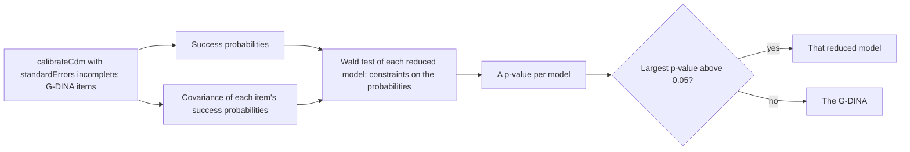

# Cognitive diagnosis

`@measurekit/psychometrics/cdm` tells which attributes, such as the skills a test measures, each person has
mastered: the G-DINA, DINA, DINO, A-CDM, LLM and R-RUM models calibrated by marginal maximum likelihood, persons'
mastery probabilities and profiles, classification accuracy and consistency, Wald tests that choose a model for each
item, Q-matrix validation, and a nonparametric classification for small samples. Each is validated against GDINA or
NPCD ([validation](validation.md)).

## Q-matrix

A `QMatrix` lists the attributes each item measures, by item id. It is the `QMatrix` of
`@measurekit/core`, which `@measurekit/knowledge-tracing` shares, so one Q-matrix serves both packages:

```ts
import type { QMatrix } from "@measurekit/psychometrics/cdm";

const qMatrix: QMatrix = {
  q1: ["fractions"],
  q2: ["fractions", "borrow"],
  q3: ["borrow"],
};
```

Every item of the response matrix needs at least one attribute. The attributes take the order in which they first
appear over the items, which orders every profile in the results; K attributes give 2^K profiles, up to 20 attributes.
A profile is an array of 0 and 1 per attribute, 1 when mastered. Profiles come in GDINA's order: by the number mastered,
then those mastering earlier attributes first, 00, 10, 01, 11.

## Models

An item with K_j attributes splits the profiles into 2^K_j latent groups by its attributes alone. Each model sets the
probability of a correct response in each group.

| `model`   | Success probabilities                                               | Parameters per item |
| --------- | ------------------------------------------------------------------- | ------------------- |
| `"gdina"` | One per latent group (de la Torre, 2011), the saturated model       | 2^K_j               |
| `"dina"`  | 1 - slip mastering all of the item's attributes, guessing otherwise | 2                   |
| `"dino"`  | guessing mastering none of them, 1 - slip otherwise                 | 2                   |
| `"acdm"`  | P = δ₀ + Σ δ_k α_k, the additive model on the identity scale        | K_j + 1             |
| `"llm"`   | logit P = δ₀ + Σ δ_k α_k, the linear logistic model                 | K_j + 1             |
| `"rrum"`  | ln P = δ₀ + Σ δ_k α_k, the reduced reparameterized unified model    | K_j + 1             |

The DINA and DINO are the G-DINA with groups equated. The additive models give an item an intercept δ₀ and one effect
δ_k for each attribute k of the item, on the scale of their link: the identity, logit or log. They are the G-DINA
without interactions, and the same model for an item of one attribute. An effect is not constrained in sign: mastering
an attribute can lower the probability of success, which a monotonicity constraint, not included, would forbid. Each
latent group's probability stays within [1e-4, 1 - 1e-4], a bound that is linear in δ because the link is monotone.

The R-RUM's original parameters are π* = exp(δ₀ + Σ δ_k), the probability of success mastering every attribute of the
item, and r*_k = exp(-δ_k), the penalty for not mastering attribute k.

## Calibration

`calibrateCdm(matrix, qMatrix, options)` estimates the success probabilities and the joint distribution of the
attributes, a proportion for each profile (saturated), by EM over the profiles, as GDINA's `GDINA`. The E-step gives
each person's posterior over the profiles; the M-step sets each group's probability to its expected correct responses
over its expected persons, pooled over equated groups, and each profile's proportion to its expected persons. For an
additive item there is no such closed form: the M-step maximizes Σ_l [R_l ln P_l + (N_l - R_l) ln(1 - P_l)] over δ, for
the expected correct responses R_l and persons N_l of its latent groups l, exactly. The objective is concave in δ under
all three links and the bounds on P are linear in δ, so the maximum is unique; Newton's method with an active set finds
it, starting from the previous iteration's. As GDINA, a probability stays within [1e-4, 1 - 1e-4], a group with fewer
than 0.001 expected persons takes 0.0005 more correct responses over 0.001 more persons, and a proportion stays above
the machine epsilon. Responses are 0 or 1; missing ones are skipped.

| Option           | Default   | Meaning                                                                                                                                                                   |
| ---------------- | --------- | ------------------------------------------------------------------------------------------------------------------------------------------------------------------------- |
| `model`          | `"gdina"` | One model for every item, or an array with one per item, each of `"gdina"`, `"dina"`, `"dino"`, `"acdm"`, `"llm"` or `"rrum"`                                             |
| `tolerance`      | `1e-4`    | EM stops when no probability or proportion changes by more than this                                                                                                      |
| `maxIterations`  | `2000`    | The most EM iterations                                                                                                                                                    |
| `standardErrors` | `"none"`  | `"incomplete"` adds each item's `standardErrors` and `covariance`, from the outer product of the gradient over persons (GDINA's `SE.type = 2`); every item must be G-DINA |

| Result          | Meaning                                                                                                                                                                          |
| --------------- | -------------------------------------------------------------------------------------------------------------------------------------------------------------------------------- |
| `attributes`    | The attributes, in order                                                                                                                                                         |
| `items`         | Per item: `id`, `attributes`, `model`, `probabilities` per latent group, `guessing`, `slip` and `coefficients`, and with `standardErrors`, its `standardErrors` and `covariance` |
| `profiles`      | Each profile with its `proportion`                                                                                                                                               |
| `logLikelihood` | The marginal log-likelihood                                                                                                                                                      |
| `aic`, `bic`    | With 2^K_j parameters per G-DINA item, 2 per DINA or DINO item, K_j + 1 per additive item, and the 2^K - 1 free proportions                                                      |
| `converged`     | Whether EM reached `tolerance`                                                                                                                                                   |
| `iterations`    | EM iterations run                                                                                                                                                                |

| Limit                                       | Value                | Why                                                                                                     |
| ------------------------------------------- | -------------------- | ------------------------------------------------------------------------------------------------------- |
| Attributes of a Q-matrix                    | 20                   | K attributes give 2^K profiles, and a fit's memory and time grow with them: about 1 GB at 20 attributes |
| Success probabilities with `standardErrors` | 3,162 over all items | An item of k attributes has 2^k, and their information matrix has p² cells: 80 MB at the limit          |

`coefficients` are GDINA's `coef(what = "delta")`:

| Model                       | `coefficients`                                                                                                                                                           |
| --------------------------- | ------------------------------------------------------------------------------------------------------------------------------------------------------------------------ |
| `"acdm"`, `"llm"`, `"rrum"` | δ₀, then δ_k for each attribute of the item, in the item's order, on the model's link scale                                                                              |
| `"gdina"`                   | The effects of the identity-link model with every interaction, one per latent group in the order of `probabilities`: δ₀, the main effects, the two-way interactions, ... |
| `"dina"`, `"dino"`          | The guessing, then the rise from it to 1 - slip                                                                                                                          |

```ts
import { calibrateCdm } from "@measurekit/psychometrics/cdm";
import { responseMatrix } from "@measurekit/psychometrics/data";

const matrix = responseMatrix([
  [1, 1, 0, 1],
  [0, 0, 1, 0],
  [1, 0, 0, 1],
  [1, 1, 1, 1],
  [0, 1, 0, 0],
  [0, 0, 0, 0],
]);
const qMatrix = { item1: ["a"], item2: ["a", "b"], item3: ["b"], item4: ["a"] };
const rrum = calibrateCdm(matrix, qMatrix, { model: "rrum" });
rrum.items[1]?.coefficients; // [-7.073, 1.098, 5.975]: δ₀, δ_a, δ_b, on the log scale
```

Profiles whose ideal responses agree on every item, frequent under the DINA and DINO with many attributes, cannot be
told apart: their proportions are identified only in sum, and so are the persons' posteriors among them. With many
attributes and few persons the G-DINA can have several maxima; compare the log-likelihoods of a few calibrations.

## Persons

`attributeProfiles(matrix, calibration)` returns, per person, as GDINA's `personparm`:

| Field       | Meaning                                                                          |
| ----------- | -------------------------------------------------------------------------------- |
| `posterior` | The posterior probability of each profile                                        |
| `mastery`   | The posterior probability of mastering each attribute                            |
| `map`       | The profile of largest posterior probability, the first in profile order on ties |
| `eap`       | Each attribute mastered when its probability is above 0.5                        |

Persons are classified from the success probabilities and proportions alone, so every model works unchanged. A calibration
from JSON may hold success probabilities of 0 or 1, which make some responses impossible. Such a
response's probability enters the likelihood as `Number.MIN_VALUE`, so that a person whose responses no profile can give
has a posterior on the profiles that the responses contradict least.

`cdmClassificationAccuracy(matrix, calibration, { classification })` returns GDINA's `CA` indices for `"map"`
(default) or `"eap"` classification: `accuracy` τ = Σ_c π_c τ_c, the probability that a person lands in the
true profile, with `profileAccuracy` τ_c, and `attributeAccuracy` τ_k; `consistency` γ, the mean of Σ_c post(c)²,
the chance that two measurements agree, and `attributeConsistency` γ_k. They use the persons with a response.

```ts
import { attributeProfiles, calibrateCdm, cdmClassificationAccuracy } from "@measurekit/psychometrics/cdm";
import { responseMatrix } from "@measurekit/psychometrics/data";

const matrix = responseMatrix([
  [1, 1, 0, 1],
  [0, 0, 1, 0],
  [1, 0, 0, 1],
  [1, 1, 1, 1],
  [0, 1, 0, 0],
  [0, 0, 0, 0],
]);
const qMatrix = { item1: ["a"], item2: ["a", "b"], item3: ["b"], item4: ["a"] };
const calibration = calibrateCdm(matrix, qMatrix, { model: "dina" });
attributeProfiles(matrix, calibration)[0]; // { id, mastery: [pa, pb], map, eap, posterior }
cdmClassificationAccuracy(matrix, calibration); // { accuracy, consistency, ... }
```

## Q-matrix validation

`validateQMatrix(matrix, calibration, { eps })` checks each item's attributes by the PVAF method of de la Torre and
Chiu (2016), as GDINA's `Qval(method = "PVAF")`. For a q-vector q, ς²(q) is the variance of the item's success
probabilities over the latent groups of q, weighted by the groups' proportions, each profile's probability its persons'
expected share correct; PVAF(q) is ς²(q) over ς² of all attributes. The suggestion is the q-vector with the fewest
attributes whose PVAF exceeds `eps`, default 0.95, of those the one of largest PVAF. An item whose success
probabilities do not vary over the profiles, such as an item without responses, has `pvaf` `null` and keeps its
attributes. A suggestion is evidence for experts to weigh, not a correction: calibrate the G-DINA before validating.

## Item-level model comparison

A G-DINA item can often be described by a model with fewer parameters, which is easier to interpret and estimated more
precisely. `compareItemModels(calibration, options)` tests, for each item with two or more attributes, whether the
DINA, DINO, A-CDM, LLM or R-RUM fits as well as the G-DINA, and selects a model for the item (de la Torre and Lee,
2013; Ma et al., 2016).



```ts
import { calibrateCdm, compareItemModels } from "@measurekit/psychometrics/cdm";
import { createRandom } from "@measurekit/psychometrics";
import { simulateCdmResponses } from "@measurekit/psychometrics/sim";

// 1,000 persons on two attributes: item3 is a DINA item, item4 an additive one.
const random = createRandom(7);
const model = {
  attributes: ["a", "b"],
  items: [
    { id: "item1", attributes: ["a"], probabilities: [0.15, 0.85] },
    { id: "item2", attributes: ["b"], probabilities: [0.15, 0.85] },
    { id: "item3", attributes: ["a", "b"], probabilities: [0.15, 0.15, 0.15, 0.85] },
    { id: "item4", attributes: ["a", "b"], probabilities: [0.1, 0.5, 0.5, 0.9] },
  ],
};
const profiles = Array.from({ length: 1000 }, () => [random.uniform() < 0.5 ? 1 : 0, random.uniform() < 0.5 ? 1 : 0]);
const matrix = simulateCdmResponses(model, profiles, random);
const qMatrix = Object.fromEntries(model.items.map(({ id, attributes }) => [id, attributes]));

const calibration = calibrateCdm(matrix, qMatrix, { standardErrors: "incomplete" });
calibration.items[2]?.standardErrors; // [0.027, 0.055, 0.052, 0.041]: one for each latent group of item3
const comparisons = compareItemModels(calibration);
comparisons.map(({ item, selected }) => [item, selected]); // [["item3", "dina"], ["item4", "acdm"]]
comparisons[0]?.tests[0]; // { model: "dina", statistic: 3.29, degreesOfFreedom: 2, pValue: 0.193 }, rounded
```

The items with one attribute have no reduced form and are left out. Each test is of constraints on the G-DINA's
success probabilities P of an item's 2^K latent groups, with the G-DINA's covariance matrix V of them:

| Model    | Constraints                                     | Scale   | Degrees of freedom |
| -------- | ----------------------------------------------- | ------- | ------------------ |
| `"dina"` | The groups below the last have one probability  | P       | 2^K - 2            |
| `"dino"` | The groups above the first have one probability | P       | 2^K - 2            |
| `"acdm"` | Every interaction of the attributes is 0        | P       | 2^K - K - 1        |
| `"llm"`  | Every interaction is 0                          | logit P | 2^K - K - 1        |
| `"rrum"` | Every interaction is 0                          | ln P    | 2^K - K - 1        |

With R the matrix of the constraints, g the scale, and G the diagonal matrix of its derivatives at P, the Wald
statistic is (R g(P))' (R G V G' R')⁺ (R g(P)), where ⁺ is the Moore-Penrose inverse, and its p-value is the upper tail
of the chi-square distribution on the degrees of freedom of the table. The selected model is the one with the largest
p-value, if that is above 0.05, and the G-DINA otherwise; the first of equal p-values wins. The p-values are not adjusted
for the number of tests.

| Option   | Default                                   | Meaning                                                         |
| -------- | ----------------------------------------- | --------------------------------------------------------------- |
| `models` | `["dina", "dino", "acdm", "llm", "rrum"]` | The reduced models to test, in the order of `tests`; none twice |

| Result                     | Meaning                                                                                           |
| -------------------------- | ------------------------------------------------------------------------------------------------- |
| `item`                     | The item's id                                                                                     |
| `tests[].model`            | The reduced model                                                                                 |
| `tests[].statistic`        | The Wald statistic; `null` when it is not finite                                                  |
| `tests[].degreesOfFreedom` | From the table above                                                                              |
| `tests[].pValue`           | The probability of a statistic at least as large under the reduced model; `null` with `statistic` |
| `selected`                 | The reduced model with the largest p-value above 0.05, or `"gdina"`                               |

A calibration that has no covariance, or an item with two or more attributes that is not G-DINA, throws a `DataError`:
calibrate with `model: "gdina"` and `standardErrors: "incomplete"`. The covariance is singular when a latent group has
no expected persons, or when the persons are fewer than the parameters; its pseudo-inverse is then used, as GDINA
does, and a group without persons adds no information to the tests. The Wald test is liberal at the sizes of many
tests: on the 20 simulated sets of the validation, 600 persons each with items of two or three attributes, it rejects
the true model of an item at 0.05 in 14% of the items, where 5% is the level, and selects it in 61%. Choose a model for
an item with this evidence and the content of the item, not with a p-value alone.

## Small samples

`nonparametricClassification(matrix, qMatrix, { rule })` classifies persons without calibration (Chiu and Douglas,
2013), as NPCD's `AlphaNP` with the Hamming distance. Each profile's ideal responses follow the Q-matrix by `rule`:
`"conjunctive"` (default) answers an item correctly mastering all its attributes, as the DINA; `"disjunctive"`
mastering any. A person takes the profile whose ideal responses differ from the person's on the fewest answered items,
the first in profile order on ties; the result reports the `distance` and the number of `ties`.

It needs no item parameters, so it suits a classroom of about 30 persons, where the G-DINA's 2^K_j probabilities per
item and 2^K - 1 proportions cannot be estimated. Prefer the G-DINA from several hundred persons, when slips and guesses
differ between items and the posterior's probabilities are wanted; nonparametric classification assumes the ideal
responses up to errors and gives no probabilities.

## Simulation

`simulateCdmResponses(model, profiles, random)` in [`@measurekit/psychometrics/sim`](sim.md) simulates responses from a
model's attributes and items, such as a calibration's, for one person per profile. It takes success probabilities, so
the probabilities of an additive item follow from its coefficients: g⁻¹(δ₀ + Σ δ_k α_k) for each of its latent groups.

## Differences from the references

| Reference | Difference                                                                                                                                                                                                                                                                                                                                                   |
| --------- | ------------------------------------------------------------------------------------------------------------------------------------------------------------------------------------------------------------------------------------------------------------------------------------------------------------------------------------------------------------ |
| GDINA     | An additive M-step is maximized exactly. GDINA's solvers stop near 1e-6, so its estimates and log-likelihood fall slightly short: the two agree within 1e-5, and the log-likelihood here is at least GDINA's.                                                                                                                                                |
| GDINA     | The small-group correction, which GDINA applies to the G-DINA, DINA and DINO, applies to every model. It changes only groups with fewer than 0.001 expected persons.                                                                                                                                                                                         |
| GDINA     | GDINA starts from the best of three random starts; `calibrateCdm` is deterministic, starting at P = 0.2 + 0.6 m / K_j for m of K_j attributes mastered, and for an additive item at the least squares fit of that on the link scale. The likelihood of a model with several attributes can have several maxima: compare the log-likelihoods of calibrations. |
| GDINA     | No monotonicity constraint (`mono.constraint`). The standard errors are those of `SE.type = 2`, and `compareItemModels` is `modelcomp(method = "Wald")` with it, for every model of `models` at once.                                                                                                                                                        |
| CDM       | The `gdina(rule = "ACDM")` of the CDM package uses another M-step and is not a reference.                                                                                                                                                                                                                                                                    |

## Not included

- **The likelihood ratio test of `modelcomp`.** Outside the sources: the Wald test is the step for choosing a model per
  item, and it is built; the likelihood ratio refits each item under each model.
- **The Lagrange multiplier test of `modelcomp`.** Outside the sources: the Wald test is the step for choosing a model
  per item, and it is built; the Lagrange multiplier test refits each item under each model.
- **The item-wise and complete information matrices of `SE.type` 1 and 3.** Outside the sources: options of GDINA,
  beside the standard errors that are built.
- **Monotonicity constraints.** Outside the sources: an option of GDINA (`mono.constraint`), off by default.
- **Sequential CDMs.** Outside the sources: an option of GDINA (`sequential`), off by default.
- **Hierarchical attribute structures.** Outside the sources: an option of GDINA (`att.str`), off by default.
- **The R-RUM's original parameters.** No fit: the parameters `π*` and `r*` follow from `coefficients`, as above.
- **Higher-order attribute models.** Outside the sources: a variant, as GDINA's `att.dist` shows; the saturated
  distribution of the profiles is its default.
- **Polytomous attributes.** Outside the sources: a variant of the models for attributes mastered or not.

## References

- Chiu, C.-Y., & Douglas, J. (2013). A nonparametric approach to cognitive diagnosis by proximity to ideal response
  patterns. Journal of Classification, 30, 225-250.
- de la Torre, J. (2011). The generalized DINA model framework. Psychometrika, 76, 179-199.
- de la Torre, J., & Lee, Y.-S. (2013). Evaluating the Wald test for item-level comparison of saturated and reduced
  models in cognitive diagnosis. Journal of Educational Measurement, 50, 355-373.
- de la Torre, J., & Chiu, C.-Y. (2016). A general method of empirical Q-matrix validation. Psychometrika, 81, 253-273.
- Iaconangelo, C. (2017). Uses of classification error probabilities in the three-step approach to estimating
  cognitive diagnosis models. Rutgers University.
- Ma, W., Iaconangelo, C., & de la Torre, J. (2016). Model similarity, model selection, and attribute classification.
  Applied Psychological Measurement, 40, 200-217.
- Wang, W., Song, L., Chen, P., Meng, Y., & Ding, S. (2015). Attribute-level and pattern-level classification
  consistency and accuracy indices for cognitive diagnostic assessment. Journal of Educational Measurement, 52, 457-476.
