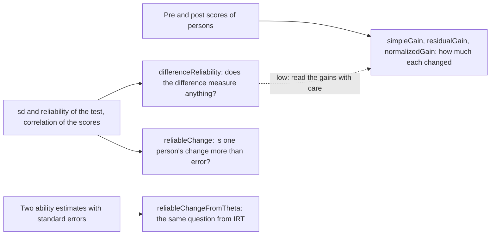
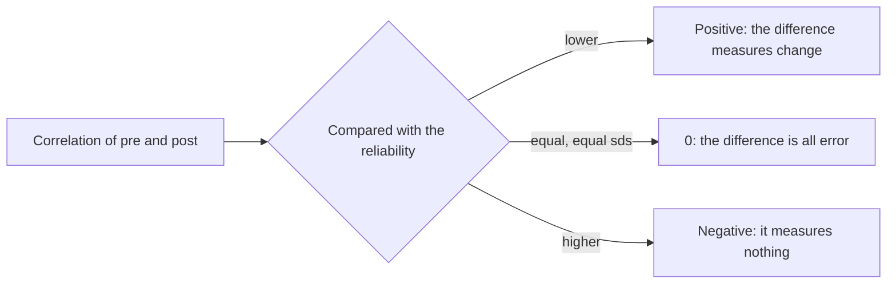

# Change

`@measurekit/psychometrics/change` measures how much persons changed between two occasions, how well a difference of
two scores measures anything, and whether one person's change is more than the error of measurement explains. Every
statistic is validated against base R or clinicalsignificance ([validation](validation.md)).



| Function                                          | Answers                                                           | Input                                       |
| ------------------------------------------------- | ----------------------------------------------------------------- | ------------------------------------------- |
| `simpleGain(pre, post)`                           | How much did each person's score change?                          | Scores of the same persons on two occasions |
| `residualGain(pre, post)`                         | How far above or below the persons who started alike?             | The same                                    |
| `normalizedGain(pre, post, options)`              | What share of the possible gain was made, by person and by group? | The same, and the highest possible score    |
| `differenceReliability(input)`                    | How reliable is the difference of two scores?                     | The sd and reliability of each, correlation |
| `reliableChange(pre, post, test, options)`        | Did one person change more than error explains, from test scores? | Two scores, the test's sd and reliability   |
| `reliableChangeFromTheta(before, after, options)` | The same, from ability estimates                                  | Two estimates with their standard errors    |

## Gains

Each function takes the scores of the same persons, in the same order, as two arrays of finite numbers, and needs at
least one person (`residualGain` two). A gain of a person who did not take both tests has no place in the arrays: leave
the person out of both.

```ts
import { normalizedGain, residualGain, simpleGain } from "@measurekit/psychometrics/change";

const pre = [12, 20, 31, 50, 25];
const post = [18, 19, 40, 50, 34];

simpleGain(pre, post); // [6, -1, 9, 0, 9]
residualGain(pre, post); // [-0.097, -6.329, 4.726, -2.451, 4.151]
normalizedGain(pre, post, { maximum: 50 });
// { group: 0.205, persons: [0.158, -0.033, 0.474, null, 0.36] }
```

| Gain       | Definition                                                                      | Reads as                                                           |
| ---------- | ------------------------------------------------------------------------------- | ------------------------------------------------------------------ |
| Simple     | post - pre                                                                      | The change in score points; it depends on where the person started |
| Residual   | post less its least-squares prediction from pre, as `residuals(lm(post ~ pre))` | The change relative to persons who started alike; sums to 0        |
| Normalized | (post - pre) / (maximum - pre); for the group, from the means (Hake's ⟨g⟩)      | The share of the possible gain that was made                       |

- A residual gain is relative to the group: the same person has another residual gain in another group. It needs pre
  scores that are not all equal.
- A person whose pre score is the maximum cannot gain, so the normalized gain is `null` there. The group's gain is
  (mean post - mean pre) / (maximum - mean pre), which is not the mean of the persons' gains, and is `null` only when
  everyone started at the maximum.
- A normalized gain is 1 when the person reaches the maximum, and negative for a decline. A score above `maximum` is
  an error.

## The reliability of a difference

A difference of two scores carries the error of both and shares the true score they have in common, so it is usually
less reliable than either score. `differenceReliability` gives Lord's reliability of the difference from what a test
manual or a calibration reports.

```ts
import { differenceReliability } from "@measurekit/psychometrics/change";

const score = { sd: 9, reliability: 0.88 };
differenceReliability({ pre: score, post: score, correlation: 0.7 }); // 0.6
differenceReliability({ pre: score, post: score, correlation: 0.88 }); // 0
differenceReliability({ pre: score, post: score, correlation: 0.95 }); // -1.4
```



With equal standard deviations and reliabilities r, the reliability of the difference is (r - rho) / (1 - rho) for a
correlation rho. It falls as the correlation rises, so a test whose scores are stable between occasions measures
change worst. The result is `null` only when the difference has no variance: equal standard deviations and a
correlation of 1. A negative value is returned as computed. Cronbach and Furby (1970) is the standard warning about
difference scores and the reason `residualGain` exists; this library gives both and leaves the choice to the reader.

## Reliable change

The reliable change index of Jacobson and Truax divides a person's change by its standard error. With the standard
error of measurement SEM = sd √(1 - reliability) of the test, the standard error of the difference is √(2 SEM²), and a
change is reliable when its index lies beyond the critical value of the level: 1.96 at the default `0.95`.

```ts
import { reliableChange, reliableChangeFromTheta } from "@measurekit/psychometrics/change";

const test = { sd: 9, reliability: 0.88 };
reliableChange(12, 21, test); // { index: 2.041, classification: "improved" }
reliableChange(21, 12, test); // { index: -2.041, classification: "declined" }
reliableChange(25, 34, test, { level: 0.9 }); // { index: 2.041, classification: "improved" }
reliableChange(12, 14, test); // { index: 0.454, classification: "unchanged" }

reliableChangeFromTheta({ theta: -0.4, standardError: 0.3 }, { theta: 0.5, standardError: 0.2 });
// { index: 2.496, classification: "improved" }
```

`reliableChangeFromTheta` takes the index from two ability estimates, as Jabrayilov, Emons and Sijtsma compare for
IRT: (theta2 - theta1) / √(SE1² + SE2²). The standard errors are the person's own, so a person measured less precisely
needs a larger change, and the estimates may come from different items, such as two adaptive tests. An
`AbilityEstimate` of the `irt` module fits. A standard error of `Infinity`, which an estimate gives when the items
carry no information, is an error: there is nothing to compare.

| Option  | Default | Meaning                                                                                            |
| ------- | ------- | -------------------------------------------------------------------------------------------------- |
| `level` | `0.95`  | The probability of the central interval of no reliable change; a number between 0 and 1, exclusive |

| Result field     | Meaning                                                                                                      |
| ---------------- | ------------------------------------------------------------------------------------------------------------ |
| `index`          | The change in units of its standard error; positive for an increase                                          |
| `classification` | `"improved"` when the index is above the critical value, `"declined"` below its negative, else `"unchanged"` |

A higher score is taken as better. For a scale where lower is better, such as a symptom score, read `"improved"` as a
decline and `"declined"` as an improvement. The `sd` and `reliability` are those of the test, such as a norm group's,
not of the persons being assessed.

## Errors

Invalid input throws `DataError` with the value found.

| Cause                                                                 | What to do                                                                           |
| --------------------------------------------------------------------- | ------------------------------------------------------------------------------------ |
| Score arrays of different lengths, or a missing or non-finite score   | Pair the scores by person and leave out a person who lacks one                       |
| A score above `maximum`                                               | Check the maximum of the test, or the scoring                                        |
| All pre scores equal, in `residualGain`                               | The regression has no slope: use `simpleGain`                                        |
| A reliability of 1 in `reliableChange`                                | A test without error has no standard error: use the reliability of the test, below 1 |
| A `level` of 0 or 1, or outside                                       | Use a level between 0 and 1, such as 0.9 or 0.95                                     |
| A standard error that is 0 or not finite in `reliableChangeFromTheta` | Estimate the person again with items that carry information                          |

## Differences from the references

| Reference                                                 | Difference                                                                                                                                                                                               |
| --------------------------------------------------------- | -------------------------------------------------------------------------------------------------------------------------------------------------------------------------------------------------------- |
| clinicalsignificance `cs_distribution(rci_method = "JT")` | It takes the standard deviation from the data and a reliability from 0 to 1; this library takes both as input and refuses a reliability of 1. `better_is = "higher"` gives this library's classification |

## Not included

| Method                                                                             | Reason                                                                                          |
| ---------------------------------------------------------------------------------- | ----------------------------------------------------------------------------------------------- |
| The cutoffs of clinical significance, and other forms of the reliable change index | Outside the sources the module follows, Cronbach and Furby (1970) and Jacobson and Truax (1991) |
