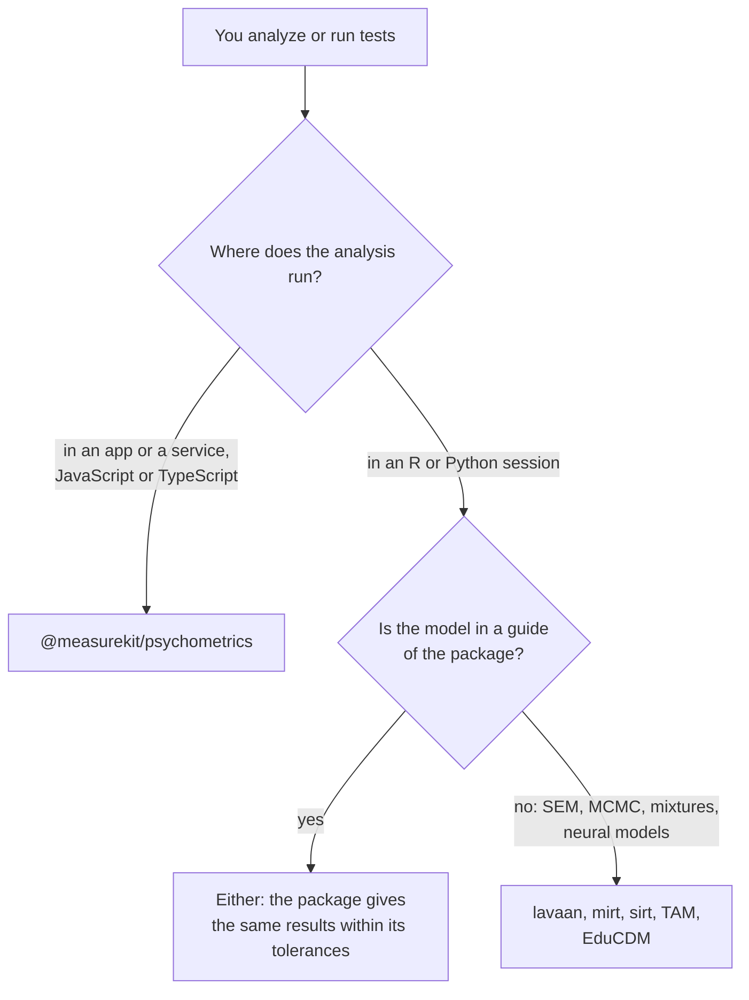

# Choosing psychometrics

When `@measurekit/psychometrics` fits a project that analyzes tests, and when another library fits better. Each comparator
was read on 2026-11-02, at the version that its row gives, from its reference manual on CRAN, its page on PyPI or its
package on npm; each capability that the package leaves out is in the Not included table of the guide that the row links,
with its reason.

| You need                                                                                    | Use                                                                                 |
| ------------------------------------------------------------------------------------------- | ----------------------------------------------------------------------------------- |
| Item analysis, IRT calibration and scoring inside a web app, a server or an edge function   | This package: `ctt`, `irt`, `scaling`, with no dependency but `@measurekit/core`    |
| An adaptive or a multistage test served one response at a time                              | This package: `createAdaptiveTest`, `createMultistageTest`, plain states to store   |
| The results of mirt, difR, equate or GDINA from TypeScript                                  | This package, within the tolerances of [validation](validation.md#tolerances)       |
| Structural equation models, confirmatory factor analysis of ordinal items, invariance tests | lavaan 0.7-3                                                                        |
| Bayesian estimation by MCMC or variational methods, mixture and latent class IRT            | mirt 1.48 (`mdirt`), sirt 4.2-133, py-irt 0.8.3                                     |
| Neural cognitive diagnosis                                                                  | EduCDM 1.0.1                                                                        |
| An analysis in R with its plots and printed summaries                                       | The R packages; [coming from R](coming-from-r.md) maps their calls to the package's |

## What the others have that the package lacks

| Comparator, version                                                                | What it has                                                                                                                                                                                                                                                | Here                                                                                                                                                                                                                                                                         |
| ---------------------------------------------------------------------------------- | ---------------------------------------------------------------------------------------------------------------------------------------------------------------------------------------------------------------------------------------------------------- | ---------------------------------------------------------------------------------------------------------------------------------------------------------------------------------------------------------------------------------------------------------------------------- |
| [mirt](https://cran.r-project.org/package=mirt) 1.48                               | Sequential, nested logit, spline and partially compensatory items; unfolding models other than the GGUM; Davidian and mixture densities; general equality constraints; Oakes and sandwich errors; X2, G2 and PV-Q1 item fit; Crossing SIBTEST, DRF and DTF | In part: GGUM, histogram densities, held parameters, Hessian and cross-product errors, S-X², RMSD, SIBTEST and DFIT; the rest in [irt](irt.md#not-included), [multidimensional](multidimensional.md#not-included), [fit](fit.md#not-included) and [dif](dif.md#not-included) |
| [TAM](https://cran.r-project.org/package=TAM) 4.3-25                               | General design matrices, MADaQ3, Thurstonian thresholds, cross-validation of a fit, mixture and multilevel models, linking of several calibrations at once                                                                                                 | In part: LLTM and facets; the rest in [irt](irt.md#not-included), [fit](fit.md#not-included) and [equating](equating.md#not-included)                                                                                                                                        |
| [sirt](https://cran.r-project.org/package=sirt) 4.2-133                            | NOHARM, MCMC and other Rasch estimators, invariance alignment, DETECT, the hierarchical rater model, linking of several studies                                                                                                                            | Excluded: [irt](irt.md#not-included), [dimensionality](dimensionality.md#not-included), [rater](rater.md#not-included), [equating](equating.md#not-included)                                                                                                                 |
| [catR](https://cran.r-project.org/package=catR) 3.17                               | Observed information, the distribution of the ability estimator, fixed and random starting thetas                                                                                                                                                          | In part: `startingItems`; the rest in [irt](irt.md#not-included) and [cat](cat.md#not-included)                                                                                                                                                                              |
| [mirtCAT](https://cran.r-project.org/package=mirtCAT) 1.14                         | A-, E- and KL-optimal multidimensional rules, shadow tests                                                                                                                                                                                                 | Excluded: [cat](cat.md#not-included); content bounds and form assembly are built                                                                                                                                                                                             |
| [GDINA](https://cran.r-project.org/package=GDINA) 2.13.2                           | Sequential and polytomous G-DINA, attribute hierarchies, higher-order models, multiple-strategy models, DIF of CDMs, MesaR and EPSA Q-matrix validation, bootstrap errors                                                                                  | In part: PVAF; the rest in [cdm](cdm.md#not-included)                                                                                                                                                                                                                        |
| [CDM](https://cran.r-project.org/package=CDM) 8.3-14                               | The general diagnostic model, multiple-choice DINA, structured latent classes, person fit of CDMs                                                                                                                                                          | Excluded: [cdm](cdm.md#not-included)                                                                                                                                                                                                                                         |
| [equate](https://cran.r-project.org/package=equate) 2.0.9                          | Circle-arc, Braun-Holland and nominal weights equating, cubic-spline postsmoothing, composite equating                                                                                                                                                     | Excluded: [equating](equating.md#not-included)                                                                                                                                                                                                                               |
| [equateIRT](https://cran.r-project.org/package=equateIRT) 2.5.2                    | Bisector linking, many forms linked at once, identity and chain-consistency tests                                                                                                                                                                          | Excluded: [equating](equating.md#not-included)                                                                                                                                                                                                                               |
| [kequate](https://cran.r-project.org/package=kequate) 1.6.4                        | IRT observed-score kernel equating, Freeman-Tukey residuals                                                                                                                                                                                                | Excluded: [equating](equating.md#not-included)                                                                                                                                                                                                                               |
| [mokken](https://cran.r-project.org/package=mokken) 3.1.2                          | Genetic and extended item selection, other orderings than MIIO, the P-matrix and rest-score checks, two-level scalability                                                                                                                                  | Excluded: [mokken](mokken.md#not-included)                                                                                                                                                                                                                                   |
| [eRm](https://cran.r-project.org/package=eRm) 1.0-10                               | The LLTM, LPCM and LRSM by conditional likelihood, nonparametric tests and the RaschSampler, stepwise item elimination                                                                                                                                     | In part: the LLTM by marginal likelihood; the rest in [explanatory](explanatory.md#not-included) and [fit](fit.md#not-included)                                                                                                                                              |
| [ltm](https://cran.r-project.org/package=ltm) 1.2-0                                | Yen's Q1 with Monte Carlo p-values, bootstrap goodness of fit, fit on two- and three-way margins                                                                                                                                                           | In part: S-X²; the rest in [fit](fit.md#not-included)                                                                                                                                                                                                                        |
| [difR](https://cran.r-project.org/package=difR) 6.1.0                              | Exact Mantel-Haenszel, Breslow-Day, several focal groups, transformed item difficulties, lasso DIF                                                                                                                                                         | Excluded: [dif](dif.md#not-included), several focal groups as a recipe                                                                                                                                                                                                       |
| [lordif](https://cran.r-project.org/package=lordif) 0.4.2                          | Iterated theta with group-specific parameters, collapsing of sparse categories, Monte Carlo cutoffs                                                                                                                                                        | Excluded: [dif](dif.md#not-included)                                                                                                                                                                                                                                         |
| [psych](https://cran.r-project.org/package=psych) 2.6.9                            | Guttman's lambdas, the greatest lower bound, test-retest reliability, polyserial correlations, KMO and Bartlett, PCA, factor scores, promax, ICLUST                                                                                                        | In part: alpha, a split half, ML and minres factors; the rest in [ctt](ctt.md#not-included) and [dimensionality](dimensionality.md#not-included)                                                                                                                             |
| [lavaan](https://cran.r-project.org/package=lavaan) 0.7-3                          | CFA of ordinal items, modification indices, multi-group invariance, structural paths, growth models                                                                                                                                                        | Excluded: [dimensionality](dimensionality.md#not-included); reliability from a factor model is built                                                                                                                                                                         |
| [gtheory](https://cran.r-project.org/src/contrib/Archive/gtheory/) 0.1.2, archived | Unbalanced designs by REML, mixed-model G studies                                                                                                                                                                                                          | In part: unbalanced designs by Henderson's Method 1; the rest in [generalizability](generalizability.md#not-included)                                                                                                                                                        |
| [irr](https://cran.r-project.org/package=irr) 0.85                                 | Krippendorff's alpha, Light's kappa, Kendall's W, sample size for kappa                                                                                                                                                                                    | Excluded: [rater](rater.md#not-included)                                                                                                                                                                                                                                     |
| [PerFit](https://cran.r-project.org/package=PerFit) 1.4.7                          | ZU3, NCI, the caution indices, polytomous U3 and G, cutoffs of aberrant patterns                                                                                                                                                                           | In part: lz, lz*, U3, Ht, G; the rest in [mokken](mokken.md#not-included) and [fit](fit.md#not-included)                                                                                                                                                                     |
| [cacIRT](https://cran.r-project.org/package=cacIRT) 1.4                            | Lee's accuracy and consistency, the nonparametric approach                                                                                                                                                                                                 | In part: Rudner's and Livingston and Lewis's; the rest in [standard-setting](standard-setting.md#not-included)                                                                                                                                                               |
| [py-irt](https://pypi.org/project/py-irt/) 0.8.3                                   | Variational Bayesian estimation with hierarchical priors, an amortized neural 1PL                                                                                                                                                                          | Excluded: [irt](irt.md#not-included)                                                                                                                                                                                                                                         |
| [girth](https://pypi.org/project/girth/) 0.8.0                                     | JML and mixed EAP of the 2PL and the GRM                                                                                                                                                                                                                   | Excluded: [irt](irt.md#not-included); JML of the Rasch model is built                                                                                                                                                                                                        |
| [catsim](https://pypi.org/project/catsim/) 0.21.0                                  | Fixed and random starting thetas, b-blocking, max-information and b-stratified selection, 54321 and cluster selection                                                                                                                                      | In part: a-stratified and Urry's rule; the rest in [cat](cat.md#not-included)                                                                                                                                                                                                |
| [EduCDM](https://pypi.org/project/EduCDM/) 1.0.1                                   | Neural and ranking cognitive diagnosis, fuzzy cognitive diagnosis                                                                                                                                                                                          | Excluded: [cdm](cdm.md#not-included)                                                                                                                                                                                                                                         |
| [@bdelab/jscat](https://www.npmjs.com/package/@bdelab/jscat) 5.3.2                 | Several adaptive tests over one corpus, validated and unvalidated items                                                                                                                                                                                    | Excluded: [cat](cat.md#not-included); one test object each, and pretest calibration is built                                                                                                                                                                                 |
| [psychometric](https://www.npmjs.com/package/psychometric) 2.0.2                   | Questionnaire scoring with reverse items and prorating, omega from a correlation matrix, summaries of reaction-time tasks                                                                                                                                  | Excluded: [ctt](ctt.md#not-included) and [response-time](response-time.md#not-included)                                                                                                                                                                                      |

## Where the evidence is

[The evidence](evidence.md) gives the references, their tolerances and the recovery studies; [coming from R](coming-from-r.md)
puts each R call beside its function with its tolerance and its time; [performance](performance.md) times every hot path
against its reference.
