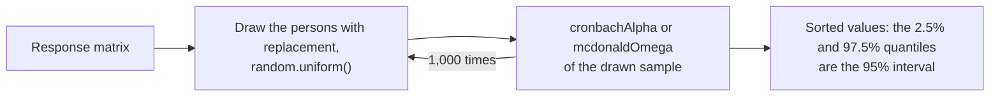
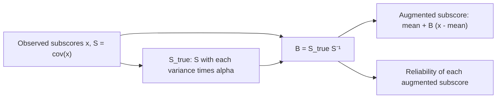

# Classical test theory

`@measurekit/psychometrics/ctt` computes item statistics, distractor analysis, reliability, McDonald's omega, the
standard error of measurement, the value of subscores and augmented subscores from a [response matrix](data.md). Every statistic is validated against R
([validation](validation.md)).

## Quick start

Compute alpha and the statistics of each item for six persons on five items:

```ts
import { cronbachAlpha, itemStatistics } from "@measurekit/psychometrics/ctt";
import { buildResponseMatrix } from "@measurekit/psychometrics/data";

const matrix = buildResponseMatrix([
  [1, 1, 0, 1, 1],
  [0, 1, 0, 0, 1],
  [1, 1, 1, 1, 1],
  [0, 0, 0, 1, 0],
  [1, 0, 1, 1, 1],
  [0, 1, 0, 0, 0],
]);
cronbachAlpha(matrix); // => 0.674
itemStatistics(matrix).map(({ itemRest }) => itemRest); // => [0.90, -0.15, 0.56, 0.35, 0.68]: item2 works against the rest
```

## Missing responses

| Statistics                                                                                                        | Persons used                                     |
| ----------------------------------------------------------------------------------------------------------------- | ------------------------------------------------ |
| An item's `count`, `mean` and `sd`; an option's `count` and `proportion`                                          | Everyone who answered the item                   |
| Everything that uses the total score or other items: correlations, D, alpha if deleted, group shares, reliability | Persons who answered every item (complete cases) |

Persons without any response change nothing. Using complete cases keeps every coefficient consistent with its
definition: alpha is at most 1, correlations lie in [-1, 1] and KR-21 is at most KR-20, which pairwise deletion does
not guarantee. To keep persons who omitted items, score omissions as wrong ([data](data.md#scoring-against-a-key)).

## Item statistics

`itemStatistics(matrix, { groupFraction })` returns one `ItemStatistics` per item, in item order.

| Field                 | Definition                                                                                                                      |
| --------------------- | ------------------------------------------------------------------------------------------------------------------------------- |
| `count`               | Persons who answered the item                                                                                                   |
| `mean`                | Mean score; the p-value (difficulty) of a 0/1 item                                                                              |
| `sd`                  | Standard deviation, denominator n - 1                                                                                           |
| `itemTotal`           | Pearson correlation with the total score; the point-biserial correlation of a 0/1 item                                          |
| `itemRest`            | Correlation with the total of the other items (corrected item-total correlation)                                                |
| `biserial`            | r √(pq) / φ(z), with r = `itemTotal`, p the share correct, q = 1 - p, φ(z) the normal density at the p quantile. 0/1 items only |
| `discriminationIndex` | D: mean score in the upper group minus mean score in the lower group; for a 0/1 item, p(upper) - p(lower)                       |
| `alphaIfDeleted`      | Cronbach's alpha of the other items; `null` with fewer than three items                                                         |

An item counts as dichotomous for `biserial` when every response to it is 0 or 1.

## Upper and lower groups

The upper and lower groups are the `groupFraction` of complete cases with the highest and the lowest total scores.
The default is 0.27 (Kelley, 1939); any value above 0 and at most 0.5 is accepted. Each group holds exactly
`groupFraction` × n persons: persons tied at a group's boundary share the remaining places equally, as fractions of a
person. With 10 persons and distinct totals, the upper group is the top two and 0.7 of the third. So D and the group
shares never depend on the order of persons.

## Distractor analysis

`distractorAnalysis(scored, { groupFraction })` takes the result of `scoreResponses` and returns, per item, its `id`,
its `key` and an `OptionStatistics` per option label:

| Field           | Definition                                                       |
| --------------- | ---------------------------------------------------------------- |
| `count`         | Persons who chose the option                                     |
| `proportion`    | `count` divided by the persons who answered the item             |
| `upper`         | Share of the upper group that chose the option                   |
| `lower`         | Share of the lower group that chose the option                   |
| `pointBiserial` | Correlation of choosing the option (1 or 0) with the total score |

A working distractor draws more of the lower group than of the upper group and has a negative point-biserial
correlation. The key's `pointBiserial` equals the item's `itemTotal`.

## Reliability

| Function                     | Value                                                                                                               |
| ---------------------------- | ------------------------------------------------------------------------------------------------------------------- |
| `cronbachAlpha`              | k / (k - 1) · (1 - Σ sᵢ² / s²), with item variances sᵢ² and total score variance s²                                 |
| `kr20`                       | The same for 0/1 items; throws `DataError` for other scores                                                         |
| `kr21`                       | k / (k - 1) · (1 - M (k - M) / (k σ²)), with the total score mean M and variance σ² (denominator n); 0/1 items only |
| `splitHalf`                  | `correlation` r of the half totals, `spearmanBrown` 2r / (1 + r), `guttman` 4 cov(A, B) / var(A + B)                |
| `mcdonaldOmega`              | McDonald's omega total of one factor, 1 - Σ (1 - λ²) / Σ r, below                                                   |
| `standardErrorOfMeasurement` | s √(1 - reliability), in total score points; the option `reliability` defaults to `cronbachAlpha`                   |

`splitHalf` splits the items by its option `split`: `odd-even` (items 1, 3, 5, ... against 2, 4, 6, ...; the default) or `first-second`
(the first k / 2 items, rounded down, against the rest). The Spearman-Brown value assumes halves of equal variance;
Guttman's coefficient (Flanagan-Rulon) does not. KR-21 assumes items of equal difficulty and is at most KR-20.

`mcdonaldOmega` fits one factor to the Pearson correlations r of the items by minres, as psych's
`omega(nfactors = 1)`: the loadings λ minimize Σ_(i<j) (r_ij - λ_i λ_j)², by Newton's method from the centroid
loadings. Omega is 1 - Σ (1 - λ_i²) / Σ_ij r_ij, the diagonal included: psych's `omega.tot`, from correlations, so for
standardized item scores. It returns `omega`, the `loadings`, whose sum is positive, `converged` and `iterations`. It
needs three items and correlations whose sum Σ_ij r_ij, the variance of the standardized total, is above 0; a loading
above 1 (a Heywood case) shows that one factor does not fit. Alpha equals omega when the loadings are equal, and is
lower otherwise. A test of several group factors under a general one has omega hierarchical and omega total from
[`omegaHierarchical`](dimensionality.md#omega-hierarchical).

## Recipe: intervals of alpha and omega

Alpha and omega are estimates from one sample of persons, and the bootstrap gives their sampling error without a formula:
draw the persons with replacement, compute the statistic of each drawn sample, and take the quantiles of the results. A row
of the matrix is a person, so a person's responses stay together.



```ts
import { createRandom } from "@measurekit/psychometrics";
import { cronbachAlpha, mcdonaldOmega } from "@measurekit/psychometrics/ctt";
import { buildResponseMatrix, type ResponseMatrix } from "@measurekit/psychometrics/data";

// 200 persons answer 8 items of five categories, which load 0.4 to 0.8 on one factor.
const random = createRandom(2);
const loadings = [0.4, 0.45, 0.5, 0.55, 0.6, 0.65, 0.7, 0.8];
const rows = Array.from({ length: 200 }, () => {
  const factor = random.normal();
  return loadings.map((loading) => {
    const score = loading * factor + Math.sqrt(1 - loading ** 2) * random.normal();
    return [-1.2, -0.4, 0.4, 1.2].filter((cut) => score > cut).length;
  });
});
const matrix = buildResponseMatrix(rows);

/** The percentile interval of a statistic over bootstrap samples of the persons. */
function percentileInterval(
  data: ResponseMatrix,
  statistic: (resample: ResponseMatrix) => number,
  { resamples = 1000, level = 0.95 } = {},
): [number, number] {
  const persons = data.responses.length;
  const values = Array.from({ length: resamples }, () => {
    const drawn = Array.from({ length: persons }, () => data.responses[Math.floor(random.uniform() * persons)] ?? []);
    return statistic(buildResponseMatrix(drawn, { itemIds: data.itemIds }));
  }).sort((a, b) => a - b);
  const tail = (1 - level) / 2;
  return [values[Math.floor(tail * resamples)] ?? 0, values[Math.ceil((1 - tail) * resamples) - 1] ?? 0];
}

cronbachAlpha(matrix); // => 0.741
percentileInterval(matrix, cronbachAlpha); // => [0.677, 0.793]
mcdonaldOmega(matrix).omega; // => 0.755
percentileInterval(matrix, (resample) => mcdonaldOmega(resample).omega); // => [0.695, 0.802]
```

| Choice        | Value                                                                                                                                                                                                             |
| ------------- | ----------------------------------------------------------------------------------------------------------------------------------------------------------------------------------------------------------------- |
| Resamples     | 1,000 for an interval; the quantile at 2.5% rests on the 25 smallest values                                                                                                                                       |
| Level         | `level` from 0 to 1: the tails are (1 - level) / 2 each                                                                                                                                                           |
| Coverage      | On 200 sets of 200 persons and the 8 items above, the 95% intervals held the population value in 92.5% of the sets for alpha and 93.5% for omega: percentile intervals of a sample this small are a little narrow |
| A failed draw | A drawn sample whose total scores have no variance throws `DataError` in `cronbachAlpha`, and one with an item of no variance in `mcdonaldOmega`: draw again, or use more persons                                 |

## Subscore value

`subscoreValue(matrix, sections)` tells, for each section of a test, whether its subscore is worth reporting. Haberman
(2008) showed that it is only if the subscore predicts its own true score better than the total score does: the total
is more reliable, so for sections of weakly different abilities it often predicts a section's true score better than the
section's own few items.

```ts
import { createRandom } from "@measurekit/psychometrics";
import { buildResponseMatrix } from "@measurekit/psychometrics/data";
import { subscoreValue } from "@measurekit/psychometrics/ctt";
import { twoParameterLogistic } from "@measurekit/psychometrics/irt";
import { simulateItems, simulateResponses, simulateThetas } from "@measurekit/psychometrics/sim";

// 400 persons answer 12 reading and 12 listening items; the two abilities correlate at 0.6.
const random = createRandom(2026);
const reading = simulateThetas(400, random);
const listening = reading.map((theta) => 0.6 * theta + 0.8 * random.normal());
const readingResponses = simulateResponses(simulateItems(twoParameterLogistic, 12, random), reading, random).responses;
const listeningResponses = simulateResponses(
  simulateItems(twoParameterLogistic, 12, random),
  listening,
  random,
).responses;
const matrix = buildResponseMatrix(
  readingResponses.map((row, person) => [...row, ...(listeningResponses[person] ?? [])]),
);

subscoreValue(matrix, { reading: matrix.itemIds.slice(0, 12), listening: matrix.itemIds.slice(12) });
// => [{ section: "reading", subscorePrmse: 0.68, totalPrmse: 0.59, addedValue: true },
//  { section: "listening", subscorePrmse: 0.67, totalPrmse: 0.59, addedValue: true }]
```

`sections` maps each section's name to the ids of its items. A section's subscore s is the sum of its items; the total x
is the sum of the items of all sections, and items in no section are left out. The predictors are compared by the
proportion reduction in mean squared error (PRMSE) with which each predicts the true subscore:

| Field           | Definition                                                                                            |
| --------------- | ----------------------------------------------------------------------------------------------------- |
| `subscorePrmse` | ρ, the reliability of s: `cronbachAlpha` of the section's items                                       |
| `totalPrmse`    | [cov(s, x) - (1 - ρ) var(s)]² / (ρ var(s) var(x)): the squared correlation of the true subscore and x |
| `addedValue`    | `subscorePrmse` above `totalPrmse`                                                                    |

The true subscore's covariance with x is that of s with x less the error variance of s, (1 - ρ) var(s), because x
contains s and so its error; the errors of different sections are taken as uncorrelated. The statistics use the persons
who answered every item of the sections, as the other coefficients above. Because ρ is estimated, `totalPrmse` can
exceed 1 where the sections correlate, corrected for unreliability, above 1; the comparison with `subscorePrmse`
stands.

A section needs at least two items for alpha, and there must be at least two sections: with one, the total is the
subscore. A section whose subscore has no variance or whose alpha is not above 0 has no true-score variance to predict:
both PRMSEs are `null` and `addedValue` is `false`.

## Augmented subscores

A section of few items gives an unreliable subscore, and the other sections carry information about it when abilities
correlate. `augmentedSubscores(matrix, sections)` estimates each person's true subscore of every section from the
observed subscores of all sections, which Wainer et al. call augmenting.



```ts
import { createRandom } from "@measurekit/psychometrics";
import { augmentedSubscores } from "@measurekit/psychometrics/ctt";
import { buildResponseMatrix } from "@measurekit/psychometrics/data";
import { twoParameterLogistic } from "@measurekit/psychometrics/irt";
import { simulateItems, simulateResponses, simulateThetas } from "@measurekit/psychometrics/sim";

// The reading and listening items of the example above.
const random = createRandom(2026);
const reading = simulateThetas(400, random);
const listening = reading.map((theta) => 0.6 * theta + 0.8 * random.normal());
const readingResponses = simulateResponses(simulateItems(twoParameterLogistic, 12, random), reading, random).responses;
const listeningResponses = simulateResponses(
  simulateItems(twoParameterLogistic, 12, random),
  listening,
  random,
).responses;
const matrix = buildResponseMatrix(
  readingResponses.map((row, person) => [...row, ...(listeningResponses[person] ?? [])]),
);

const result = augmentedSubscores(matrix, {
  reading: matrix.itemIds.slice(0, 12),
  listening: matrix.itemIds.slice(12),
});
result.sections.map(({ section, reliability, augmentedReliability }) => [
  section,
  Math.round(reliability * 1000) / 1000,
  Math.round(augmentedReliability * 1000) / 1000,
]);
// => [["reading", 0.678, 0.721], ["listening", 0.67, 0.717]]
result.weights.map((row) => row.map((weight) => Math.round(weight * 100) / 100)); // => [[0.63, 0.14], [0.14, 0.62]]
```

`sections` is as for `subscoreValue`. The result has these fields:

| Field      | Meaning                                                                                                                                                 |
| ---------- | ------------------------------------------------------------------------------------------------------------------------------------------------------- |
| `sections` | For each section in the order given: `reliability` (alpha of its items), `augmentedReliability`, `mean`, `standardDeviation` of the augmented subscores |
| `persons`  | The indices in the matrix of the persons scored: those who answered every item of the sections                                                          |
| `scores`   | The augmented subscores by person, then section                                                                                                         |
| `weights`  | B by section, then section: the deviation of an augmented subscore is its row times the deviations of the observed subscores                            |

With x the observed subscores and S their covariance matrix, S_true is S with each variance S_jj replaced by ρ_j S_jj, ρ_j
being alpha of section j: the errors of different sections are taken as uncorrelated. The augmented subscores are
x̄ + B (x - x̄) with B = S_true S⁻¹, the regression of the true subscores on all observed ones. The reliability of the
augmented subscore j is [B B S_true]_jj / [B S_true]_jj. Sections that do not correlate get B = diag(ρ), the reliability of
the subscore itself, shrunk toward the mean; sections that do correlate lend each other their items.

| Situation                                                                      | Result                                                                                                                                                           |
| ------------------------------------------------------------------------------ | ---------------------------------------------------------------------------------------------------------------------------------------------------------------- |
| A section with a constant subscore or alpha not above 0                        | Throws: it has no true-score variance to estimate                                                                                                                |
| Subscores that are linearly dependent, or fewer persons than sections          | Throws: S cannot be inverted                                                                                                                                     |
| Sections that correlate, corrected for unreliability, above 1                  | S_true is not positive definite, as in the example data of the subscore package; a reliability can leave 0 to 1 and the sections do not measure different things |
| Fewer than two sections, a section of one item, an unknown or repeated item id | Throws                                                                                                                                                           |

The statistics use the persons who answered every item of the sections, as `subscoreValue` does. On a simulation of
three abilities that correlate at 0.8, with six items in each section and known true subscores, the observed subscores
correlate 0.744 with the true ones and the augmented 0.824 ([validation](validation.md)).

## Classification

`classifyDifficulty(p)` and `classifyDiscrimination(value)` label items. Both take the option `thresholds`; the
defaults are exported.

| `DIFFICULTY_THRESHOLDS` | Class       |
| ----------------------- | ----------- |
| p < 0.30 (`difficult`)  | `difficult` |
| 0.30 ≤ p ≤ 0.70         | `moderate`  |
| p > 0.70 (`easy`)       | `easy`      |

| `DISCRIMINATION_THRESHOLDS` (Ebel and Frisbie, 1991) | Class       |
| ---------------------------------------------------- | ----------- |
| value ≥ 0.40 (`veryGood`)                            | `very-good` |
| 0.30 ≤ value < 0.40 (`good`)                         | `good`      |
| 0.20 ≤ value < 0.30 (`marginal`)                     | `marginal`  |
| value < 0.20                                         | `poor`      |

```ts
import { classifyDifficulty, DIFFICULTY_THRESHOLDS } from "@measurekit/psychometrics/ctt";

classifyDifficulty(0.75, { thresholds: { ...DIFFICULTY_THRESHOLDS, easy: 0.8 } }); // => "moderate"
```

Ebel's bounds were set for D; they are often applied to `itemTotal` and `itemRest` as well.

## Undefined statistics and edge cases

A function that returns a table (`itemStatistics`, `distractorAnalysis`) sets a statistic that is undefined for the
data to `null`. A function that returns one statistic throws `DataError` with the reason instead. No result is `NaN`.

| Case                                                 | Result                                                                                                          |
| ---------------------------------------------------- | --------------------------------------------------------------------------------------------------------------- |
| An item with one score for everyone                  | `sd` 0; `itemTotal`, `itemRest` and `biserial` `null`; D 0. Alpha counts it as an item of variance 0            |
| A person without responses                           | Skipped by every statistic                                                                                      |
| An item without responses                            | `count` 0, `mean` and `sd` `null`. Nobody answered every item, so the next row applies; remove the item         |
| Fewer than two persons answered every item           | Score-based fields `null`; reliability functions and `standardErrorOfMeasurement` throw `DataError`             |
| One item                                             | `itemTotal` 1 (or `null` without variance), `itemRest` and `alphaIfDeleted` `null`; reliability functions throw |
| Two persons                                          | Defined: correlations are 1, -1 or `null`; each group holds 0.54 of a person                                    |
| Total scores without variance                        | Correlations `null`; `cronbachAlpha`, `kr20`, `kr21` throw                                                      |
| A half score without variance, or halves at r = -1   | `splitHalf` throws                                                                                              |
| An item without variance, fewer than 3 or over 1,000 | `mcdonaldOmega` throws: its correlations hold every pair of items                                               |
| A reliability outside [0, 1]                         | `standardErrorOfMeasurement` throws                                                                             |
| A section with a constant or negative-alpha subscore | `subscoreValue` gives `null` PRMSEs and `addedValue` `false`                                                    |
| Fewer than two sections or a section of one item     | `subscoreValue` throws                                                                                          |

## Errors

Invalid input throws `DataError` naming the value found, also input of another type, as JavaScript or JSON passes it.

| Function                                                                   | Error                                                                                                                           | What to do                                                                                     |
| -------------------------------------------------------------------------- | ------------------------------------------------------------------------------------------------------------------------------- | ---------------------------------------------------------------------------------------------- |
| Every function of a matrix                                                 | A matrix that is not one `buildResponseMatrix` returns, such as rows of other lengths or responses that are not integers from 0 | Build the matrix with `buildResponseMatrix`, `null` for a missing response                     |
| `itemStatistics`, `distractorAnalysis`                                     | `groupFraction` not above 0 and at most 0.5                                                                                     | Give a share of persons such as Kelley's 0.27                                                  |
| `distractorAnalysis`                                                       | Choices, a key, option labels or ids that `scoreResponses` refuses                                                              | Pass the result of `scoreResponses`                                                            |
| `cronbachAlpha`, `kr20`, `kr21`, `splitHalf`, `standardErrorOfMeasurement` | Fewer than two items, or fewer than two persons who answered every item                                                         | Give more items or more complete persons; the statistics use those who answered every item     |
| `cronbachAlpha`, `kr20`, `kr21`, `standardErrorOfMeasurement`              | Total scores without variance                                                                                                   | The persons must differ in their totals                                                        |
| `kr20`, `kr21`                                                             | A response that is neither 0 nor 1                                                                                              | Use `cronbachAlpha` for items with more categories                                             |
| `splitHalf`                                                                | An unknown `split`, a half score without variance, or halves that correlate at -1                                               | Use `"odd-even"` or `"first-second"`, and halves that vary                                     |
| `standardErrorOfMeasurement`                                               | A `reliability` outside [0, 1]                                                                                                  | Give a reliability coefficient, or leave it out for alpha                                      |
| `mcdonaldOmega`                                                            | Fewer than three items or more than 1,000, or an item without variance                                                          | One factor needs three items; remove constant items; its correlations hold every pair of items |
| `mcdonaldOmega`                                                            | Correlations that sum to 0                                                                                                      | The standardized totals must vary; check for reversed items                                    |
| `subscoreValue`, `augmentedSubscores`                                      | Sections that are not an object of arrays of item ids, fewer than two sections, or a section of one item                        | Give at least two sections of at least two items each, by item id                              |
| `subscoreValue`, `augmentedSubscores`                                      | An id that is not an item of the matrix, or an item in two sections                                                             | Give each section items of its own, by their ids in the matrix                                 |
| `subscoreValue`, `augmentedSubscores`                                      | Fewer than two persons who answered every item of the sections                                                                  | The statistics use the persons who answered every item of the sections                         |
| `subscoreValue`                                                            | Total scores without variance                                                                                                   | The persons must differ in their totals                                                        |
| `augmentedSubscores`                                                       | A section whose alpha is not above 0, or subscores that are linearly dependent                                                  | Augment sections with true-score variance, and more persons than sections                      |
| `classifyDifficulty`                                                       | A p-value outside [0, 1], or thresholds not ordered within it                                                                   | Give a mean score of a dichotomous item, and difficult ≤ easy                                  |
| `classifyDiscrimination`                                                   | A value that is not finite, or thresholds not in order                                                                          | Give marginal ≤ good ≤ very good                                                               |

## Not included

| Not included                                                     | Why                                                                                                                                                                                                                                                                                      |
| ---------------------------------------------------------------- | ---------------------------------------------------------------------------------------------------------------------------------------------------------------------------------------------------------------------------------------------------------------------------------------- |
| The significance of differences between PRMSEs (Olkin, Williams) | Outside the sources: `subscore` has no such test, and `addedValue` is the plain comparison, as CTTsub's `added.value.s`.                                                                                                                                                                 |
| Guttman's λ1, λ2, λ4, λ5 and λ6, and Revelle's β                 | Outside the sources: not confirmed in McDonald (1999) or Thissen and Wainer (2001), and no testing program's technical report was found to use them. Omega total and omega hierarchical, which reviews favor (Revelle and Zinbarg, 2009; McNeish, 2018), are built from McDonald (1999). |
| The greatest lower bound                                         | Outside the sources: as above; the sample bound overestimates reliability, the more so in small samples (Ten Berge and Sočan, 2004).                                                                                                                                                     |
| Ten Berge and Zegers' μ bounds                                   | Outside the sources: as above.                                                                                                                                                                                                                                                           |
| Stratified alpha                                                 | Outside the sources: not confirmed in them; `cronbachAlpha` per section composes it.                                                                                                                                                                                                     |
| Green-Yang and nonlinear SEM reliability                         | Outside the sources: functions of sirt.                                                                                                                                                                                                                                                  |
| Multilevel reliability                                           | No fit: `generalizabilityStudy` covers it.                                                                                                                                                                                                                                               |
| Test-retest reliability                                          | No fit: a correlation of two totals.                                                                                                                                                                                                                                                     |
| Intervals of alpha and omega                                     | No fit: a bootstrap over the persons gives them, [a recipe](#recipe-intervals-of-alpha-and-omega).                                                                                                                                                                                       |
| The correction for attenuation                                   | No fit: one line.                                                                                                                                                                                                                                                                        |
| The correction for range restriction                             | No fit: one line.                                                                                                                                                                                                                                                                        |
| Omega from given loadings                                        | No fit: one line of `mcdonaldOmega`'s formula.                                                                                                                                                                                                                                           |
| Reverse scoring, prorating and composites                        | No fit: scoring rules of a questionnaire, which the caller holds.                                                                                                                                                                                                                        |
| psych's `reliability()` table                                    | No fit: a table of coefficients that are built.                                                                                                                                                                                                                                          |
| The AUC and d prime of an item                                   | No fit: general statistics.                                                                                                                                                                                                                                                              |

## Differences from the references

The statistics match their R references within the tolerances of
[validation](validation.md); the subscores differ from their references as follows.

### The subscore package

| Topic             | This package                                        | CTTsub                                                                          |
| ----------------- | --------------------------------------------------- | ------------------------------------------------------------------------------- |
| Sections          | Item ids by name; items in no section are left out  | The sections' item columns side by side, and the total test as a last matrix    |
| Missing responses | Persons who answered every item of the sections     | `rowSums` of the answered items, `na.rm = TRUE`: a missing response counts as 0 |
| Total test        | The sum of the items of the sections                | Any matrix; the formulas assume it is the sum of the sections                   |
| Reliability       | Alpha of the section's items, from sample variances | The same (`CTT::itemAnalysis`)                                                  |

### subscore.Wainer

| Topic             | This package                                       | `subscore.Wainer`                                               |
| ----------------- | -------------------------------------------------- | --------------------------------------------------------------- |
| Sections          | Item ids by name; items in no section are left out | The sections' item columns, and the total test as a last matrix |
| Missing responses | Persons who answered every item of the sections    | `rowSums` of the answered items and pairwise covariances        |
| Reliability       | Alpha of the section's items; it must be above 0   | `CTT::itemAnalysis`, whatever its sign                          |
| Weights           | Returned as `weights`                              | Not returned                                                    |

## References

- Cronbach, L. J. (1951). Coefficient alpha and the internal structure of tests. Psychometrika, 16, 297-334.
- Ebel, R. L., & Frisbie, D. A. (1991). Essentials of educational measurement (5th ed.). Prentice Hall.
- Guttman, L. (1945). A basis for analyzing test-retest reliability. Psychometrika, 10, 255-282.
- Kelley, T. L. (1939). The selection of upper and lower groups for the validation of test items. Journal of
  Educational Psychology, 30, 17-24.
- Kuder, G. F., & Richardson, M. W. (1937). The theory of the estimation of test reliability. Psychometrika, 2,
  151-160.
- Haberman, S. J. (2008). When can subscores have value? Journal of Educational and Behavioral Statistics, 33,
  204-229.
- Lord, F. M., & Novick, M. R. (1968). Statistical theories of mental test scores. Addison-Wesley.
- McDonald, R. P. (1999). Test theory: A unified treatment. Lawrence Erlbaum.
- McNeish, D. (2018). Thanks coefficient alpha, we'll take it from here. Psychological Methods, 23, 412-433.
- Revelle, W., and Zinbarg, R. E. (2009). Coefficients alpha, beta, omega, and the glb: Comments on Sijtsma.
  Psychometrika, 74, 145-154.
- Ten Berge, J. M. F., and Sočan, G. (2004). The greatest lower bound to the reliability of a test and the hypothesis
  of unidimensionality. Psychometrika, 69, 613-625.
