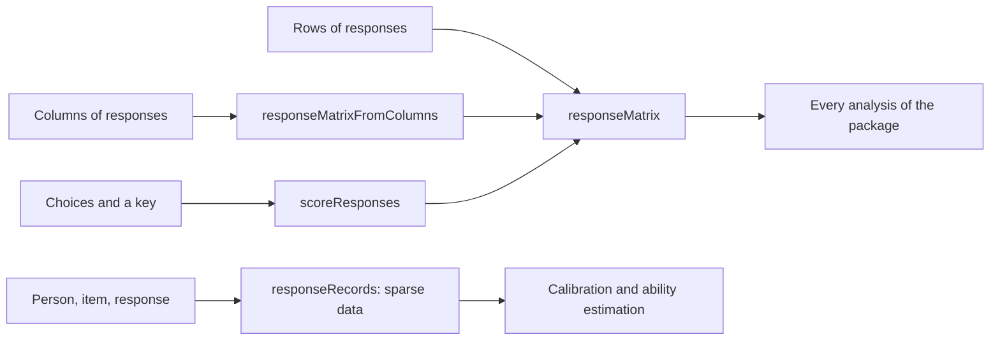

# Data

Functions in `@measurekit/psychometrics/data` build the response matrices that every analysis takes, and the
response records that calibration and ability estimation also take for sparse data. They are plain objects, so they
can be built by hand or loaded from JSON; every analysis function checks its input.



## Response matrices

A `ResponseMatrix` holds `personIds`, `itemIds` and `responses`: one row per person, one column per item.

```ts
import { responseMatrix, responseMatrixFromColumns } from "@measurekit/psychometrics/data";

const byRows = responseMatrix(
  [
    [1, 0, 2],
    [0, null, 1],
  ],
  { personIds: ["ana", "budi"], itemIds: ["q1", "q2", "q3"] },
);

const byColumns = responseMatrixFromColumns(
  [
    [1, 0],
    [0, null],
    [2, 1],
  ],
  { itemIds: ["q1", "q2", "q3"] },
);
```

| Rule      | Detail                                                                                                                  |
| --------- | ----------------------------------------------------------------------------------------------------------------------- |
| Responses | Integers from 0 to 2³¹ - 1: 0 and 1 for dichotomous items, 0 to k - 1 for items with k categories. `null` when missing. |
| Size      | At least one person and one item; every row has one response per item.                                                  |
| Ids       | Strings, unique among persons and among items. Default: `person1`, `person2`, ... and `item1`, `item2`, ...             |
| Copies    | The builders copy the rows, so later changes to the input do not change the matrix.                                     |

`responseMatrix(rows, { times })` adds response times in seconds, by person, then item, aligned with the responses:
positive, `null` when missing, and only where there is a response. A record takes its time as an optional `time`.
[Response times](response-time.md) uses them; the other analyses ignore them.

A malformed matrix throws `DataError` naming the first problem, e.g.
`The response of person "budi" to item "q2" must be an integer from 0 to 2147483647 or null, found 0.5.` `NaN`, `undefined`,
holes in sparse arrays and values of other types are rejected.

## Response records

`ResponseRecords` holds responses in long format: `personIds`, `itemIds` and `records`, one `{ person, item, response }`
per answered item, in any order. Their size grows with the responses, while a matrix grows with persons times items:
for 20,000 persons answering 40 of 1,000 items, 800,000 records instead of 20 million cells.

```ts
import { responseRecords } from "@measurekit/psychometrics/data";

const data = responseRecords(
  [
    { person: "ana", item: "q7", response: 1 },
    { person: "budi", item: "q2", response: 0 },
    { person: "ana", item: "q2", response: 2 },
  ],
  { itemIds: ["q2", "q7", "q9"] },
);
data.personIds; // ["ana", "budi"], in order of first appearance
```

| Rule      | Detail                                                                                                                                         |
| --------- | ---------------------------------------------------------------------------------------------------------------------------------------------- |
| Responses | Integers from 0 to 2³¹ - 1. A response not given has no record.                                                                                |
| Ids       | `personIds` and `itemIds` default to the order of first appearance; pass them to include persons or items without records or to fix the order. |
| Records   | Each person and item among the ids; a person has at most one record per item.                                                                  |

| Input                                 | Functions                                                                                                |
| ------------------------------------- | -------------------------------------------------------------------------------------------------------- |
| `ResponseMatrix` or `ResponseRecords` | `calibrate` and `abilityEstimates` ([IRT](irt.md)); every function of [response times](response-time.md) |
| `ResponseMatrix`                      | Classical test theory, joint maximum likelihood, fit, DIF, and `simulateResponses`'s result              |

Calibration works internally on the answered responses of each person, whichever input it takes, so both give the
same results. The other statistics compare persons over whole rows or items, and take a matrix.

## Faceted scores

A `FacetedScore` is one score in long format with the element of each facet it was observed at, for designs in which a
score depends on several facets, such as the person, the task and the rater. It is a plain object, so it can be built by
hand or loaded from JSON.

```ts
import type { FacetedScore } from "@measurekit/psychometrics/data";

const scores: FacetedScore[] = [
  { levels: { person: "p1", task: "essay", rater: "r1" }, score: 3 },
  { levels: { person: "p1", task: "essay", rater: "r2" }, score: 4 },
  { levels: { person: "p2", task: "essay", rater: "r1" }, score: 2 },
];
```

| Field    | Meaning                                                                                    |
| -------- | ------------------------------------------------------------------------------------------ |
| `levels` | The element of each facet by facet name, as a string: `{ person: "p1", rater: "r2" }`.     |
| `score`  | The score, a finite number. What else it must be, such as an integer, is for the analysis. |

Scores need not form a complete design: each combination of elements occurs as often as it was observed, and a facet
may have elements that others do not meet.

## Missing responses

`null` marks a missing response. Each analysis states how it treats them; in classical test theory, statistics of
one item use everyone who answered it, and statistics that use the total score use the persons who answered every
item ([details](ctt.md#missing-responses)).

## Scoring against a key

`scoreResponses` scores multiple-choice responses: 1 for the keyed option, 0 for any other option and `null` when no
option was chosen. The result is a response matrix that also keeps the choices, the key and the option labels, so
it serves both item statistics and distractor analysis.

```ts
import { scoreResponses } from "@measurekit/psychometrics/data";

const scored = scoreResponses(
  [
    ["A", "C", null],
    ["B", "C", "D"],
  ],
  ["A", "C", "B"],
  { optionLabels: ["A", "B", "C", "D", "E"] },
);
scored.responses; // [[1, 1, null], [0, 1, 0]]
```

| Option         | Meaning                                                                                                         |
| -------------- | --------------------------------------------------------------------------------------------------------------- |
| `optionLabels` | Labels in display order. Choices and keys outside them are rejected. Default: labels found in the data, sorted. |
| `personIds`    | As for `responseMatrix`.                                                                                        |
| `itemIds`      | As for `responseMatrix`.                                                                                        |

Pass `optionLabels` to list options nobody chose in distractor analysis and to catch typing errors in the data.
Empty strings are rejected; convert blank cells to `null`. To score an omitted response as wrong instead of missing,
replace its `null` with a label of its own, such as `"omit"`, and add that label to `optionLabels` if you pass them;
distractor analysis then reports it as an option.
