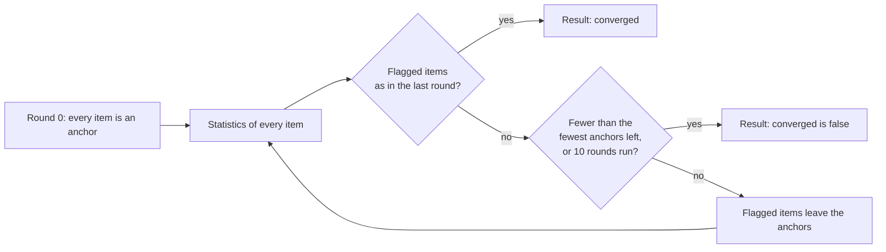
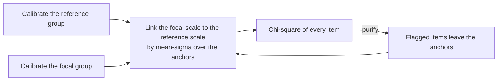

# Differential item functioning

`@measurekit/psychometrics/dif` tests whether an item functions differently for two groups of persons of equal
ability. For dichotomous items it has the Mantel-Haenszel statistics with the ETS categories, logistic regression and
Lord's chi-square; for items with any number of categories, the Mantel test and ordinal logistic regression. All but
Lord's chi-square work on sparse data, and all purify their matching criterion or their link on request. The dichotomous statistics are
validated against difR, the polytomous ones against base R, rms, MASS and lordif, and the sparse-data rule against base R
([validation](validation.md)).

## Groups

Every function takes a [response matrix](data.md) and one `DifGroup` per person: `"reference"` or `"focal"`, the group
whose items are studied. Both groups need persons.

| Function                                                | Items           | Matching                                                        | Persons used                                                            |
| ------------------------------------------------------- | --------------- | --------------------------------------------------------------- | ----------------------------------------------------------------------- |
| `mantelHaenszel(matrix, groups, options)`               | Dichotomous     | [Matching score](#matching-score), item included                | Per item: who answered it and another matching item                     |
| `logisticRegressionDif(matrix, groups, options)`        | Dichotomous     | [Matching score](#matching-score), item included                | Per item: who answered it and another matching item                     |
| `lordChiSquare(matrix, groups, options)`                | 2PL, 3PL or 4PL | Theta, by separate calibrations                                 | All; calibration skips missing responses                                |
| `mantelTest(matrix, groups, options)`                   | Any             | [Matching score](#matching-score), item included                | Per item: who answered it and another matching item                     |
| `ordinalLogisticRegressionDif(matrix, groups, options)` | Any             | [Matching score](#matching-score), item included, or `matching` | Per item: who answered it and another matching item, or who has a score |

```ts
import { createRandom } from "@measurekit/psychometrics";
import { responseMatrix } from "@measurekit/psychometrics/data";
import { type DifGroup, logisticRegressionDif, lordChiSquare, mantelHaenszel } from "@measurekit/psychometrics/dif";
import { twoParameterLogistic } from "@measurekit/psychometrics/irt";
import { simulateItems, simulateResponses, simulateThetas } from "@measurekit/psychometrics/sim";

// 500 persons per group answer 10 items; item 3 is one point harder for the focal group.
const random = createRandom(2026);
const items = simulateItems(twoParameterLogistic, 10, random);
const shifted = items.map((item, j) =>
  j === 2 ? { ...item, parameters: { ...item.parameters, b: item.parameters.b + 1 } } : item,
);
const reference = simulateResponses(items, simulateThetas(500, random), random);
const focal = simulateResponses(shifted, simulateThetas(500, random), random);
const matrix = responseMatrix([...reference.responses, ...focal.responses]);
const groups: DifGroup[] = matrix.personIds.map((_, person) => (person < 500 ? "reference" : "focal"));

mantelHaenszel(matrix, groups).items[2]; // { id: "item3", chiSquare: 33.6, ..., delta: -2.76, etsCategory: "C" }
// Purification flags item3 alone and leaves the other items as anchors.
logisticRegressionDif(matrix, groups, { purify: true }).purification; // { anchors, iterations: 1, converged: true }
lordChiSquare(matrix, groups, { model: twoParameterLogistic }).items[2]; // { id: "item3", chiSquare: 19.3, ... }
```

## Matching score

Persons are matched on their score over the matching items: all items, or the anchors after
[purification](#purification), and always the studied item. Each item uses the persons who answered it and at least one
other matching item. A person who answered some of the other matching items has the score

x + round(M s / m),

with x the response to the studied item, s the person's total over the other matching items answered, m the highest
possible sum of those items, M that of all the other matching items, and halves rounded up: the share of the possible
points won on the items the person answered, scaled to all of them. An item's highest possible score is its highest
response in the matrix, at least 1, as a matrix does not declare more: 1 for a dichotomous item, where m is the number
of items answered and s the number correct. With every response present the score is the total score over the matching
items, difR's criterion. Omitted responses that should count as wrong are scored 0 before the analysis
([data](data.md#scoring-against-a-key)); a missing response is one not presented, as an item not administered in an
adaptive test. With 2% of the responses missing at random over 30 items, 45% of the persons miss one; this rule keeps
them all.

## Purification



With `purify: true` (default `false`), the items flagged at the 0.05 level leave the anchors, and the statistics
are computed again on the items not flagged, until a round flags the items the previous one did, too few anchors are
left, or 10 rounds have run, as difR's `purify` (Holland and Thayer, 1988). The anchors are the items that define the
matching score or, for Lord's chi-square, the scale on which the groups are linked.

| Statistic                                               | Flags an item when                                           | Fewest anchors                             |
| ------------------------------------------------------- | ------------------------------------------------------------ | ------------------------------------------ |
| `mantelHaenszel`, `mantelTest`                          | The chi-square is significant                                | 1, the studied item's match                |
| `logisticRegressionDif`, `ordinalLogisticRegressionDif` | The test of both terms is significant, difR's default `type` | 1                                          |
| `lordChiSquare`                                         | The chi-square is significant                                | 2, as a transformation needs two locations |

The result's `purification` holds the `anchors` of the final statistics, the `iterations` after the first statistics and
whether they `converged`; it is `null` without `purify`. `converged` is `false` when the rounds ran out or too few anchors
were left for another.

## Mantel-Haenszel

Persons are matched on their total score. Each score group gives a 2 × 2 table: A and B the reference group's correct
and incorrect responses, C and D the focal group's, T persons in all, with E(A) = (A + B)(A + C) / T and
Var(A) = (A + B)(C + D)(A + C)(B + D) / (T² (T - 1)). Score groups of one person are left out.

| Field                | Definition                                                                                         |
| -------------------- | -------------------------------------------------------------------------------------------------- |
| `chiSquare`          | (\|Σ (A - E(A))\| - 0.5)² / Σ Var(A), with one degree of freedom                                   |
| `significance`       | The probability of a chi-square at least as large without DIF                                      |
| `oddsRatio`          | α = Σ (AD / T) / Σ (BC / T): above 1 when the item favors the reference group                      |
| `delta`              | MH D-DIF = -2.35 ln α on the ETS delta scale: negative when the item is harder for the focal group |
| `deltaStandardError` | 2.35 times the square root of the Robins-Breslow-Greenland variance of ln α                        |
| `etsCategory`        | `"A"`, `"B"` or `"C"`, below                                                                       |

`continuityCorrection` (default `true`, as difR) subtracts 0.5 when \|Σ (A - E(A))\| is at least 0.5, as R's
`mantelhaen.test` does; `false` gives Σ (A - E(A))² / Σ Var(A).

### ETS categories

ETS's rule (Zwick, 2012), with SE the standard error of MH D-DIF:

| Category | DIF                | Rule                                                                                             |
| -------- | ------------------ | ------------------------------------------------------------------------------------------------ |
| `"A"`    | Negligible         | \|MH D-DIF\| < 1, or the chi-square is not significant at 0.05                                   |
| `"C"`    | Moderate to large  | \|MH D-DIF\| ≥ 1.5 and (\|MH D-DIF\| - 1) / SE > 1.645: significantly above 1, one-sided at 0.05 |
| `"B"`    | Slight to moderate | Otherwise                                                                                        |

The sign of `delta` tells which group the item favors: C- and B- items, negative, are harder for the focal group.

## Logistic regression

Three logistic regressions of a correct response on the total score S and the group G, 1 for the focal group
(Swaminathan and Rogers, 1990), each fitted by Newton's method, as glm:

| Model | Log odds                  |
| ----- | ------------------------- |
| 0     | β0 + β1 S                 |
| 1     | β0 + β1 S + β2 G          |
| 2     | β0 + β1 S + β2 G + β3 S G |

Each test is a `LikelihoodRatioTest`: `chiSquare`, the difference of the deviances; `degreesOfFreedom`;
`significance`; and `rSquaredChange`, the increase of Nagelkerke's R², (1 - e^((D - D0) / n)) / (1 - e^(-D0 / n)) with
D0 the deviance of the intercept alone, as difR's `deltaR2`.

| Test         | Models | Degrees of freedom | DIF                                             |
| ------------ | ------ | ------------------ | ----------------------------------------------- |
| `uniform`    | 1 vs 0 | 1                  | The item is harder for one group at every score |
| `nonuniform` | 2 vs 1 | 1                  | The difference changes with the score           |
| `both`       | 2 vs 0 | 2                  | Either                                          |

Where an estimate diverges (separation), the deviance reaches its infimum and the test is still computed. An item
its persons answered alike, or answered by one group only, has `null` tests.

## Lord's chi-square

`lordChiSquare` compares an item's IRT parameters between the groups (Lord, 1980), as difR's `difLord`:



1. It calibrates each group separately with `calibrate` and `options`: the [calibration options](irt.md#calibration)
   without `fixed`. The model is the 2PL, 3PL or 4PL.
2. It moves the focal group's estimates to the reference scale by the mean-sigma transformation over the anchors, all
   items at first ([equating](equating.md#linking)): a / A and A b + B, and their covariance matrices with them.
3. For each item, with v the estimated parameters and Σ their covariance matrix from the calibration,
   χ² = (v_R - v_F)ᵀ (Σ_R + Σ_F)⁻¹ (v_R - v_F), with as many degrees of freedom as parameters.

The covariance matrices are the observed information: the inverse Hessian of the marginal log-likelihood
(`standardErrors: "hessian"` in [calibration](irt.md#standard-errors)), which is what ltm's `vcov` gives to difR's
`itemPar2PL`. Neither the cross-product nor a sandwich estimate is used.

With `purify: true` the two calibrations are kept: each round links the scales again over the items not flagged by the
round before, and compares every item, flagged ones included, on that link. The calibrations are not repeated, as in
difR, so purification costs the linking and the statistics only.

| Option   | Default        | Meaning                                                                                                |
| -------- | -------------- | ------------------------------------------------------------------------------------------------------ |
| `purify` | `false`        | [Purification](#purification), with at least 2 anchors and 10 rounds                                   |
| Others   | As `calibrate` | The [calibration options](irt.md#calibration) without `fixed`, `groups`, `latent` and `standardErrors` |

The result holds `items`, `{ id, chiSquare, degreesOfFreedom, significance }` each, both calibrations, whose
`converged` reports their EM, the `transformation` of the final round and the `purification`. difR's ltm uses 21
Gauss-Hermite points: `{ quadrature: { method: "gauss-hermite", points: 21 } }` reproduces it. lordif's defaults for
`maxIter`, 10, and difR's for `nrIter` are the 10 rounds; its `minCell`, 5, collapses sparse categories of polytomous
items, which a dichotomous model has none of.

## Polytomous items

```ts
import { createRandom } from "@measurekit/psychometrics";
import { responseMatrix } from "@measurekit/psychometrics/data";
import { type DifGroup, mantelTest, ordinalLogisticRegressionDif } from "@measurekit/psychometrics/dif";
import { abilityEstimates, calibrate, gradedResponse } from "@measurekit/psychometrics/irt";
import { simulateItems, simulateResponses, simulateThetas } from "@measurekit/psychometrics/sim";

// 500 persons per group answer 10 items of 4 categories; the thresholds of item 3 are one point higher for the focal group.
const random = createRandom(2026);
const items = simulateItems(gradedResponse, 10, random, { categoryCount: 4 });
const shifted = items.map((item, j) =>
  j === 2 ? { ...item, parameters: { ...item.parameters, b: item.parameters.b.map((b) => b + 1) } } : item,
);
const reference = simulateResponses(items, simulateThetas(500, random), random);
const focal = simulateResponses(shifted, simulateThetas(500, random), random);
const matrix = responseMatrix([...reference.responses, ...focal.responses]);
const groups: DifGroup[] = matrix.personIds.map((_, person) => (person < 500 ? "reference" : "focal"));

mantelTest(matrix, groups).items[2]; // { id: "item3", chiSquare: 94.3, ..., standardizedMeanDifference: -0.62, effectSize: -0.52, etsCategory: "CC" }
ordinalLogisticRegressionDif(matrix, groups).items[2]?.uniform; // { chiSquare: 99.4, degreesOfFreedom: 1, significance: 2.0e-23, rSquaredChange: 0.075 }
// Matched on theta from a graded response calibration, as lordif does in one pass.
const calibration = calibrate(matrix, { model: gradedResponse });
const matching = abilityEstimates(matrix, calibration.items).map((estimate) => estimate.theta);
ordinalLogisticRegressionDif(matrix, groups, { matching }).items[2]?.uniform.chiSquare; // 99.5
```

### Mantel test

`mantelTest` tests an item of any number of categories. Persons are matched on their [matching score](#matching-score),
and each score group holds the responses of both groups. With n persons in a score group, n_R and n_F in the groups,
n_k who responded k, and F the sum of the focal group's responses:

E(F) = n_F Σ k n_k / n, Var(F) = n_R n_F [n Σ k² n_k - (Σ k n_k)²] / (n² (n - 1)).

Score groups of one person are left out.

| Field                        | Definition                                                                                                                                                        |
| ---------------------------- | ----------------------------------------------------------------------------------------------------------------------------------------------------------------- |
| `chiSquare`                  | Mantel's (Σ (F - E(F)))² / Σ Var(F), with one degree of freedom: the groups differ in their mean response                                                         |
| `significance`               | The probability of a chi-square at least as large without DIF                                                                                                     |
| `generalized`                | The generalized Mantel-Haenszel test: `chiSquare`, `degreesOfFreedom` and `significance`                                                                          |
| `standardizedMeanDifference` | SMD = Σ (n_Fs / n_F) (m_Fs - m_Rs) over the score groups s with persons of both groups, m the mean response: negative when the item is harder for the focal group |
| `effectSize`                 | SMD over the sample standard deviation of the item's responses in both groups                                                                                     |
| `etsCategory`                | `"AA"`, `"BB"` or `"CC"`, below                                                                                                                                   |

The generalized test is the Cochran-Mantel-Haenszel statistic of general association of the 2 × K tables of group by
response, for the K categories used in score groups of more than one person. It takes the focal group's counts in the
categories but the last, a, and tests Σ (a - E(a)) in the quadratic form of the inverse of Σ Cov(a), with K - 1 degrees
of freedom. It sees any difference between the distributions of responses, such as nonuniform DIF, that Mantel's test
misses. It is `null` when Σ Cov(a) is singular, as when the score groups use no category in common. For two categories
both tests equal the Mantel-Haenszel chi-square without the continuity correction.

#### ETS categories of polytomous items

ETS's rule for polytomous items (Zwick, 2012), with p the significance of Mantel's chi-square:

| Category | DIF                | Rule                                |
| -------- | ------------------ | ----------------------------------- |
| `"AA"`   | Negligible         | p ≥ 0.05, or \|effect size\| ≤ 0.17 |
| `"CC"`   | Moderate to large  | p < 0.05 and \|effect size\| > 0.25 |
| `"BB"`   | Slight to moderate | Otherwise                           |

### Ordinal logistic regression

`ordinalLogisticRegressionDif` fits three cumulative logit regressions of an item's responses on the matching score S and
the group G, 1 for the focal group (Zumbo, 1999; Crane et al., 2006). The item's persons used K categories, numbered
from 1; for k from 2 to K, the log odds that a response Y is in category k or above are:

| Model | Log odds of Y in category k or above |
| ----- | ------------------------------------ |
| 0     | α_k + β1 S                           |
| 1     | α_k + β1 S + β2 G                    |
| 2     | α_k + β1 S + β2 G + β3 S G           |

The thresholds α_k decrease with k. Each model is fitted by Newton's method from the thresholds of the model with no
covariates, halving a step that leaves the thresholds out of order or raises the deviance. A category no person used
is skipped, whichever integers the responses are. Where an estimate diverges (separation), the deviance reaches its
infimum and the test is still computed. An item its persons answered alike, answered by one group only, or with the
same matching score for every person has `null` tests.

The tests are the `LikelihoodRatioTest`s of [logistic regression](#logistic-regression), with the same models and
degrees of freedom: `uniform` (1 vs 0), `nonuniform` (2 vs 1) and `both` (2 vs 0). `rSquaredChange` is Nagelkerke's,
with the deviance of the thresholds alone as D0. `slopeChange` is |β1(1) - β1(0)| / |β1(0)|, the relative change of the
score coefficient when the group joins the model, which lordif calls `beta12`; its default threshold for flagging by this
criterion is 0.1.

| Option     | Default                                 | Meaning                                                                                              |
| ---------- | --------------------------------------- | ---------------------------------------------------------------------------------------------------- |
| `purify`   | `false`                                 | [As the dichotomous statistics](#purification)                                                       |
| `matching` | The total score over the matching items | One score per person, a finite number, or `null` to leave a person out. Cannot be used with `purify` |

With `matching` each item uses the persons who answered it and have a score. lordif's workflow, in one pass, is a
composition: `calibrate` a graded response model, `abilityEstimates` for theta, and pass theta as `matching`, as in the
example above. A matching score that is not a sum of items cannot lose items to purification.

## Not included

- The exact Mantel-Haenszel test, Wald tests, and matching on a score other than the total for the Mantel-Haenszel
  and logistic regression statistics.
- Polytomous IRT likelihood-ratio and Lord tests, which need multiple-group IRT; lordif's iterated theta with
  group-specific item parameters, of which one pass is the composition above; lordif's `minCell` collapsing of sparse
  categories; the Mantel test matched on theta, which needs a discretization; multiple focal groups.

## Differences from difR

| Topic                 | This package                                                        | difR                                                                                                          |
| --------------------- | ------------------------------------------------------------------- | ------------------------------------------------------------------------------------------------------------- |
| Continuity correction | Subtracted when \|Σ (A - E(A))\| ≥ 0.5, as `mantelhaen.test`        | Always subtracted: identical groups get (0.5)² / Σ Var(A), not 0                                              |
| ETS categories        | ETS's rule with its significance tests                              | `print` codes \|MH D-DIF\| alone: below 1 A, below 1.5 B, else C                                              |
| Lord's calibrations   | EM to `tolerance`                                                   | ltm's default control, 40 EM cycles then BFGS, stops short: up to 2% in χ²                                    |
| Lord's 1PL            | Not supported: `oneParameterLogistic` estimates a common a          | a fixed at 1                                                                                                  |
| Lord's purification   | Stops before fewer than 2 anchors are left, and `converged` says so | Rescales on the items not flagged, whose spread is undefined for fewer than two                               |
| Missing responses     | The scaled matching score of each item's persons                    | Sums the responses given; `difMH` counts a missing response to the studied item as both correct and incorrect |

## Differences from lordif

| Topic             | This package                                                     | lordif                                                                                          |
| ----------------- | ---------------------------------------------------------------- | ----------------------------------------------------------------------------------------------- |
| R² change         | Nagelkerke's                                                     | McFadden's by default; Nagelkerke's and Cox and Snell's on request                              |
| Rounding          | Full precision                                                   | `rundif` rounds p-values, R² changes and the slope change to 4 decimals                         |
| Flagging          | None, apart from purification at 0.05 on the test of both terms  | `criterion` flags by p-value (0.01), the slope change (0.1) or the R² change (0.02)             |
| Matching          | The total score, or one `matching` score per person, in one pass | Theta from a graded response calibration, re-estimated with group-specific parameters per round |
| Sparse categories | Uses the categories the item's persons used                      | `minCell` collapses categories with fewer than 5 persons                                        |
| Missing responses | Each item uses the persons who answered it; R² uses their number | `rundif` drops them in `lrm` but counts them in n for R²                                        |
| Estimation        | Newton's method on the cumulative logit likelihood               | `rms::lrm`, Newton-Raphson stopping at a change of 0.0005 in the deviance                       |
