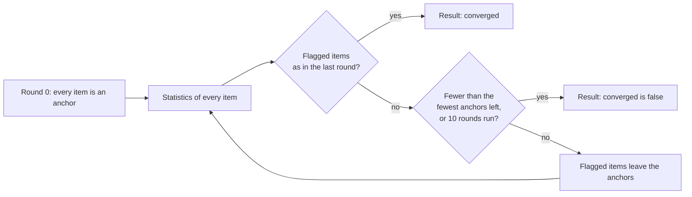
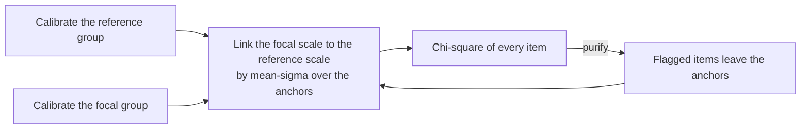
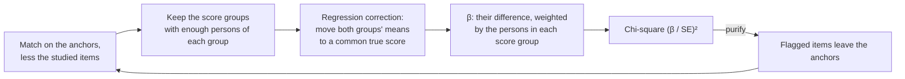
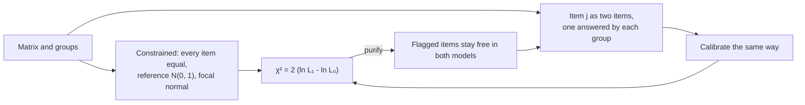
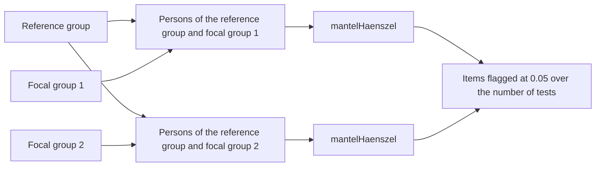

# Differential item functioning

`@measurekit/psychometrics/dif` tests whether an item functions differently for two groups of persons of equal
ability. For dichotomous items it has the Mantel-Haenszel statistics with the ETS categories, logistic regression,
Lord's chi-square and Raju's areas; for items with any number of categories, the Mantel test, ordinal logistic
regression, SIBTEST, which also tests bundles of items, and IRT likelihood-ratio tests; and for items of any model on one
scale, the differential functioning of items and tests. The statistics on the matching score work on sparse data, and
all purify their matching criterion or their link on request. The dichotomous statistics are validated against difR, the
polytomous ones against base R, rms, MASS and lordif, SIBTEST against mirt and difR, the likelihood-ratio tests against
mirt, the differential functioning against DFIT, and the sparse-data rule against base R ([validation](validation.md)).

## Groups

Every function takes a [response matrix](data.md) and one `DifGroup` per person: `"reference"` or `"focal"`, the group
whose items are studied. Both groups need persons.

| Function                                                | Items           | Matching                                                        | Persons used                                                            |
| ------------------------------------------------------- | --------------- | --------------------------------------------------------------- | ----------------------------------------------------------------------- |
| `mantelHaenszel(matrix, groups, options)`               | Dichotomous     | [Matching score](#matching-score), item included                | Per item: who answered it and another matching item                     |
| `logisticRegressionDif(matrix, groups, options)`        | Dichotomous     | [Matching score](#matching-score), item included                | Per item: who answered it and another matching item                     |
| `lordChiSquare(matrix, groups, options)`                | 2PL, 3PL or 4PL | Theta, by separate calibrations                                 | All; calibration skips missing responses                                |
| `mantelTest(matrix, groups, options)`                   | Any             | [Matching score](#matching-score), item included                | Per item: who answered it and another matching item                     |
| `ordinalLogisticRegressionDif(matrix, groups, options)` | Any             | [Matching score](#matching-score), item included, or `matching` | Per item: who answered it and another matching item, or who has a score |
| `sibtest(matrix, groups, options)`                      | Any, or bundles | The total over the anchors, studied items left out              | Per item or bundle: who answered it and every matching item             |
| `rajuAreaDif(matrix, groups, options)`                  | 2PL             | Theta, by separate calibrations                                 | All; calibration skips missing responses                                |
| `irtLikelihoodRatioDif(matrix, groups, options)`        | Any model       | Theta, by one calibration of both groups                        | All; calibration skips missing responses                                |
| `differentialFunctioning(reference, focal, options)`    | Any model       | Theta of the focal group's population                           | None: it takes items                                                    |

```ts
import { createRandom } from "@measurekit/psychometrics";
import { responseMatrix } from "@measurekit/psychometrics/data";
import { type DifGroup, logisticRegressionDif, lordChiSquare, mantelHaenszel } from "@measurekit/psychometrics/dif";
import { twoParameterLogistic } from "@measurekit/psychometrics/irt";
import { simulateItems, simulateResponses, simulateThetas } from "@measurekit/psychometrics/sim";

// 500 persons per group answer 10 items; item 3 is one point harder for the focal group.
const random = createRandom(2026);
const items = simulateItems(twoParameterLogistic, 10, random);
const shifted = items.map((item, j) =>
  j === 2 ? { ...item, parameters: { ...item.parameters, b: item.parameters.b + 1 } } : item,
);
const reference = simulateResponses(items, simulateThetas(500, random), random);
const focal = simulateResponses(shifted, simulateThetas(500, random), random);
const matrix = responseMatrix([...reference.responses, ...focal.responses]);
const groups: DifGroup[] = matrix.personIds.map((_, person) => (person < 500 ? "reference" : "focal"));

mantelHaenszel(matrix, groups).items[2]; // { id: "item3", chiSquare: 33.6, ..., delta: -2.76, etsCategory: "C" }
// Purification flags item3 alone and leaves the other items as anchors.
logisticRegressionDif(matrix, groups, { purify: true }).purification; // { anchors, iterations: 1, converged: true }
lordChiSquare(matrix, groups, { model: twoParameterLogistic }).items[2]; // { id: "item3", chiSquare: 19.3, ... }
```

## Matching score

Persons are matched on their score over the matching items: all items, or the anchors after
[purification](#purification), and always the studied item. Each item uses the persons who answered it and at least one
other matching item. A person who answered some of the other matching items has the score

x + round(M s / m),

with x the response to the studied item, s the person's total over the other matching items answered, m the highest
possible sum of those items, M that of all the other matching items, and halves rounded up: the share of the possible
points won on the items the person answered, scaled to all of them. An item's highest possible score is its highest
response in the matrix, at least 1, as a matrix does not declare more: 1 for a dichotomous item, where m is the number
of items answered and s the number correct. With every response present the score is the total score over the matching
items, difR's criterion. Omitted responses that should count as wrong are scored 0 before the analysis
([data](data.md#scoring-against-a-key)); a missing response is one not presented, as an item not administered in an
adaptive test. With 2% of the responses missing at random over 30 items, 45% of the persons miss one; this rule keeps
them all.

## Purification



With `purify: true` (default `false`), the items flagged at the 0.05 level leave the anchors, and the statistics
are computed again on the items not flagged, until a round flags the items the previous one did, too few anchors are
left, or 10 rounds have run, as difR's `purify` (Holland and Thayer, 1988). The anchors are the items that define the
matching score or, for Lord's chi-square, the scale on which the groups are linked.

| Statistic                                               | Flags an item when                                           | Fewest anchors                                          |
| ------------------------------------------------------- | ------------------------------------------------------------ | ------------------------------------------------------- |
| `mantelHaenszel`, `mantelTest`                          | The chi-square is significant                                | 1, the studied item's match                             |
| `logisticRegressionDif`, `ordinalLogisticRegressionDif` | The test of both terms is significant, difR's default `type` | 1                                                       |
| `lordChiSquare`, `rajuAreaDif`                          | The chi-square, or the unsigned area's z, is significant     | 2, as a transformation needs two locations              |
| `irtLikelihoodRatioDif`                                 | The chi-square is significant                                | 2, as [a free item](#irt-likelihood-ratio) needs a link |
| `sibtest`                                               | An item's chi-square is significant; a bundle flags nothing  | 3, or 2 [without the correction](#fewest-anchors)       |

The result's `purification` holds the `anchors` of the final statistics, the `iterations` after the first statistics and
whether they `converged`; it is `null` without `purify`. `converged` is `false` when the rounds ran out or too few anchors
were left for another.

## Mantel-Haenszel

Persons are matched on their total score. Each score group gives a 2 × 2 table: A and B the reference group's correct
and incorrect responses, C and D the focal group's, T persons in all, with E(A) = (A + B)(A + C) / T and
Var(A) = (A + B)(C + D)(A + C)(B + D) / (T² (T - 1)). Score groups of one person are left out.

| Field                | Definition                                                                                         |
| -------------------- | -------------------------------------------------------------------------------------------------- |
| `chiSquare`          | (\|Σ (A - E(A))\| - 0.5)² / Σ Var(A), with one degree of freedom                                   |
| `significance`       | The probability of a chi-square at least as large without DIF                                      |
| `oddsRatio`          | α = Σ (AD / T) / Σ (BC / T): above 1 when the item favors the reference group                      |
| `delta`              | MH D-DIF = -2.35 ln α on the ETS delta scale: negative when the item is harder for the focal group |
| `deltaStandardError` | 2.35 times the square root of the Robins-Breslow-Greenland variance of ln α                        |
| `etsCategory`        | `"A"`, `"B"` or `"C"`, below                                                                       |

`continuityCorrection` (default `true`, as difR) subtracts 0.5 when \|Σ (A - E(A))\| is at least 0.5, as R's
`mantelhaen.test` does; `false` gives Σ (A - E(A))² / Σ Var(A).

### ETS categories

ETS's rule (Zwick, 2012), with SE the standard error of MH D-DIF:

| Category | DIF                | Rule                                                                                             |
| -------- | ------------------ | ------------------------------------------------------------------------------------------------ |
| `"A"`    | Negligible         | \|MH D-DIF\| < 1, or the chi-square is not significant at 0.05                                   |
| `"C"`    | Moderate to large  | \|MH D-DIF\| ≥ 1.5 and (\|MH D-DIF\| - 1) / SE > 1.645: significantly above 1, one-sided at 0.05 |
| `"B"`    | Slight to moderate | Otherwise                                                                                        |

The sign of `delta` tells which group the item favors: C- and B- items, negative, are harder for the focal group.

## Logistic regression

Three logistic regressions of a correct response on the total score S and the group G, 1 for the focal group
(Swaminathan and Rogers, 1990), each fitted by Newton's method, as glm:

| Model | Log odds                  |
| ----- | ------------------------- |
| 0     | β0 + β1 S                 |
| 1     | β0 + β1 S + β2 G          |
| 2     | β0 + β1 S + β2 G + β3 S G |

Each test is a `LikelihoodRatioTest`: `chiSquare`, the difference of the deviances; `degreesOfFreedom`;
`significance`; and `rSquaredChange`, the increase of Nagelkerke's R², (1 - e^((D - D0) / n)) / (1 - e^(-D0 / n)) with
D0 the deviance of the intercept alone, as difR's `deltaR2`.

| Test         | Models | Degrees of freedom | DIF                                             |
| ------------ | ------ | ------------------ | ----------------------------------------------- |
| `uniform`    | 1 vs 0 | 1                  | The item is harder for one group at every score |
| `nonuniform` | 2 vs 1 | 1                  | The difference changes with the score           |
| `both`       | 2 vs 0 | 2                  | Either                                          |

Where an estimate diverges (separation), the deviance reaches its infimum and the test is still computed. An item
its persons answered alike, answered by one group only, or whose persons share one matching score has `null` tests, as
does a test whose model has collinear terms, such as the interaction when every focal person has the same score.

## Lord's chi-square

`lordChiSquare` compares an item's IRT parameters between the groups (Lord, 1980), as difR's `difLord`:



1. It calibrates each group separately with `calibrate` and `options`: the [calibration options](irt.md#calibration)
   without `fixed`. The model is the 2PL, 3PL or 4PL.
2. It moves the focal group's estimates to the reference scale by the mean-sigma transformation over the anchors, all
   items at first ([equating](equating.md#linking)): a / A and A b + B, and their covariance matrices with them.
3. For each item, with v the estimated parameters and Σ their covariance matrix from the calibration,
   χ² = (v_R - v_F)ᵀ (Σ_R + Σ_F)⁻¹ (v_R - v_F), with as many degrees of freedom as parameters.

The covariance matrices are the observed information: the inverse Hessian of the marginal log-likelihood
(`standardErrors: "hessian"` in [calibration](irt.md#standard-errors)), which is what ltm's `vcov` gives to difR's
`itemPar2PL`. Neither the cross-product nor a sandwich estimate is used.

With `purify: true` the two calibrations are kept: each round links the scales again over the items not flagged by the
round before, and compares every item, flagged ones included, on that link. The calibrations are not repeated, as in
difR, so purification costs the linking and the statistics only.

| Option   | Default        | Meaning                                                                                                |
| -------- | -------------- | ------------------------------------------------------------------------------------------------------ |
| `purify` | `false`        | [Purification](#purification), with at least 2 anchors and 10 rounds                                   |
| Others   | As `calibrate` | The [calibration options](irt.md#calibration) without `fixed`, `groups`, `latent` and `standardErrors` |

The result holds `items`, `{ id, chiSquare, degreesOfFreedom, significance }` each, both calibrations, whose
`converged` reports their EM, the `transformation` of the final round and the `purification`. difR's ltm uses 21
Gauss-Hermite points: `{ quadrature: { method: "gauss-hermite", points: 21 } }` reproduces it. lordif's defaults for
`maxIter`, 10, and difR's for `nrIter` are the 10 rounds; its `minCell`, 5, collapses sparse categories of polytomous
items, which a dichotomous model has none of.

## Raju's areas

`rajuAreaDif` measures the area between an item's curves in the two groups (Raju, 1988, 1990), as difR's `difRaju`. It
calibrates and links the groups as [Lord's chi-square](#lords-chi-square) does, with the same options, for the 2PL alone:
a 3PL item with unequal lower asymptotes has an infinite unsigned area. With Δb = b_F - b_R and the focal estimates on
the reference scale:

| Field          | Definition                                                                                                        |
| -------------- | ----------------------------------------------------------------------------------------------------------------- |
| `signedArea`   | Δb: positive when the item is harder for the focal group                                                          |
| `unsignedArea` | \|2 (a_F - a_R) ln(1 + e^Y) / (a_F a_R) - Δb\|, Y = a_F a_R Δb / (a_F - a_R); \|Δb\| when the slopes are equal    |
| `signedZ`      | The signed area over its standard error, √(SE²(b_F) + SE²(b_R))                                                   |
| `unsignedZ`    | The unsigned area over its standard error, by the delta method on the covariance matrices of (a, b) in each group |
| `significance` | The two-sided probability of an unsigned z at least as large without DIF; purification flags by it                |

The areas are `null` where a group's information matrix cannot be inverted, and the z tests where a standard error is 0.
The signed test's probability is `chiSquareUpperTail(signedZ ** 2, 1)` of `@measurekit/core`.

## Polytomous items

```ts
import { createRandom } from "@measurekit/psychometrics";
import { responseMatrix } from "@measurekit/psychometrics/data";
import { type DifGroup, mantelTest, ordinalLogisticRegressionDif } from "@measurekit/psychometrics/dif";
import { abilityEstimates, calibrate, gradedResponse } from "@measurekit/psychometrics/irt";
import { simulateItems, simulateResponses, simulateThetas } from "@measurekit/psychometrics/sim";

// 500 persons per group answer 10 items of 4 categories; the thresholds of item 3 are one point higher for the focal group.
const random = createRandom(2026);
const items = simulateItems(gradedResponse, 10, random, { categoryCount: 4 });
const shifted = items.map((item, j) =>
  j === 2 ? { ...item, parameters: { ...item.parameters, b: item.parameters.b.map((b) => b + 1) } } : item,
);
const reference = simulateResponses(items, simulateThetas(500, random), random);
const focal = simulateResponses(shifted, simulateThetas(500, random), random);
const matrix = responseMatrix([...reference.responses, ...focal.responses]);
const groups: DifGroup[] = matrix.personIds.map((_, person) => (person < 500 ? "reference" : "focal"));

mantelTest(matrix, groups).items[2]; // { id: "item3", chiSquare: 94.3, ..., standardizedMeanDifference: -0.62, effectSize: -0.52, etsCategory: "CC" }
ordinalLogisticRegressionDif(matrix, groups).items[2]?.uniform; // { chiSquare: 99.4, degreesOfFreedom: 1, significance: 2.0e-23, rSquaredChange: 0.075 }
// Matched on theta from a graded response calibration, as lordif does in one pass.
const calibration = calibrate(matrix, { model: gradedResponse });
const matching = abilityEstimates(matrix, calibration.items).map((estimate) => estimate.theta);
ordinalLogisticRegressionDif(matrix, groups, { matching }).items[2]?.uniform.chiSquare; // 99.5
```

### Mantel test

`mantelTest` tests an item of any number of categories. Persons are matched on their [matching score](#matching-score),
and each score group holds the responses of both groups. With n persons in a score group, n_R and n_F in the groups,
n_k who responded k, and F the sum of the focal group's responses:

E(F) = n_F Σ k n_k / n, Var(F) = n_R n_F [n Σ k² n_k - (Σ k n_k)²] / (n² (n - 1)).

Score groups of one person are left out.

| Field                        | Definition                                                                                                                                                        |
| ---------------------------- | ----------------------------------------------------------------------------------------------------------------------------------------------------------------- |
| `chiSquare`                  | Mantel's (Σ (F - E(F)))² / Σ Var(F), with one degree of freedom: the groups differ in their mean response                                                         |
| `significance`               | The probability of a chi-square at least as large without DIF                                                                                                     |
| `generalized`                | The generalized Mantel-Haenszel test: `chiSquare`, `degreesOfFreedom` and `significance`                                                                          |
| `standardizedMeanDifference` | SMD = Σ (n_Fs / n_F) (m_Fs - m_Rs) over the score groups s with persons of both groups, m the mean response: negative when the item is harder for the focal group |
| `effectSize`                 | SMD over the sample standard deviation of the item's responses in both groups                                                                                     |
| `etsCategory`                | `"AA"`, `"BB"` or `"CC"`, below                                                                                                                                   |

The generalized test is the Cochran-Mantel-Haenszel statistic of general association of the 2 × K tables of group by
response, for the K categories used in score groups of more than one person. It takes the focal group's counts in the
categories but the last, a, and tests Σ (a - E(a)) in the quadratic form of the inverse of Σ Cov(a), with K - 1 degrees
of freedom. It sees any difference between the distributions of responses, such as nonuniform DIF, that Mantel's test
misses. It is `null` when Σ Cov(a) is singular, as when the score groups use no category in common. For two categories
both tests equal the Mantel-Haenszel chi-square without the continuity correction.

#### ETS categories of polytomous items

ETS's rule for polytomous items (Zwick, 2012), with p the significance of Mantel's chi-square:

| Category | DIF                | Rule                                |
| -------- | ------------------ | ----------------------------------- |
| `"AA"`   | Negligible         | p ≥ 0.05, or \|effect size\| ≤ 0.17 |
| `"CC"`   | Moderate to large  | p < 0.05 and \|effect size\| > 0.25 |
| `"BB"`   | Slight to moderate | Otherwise                           |

### Ordinal logistic regression

`ordinalLogisticRegressionDif` fits three cumulative logit regressions of an item's responses on the matching score S and
the group G, 1 for the focal group (Zumbo, 1999; Crane et al., 2006). The item's persons used K categories, numbered
from 1; for k from 2 to K, the log odds that a response Y is in category k or above are:

| Model | Log odds of Y in category k or above |
| ----- | ------------------------------------ |
| 0     | α_k + β1 S                           |
| 1     | α_k + β1 S + β2 G                    |
| 2     | α_k + β1 S + β2 G + β3 S G           |

The thresholds α_k decrease with k. Each model is fitted by Newton's method from the thresholds of the model with no
covariates, halving a step that leaves the thresholds out of order or raises the deviance. A category no person used
is skipped, whichever integers the responses are. Where an estimate diverges (separation), the deviance reaches its
infimum and the test is still computed. An item its persons answered alike, answered by one group only, or with the
same matching score for every person has `null` tests.

The tests are the `LikelihoodRatioTest`s of [logistic regression](#logistic-regression), with the same models and
degrees of freedom: `uniform` (1 vs 0), `nonuniform` (2 vs 1) and `both` (2 vs 0). `rSquaredChange` is Nagelkerke's,
with the deviance of the thresholds alone as D0. `slopeChange` is |β1(1) - β1(0)| / |β1(0)|, the relative change of the
score coefficient when the group joins the model, which lordif calls `beta12`; its default threshold for flagging by this
criterion is 0.1.

| Option     | Default                                 | Meaning                                                                                              |
| ---------- | --------------------------------------- | ---------------------------------------------------------------------------------------------------- |
| `purify`   | `false`                                 | [As the dichotomous statistics](#purification)                                                       |
| `matching` | The total score over the matching items | One score per person, a finite number, or `null` to leave a person out. Cannot be used with `purify` |

With `matching` each item uses the persons who answered it and have a score. lordif's workflow, in one pass, is a
composition: `calibrate` a graded response model, `abilityEstimates` for theta, and pass theta as `matching`, as in the
example above. A matching score that is not a sum of items cannot lose items to purification.

## SIBTEST

`sibtest` compares the groups on the studied items among persons of equal score on the other items, and corrects that
score for the groups' difference in ability (Shealy and Stout, 1993), as `mirt::SIBTEST` and
`difR::difSIBTEST(type = "udif")`. It takes items of any number of categories (Chang, Mazzeo and Roussos, 1996) and
bundles of items (Douglas, Roussos and Stout, 1996).



```ts
import { createRandom } from "@measurekit/psychometrics";
import { responseMatrix } from "@measurekit/psychometrics/data";
import { type DifGroup, sibtest } from "@measurekit/psychometrics/dif";
import { twoParameterLogistic } from "@measurekit/psychometrics/irt";
import { simulateItems, simulateResponses, simulateThetas } from "@measurekit/psychometrics/sim";

// 500 persons per group answer 20 items. The focal group's theta is 0.5 lower, and items 3 and 4 are half a point harder
// for it.
const random = createRandom(2026);
const items = simulateItems(twoParameterLogistic, 20, random);
const shifted = items.map((item, j) =>
  j === 2 || j === 3 ? { ...item, parameters: { ...item.parameters, b: item.parameters.b + 0.5 } } : item,
);
const reference = simulateResponses(items, simulateThetas(500, random), random);
const focalThetas = simulateThetas(500, random).map((theta) => theta - 0.5);
const focal = simulateResponses(shifted, focalThetas, random);
const matrix = responseMatrix([...reference.responses, ...focal.responses]);
const groups: DifGroup[] = matrix.personIds.map((_, person) => (person < 500 ? "reference" : "focal"));

sibtest(matrix, groups).items[2]; // { id: "item3", beta: 0.092, standardError: 0.025, chiSquare: 13.5, significance: 0.00024, persons: 1000 }
sibtest(matrix, groups).items[10]; // { id: "item11", beta: 0.010, standardError: 0.027, chiSquare: 0.14, significance: 0.71, persons: 1000 }
// The two items as one bundle, purified: each item alone has 16.0 and 14.2 on the same anchors.
sibtest(matrix, groups, { bundles: { passage: ["item3", "item4"] }, purify: true }).bundles;
// [{ id: "passage", beta: 0.210, standardError: 0.041, chiSquare: 26.9, significance: 2.1e-7, persons: 1000 }]
```

| Field           | Definition                                                                                                                   |
| --------------- | ---------------------------------------------------------------------------------------------------------------------------- |
| `id`            | The item's id, or the bundle's name                                                                                          |
| `beta`          | β = Σ p(k) (m\*_R(k) - m\*_F(k)): positive when the item favors the reference group, the opposite sign of `delta` and of SMD |
| `standardError` | SE = √(Σ p(k)² (s²_R(k) / n_R(k) + s²_F(k) / n_F(k))), of the raw scores in each score group                                 |
| `chiSquare`     | (β / SE)², with one degree of freedom                                                                                        |
| `significance`  | The probability of a chi-square at least as large without DIF                                                                |
| `persons`       | The persons the analysis used, whatever its statistics: those who answered every studied and matching item                   |

The result holds `items`, `bundles` in the order of the option, and the [`purification`](#purification). A statistic is
`null` without a score group to use, or where the correction is undefined, as for fewer than two matching items.

| Option       | Default    | Meaning                                                                                                                     |
| ------------ | ---------- | --------------------------------------------------------------------------------------------------------------------------- |
| `purify`     | `false`    | [Purification](#purification), with at least 2 anchors and 10 rounds. It flags items, never bundles                         |
| `smallCell`  | `5`        | A cell of this many persons or fewer is small: a score group is used when each group has more, mirt's `Jmin`. From 2        |
| `correction` | `true`     | The regression correction. `false` compares the raw means, which group differences in ability bias: see below               |
| `guessing`   | `0`        | The guessing parameter of the correction, mirt's `guess_correction`, for all items: from 0 to below 1                       |
| `bundles`    | No bundles | `{ name: [item ids] }`: each bundle's total is tested against the anchors outside it. A bundle of one item equals that item |

### Persons and score groups

Persons are matched on their total over the matching items: all items or, with `purify`, the anchors, less the studied
item or bundle. Each analysis uses the persons who answered every studied and matching item, as the correction needs
one set of items for all of them. So a person with a missing response to an anchor leaves the analysis of every item,
and [the scaled score](#matching-score) of the other statistics does not apply: with 2% of the responses missing at
random over 30 items, 45% of the persons leave, and `persons` shows it. Use `mantelHaenszel` or `mantelTest` on data
missing by design.

The score groups k are the matching scores that occur. A score group is used when:

- each group has more than `smallCell` persons in it, and their studied scores vary;
- it is neither the lowest score nor the highest, which lack a neighbor for the correction;
- k is at least `guessing` times the number of items.

p(k) is k's share of the persons of the score groups used, of both groups.

### Regression correction

Two groups of different ability that share a matching score differ in true score, as the score is unreliable. With x_G
the mean matching score of group G and b_G the coefficient alpha of the matching items in G, the estimated true score is
V_G(k) = x_G + b_G (k - x_G). Each group's mean m_G(k) moves to the groups' common V(k) = (V_R(k) + V_F(k)) / 2, along the
slope between the neighbors of k, the next scores that occur:

m\*_G(k) = m_G(k) + M (V(k) - V_G(k)), with M = (m_G(k + 1) - m_G(k - 1)) / (V_G(k + 1) - V_G(k - 1)).

A neighbor without persons of G has the mean 0, as in mirt. On 30 sets of 20 items with the focal group's theta 0.5
lower, the correction holds the false alarms of clean items at 5.6%; without it they reach 9.8%.

With `guessing`, an item with two different responses in a group enters coefficient alpha with the variance v (1 - v)
in place of its own, for v = max((u - guessing) / (1 - guessing), 0) and u its mean above its lower response.

### Fewest anchors

Purification flags items, never bundles, and matches the bundles on the anchors of its final round. It stops, with
`converged` false, before the anchors are too few for each anchor to be tested on the others, as a statistic of an
anchor is matched on the other anchors:

| Correction | Items                           | Fewest anchors | Why                                                                    |
| ---------- | ------------------------------- | -------------- | ---------------------------------------------------------------------- |
| On         | Any                             | 3              | Coefficient alpha needs two matching items                             |
| Off        | One of them dichotomous         | 3              | A score between the lowest and the highest needs two dichotomous items |
| Off        | All of three categories or more | 2              | One such item gives a score between the lowest and the highest         |

difR's `purify` has no floor: on bfi it goes on with 2 anchors, whose statistics are undefined, and reports
convergence.

## IRT likelihood ratio

`irtLikelihoodRatioDif` tests each item by the likelihood ratio of two calibrations of both groups on one scale (Thissen,
Steinberg and Wainer, 1993; Kim and Cohen, 1998), as mirt's `DIF(scheme = "drop")` on a multiple-group model. It takes
items of any model, so it is the IRT test for polytomous items.



```ts
import { createRandom } from "@measurekit/psychometrics";
import { responseMatrix } from "@measurekit/psychometrics/data";
import { type DifGroup, differentialFunctioning, irtLikelihoodRatioDif } from "@measurekit/psychometrics/dif";
import { twoParameterLogistic } from "@measurekit/psychometrics/irt";
import { simulateItems, simulateResponses, simulateThetas } from "@measurekit/psychometrics/sim";

// 500 persons per group answer 10 items; item 3 is one point harder for the focal group.
const random = createRandom(2026);
const items = simulateItems(twoParameterLogistic, 10, random);
const shifted = items.map((item, j) =>
  j === 2 ? { ...item, parameters: { ...item.parameters, b: item.parameters.b + 1 } } : item,
);
const reference = simulateResponses(items, simulateThetas(500, random), random);
const focal = simulateResponses(shifted, simulateThetas(500, random), random);
const matrix = responseMatrix([...reference.responses, ...focal.responses]);
const groups: DifGroup[] = matrix.personIds.map((_, person) => (person < 500 ? "reference" : "focal"));

const dif = irtLikelihoodRatioDif(matrix, groups, { model: twoParameterLogistic, purify: true });
dif.items[2]; // { id: "item3", chiSquare: 34.0, degreesOfFreedom: 2, significance: 4.2e-8 }
dif.purification; // { anchors: [8 items], iterations: 1, converged: true }: item3 and item4 are flagged
dif.constrained.items.map((item) => item.id); // ["item1", "item2", "item3:reference", "item3:focal", "item4:reference", ...]
```

The constrained model calibrates both groups with every item equal across them, the reference group N(0, 1) and the focal
group normal, its mean and standard deviation estimated with the items. An item is tested by replacing it with two items,
`<id>:reference` answered by the reference group and `<id>:focal` by the focal group, and calibrating again. χ² is twice
the difference of the log-likelihoods, with as many degrees of freedom as the item has parameters its model does not
share: 2 for the 2PL, K for a graded or generalized partial credit item of K categories, 1 for the 1PL, whose slope is
shared. Missing responses are skipped, as in calibration.

| Field              | Definition                                                                                                                                 |
| ------------------ | ------------------------------------------------------------------------------------------------------------------------------------------ |
| `chiSquare`        | 2 (ln L with the item free in each group - ln L with it equal); `null` when a group lacks one of its categories, or a fit did not converge |
| `degreesOfFreedom` | The entries of the item's parameter vector its model does not share                                                                        |
| `significance`     | The probability of a chi-square at least as large without DIF                                                                              |

The result holds `items`, the [`purification`](#purification) and `constrained`, the calibration of the last round, whose
`converged` reports its EM and whose items include the free items of the flagged ones. With `purify`, the items flagged at
0.05 stay free in both models of the next round: an item not flagged is tested by freeing it, a flagged one by
constraining it. It stops before fewer than two items are constrained, as the free item of a test is linked to the
reference scale through the others. Each round runs one calibration more than there are items.

| Option          | Default        | Meaning                                                                               |
| --------------- | -------------- | ------------------------------------------------------------------------------------- |
| `model`         | Required       | One model for every item, or one per item                                             |
| `quadrature`    | 61 rectangular | The rule over theta; the focal group's normal distribution needs the rectangular rule |
| `tolerance`     | `1e-4`         | EM's tolerance in each calibration                                                    |
| `maxIterations` | `500`          | EM's most iterations in each calibration                                              |
| `purify`        | `false`        | [Purification](#purification), with at least 2 anchors and 10 rounds                  |

Priors, fixed items, covariates, testlets and the choice of groups and distributions are not options: priors would turn
the ratio of likelihoods into one of posteriors, and the rest are the test's own.

## Differential functioning

`differentialFunctioning` gives DFIT's noncompensatory and compensatory DIF of every item and the differential functioning
of the test (Raju, van der Linden and Fleer, 1995), as DFIT's `Ncdif`, `Cdif` and `Dtf`, for items of any model, polytomous
ones by their expected scores (Flowers, Oshima and Raju, 1999). It takes the items with each group's parameters on one
scale and the focal group's distribution of theta. At each node θ, d_i(θ) is item i's expected score under its focal
parameters less that under its reference parameters, and D(θ) = Σ d_i(θ):

| Field   | Definition                                                                               |
| ------- | ---------------------------------------------------------------------------------------- |
| `ncdif` | NCDIF_i = E[d_i²], the item's DIF as if every other item were free of it                 |
| `cdif`  | CDIF_i = E[d_i D], the item's share of the test's DIF, which other items' DIF may cancel |
| `dtf`   | DTF = E[D²] = Σ CDIF_i                                                                   |

The expectations are over the nodes of `population`, weighted. The population is required, as N(0, 1) is rarely the focal
group's: a calibration group's `nodes` and `weights`, or the focal persons' estimates with equal weights. The two lists hold
the same items in the same order. The free items of `irtLikelihoodRatioDif`'s constrained calibration give the parameters
on one scale, the anchors the same in both lists:

```ts continues
const freeOf = (group: string) =>
  dif.constrained.items
    .filter((item) => !item.id.includes(":") || item.id.endsWith(`:${group}`))
    .map((item) => ({ ...item, id: item.id.replace(`:${group}`, "") }));
const focalGroup = dif.constrained.groups.find((distribution) => distribution.group === "focal");
const functioning = differentialFunctioning(freeOf("reference"), freeOf("focal"), {
  population: { nodes: focalGroup?.nodes ?? [], weights: focalGroup?.weights ?? [] },
});
functioning.items[2]; // { id: "item3", ncdif: 0.0276, cdif: 0.0219 }
functioning.dtf; // 0.0263
```

A bundle's differential functioning, DBF (Oshima et al., 1998), is the `dtf` of its items alone, such as those of a
reading passage:

```ts continues
const inPassage = (item: { id: string }) => ["item3", "item4"].includes(item.id);
differentialFunctioning(freeOf("reference").filter(inPassage), freeOf("focal").filter(inPassage), {
  population: { nodes: focalGroup?.nodes ?? [], weights: focalGroup?.weights ?? [] },
}).dtf; // 0.0263: the free items hold all of the test's DIF, as the anchors are equal in both lists
```

Raju et al. flag an item whose NCDIF is above 0.006 for a dichotomous item, a cutoff the caller applies; their item
parameter replication for the cutoffs is not included.

## Not included

- **The exact Mantel-Haenszel test.** Outside the sources: an option of `difR::difMH`, off by default.
- **Wald tests.** Outside the sources: an option of difR (`criterion = "Wald"` of `difLogistic`), whose default, the
  likelihood ratio, is built.
- **Matching on a score other than the total for the Mantel-Haenszel and logistic regression statistics.** Outside the
  sources: an option of difR, off by default.
- **Lord's test for polytomous items.** Outside the sources: the likelihood ratio, the cited practice for polytomous items
  (Kim and Cohen, 1998), is built.
- **The iterated theta of lordif with group-specific item parameters.** Outside the sources: one pass of lordif is the
  composition above, and ordinal logistic regression is the practice.
- **lordif's `minCell` collapsing of sparse categories.** Outside the sources: ordinal logistic regression and the
  Mantel test are the practice.
- **The Mantel test matched on theta.** Outside the sources: it needs a discretization, and the Mantel test matched on
  the total score is the practice.
- **Multiple focal groups.** Outside the sources: the sources were not confirmed to treat it, and [a
  recipe](#recipe-several-focal-groups) runs `mantelHaenszel` for each focal group.
- **The Breslow-Day test.** Outside the sources: Penfield and Camilli cite neither Breslow and Day (1980) nor Penfield
  (2003), and `logisticRegressionDif`'s `nonuniform` tests crossing DIF.
- **Crossing SIBTEST.** Outside the sources: Li and Stout (1996) is not cited, and `logisticRegressionDif`'s `nonuniform`
  tests crossing DIF.
- **The multi-group SIBTEST of mirt.** Outside the sources: Chalmers and Zheng (2023) is not cited, and [a
  recipe](#recipe-several-focal-groups) compares each focal group with the reference group.
- **The focal group's weights of SIBTEST.** Outside the sources: an option of mirt (`pk_focal`), off by default.
- **The reference and total weights of standardization.** Outside the sources: options of difR; focal weights, Dorans and
  Kulick's, are `mantelTest`'s [standardized mean difference](#recipe-standardization).
- **Standardized alpha.** No fit: one line from STD P-DIF and the focal group's proportion correct.
- **Bayesian and hierarchical DIF.** Outside the sources: the listed chapter presents them as recent innovations, and
  hierarchical models are lme4's.
- **Quade-type association indices.** Outside the sources: not cited by the listed chapter, and the Mantel test is the
  practice.
- **Transformed item difficulties.** Outside the sources: not cited, and it matches no ability.
- **Wald tests with a full covariance of groups.** Outside the sources: `lordChiSquare` is the Wald test of the sources.
- **DRF, DTF, `RMSD_DIF` and the empirical effect sizes of mirt.** Outside the sources: beside DFIT, which is built.
- **Item parameter replication for DFIT's cutoffs.** No fit: a loop over draws from a covariance; the guide gives the
  usual 0.006.
- **DIF between calibrations (`dif.test`).** Outside the sources: `lordChiSquare` is the same test.
- **Lasso DIF.** Outside the sources: a research method of difR.
- **Item-level heterogeneous mixed-model DIF.** Outside the sources: a research method of difR.
- **DIF of continuous item scores.** No fit: a response is an integer category.
- **Flagging by chi-square, slope or R² cutoffs.** No fit: the numbers are in the result, and a cutoff is the caller's.
- **Monte Carlo and permutation cutoffs.** No fit: a loop over the simulation functions.
- **Generation of DIF.** No fit: `simulateResponses` with changed items, as the examples above show.

## Recipe: several focal groups

The functions compare one focal group with the reference group. For several focal groups, such as the languages of a
test, compare each with the reference group on the persons of the two, and correct the level of significance for the
number of tests. This is what `difR::difMH` does for one pair, repeated.



```ts
import { createRandom } from "@measurekit/psychometrics";
import { responseMatrix } from "@measurekit/psychometrics/data";
import { type DifGroup, mantelHaenszel } from "@measurekit/psychometrics/dif";
import { twoParameterLogistic } from "@measurekit/psychometrics/irt";
import { simulateItems, simulateResponses, simulateThetas } from "@measurekit/psychometrics/sim";

// 500 persons in each of three groups answer 10 items. Item 5 is one point harder for both focal groups, and item 8
// half a point harder for the second.
const random = createRandom(2026);
const items = simulateItems(twoParameterLogistic, 10, random);
const harder = (shifts: Record<number, number>) =>
  items.map((item, j) => ({ ...item, parameters: { ...item.parameters, b: item.parameters.b + (shifts[j] ?? 0) } }));
const populations = { reference: items, first: harder({ 4: 1 }), second: harder({ 4: 1, 7: 0.5 }) };
const responses = Object.fromEntries(
  Object.entries(populations).map(([name, population]) => [
    name,
    simulateResponses(population, simulateThetas(500, random), random).responses,
  ]),
);

// The items each focal group's comparison flags, with 20 tests in all.
const flagged = (focal: "first" | "second"): string[] => {
  const matrix = responseMatrix([...(responses.reference ?? []), ...(responses[focal] ?? [])]);
  const groups: DifGroup[] = matrix.personIds.map((_, person) => (person < 500 ? "reference" : "focal"));
  return mantelHaenszel(matrix, groups)
    .items.filter((item) => (item.significance ?? 1) < 0.05 / 20)
    .map((item) => item.id);
};
flagged("first"); // ["item4", "item5"]
flagged("second"); // ["item5", "item8"]
```

Item 5 is flagged for both focal groups and item 8 for the second alone. Item 4 is a chance flag at this seed: the
correction holds the chance of any false flag to 0.05, so one comes about once in 20 such analyses. A statistic that
compares all the groups at once, as `difR::difGMH` does, is a different statistic from this recipe's pairs. The test of
this recipe runs the code on the seeded groups and checks that item 5 is flagged in both comparisons.

## Recipe: standardization

STD P-DIF (Dorans and Kulick, 1986) is the focal group's proportion correct less the reference group's, averaged over
the score groups with the focal group's persons as weights. On items scored 0 and 1 that is the
`standardizedMeanDifference` of `mantelTest`: it equals `difR::difStd(stdWeight = "focal")` over the score groups that
hold both groups. Its test runs on `verbal` and a simulation.

```ts
import { createRandom } from "@measurekit/psychometrics";
import { responseMatrix } from "@measurekit/psychometrics/data";
import { type DifGroup, mantelTest } from "@measurekit/psychometrics/dif";
import { twoParameterLogistic } from "@measurekit/psychometrics/irt";
import { simulateItems, simulateResponses, simulateThetas } from "@measurekit/psychometrics/sim";

// 500 persons per group answer 15 items; item 3 is one point harder for the focal group.
const random = createRandom(2026);
const items = simulateItems(twoParameterLogistic, 15, random);
const shifted = items.map((item, j) =>
  j === 2 ? { ...item, parameters: { ...item.parameters, b: item.parameters.b + 1 } } : item,
);
const reference = simulateResponses(items, simulateThetas(500, random), random);
const focal = simulateResponses(shifted, simulateThetas(500, random), random);
const matrix = responseMatrix([...reference.responses, ...focal.responses]);
const groups: DifGroup[] = matrix.personIds.map((_, person) => (person < 500 ? "reference" : "focal"));

mantelTest(matrix, groups)
  .items.map((item) => item.standardizedMeanDifference)
  .slice(0, 4);
// [0.009, -0.009, -0.111, -0.002]: on item 3 the focal group's proportion correct is 0.11 lower at equal scores
```

## Recipe: DIF variance

The variance τ² of an item set's true DIF says how much the items differ (Camilli and Penfield, 1997), and shrinks each
item's MH D-DIF towards the mean by what its standard error leaves unexplained (Longford, Holland and Thayer, 1993). With
d the `delta` of `mantelHaenszel`, SE its `deltaStandardError`, d̄ their mean and w = 1 / SE²:

τ² = max((Σ w² (d - d̄)² - Σ w) / Σ w², 0), λ = τ² / (τ² + SE²), shrunken d = λ d + (1 - λ) d̄.

```ts
import { createRandom } from "@measurekit/psychometrics";
import { responseMatrix } from "@measurekit/psychometrics/data";
import { type DifGroup, mantelHaenszel } from "@measurekit/psychometrics/dif";
import { twoParameterLogistic } from "@measurekit/psychometrics/irt";
import { simulateItems, simulateResponses, simulateThetas } from "@measurekit/psychometrics/sim";

// 500 persons per group answer 15 items; item 3 is one point harder for the focal group.
const random = createRandom(2026);
const items = simulateItems(twoParameterLogistic, 15, random);
const shifted = items.map((item, j) =>
  j === 2 ? { ...item, parameters: { ...item.parameters, b: item.parameters.b + 1 } } : item,
);
const reference = simulateResponses(items, simulateThetas(500, random), random);
const focal = simulateResponses(shifted, simulateThetas(500, random), random);
const matrix = responseMatrix([...reference.responses, ...focal.responses]);
const groups: DifGroup[] = matrix.personIds.map((_, person) => (person < 500 ? "reference" : "focal"));

const sum = (values: readonly number[]): number => values.reduce((total, value) => total + value, 0);
const estimates = mantelHaenszel(matrix, groups).items.flatMap(({ id, delta, deltaStandardError }) =>
  delta === null || deltaStandardError === null ? [] : [{ id, delta, standardError: deltaStandardError }],
);
const center = sum(estimates.map(({ delta }) => delta)) / estimates.length;
const weights = estimates.map(({ standardError }) => standardError ** -2);
const excess = sum(estimates.map(({ delta }, i) => (weights[i] ?? 0) ** 2 * (delta - center) ** 2)) - sum(weights);
const difVariance = Math.max(excess / sum(weights.map((weight) => weight ** 2)), 0);
const shrunken = estimates.map(({ id, delta, standardError }) => {
  const shrinkage = difVariance / (difVariance + standardError ** 2);
  return { id, delta: shrinkage * delta + (1 - shrinkage) * center };
});

Math.sqrt(difVariance); // 0.361
shrunken[2]; // { id: "item3", delta: -0.86 }, from -2.29
```

Its test compares with `sirt::dif.variance`. That function's `eb.dif` is λ (d - d̄) + (1 - λ) d̄, the shrunken estimate only
when d̄ is 0, so the test passes it centered values and adds d̄ back.

## Errors

Invalid input throws `DataError` naming the value found.

| Error                                                            | What to do                                                                        |
| ---------------------------------------------------------------- | --------------------------------------------------------------------------------- |
| A group is not `"reference"` or `"focal"`, or one has no persons | Give one group for each person, and persons to both groups                        |
| An item is not dichotomous, for the dichotomous statistics       | Use `mantelTest` or `ordinalLogisticRegressionDif` for items with more categories |
| `purify` with `matching`                                         | Purify the total score, or give the matching score and leave `purify` off         |
| A matching score is not a finite number                          | Give `null` for a person to leave out                                             |
| `smallCell` is below 2, or `guessing` is 1 or more               | Give an integer from 2, and a guessing parameter from 0 to below 1                |
| A bundle is empty, or names an unknown item or one item twice    | Give each bundle its distinct items, by their ids in the matrix                   |

## Differences from difR

| Topic                 | This package                                                        | difR                                                                                                          |
| --------------------- | ------------------------------------------------------------------- | ------------------------------------------------------------------------------------------------------------- |
| Continuity correction | Subtracted when \|Σ (A - E(A))\| ≥ 0.5, as `mantelhaen.test`        | Always subtracted: identical groups get (0.5)² / Σ Var(A), not 0                                              |
| ETS categories        | ETS's rule with its significance tests                              | `print` codes \|MH D-DIF\| alone: below 1 A, below 1.5 B, else C                                              |
| Lord's calibrations   | EM to `tolerance`                                                   | ltm's default control, 40 EM cycles then BFGS, stops short: up to 2% in χ²                                    |
| Lord's 1PL            | Not supported: `oneParameterLogistic` estimates a common a          | a fixed at 1                                                                                                  |
| Lord's purification   | Stops before fewer than 2 anchors are left, and `converged` says so | Rescales on the items not flagged, whose spread is undefined for fewer than two                               |
| Raju's unsigned area  | The area between the curves, at least 0                             | Negative where the focal slope is the lower: the expression inside the absolute value, `integrate` shows      |
| Raju's p-value        | Two-sided, 2 (1 - Φ(\|z\|))                                         | 2 (1 - Φ(z)), above 1 for a negative z; its flags and adjusted p-values use \|z\|                             |
| Missing responses     | The scaled matching score of each item's persons                    | Sums the responses given; `difMH` counts a missing response to the studied item as both correct and incorrect |

## Differences from mirt

| Topic                | This package                                                | mirt                                                                                                    |
| -------------------- | ----------------------------------------------------------- | ------------------------------------------------------------------------------------------------------- |
| Missing responses    | Each analysis uses the persons who answered its items       | Refuses them; `na.rm` removes a person with a missing response to any item, studied and matching or not |
| Undefined statistics | `null`                                                      | β and SE 0 with a chi-square of `NaN`, or `NaN` from the correction                                     |
| Small significances  | The upper tail of the chi-square, which keeps its precision | `1 - pchisq`, which is 0 below about 1e-16                                                              |
| Guessing             | One value for all items                                     | One for all items, or one per item                                                                      |
| Purification         | `purify`, as difR's, with [a floor](#fewest-anchors)        | None; difR's `purify` goes on without a floor                                                           |
| Likelihood-ratio DIF | Every parameter of the item is freed; `purify` as difR's    | `which.par` chooses the parameters; `scheme = "drop_sequential"` purifies by dropping anchors in rounds |
| Likelihood-ratio DIF | One calibration per test, from the starting values          | `DIF` refits from the constrained model's estimates; both reach the same maximum within 3e-7 in χ²      |

## Differences from DFIT

| Topic      | This package                                | DFIT                                                                                   |
| ---------- | ------------------------------------------- | -------------------------------------------------------------------------------------- |
| Population | Nodes with weights, such as a calibration's | `focalAbilities` with equal weights, or `integrate` over a normal density without them |
| Models     | Any model, by its expected score            | The 1PL to the 4PL, the graded and the partial credit models, by name                  |
| Cutoffs    | None: the numbers are in the result         | `Ipr` and `CutoffIpr` draw item parameters from their covariance for cutoffs           |

## Differences from lordif

| Topic             | This package                                                     | lordif                                                                                          |
| ----------------- | ---------------------------------------------------------------- | ----------------------------------------------------------------------------------------------- |
| R² change         | Nagelkerke's                                                     | McFadden's by default; Nagelkerke's and Cox and Snell's on request                              |
| Rounding          | Full precision                                                   | `rundif` rounds p-values, R² changes and the slope change to 4 decimals                         |
| Flagging          | None, apart from purification at 0.05 on the test of both terms  | `criterion` flags by p-value (0.01), the slope change (0.1) or the R² change (0.02)             |
| Matching          | The total score, or one `matching` score per person, in one pass | Theta from a graded response calibration, re-estimated with group-specific parameters per round |
| Sparse categories | Uses the categories the item's persons used                      | `minCell` collapses categories with fewer than 5 persons                                        |
| Missing responses | Each item uses the persons who answered it; R² uses their number | `rundif` drops them in `lrm` but counts them in n for R²                                        |
| Estimation        | Newton's method on the cumulative logit likelihood               | `rms::lrm`, Newton-Raphson stopping at a change of 0.0005 in the deviance                       |
