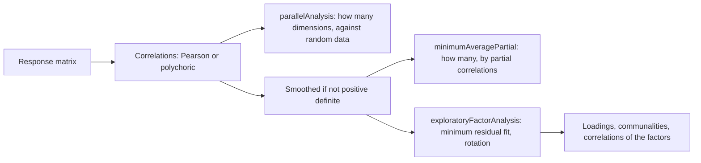

# Dimensionality

`@measurekit/psychometrics/dimensionality` estimates the correlations of the normal variables behind item responses,
polychoric for items with several categories and tetrachoric for dichotomous items, and asks how many dimensions a test
has: by Horn's parallel analysis and by Velicer's minimum average partial test. It fits that many factors to the items by
the minimum residual method, rotated to a simple structure, and smooths correlation matrices that are not positive
definite. The correlations are validated against psych and polycor, the bivariate normal distribution against mvtnorm,
and the eigenvalues, the factors and the partial correlations against base R and psych ([validation](validation.md)).



## Correlations

`polychoricCorrelations(matrix, options)` takes a [response matrix](data.md): responses are integers from 0, `null` when
missing, with any number of categories per item. Pearson correlations of scores treat the categories as equally spaced
numbers; a polychoric correlation instead takes each item to be a normal variable cut at thresholds into its categories,
and estimates the correlation of those variables.

| Option       | Default | Meaning                                                                                                         |
| ------------ | ------- | --------------------------------------------------------------------------------------------------------------- |
| `correction` | `0.5`   | A number of 0 or more added to each empty cell of a table of two items with two categories each; 0 adds nothing |

The result holds the `itemIds`, the `correlations` and each item's `thresholds`.

| Field          | Meaning                                                                                                      |
| -------------- | ------------------------------------------------------------------------------------------------------------ |
| `correlations` | A symmetric matrix by item, 1 on the diagonal; `null` where undefined, below                                 |
| `thresholds`   | Φ⁻¹ of each item's cumulative proportions over its observed categories but the last: one fewer than they are |

```ts
import { createRandom } from "@measurekit/psychometrics";
import { parallelAnalysis, polychoricCorrelations } from "@measurekit/psychometrics/dimensionality";
import { responseMatrix } from "@measurekit/psychometrics/data";

// 800 persons answer 12 items: items 1 to 6 measure one trait and items 7 to 12 another, independent of the first.
const random = createRandom(31);
const rows = Array.from({ length: 800 }, () => {
  const traits = [random.normal(), random.normal()];
  return Array.from({ length: 12 }, (_, j) => {
    const trait = traits[j < 6 ? 0 : 1] ?? 0;
    return random.uniform() < 1 / (1 + Math.exp(-1.7 * trait)) ? 1 : 0;
  });
});
const matrix = responseMatrix(rows);

const { correlations, thresholds } = polychoricCorrelations(matrix);
correlations[0]?.[1]; // 0.557: items 1 and 2 share a trait
correlations[0]?.[6]; // -0.031: items 1 and 7 do not
thresholds[0]; // [-0.006]: one for a dichotomous item
```

Each item's thresholds come from all the persons who answered it. For each pair of items, the correlation ρ maximizes
the log-likelihood Σ n_kl ln π_kl(ρ) of the table of the persons who answered both, where π_kl is the probability of
cell (k, l) under the bivariate normal distribution with correlation ρ between the thresholds, as Olsson's (1979)
two-step estimate. Newton's method with the exact derivatives, which are bivariate normal densities, runs inside a
bracket that bisection narrows, from the Pearson correlation of the category numbers. The bivariate normal distribution
function is Genz's (2004) algorithm, accurate to about 1e-15.

Categories are the responses an item has, in order: an item answered 0, 2 and 5 has three categories, like one answered
0, 1 and 2. Missing responses are skipped for the pairs they are in. The correction follows psych's `tetrachoric`: it
replaces an empty cell of a table of two dichotomous items by `correction` counts, for the pair's persons. Without it, a
table with an empty cell where the association is perfect gives 1 or -1, where the likelihood increases to the boundary.
Tables of items with more categories are not corrected, as psych's `polychoric` does not with its default thresholds
from all responses.

| Case                                            | Result                                              |
| ----------------------------------------------- | --------------------------------------------------- |
| An item with fewer than two observed categories | `null` in its row and column, the diagonal included |
| A pair of items that no person answered both    | `null`                                              |
| A table with one person                         | A number from -1 to 1, which carries no information |

Cost grows with the pairs of items, the persons and the product of the items' categories: the 25 items of `bfi`, with
six categories and 2,800 persons, take about 20 ms, and a parallel analysis of 100 replications under a second. Items
with many categories, such as scores, suit Pearson correlations.

## Parallel analysis

`parallelAnalysis(matrix, random, options)` asks how many dimensions the data support: it compares the eigenvalues of
the correlations with the eigenvalues of correlations of random data of the same size, and counts the leading ones that
exceed what chance gives. It needs at least three items, each with at least two observed categories, and a correlation
for every pair, so that every pair of items shares a person.

| Option         | Default        | Meaning                                                                                                                  |
| -------------- | -------------- | ------------------------------------------------------------------------------------------------------------------------ |
| `correlation`  | `"polychoric"` | `"polychoric"` for item responses; `"pearson"` for scores treated as continuous, over the persons who answered a pair    |
| `comparison`   | `"resampled"`  | `"resampled"`: each item's responses permuted among the persons; `"normal"`: standard normal data, with `"pearson"` only |
| `replications` | `100`          | The number of random data sets, a positive integer; psych's default is 20                                                |
| `quantile`     | `0.95`         | The quantile of the random eigenvalues that the observed ones must exceed, from 0 to 1                                   |
| `correction`   | `0.5`          | As for [`polychoricCorrelations`](#correlations)                                                                         |

Randomness comes from the `random` argument, so a seeded generator reproduces the result.

```ts
const result = parallelAnalysis(matrix, createRandom(1));
result.components.observed; // [3.671, 3.406, 0.647, 0.611, ...]: 12 eigenvalues of the correlation matrix
result.components.randomQuantile; // [1.4, 1.274, 1.206, 1.153, ...]: of random data
result.components.suggested; // 2
result.factors.observed; // [3.185, 2.423, 0.088, 0.035, ...]
result.factors.randomQuantile; // [1.049, 0.294, 0.231, 0.177, ...]
result.factors.suggested; // 2
```

The result has two `EigenvalueComparison`s, one for the components and one for the factors.

| Comparison   | Eigenvalues of                                                                                               |
| ------------ | ------------------------------------------------------------------------------------------------------------ |
| `components` | The correlation matrix, with 1 on its diagonal: the principal components                                     |
| `factors`    | The correlation matrix with the communalities λ² of the one-factor minimum residual solution on its diagonal |

| Field            | Meaning                                                                                           |
| ---------------- | ------------------------------------------------------------------------------------------------- |
| `observed`       | The eigenvalues of the data's correlations, largest first                                         |
| `randomMean`     | The mean of each eigenvalue over the random data sets                                             |
| `randomQuantile` | The `quantile` of each eigenvalue over the random data sets                                       |
| `suggested`      | The number of leading observed eigenvalues above the random quantile, up to the first that is not |

A matrix that is not positive definite, as polychoric correlations can be, is used as it is, without smoothing, so that
`observed` and the random eigenvalues can be negative. The sum of the component eigenvalues is the number of items.

The factor eigenvalues need the one-factor minres loadings: the λ that minimize Σ_(i<j) (r_ij - λ_i λ_j)². Each loading
is at most √0.995 in absolute value, as psych keeps each uniqueness at least 0.005. Where one factor does not fit, as in
random data, the residuals have no minimum without the bound, and with it a loading is often at the bound, so that the
first factor eigenvalue of random data is close to 1 in some data sets: the random quantile of the first factor in the
example is 1.049, far above the 0.294 of the second, so that the first factor of the data must exceed it to count. psych
behaves alike: its quantile on these data is 1.053. The residuals can have several local minima; the search starts from
the centroid loadings, as `mcdonaldOmega` does, and reaches one of them.

The `"resampled"` comparison permutes each item's responses among the persons, independently for each item, which keeps
each item's distribution and its missing responses and breaks the association between items, and computes the
correlations as for the data. The `"normal"` comparison draws standard normal scores for every person and item, as
psych's simulated data do, and takes their Pearson correlations: it suits `correlation: "pearson"`, and `"polychoric"`
with it throws `DataError`.

## Exploratory factor analysis

`exploratoryFactorAnalysis(matrix, options)` fits `factors` common factors to the items by the minimum residual (minres)
method, as `psych::fa(fm = "minres")`. It takes a [response matrix](data.md), correlates the items, smooths the
correlations if they are not positive definite, and returns the rotated loadings, the communalities and the correlations
between the factors.

| Option          | Default     | Meaning                                                                                                               |
| --------------- | ----------- | --------------------------------------------------------------------------------------------------------------------- |
| `factors`       | required    | The number of factors, a positive integer that the items identify: 12 items identify at most 7                        |
| `correlation`   | `"pearson"` | `"pearson"` for scores treated as continuous, over the persons who answered a pair; `"polychoric"` for item responses |
| `rotation`      | `"oblimin"` | `"none"`; `"varimax"`, orthogonal with Kaiser's normalization; `"oblimin"`, oblique. One factor is not rotated        |
| `tolerance`     | `1e-6`      | The largest change of a communality in an iteration at which the fit stops                                            |
| `maxIterations` | `100`       | The most iterations of the fit                                                                                        |
| `correction`    | `0.5`       | As for [`polychoricCorrelations`](#correlations)                                                                      |

| Field           | Meaning                                                                            |
| --------------- | ---------------------------------------------------------------------------------- |
| `itemIds`       | The item ids, in the matrix's order                                                |
| `loadings`      | Items by factors; the factors are in the order of the variance they account for    |
| `communalities` | The part of each item's variance that the factors share                            |
| `correlations`  | Between the factors, by rows: the identity unless the rotation is oblique          |
| `converged`     | Whether the fit and the rotation both reached their tolerances                     |
| `iterations`    | The iterations of the fit                                                          |
| `smoothed`      | Whether the correlations of the items were not positive definite and were smoothed |

```ts
import { exploratoryFactorAnalysis } from "@measurekit/psychometrics/dimensionality";

// `matrix` is the response matrix of the example above: two independent traits, six items each.
const fit = exploratoryFactorAnalysis(matrix, { factors: 2, correlation: "polychoric" });
fit.loadings.slice(0, 2); // [[0.774, -0.021], [0.753, 0.025]]: items 1 and 2 load on the first factor
fit.loadings.slice(6, 8); // [[-0.01, 0.717], [-0.073, 0.718]]: items 7 and 8 on the second
fit.communalities.slice(0, 3); // [0.599, 0.569, 0.476]
fit.correlations; // [[1, 0.017], [0.017, 1]]: the traits are independent
fit.converged; // true
```

**The fit.** The unknowns are the communalities h, which lie from 0 to 0.995: each item's uniqueness is at least 0.005, as
in psych's `fa`. For some h, the correlation matrix with h on its diagonal has eigenvalues, and the best fit of the
factors to it keeps the leading ones; what the fit leaves out, half the sum of the squares of the other eigenvalues, is
the objective. It is the sum of the squared residuals of the off-diagonal correlations, where the communalities are those
of the fit. Each iteration takes a Newton step on the communalities, with the Hessian that the objective has at a perfect
fit, a backtracking line search that keeps the bounds, and an eigendecomposition of the matrix. The search starts from
the squared multiple correlations. Convergence takes 5 to 20 iterations and a few milliseconds for 25 items.

**The solution.** The unrotated loadings are the leading eigenvectors of the reduced matrix scaled by the roots of their
eigenvalues. They are rotated by gradient projection from there, with the oblimin criterion without normalization, as
`GPArotation::oblimin`, or the varimax criterion with each item's loadings scaled to unit length, as `stats::varimax`
does. Each factor's sign makes its loadings sum to a positive number, and the factors follow the variance they account
for, the diagonal of Φ ΛᵀΛ, as psych orders them. The communalities are the diagonal of Λ Φ Λᵀ for every rotation.

A communality that the fit pushes beyond 0.995, a Heywood case, stays at the bound in the matrix the fit starts from, and
the communality of the loadings can exceed it, as it does in psych; `converged` is `true`. More factors than the items
identify throw `DataError`: the number of correlations must be at least the number of loadings less the rotations that
leave the model as it is.

**Which function.** `exploratoryFactorAnalysis` works on the correlations of the items, takes milliseconds and returns
the factors. `calibrateMultidimensional` with `dimensions` estimates a compensatory item response model from the
responses, by full information, and returns item parameters, a likelihood and standard errors, in seconds to minutes.
The two agree on what they share: on the 12 simulated tetrachoric items of the validation, the loadings of the first
factor average 0.710 here and 0.724 by full information after `rotateLoadings`, those of the second 0.606 and 0.618, and
the correlation of the factors 0.316 and 0.306, for the truth of 0.7, 0.6 and 0.3. Use the factors to explore and to
choose the number of dimensions, and the calibration when the item parameters matter.

## Minimum average partial test

`minimumAveragePartial(matrix, options)` is Velicer's test for the number of factors. It removes the principal
components of the correlations one at a time and, after each, squares and averages the partial correlations of the
items. While the components remove common variance the average falls; when they start removing the variance of single
items it rises, and the number of components at the minimum is the number of factors.

| Option        | Default                 | Meaning                                                             |
| ------------- | ----------------------- | ------------------------------------------------------------------- |
| `correlation` | `"pearson"`             | As for [`exploratoryFactorAnalysis`](#exploratory-factor-analysis)  |
| `maxFactors`  | the number of items - 1 | The most components to remove, from 1 to the number of items less 1 |
| `correction`  | `0.5`                   | As for [`polychoricCorrelations`](#correlations)                    |

The result holds `map`, the mean squared partial correlation after 1, 2, ... components, `factors`, the number at the
lowest value, the first when tied, and `smoothed`.

```ts
import { minimumAveragePartial } from "@measurekit/psychometrics/dimensionality";

const { map, factors } = minimumAveragePartial(matrix, { correlation: "polychoric" });
map.slice(0, 4); // [0.0782, 0.0219, 0.0364, 0.0518]: the lowest is after 2 components
factors; // 2
```

`map` is the `map` of psych's `VSS`, which starts at one component, so the test never answers none; Velicer's original also
scores zero components. With all the components but one removed, what is left of each pair is a correlation of 1 in
absolute value, so the last value is 1.

## Smoothing

`smoothCorrelations(correlations, size, options)` returns a correlation matrix that is positive definite. A matrix whose
least eigenvalue is below the machine epsilon has its eigenvalues below `tolerance` (`1e-12`) raised to 100 times it,
rescaled to sum to the number of variables, and the matrix rebuilt and rescaled to a correlation matrix, as
`psych::cor.smooth`. A matrix that is positive definite comes back as it is, in a copy.

Polychoric correlations come from pairs of items estimated apart and can fail to be positive definite: the tetrachoric
correlations of `SAT12`, 32 items, have a least eigenvalue of -0.09. `exploratoryFactorAnalysis` and
`minimumAveragePartial` smooth and report it in `smoothed`; `parallelAnalysis` does not, so that its eigenvalues can be
negative.

## Not included

- **Factor extraction other than minres, such as maximum likelihood.** Outside the sources: an option of `psych::fa`,
  beside the minres extraction that is built.
- **Rotations other than varimax and oblimin, such as promax.** Outside the sources: options of `psych::fa`, beside
  oblimin, its default, and varimax, which are built.
- **DETECT.** Outside the sources: a method for clusters of items, beside the parallel analysis, MAP and factor analysis
  that are built.
- **DIMTEST.** No reference: no package that runs it was found.
- **Polyserial correlations of scores with categories.** Outside the sources: not confirmed in them; `itemRest` serves
  polytomous item analysis.
- **Standard errors of the correlations.** Outside the sources: a bootstrap over the persons gives them.
- **Weights of persons.** Outside the sources: the functions take responses.
- **A correlation matrix as input.** Outside the sources: the functions take responses.

## Differences from psych

| Topic                     | This package                                                                      | psych                                                                         |
| ------------------------- | --------------------------------------------------------------------------------- | ----------------------------------------------------------------------------- |
| Maximum of the likelihood | Newton's method with derivatives, to 1e-13; the maximum of `optimize`             | `optimize` with its default tolerance, within about 2e-5 of the maximum       |
| Correlation matrix        | As estimated: not smoothed                                                        | `smooth = TRUE` by default, which makes the matrix positive definite          |
| `correct`                 | Two items with two categories each, over the pair's persons                       | The same for `tetrachoric`; `polychoric` ignores it with global thresholds    |
| Thresholds                | From all responses, over the observed categories                                  | The same (`global = TRUE`), over a range of categories shared by every item   |
| Random data               | Each item permuted among the persons (`resampled`), or normal data (`normal`)     | `fa.parallel` resamples each item with replacement, and also simulates normal |
| Suggested numbers         | From the quantile of the comparison you choose                                    | From the simulated normal data, also for polychoric correlations              |
| Replications              | 100                                                                               | 20 (`n.iter`)                                                                 |
| Factor eigenvalues        | One-factor minres by Newton's method from the centroid loadings, to 1e-8          | `fa(fm = "minres")` by L-BFGS-B from the squared multiple correlations        |
| Minres solution           | Newton steps on the communalities from the squared multiple correlations          | L-BFGS-B on the same objective, within about 1e-5 of its minimum              |
| Varimax                   | Gradient projection to a gradient of 1e-10, with Kaiser's normalization           | `stats::varimax`, which stops at 1e-5 of its criterion: loadings within 1e-2  |
| Smoothed correlations     | Of the items' correlations in the factors and the test; not in `parallelAnalysis` | Of every correlation matrix `tetrachoric` and `polychoric` return             |
| Items without variance    | `null` in the correlations; an error in parallel analysis                         | Deleted with a message                                                        |

## References

- Bock, R. D., Gibbons, R., and Muraki, E. (1988). Full-information item factor analysis. Applied Psychological
  Measurement, 12, 261-280.
- Fabrigar, L. R., Wegener, D. T., MacCallum, R. C., and Strahan, E. J. (1999). Evaluating the use of exploratory factor
  analysis in psychological research. Psychological Methods, 4, 272-299.
- Genz, A. (2004). Numerical computation of rectangular bivariate and trivariate normal and t probabilities. Statistics
  and Computing, 14, 251-260.
- Glorfeld, L. W. (1995). An improvement on Horn's parallel analysis methodology for selecting the correct number of
  factors to retain. Educational and Psychological Measurement, 55, 377-393.
- Horn, J. L. (1965). A rationale and test for the number of factors in factor analysis. Psychometrika, 30, 179-185.
- Jöreskog, K. G. (1967). Some contributions to maximum likelihood factor analysis. Psychometrika, 32, 443-482.
- Olsson, U. (1979). Maximum likelihood estimation of the polychoric correlation coefficient. Psychometrika, 44,
  443-460.
- Velicer, W. F. (1976). Determining the number of components from the matrix of partial correlations. Psychometrika, 41,
  321-327.
- Wothke, W. (1993). Nonpositive definite matrices in structural modeling. In K. A. Bollen and J. S. Long (Eds.), Testing
  structural equation models (pp. 256-293). Sage.
