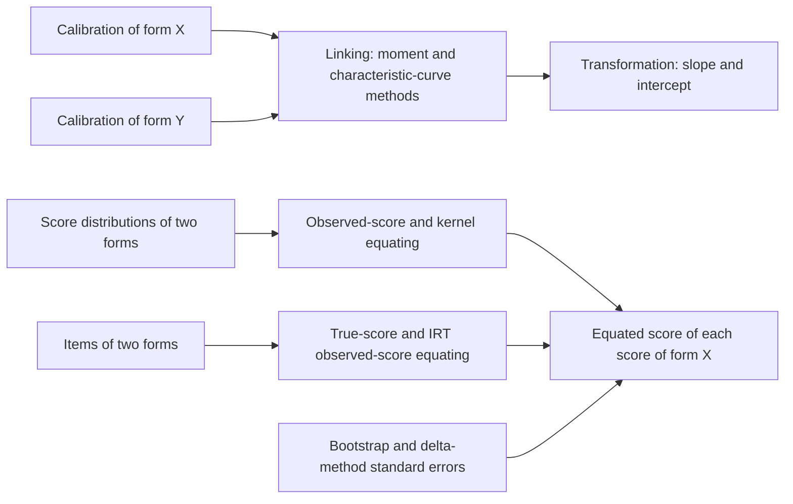
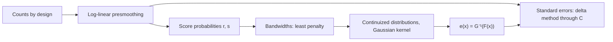
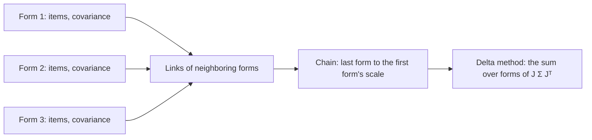

# Linking and equating

`@measurekit/psychometrics/equating` puts the item parameters of two calibrations on one theta scale (linking)
and converts the scores of one form to the scale of another (equating). Linking is validated against equateIRT and
base R, observed-score equating, with or without common items, and its bootstrap standard errors against the equate
package and base R, true-score equating against base R and equateIRT, IRT observed-score equating against base R and
equateIRT, kernel equating against kequate, the standard errors of IRT equating against base R and mirt, and those of
links between separate calibrations against equateIRT ([validation](validation.md)).



## Quick start

Link two forms through their common items, move form X to form Y's scale, and equate their true scores:

```ts
import { haebaraLinking, transformItem, transformTheta, trueScoreEquating } from "@measurekit/psychometrics/equating";
import { threeParameterLogistic } from "@measurekit/psychometrics/irt";

const item = (a: number, b: number, c: number) => ({ model: threeParameterLogistic, parameters: { a, b, c, d: 1 } });
// Two common items as calibrated with form X and with form Y; the forms' other items are left out here.
const commonOnX = [item(1.1, -0.4, 0.2), item(0.9, 0.6, 0.15)];
const commonOnY = [item(0.95, -0.2, 0.2), item(0.8, 0.85, 0.15)];
const formX = [...commonOnX, item(1.3, 0.1, 0.25)];
const formY = [...commonOnY, item(1.0, -0.9, 0.2)];

const transformation = haebaraLinking(commonOnX, commonOnY); // => { slope: 1.13, intercept: 0.22, converged: true, ... }
const formXOnY = formX.map((x) => transformItem(x, transformation));
transformTheta(0.5, transformation); // => 0.78, a theta of form X's calibration on form Y's scale
trueScoreEquating(formXOnY, formY); // => [0.00, 1.17, 2.16, 3.00]: the form Y true score of each form X score, 0 to 3
```

## Linking

Each calibration fixes theta ~ N(0, 1) in its own group, so the same item gets different parameters from groups of
different ability. A linear transformation θ_to = A θ_from + B, a `ScaleTransformation` `{ slope, intercept }`, maps
one scale to the other. The linking functions estimate it from common items: `from[j]` and `to[j]` are the same item
calibrated on the two scales, with the same model and number of categories.

| Function                                 | A and B                                                                                                        |
| ---------------------------------------- | -------------------------------------------------------------------------------------------------------------- |
| `meanMeanLinking(from, to)`              | A = mean a_from / mean a_to; B = mean b_to - A mean b_from (Loyd and Hoover, 1980)                             |
| `meanSigmaLinking(from, to)`             | A = sd b_to / sd b_from; B as mean-mean (Marco, 1977)                                                          |
| `haebaraLinking(from, to, options)`      | Minimize Σ_θ w(θ) Σ_j Σ_k (P_jk(θ; to) - P_jk(θ; from moved))² (Haebara, 1980)                                 |
| `stockingLordLinking(from, to, options)` | Minimize Σ_θ w(θ) (Σ_j E_j(θ; to) - Σ_j E_j(θ; from moved))² (Stocking and Lord, 1983)                         |
| `chainTransformations(links)`            | Compose the links of successive forms: A = A₁ A₂ … Aₙ; B ← B Aᵢ + Bᵢ ([vertical scaling](vertical-scaling.md)) |

### Moment methods

a is each item's slope; b its locations: the difficulty, every threshold of a GRM, GPCM or PCM item, and b + τ_k of an
RSM item, so mixed formats pool them (Kim and Lee, 2006). Standard deviations have denominator n - 1. NRM items have no
locations, so they throw `DataError`. For Rasch items, a = 1 on both scales, mean-mean gives A = 1.

### Characteristic curve methods

The sum runs over the quadrature nodes θ of the `to` scale with their N(0, 1) weights, `options.quadrature`: by default
61 rectangular points; equateIRT's are `{ method: "gauss-hermite", points: 30 }`. A `from` item moved to the `to` scale
gives P_jk((θ - B) / A), so the criteria work for items of any model, a custom one included. Haebara's criterion sums
every category, which for a dichotomous item is twice the usual term and does not move the minimum. BFGS minimizes over
ln A and B from A = 1, B = 0, with the criterion's exact gradient, and reports `converged` and `iterations`. It has
converged at a gradient of at most 1e-10, or, as R's `optim`, when rounding of the criterion leaves no step that lowers
it or its gradient: within about 1e-8 of the minimum.

### Moving items and thetas

`transformItem(item, transformation)` returns the item on the new scale: a person at A θ + B has the probabilities a
person at θ had. It keeps the item's other fields, such as `id`, and scales its `standardErrors` with their
parameters, treating A and B as known: a by 1 / A, locations and steps by A, asymptotes unchanged. An NRM item's
intercepts c_k - a_k B / A need the covariances of a_k and c_k, so with B ≠ 0 its standard errors become `null`. It
supports the built-in models:

| Model          | New parameters           |
| -------------- | ------------------------ |
| 1PL to 4PL     | a / A, A b + B, c, d     |
| GRM, GPCM, PCM | a / A, A b_k + B         |
| RSM            | a / A, A b + B, A τ_k    |
| NRM            | a_k / A, c_k - a_k B / A |

`transformTheta(theta, transformation)` returns A θ + B; a standard error of theta scales by A.

## Observed-score equating

Linear and equipercentile equating convert the scores of form X to the scale of form Y from random groups: one group
took X and an equivalent group took Y. Each form's score distribution is the number of persons at each score, from 0
to the highest, as the equate package's frequency tables; fractional counts, as from smoothing, are accepted. The
result has the equated score of each X score.

| Function                           | Equated score of x                                                                |
| ---------------------------------- | --------------------------------------------------------------------------------- |
| `linearEquating(from, to)`         | μ_Y + (σ_Y / σ_X)(x - μ_X), standard deviations with denominator n - 1, as equate |
| `equipercentileEquating(from, to)` | The Y score with x's percentile rank (Kolen and Brennan, 2014)                    |

`logLinearPresmoothing(distribution, degree)` smooths a distribution before equipercentile equating (Holland and
Thayer, 2000): the maximum likelihood fit of ln m_x = β0 + β1 x + ... + β_C x^C to the counts, a Poisson regression,
as the equate package's `presmoothing(smoothmethod = "loglinear")`. The fit keeps the number of persons and the first
C moments of the scores, and fills scores without persons. It returns the fitted `distribution`, `converged` and
`iterations`; pass the distribution to `equipercentileEquating`. Degrees from 2 to 6 are usual: compare the fits'
moments and plots, or the AIC of the Poisson fits, to choose one. A degree is at most 20, and less than the number of
scores: each Newton step of a fit takes the cube of its terms.

```ts
import { equipercentileEquating, logLinearPresmoothing } from "@measurekit/psychometrics/equating";

const from = [1, 3, 6, 10, 14, 15, 12, 9, 6, 3, 1];
const to = [2, 4, 8, 11, 13, 14, 11, 8, 5, 3, 1];
const smooth = (counts: number[]) => [...logLinearPresmoothing(counts, 3).distribution];
equipercentileEquating(smooth(from), smooth(to));
```

Equipercentile equating treats scores as continuous, each uniform over [x - 0.5, x + 0.5]. The percentile rank of x is
P = F_X(x - 1) + f_X(x) / 2, and its Y equivalent is y - 0.5 + (P - F_Y(y - 1)) / f_Y(y) for the smallest y with
F_Y(y) > P. Where Y has scores without persons the inverse is ambiguous; the result is the mean of that value and
y' + 0.5 + (P - F_Y(y')) / (F_Y(y' + 1) - F_Y(y')) for the largest y' with F_Y(y') < P, as equate. A rank of 0 gives
-0.5 and a rank of 1 the highest Y score plus 0.5. Ranks compare with cumulative shares exactly, by cross-multiplying
the counts.

## Equating through common items

When two groups of different ability took different forms, their score distributions differ for two reasons: the
forms and the groups. Common items, the anchor, tell the groups apart: both groups took them. A distribution here is
the number of persons at each total score and anchor score, a `BivariateDistribution`: a row for each total score from
0, each row holding a count for each anchor score from 0. `from` is the group that took the form to equate and `to`
the group that took the form to equate to. Both need at least two total scores and two anchor scores, the same
anchor scores, non-negative counts and at least one person; fractional counts, as from smoothing, are accepted. The
total score counts the anchor items for an internal anchor and not for an external one.

| Function                                         | Equated score of x                                                                                   |
| ------------------------------------------------ | ---------------------------------------------------------------------------------------------------- |
| `tuckerEquating(from, to, options)`              | Linear in the synthetic population, with the regression slope of the total on the anchor score as γ  |
| `levineEquating(from, to, options)`              | As Tucker with Levine's γ, or by Levine's true-score method                                          |
| `chainedLinearEquating(from, to)`                | x to the anchor in `from`'s group by a linear equating, then the anchor to the total in `to`'s group |
| `chainedEquipercentileEquating(from, to)`        | The same with equipercentile equating                                                                |
| `frequencyEstimationEquating(from, to, options)` | Equipercentile equating of the two forms' score distributions in the synthetic population            |

```ts
import {
  chainedEquipercentileEquating,
  chainedLinearEquating,
  frequencyEstimationEquating,
  levineEquating,
  tuckerEquating,
} from "@measurekit/psychometrics/equating";

// Persons by total score on the form, 0 to 5 (rows), then by score on the anchor, 0 to 3 (columns).
const groupX = [
  [8, 3, 1, 0],
  [10, 8, 3, 0],
  [7, 12, 8, 2],
  [3, 10, 14, 6],
  [1, 4, 11, 9],
  [0, 1, 4, 7],
]; // took form X
const groupY = [
  [5, 2, 0, 0],
  [9, 5, 1, 0],
  [8, 11, 4, 1],
  [4, 12, 12, 4],
  [1, 6, 13, 10],
  [0, 1, 5, 9],
]; // took form Y

tuckerEquating(groupX, groupY); // => [0.407, 1.372, 2.337, 3.301, 4.266, 5.231]: the form Y score of each form X score
levineEquating(groupX, groupY, { trueScore: true }); // => [0.586, 1.48, 2.375, 3.27, 4.164, 5.059]
chainedLinearEquating(groupX, groupY); // => [0.425, 1.383, 2.34, 3.298, 4.255, 5.213]
chainedEquipercentileEquating(groupX, groupY); // => [0.298, 1.43, 2.459, 3.369, 4.186, 5.1]
frequencyEstimationEquating(groupX, groupY); // => [0.305, 1.44, 2.438, 3.35, 4.234, 5.121]
```

### Synthetic population

Tucker, Levine and frequency estimation equate in a synthetic population: the two groups, weighted by w₁ for `from`'s
group and w₂ = 1 - w₁ for `to`'s (Braun and Holland, 1982). Each form's score distribution in it is estimated from
the group that took the form and the anchor scores of the other.

| Option      | Of                                                                | Default                       | Meaning                                                                                   |
| ----------- | ----------------------------------------------------------------- | ----------------------------- | ----------------------------------------------------------------------------------------- |
| `weight`    | `tuckerEquating`, `levineEquating`, `frequencyEstimationEquating` | `from`'s share of the persons | w₁, a number from 0 to 1; equate's `ws`, which is -1 for this default                     |
| `trueScore` | `levineEquating`                                                  | `false`                       | Levine's true-score method, which does not use `weight`; equate's `lts`                   |
| `anchor`    | `levineEquating`                                                  | `"internal"`                  | `"internal"` or `"external"`: whether the anchor counts in the total; equate's `internal` |

Moments have denominator n - 1, as equate. With μ, σ² and σ(X, V) the means, variances and covariance of a group's total
score X and anchor score V, Δ the difference of the groups' mean anchor scores, and γ₁, γ₂ the slopes of the groups:

| Quantity                  | Formula                                               |
| ------------------------- | ----------------------------------------------------- |
| Synthetic mean of X       | μ₁(X) - w₂ γ₁ Δ                                       |
| Synthetic mean of Y       | μ₂(Y) + w₁ γ₂ Δ                                       |
| Synthetic variance of X   | σ₁²(X) - w₂ γ₁² (σ₁²(V) - σ₂²(V)) + w₁ w₂ γ₁² Δ²      |
| Synthetic variance of Y   | σ₂²(Y) + w₁ γ₂² (σ₁²(V) - σ₂²(V)) + w₁ w₂ γ₂² Δ²      |
| Tucker γ                  | σ(X, V) / σ²(V) in each group                         |
| Levine γ, internal anchor | σ²(X) / σ(X, V)                                       |
| Levine γ, external anchor | (σ²(X) + σ(X, V)) / (σ²(V) + σ(X, V))                 |
| Levine true score         | y = (γ₂ / γ₁)(x - μ₁(X)) + μ₂(Y) + γ₂ (μ₁(V) - μ₂(V)) |

Linear equating in the synthetic population maps x to the Y score with the same distance from the synthetic mean in
standard deviations. Each group needs at least two persons and total and anchor scores with variance, Levine's methods a
positive covariance of the two, and the synthetic population total scores with variance, or the function throws
`DataError`.

Chained linear equating needs no synthetic population: a linear equating of the total score to the anchor score in
`from`'s group, followed by the linear equating of the anchor score to the total score in `to`'s.

### Equipercentile methods

Chained equipercentile equating equates the total score to the anchor score in `from`'s group by
`equipercentileEquating`. The anchor equivalent is not a whole score, so its percentile rank in `to`'s group
interpolates linearly between the cumulative shares at the ends of its score's interval; the Y score with that rank
in `to`'s group is the result.

Frequency estimation (Braun and Holland, 1982) estimates the distribution of each form in the synthetic population
from the group that took it and the other group's anchor distribution h:

- f(x) = w₁ f₁(x) + w₂ Σ_v f₁(x | v) h₂(v) for form X, where f₁(x | v) is the share of the persons of `from`'s
  group with the anchor score v who scored x;
- g(y) = w₁ Σ_v g₂(y | v) h₁(v) + w₂ g₂(y) for form Y.

`equipercentileEquating` of f and g gives the result. The conditional distribution given an anchor score needs persons
with it, so an anchor score that persons in one group have and none in the other have throws a `DataError` that names
the score; smooth the distributions first.

## Bivariate presmoothing

`bivariateLogLinearPresmoothing(distribution, { degrees, crossDegree })` smooths a bivariate distribution (Holland
and Thayer, 2000): the maximum likelihood fit of the Poisson regression

ln m_xv = β₀ + Σ_{i ≤ C_x} β_i xⁱ + Σ_{j ≤ C_v} γ_j vʲ + Σ_{i, j ≤ C_xv} δ_ij xⁱ vʲ

to the counts, as the equate package's `presmoothing(smoothmethod = "loglinear", degrees = list(c(C_x, C_v), C_xv))`.
The fit keeps the number of persons, the first C_x moments of the total scores, the first C_v of the anchor scores and
the cross moments E[xⁱ vʲ]. It fills cells without persons, which frequency estimation needs.

| Option        | Default | Meaning                                                                                                           |
| ------------- | ------- | ----------------------------------------------------------------------------------------------------------------- |
| `degrees`     | none    | `[total, anchor]`: integers from 1 to one less than the number of total scores and of anchor scores, at most 20   |
| `crossDegree` | `1`     | The highest power of each score in the cross products, an integer from 0, for none, to the smaller of the degrees |

It returns the fitted `distribution`, `converged` and `iterations`, as `logLinearPresmoothing`. `converged` is `false`
when Newton's method does not reach the maximum within 200 iterations, as when cells without persons leave the
likelihood no finite maximum; the distribution is then the last iterate.

```ts
import { bivariateLogLinearPresmoothing, frequencyEstimationEquating } from "@measurekit/psychometrics/equating";

const groupX = [
  [8, 3, 1, 0],
  [10, 8, 3, 0],
  [7, 12, 8, 2],
  [3, 10, 14, 6],
  [1, 4, 11, 9],
  [0, 1, 4, 7],
];
const smooth = bivariateLogLinearPresmoothing(groupX, { degrees: [3, 2] });
smooth.converged; // => true
smooth.distribution[0]?.map((count) => Math.round(count * 10) / 10); // => [7.8, 3.6, 0.6, 0]: fitted persons at total score 0
```

## Standard errors by bootstrap

`bootstrapEquating(sample, equate, random, options)` returns the standard error of the equated score at each score of
the form to equate (Efron and Tibshirani, 1993; Kolen and Brennan, 2014). Each replication draws as many persons as the
sample has, with replacement, in proportion to the counts of the cells, applies `equate` to the resampled
distributions, and the standard error at a score is the standard deviation (denominator B - 1) of the B equated scores,
as the equate package's `bootstrap`.

The sample names its design, and groups are resampled independently:

| `design`          | Fields                                                                        | Resampled                                                    |
| ----------------- | ----------------------------------------------------------------------------- | ------------------------------------------------------------ |
| `"random-groups"` | `from`, `to`: counts of each score                                            | The persons of each form separately                          |
| `"single-group"`  | `joint`: counts by score on the form to equate, then on the form to equate to | Pairs of scores, so that the correlation of the forms counts |
| `"neat"`          | `from`, `to`: bivariate distributions                                         | The persons of each group separately                         |

| Option         | Default | Meaning                                                                                                                             |
| -------------- | ------- | ----------------------------------------------------------------------------------------------------------------------------------- |
| `replications` | `500`   | The number B of resamples, an integer from 2; the Monte Carlo error of a standard error is about 1 / √(2 (B - 1)) of it: 3% for 500 |

The counts of a sample are whole numbers of persons. `equate` takes a sample of the design's shape and returns the
equated score of every score of the form to equate, and every smoothing or other step belongs inside it, so that its
variability counts; a resample for which it throws, such as frequency estimation with an anchor score in one group only,
stops the bootstrap with that error. The same seed in `random` gives the same standard errors.

```ts
import { createRandom } from "@measurekit/psychometrics";
import { bootstrapEquating, tuckerEquating } from "@measurekit/psychometrics/equating";

const groupX = [
  [8, 3, 1, 0],
  [10, 8, 3, 0],
  [7, 12, 8, 2],
  [3, 10, 14, 6],
  [1, 4, 11, 9],
  [0, 1, 4, 7],
];
const groupY = [
  [5, 2, 0, 0],
  [9, 5, 1, 0],
  [8, 11, 4, 1],
  [4, 12, 12, 4],
  [1, 6, 13, 10],
  [0, 1, 5, 9],
];
const sample = { design: "neat", from: groupX, to: groupY } as const;
bootstrapEquating(sample, (s) => tuckerEquating(s.from, s.to), createRandom(1), { replications: 200 });
// => [0.216, 0.168, 0.137, 0.133, 0.16, 0.205]: the standard error of each form X score's equivalent
```

A single group equates the marginal distributions of its two forms with `linearEquating` and `equipercentileEquating`;
only the bootstrap differs, as it resamples pairs of scores:

```ts
import { createRandom } from "@measurekit/psychometrics";
import { bootstrapEquating, linearEquating } from "@measurekit/psychometrics/equating";

const joint = [
  [6, 3, 1],
  [2, 8, 4],
  [0, 3, 7],
]; // persons by score on form X (rows), then on form Y (columns)
const sum = (counts: readonly number[]) => counts.reduce((total, count) => total + count, 0);
const marginals = (pairs: readonly (readonly number[])[]) =>
  [pairs.map(sum), (pairs[0] ?? []).map((_, y) => sum(pairs.map((row) => row[y] ?? 0)))] as const;

linearEquating(...marginals(joint)); // => [0.129, 1.118, 2.106]
bootstrapEquating(
  { design: "single-group", joint },
  (sample) => linearEquating(...marginals(sample.joint)),
  createRandom(1),
  { replications: 200 },
); // => [0.153, 0.116, 0.152]
```

## Kernel equating

`kernelEquating(data, options)` equates the scores of a form to the scale of another by the kernel method of von
Davier, Holland and Thayer (2004), in five data collection designs, with the standard error of each equated score, as
kequate (González and Wiberg, 2017).



| `design`                | Fields                                                                                                                            | r and s                                                                                                  |
| ----------------------- | --------------------------------------------------------------------------------------------------------------------------------- | -------------------------------------------------------------------------------------------------------- |
| `"equivalent-groups"`   | `from`, `to`: the persons at each score of two random groups                                                                      | Each group's presmoothed distribution                                                                    |
| `"single-group"`        | `joint`: persons by score on the form to equate (rows), then on the form to equate to (columns)                                   | The margins of the presmoothed table                                                                     |
| `"counterbalanced"`     | `first`: the group that took the form to equate first; `second`: the other; each as `joint`                                       | w r₁ + (1 - w) r₂ and w s₁ + (1 - w) s₂, w the `weight` of the first group                               |
| `"chained"`             | `from`, `to`: each group's persons by total score (rows) and anchor score (columns), as in [NEAT](#equating-through-common-items) | The total and anchor margins of each group: x to the anchor in `from`'s group, the anchor to y in `to`'s |
| `"post-stratification"` | As `"chained"`                                                                                                                    | Each form in the synthetic population, `weight` that of `from`'s group                                   |

`degrees` holds the degree of each score's log-linear model, `[from, to]` or, for the anchor designs, `[total,
anchor]`, and `crossDegree` that of the cross products of a bivariate table, as `bivariateLogLinearPresmoothing`; its
default is `1`. Every presmoothed distribution F is continuized by a Gaussian kernel:

F_h(t) = Σ_j r_j Φ((t - a x_j - (1 - a) μ) / (a h)), a = √(σ² / (σ² + h²))

which keeps the mean μ and the variance σ² of the scores; σ² is the variance times n / (n - 1), n the group's persons
(the first group's in the counterbalanced design), as kequate. The equated score is e(x) = G_h⁻¹(F_h(x)), and the chained
design composes the two links.

| Option          | Default               | Meaning                                                                                                                                         |
| --------------- | --------------------- | ----------------------------------------------------------------------------------------------------------------------------------------------- |
| `bandwidths`    | the penalty's minimum | `{ from, to }`, and `fromAnchor`, `toAnchor` in the chained design: positive numbers; each omitted one minimizes the penalty                    |
| `linear`        | `false`               | Each bandwidth not given is 1000 σ, which gives linear equating                                                                                 |
| `weight`        | `0.5`                 | The weight of the first group of `"counterbalanced"`, or of `from`'s group in `"post-stratification"`: from 0 to 1; the other designs ignore it |
| `penaltyWeight` | `0`                   | K of the penalty's second term: from 0                                                                                                          |

A bandwidth minimizes the penalty PEN₁(h) + K PEN₂(h) over (0, 4] by Brent's search, as kequate: PEN₁ = Σ_j (r_j -
f_h(x_j))² compares the density with the probabilities at the scores, and PEN₂ counts the scores whose density turns
between x_j - 1/4 and x_j + 1/4. With K > 0 the second search starts above the minimum of PEN₁. A bandwidth given may be
as large as a number goes, which is linear equating; one so small that the density vanishes at an equated score leaves
its standard error without a density to divide by, and throws a `DataError`.

| Field                        | Meaning                                                                                                                                                       |
| ---------------------------- | ------------------------------------------------------------------------------------------------------------------------------------------------------------- |
| `equated`                    | e(x) at each score of the form to equate, from 0                                                                                                              |
| `standardErrors`             | The delta method's standard errors: the length of each error vector                                                                                           |
| `errorVectors`               | (1 / g(e(x))) (∂F/∂r J_r C - ∂G/∂s J_s C) at each score, J the design function's Jacobian and Cov(p̂) = C Cᵀ of the log-linear fits; the bandwidths held fixed |
| `bandwidths`                 | The bandwidths used, with `fromAnchor` and `toAnchor` in the chained design                                                                                   |
| `percentRelativeError`       | 100 (Σ_x e(x)ᵖ r_x - Σ_y yᵖ s_y) / Σ_y yᵖ s_y for p = 1 to 10; in the chained design, of the link of the total to the anchor in `from`'s group                |
| `anchorPercentRelativeError` | In the chained design, the same of the link of the anchor to the form to equate to in `to`'s group                                                            |
| `converged`                  | `false` when a presmoothing did not converge or a bandwidth's search stopped at 4                                                                             |

`kernelEquatingDifference(first, second)` returns the standard error of e₁(x) - e₂(x) for two equatings of one design
and data, such as kernel and linear, or chained and post-stratification: the length of the difference of their error
vectors, as kequate's `genseed`.

```ts
import { kernelEquating, kernelEquatingDifference } from "@measurekit/psychometrics/equating";

const data = {
  design: "equivalent-groups",
  from: [1, 3, 6, 10, 14, 15, 12, 9, 6, 3, 1],
  to: [2, 4, 8, 11, 13, 14, 11, 8, 5, 3, 1],
  degrees: [3, 3],
} as const;
const kernel = kernelEquating(data);
kernel.equated; // => [-0.282, 0.582, 1.554, 2.589, 3.648, 4.715, 5.785, 6.854, 7.919, 8.974, 10.001], after rounding
kernel.standardErrors; // => [0.346, 0.487, 0.483, 0.424, 0.398, 0.401, 0.417, 0.461, 0.551, 0.616, 0.459]
kernel.bandwidths; // => { from: 0.608, to: 0.585 }, after rounding
const linear = kernelEquating(data, { linear: true });
kernelEquatingDifference(kernel, linear); // => [0.397, 0.299, 0.182, 0.054, 0.102, 0.146, 0.115, 0.053, 0.191, 0.343, 0.41]
```

## Anchor screen

Before linking or equating through common items, programs drop the items whose parameters drifted between
calibrations. `robustZ(from, to)` takes the common items on both calibrations, `from[j]` and `to[j]` being the same
item with the same model and number of categories, and returns for each item the `difference` d of its location (b, or
the mean of a polytomous item's thresholds) between the two, its robust z and whether it is `flagged` (Huynh and Meyer,
2010):

z = (d - median d) / (0.74 IQR d)

with R's `median` and `IQR` (quantiles by linear interpolation) over the common items, and an item flagged when |z|
exceeds 1.645. The differences of locations measure drift only when the scales differ by a shift, as the Rasch and
partial credit models do; for other models, move the `from` items to the `to` scale with `transformItem` first. The
interquartile range of the differences must be above 0: with a single common item, or when the middle half of the
differences are equal, there is no spread to judge drift by, and `robustZ` throws.

```ts
import { robustZ } from "@measurekit/psychometrics/equating";
import { twoParameterLogistic } from "@measurekit/psychometrics/irt";

const item = (b: number) => ({ model: twoParameterLogistic, parameters: { a: 1, b, c: 0, d: 1 } });
const from = [-1.2, -0.6, -0.1, 0.4, 0.9, 1.5].map(item);
const to = [-0.85, -0.34, 0.22, 0.67, 2.1, 1.81].map(item);
robustZ(from, to).map(({ z, flagged }) => [Math.round(z * 100) / 100, flagged]);
// => [[0.76, false], [-1.19, false], [0.11, false], [-0.97, false], [19.14, true], [-0.11, false]]
```

## True-score equating

`trueScoreEquating(from, to)` takes the items of two forms on a common scale, as after linking, and returns the Y true
score of each X score from 0 to the highest (Lord, 1980; Kolen and Brennan, 2014):

1. A form's true score τ(θ) is the sum of its items' expected scores. It rises from the sum L of the items' limits as
   theta goes to -∞, Σ c for logistic items and 0 for the others, to the sum U of their limits at +∞, Σ d and the
   highest categories.
2. For L_X < x < U_X, solve τ_X(θ) = x and return τ_Y(θ).
3. Below L_X no theta gives x: x maps linearly from 0 to L_Y (Kolen and Brennan's procedure). Above U_X, which happens
   with 4PL items, x maps linearly from U_Y to Y's highest score.

The items' expected scores must increase with theta: built-in models with a > 0, not the NRM.

## IRT observed-score equating

`irtObservedScoreEquating(from, to, options)` takes the items of two forms on a common scale, as after linking, and the
distribution of theta of the group that took each form on that scale. It computes each form's distribution of summed
scores in a synthetic population of the two groups and equates them by `equipercentileEquating` (Lord and Wingersky,
1984; Kolen and Brennan, 2014). With P(x | θ) the probability of the summed score x at theta, from the Lord-Wingersky
recursion, g₁ and g₂ the populations and w₁ the weight of `from`'s:

f(x) = w₁ Σ_q P_X(x | θ_q) g₁(θ_q) + (1 - w₁) Σ_q P_X(x | θ_q) g₂(θ_q)

and g(y) likewise for the form to equate to. Items of any model are supported, polytomous items included, with the sum
of the categories as the score. The result is the form Y score of each form X score from 0 to its highest, as the other
equating functions give it; scores whose percentile rank is 0 or 1 map to -0.5 and the highest score plus 0.5.

| Option        | Default                                   | Meaning                                                                                                                                            |
| ------------- | ----------------------------------------- | -------------------------------------------------------------------------------------------------------------------------------------------------- |
| `populations` | N(0, 1) on 61 rectangular points for both | `{ from, to }`: each a `ThetaDistribution`, `{ nodes, weights }` with finite nodes in any order and non-negative weights that sum to 1 within 1e-6 |
| `weight`      | `0.5`                                     | w₁, a number from 0 to 1; equateIRT's `w`                                                                                                          |

A group linked to the scale of the other by A and B has the nodes A θ + B of the other's, with the same weights. A
calibration's group distribution, a posterior from `thetaPosterior` or any other discrete distribution works as a
population.

```ts
import { irtObservedScoreEquating } from "@measurekit/psychometrics/equating";
import { twoParameterLogistic } from "@measurekit/psychometrics/irt";

const item = (a: number, b: number) => ({ model: twoParameterLogistic, parameters: { a, b, c: 0, d: 1 } });
const formX = [item(1.1, -0.8), item(0.9, -0.2), item(1.3, 0.3), item(1, 0.9)];
const formY = [item(1, -1.1), item(1.2, -0.4), item(0.8, 0.2), item(1.1, 1)];
// Form X's group is N(0, 1) and form Y's is N(0.4, 1.2²), on the common scale, on five nodes each.
const nodes = [-2, -1, 0, 1, 2];
const weights = [0.06, 0.24, 0.4, 0.24, 0.06];
irtObservedScoreEquating(formX, formY, {
  populations: { from: { nodes, weights }, to: { nodes: nodes.map((z) => 0.4 + 1.2 * z), weights } },
}); // => [0.145, 1.163, 2.118, 3.05, 4.004], after rounding
```

## Standard errors of IRT equating

`irtEquatingStandardErrors(from, to, covariance, options)` returns the standard error of the equated score at each
score of the form to equate, by the delta method (Lord, 1982; Ogasawara, 2001). The equated score e(x) is a function of
the item parameters of both forms, so with g its gradient with respect to the parameters and Σ their covariance
matrix, the standard error is √(gᵀ Σ g). The gradient comes from central differences; a true-score equating at a moved
parameter takes one Newton step from the theta of each score rather than solving for it again, which leaves an error of
the order of the step squared.

| Option        | Default        | Meaning                                                                                   |
| ------------- | -------------- | ----------------------------------------------------------------------------------------- |
| `method`      | `"true-score"` | `"true-score"` for `trueScoreEquating`, `"observed-score"` for `irtObservedScoreEquating` |
| `populations` | as above       | Used by the observed-score method only                                                    |
| `weight`      | `0.5`          | Used by the observed-score method only                                                    |

The covariance is a `ParameterCovariance`, as `calibrateWithCovariance` returns it, with a label `{ item, name }` for
each row. The items of both forms need string ids, distinct within a form, and are matched to the labels by id and
parameter name; the names are those the model estimates, such as `a` and `b`, `b1` to `b3`, `c`. An item on both forms
is one set of parameters, so it must have the same model and parameters on both. Items and parameters that the
covariance lacks are known: fixed items, and the parameters of the model that calibration does not estimate. The
populations are known too. A label of an item on neither form is ignored. A parameter that items share, such as the
slope of the 1PL, is listed once for each item with a correlation of 1 and is moved as one. Every parameter of the
covariance that belongs to an item of the forms must lie inside its range, so that c = 0 of a 3PL item is rejected.

The standard errors are valid when both forms are on the scale of one calibration: a concurrent calibration of both
forms, or a calibration of one form with the other's common items fixed to their values. A response left `null` for an
item a person did not take makes a NEAT design one calibration. Forms calibrated apart and linked take
[`linkedEquatingErrors`](#standard-errors-across-separate-calibrations), which adds the error of the link.

```ts
import { createRandom } from "@measurekit/psychometrics";
import { irtEquatingStandardErrors, trueScoreEquating } from "@measurekit/psychometrics/equating";
import { calibrateWithCovariance, twoParameterLogistic } from "@measurekit/psychometrics/irt";
import { simulateItems, simulateResponses, simulateThetas } from "@measurekit/psychometrics/sim";

const random = createRandom(7);
const truth = simulateItems(twoParameterLogistic, 14, random);
const matrix = simulateResponses(truth, simulateThetas(2000, random), random);
const { calibration, covariance } = calibrateWithCovariance(matrix, {
  model: twoParameterLogistic,
  standardErrors: "hessian",
});
if (covariance === null) throw new Error("The calibration has no covariance.");
// Form X is items 1 to 9 and form Y items 6 to 14, so that items 6 to 9 are common.
const formX = calibration.items.slice(0, 9);
const formY = calibration.items.slice(5);
trueScoreEquating(formX, formY); // => [0, 1.477, 2.642, 3.627, 4.527, 5.404, 6.29, 7.195, 8.101, 9], after rounding
irtEquatingStandardErrors(formX, formY, covariance);
// => [0, 0.094, 0.071, 0.048, 0.036, 0.035, 0.043, 0.049, 0.033, 0], after rounding
irtEquatingStandardErrors(formX, formY, covariance, { method: "observed-score" });
// => [0.04, 0.048, 0.042, 0.035, 0.033, 0.033, 0.034, 0.034, 0.029, 0.022], after rounding
```

## Standard errors across separate calibrations

When each form is calibrated on its own, a common item has an estimate on each form, and a link between the forms
carries the error of both. A `CalibratedForm` is `{ items, covariance }`: a form's items with string ids and the
covariance of their parameters, as `calibrateWithCovariance` returns it. Forms share items by id.



| Function                                  | Returns                                                                                                                                                      |
| ----------------------------------------- | ------------------------------------------------------------------------------------------------------------------------------------------------------------ |
| `linkCovariance(forms, options)`          | The transformation of the last form to the first form's scale, each form linked to the one before it, with the standard errors and the covariance of A and B |
| `linkedEquatingErrors(from, to, options)` | The standard error of each equated score of `from`, its items moved to the scale of `to` by their link, the link's error included                            |

Both differentiate their result by central differences in each parameter of each form's covariance, as
`irtEquatingStandardErrors` does, and add J Σ Jᵀ over the forms, which are independent: a form between two links counts
once, as `equateIRT::chainec` does (Ogasawara, 2001; Battauz, 2015). A Haebara or Stocking-Lord link at a moved
parameter is one Newton step from its minimum, the derivative of the implicit function that the minimum defines, so no
step minimizes again; the errors agree with equateIRT's analytic derivatives to 2e-10. Two forms are a chain of one link. A parameter that
a covariance lacks, such as one of a fixed item, is known; in `linkCovariance`, one of an item that no neighboring form
shares does not enter a link.

| Option        | Default           | Meaning                                                                                                            |
| ------------- | ----------------- | ------------------------------------------------------------------------------------------------------------------ |
| `linking`     | `"stocking-lord"` | `"mean-mean"`, `"mean-sigma"`, `"haebara"` or `"stocking-lord"`                                                    |
| `quadrature`  | as above          | The quadrature of the characteristic curve methods                                                                 |
| `method`      | `"true-score"`    | `linkedEquatingErrors` only: `"true-score"` or `"observed-score"`                                                  |
| `populations` | as above          | `linkedEquatingErrors` with `"observed-score"`: `from` lies on the `from` form's own scale and moves with the link |
| `weight`      | `0.5`             | `linkedEquatingErrors` with `"observed-score"`                                                                     |

```ts
import { createRandom } from "@measurekit/psychometrics";
import { linkCovariance, linkedEquatingErrors } from "@measurekit/psychometrics/equating";
import { calibrateWithCovariance, twoParameterLogistic } from "@measurekit/psychometrics/irt";
import { simulateItems, simulateResponses, simulateThetas } from "@measurekit/psychometrics/sim";

const random = createRandom(3);
const truth = simulateItems(twoParameterLogistic, 16, random);
// Form X has items 1 to 10 and form Y items 7 to 16, each calibrated on its own group; Y's group is abler.
const calibrated = (first: number, shift: number) => {
  const ids = Array.from({ length: 10 }, (_, j) => `q${first + j}`);
  const thetas = simulateThetas(1500, random).map((theta) => theta + shift);
  const matrix = simulateResponses(truth.slice(first - 1, first + 9), thetas, random);
  const { calibration, covariance } = calibrateWithCovariance(matrix, {
    model: twoParameterLogistic,
    standardErrors: "hessian",
  });
  if (covariance === null) throw new Error("The calibration has no covariance.");
  const id = (item: string) => ids[Number(item.slice(4)) - 1] ?? item;
  return {
    items: calibration.items.map((item) => ({ ...item, id: id(item.id) })),
    covariance: { ...covariance, parameters: covariance.parameters.map((p) => ({ ...p, item: id(p.item) })) },
  };
};
const formX = calibrated(1, 0);
const formY = calibrated(7, 0.5);
const { transformation, errors } = linkCovariance([formX, formY]); // Y's scale to X's
transformation; // => { slope: 0.976, intercept: 0.411 }, after rounding
errors.standardErrors; // => { slope: 0.082, intercept: 0.065 }, after rounding
linkedEquatingErrors(formY, formX);
// => [0, 0.139, 0.192, 0.181, 0.126, 0.087, 0.091, 0.108, 0.112, 0.086, 0]: the error of each form Y score's equivalent
```

## Errors

Invalid input throws `DataError` naming the value found, also input of another type, as JavaScript or JSON passes it.

| Function                                                                                                                    | Error                                                                                                                                                                                      | What to do                                                                               |
| --------------------------------------------------------------------------------------------------------------------------- | ------------------------------------------------------------------------------------------------------------------------------------------------------------------------------------------ | ---------------------------------------------------------------------------------------- |
| `meanMeanLinking`, `meanSigmaLinking`, `haebaraLinking`, `stockingLordLinking`, `robustZ`                                   | Lists of common items of different lengths or empty, or a pair of different models or numbers of categories                                                                                | Give the same items in the same order on both scales                                     |
| `meanMeanLinking`, `meanSigmaLinking`, `robustZ`                                                                            | An NRM item or a model other than the built-in ones                                                                                                                                        | Link it by `haebaraLinking` or `stockingLordLinking`, which take any model               |
| `meanMeanLinking`; `meanSigmaLinking`; `robustZ`                                                                            | A mean slope not above 0; locations without variance; differences with an interquartile range of 0, as with one item                                                                       | Use more common items, or a characteristic curve method                                  |
| `transformItem`, `transformTheta`, `chainTransformations`                                                                   | A transformation without a positive finite slope and a finite intercept, an empty chain, or a chain that overflows                                                                         | Link again, checking the common items of that link                                       |
| `linearEquating`, `equipercentileEquating`, `logLinearPresmoothing`                                                         | A distribution of fewer than two scores, a negative or non-finite count, or no persons                                                                                                     | Give the persons at each score from 0 to the highest                                     |
| `linearEquating`                                                                                                            | Fewer than two persons, or `from` scores without variance                                                                                                                                  | Equate distributions with spread                                                         |
| `logLinearPresmoothing`, `bivariateLogLinearPresmoothing`                                                                   | A degree that is not an integer from 1 to one less than the scores and at most 20, or a `crossDegree` above the smaller degree                                                             | Choose degrees from 2 to 6, as usual, and compare their fits                             |
| `tuckerEquating`, `levineEquating`, `chainedLinearEquating`, `chainedEquipercentileEquating`, `frequencyEstimationEquating` | Tables of rows of unequal length, a negative count, or groups with different numbers of anchor scores                                                                                      | Give each group's persons by total score, then anchor score, over the same anchor scores |
| `tuckerEquating`, `levineEquating`, `chainedLinearEquating`                                                                 | A group of fewer than two persons, total or anchor scores without variance, or a synthetic population without variance                                                                     | Equate groups with spread, or another weight                                             |
| `levineEquating`                                                                                                            | Total and anchor scores without a positive covariance, or an `anchor` other than `"internal"` or `"external"`                                                                              | Check the anchor: it must measure what the forms do                                      |
| `frequencyEstimationEquating`                                                                                               | An anchor score that persons of only one group have                                                                                                                                        | Smooth both tables with `bivariateLogLinearPresmoothing` first                           |
| `bootstrapEquating`                                                                                                         | Counts that are not whole numbers, an `equate` that does not return a finite score at each score, or `replications` below 2                                                                | Resample raw counts, and smooth inside `equate`                                          |
| `kernelEquating`                                                                                                            | Data of an unknown design, tables of a design that do not fit together, or fewer than two persons                                                                                          | Give the design's distributions, with the same scores where the design shares them       |
| `kernelEquating`                                                                                                            | A centered log-linear basis that is singular                                                                                                                                               | Lower the degrees of the presmoothing                                                    |
| `kernelEquating`                                                                                                            | Bandwidths so small that an equated score or its standard error is not finite                                                                                                              | Use larger bandwidths, or omit them to minimize the penalty                              |
| `kernelEquatingDifference`                                                                                                  | Equatings whose error vectors differ in number or length                                                                                                                                   | Compare two equatings of one design and data                                             |
| `trueScoreEquating`, `irtObservedScoreEquating`                                                                             | No items, an invalid item, or, for true scores, an NRM item or a slope a ≤ 0                                                                                                               | Give each form's items on one scale, linked first                                        |
| `irtObservedScoreEquating`                                                                                                  | Populations whose weights do not sum to 1 within 1e-6, or a `weight` outside [0, 1]                                                                                                        | Give each group's distribution of theta on the scale of the items                        |
| `irtEquatingStandardErrors`                                                                                                 | Items without distinct string ids, an item on both forms with different parameters, a label naming a parameter its model does not estimate, or a covariance with no parameter of the forms | Give the items with the ids of the covariance of one calibration                         |
| `irtEquatingStandardErrors`, `linkCovariance`, `linkedEquatingErrors`                                                       | A covariance that is not a square matrix of finite numbers, a parameter on a bound of its range such as c = 0, or a negative variance                                                      | Pass the covariance of `calibrateWithCovariance`, without fixed bounds                   |
| `linkCovariance`, `linkedEquatingErrors`                                                                                    | Fewer than two forms, forms that share no item by id, or no covariance with a parameter of a common item                                                                                   | Give forms that share common items, with their covariances                               |
| `linkCovariance`, `linkedEquatingErrors`                                                                                    | A characteristic curve criterion with no strict minimum at the link                                                                                                                        | Use common items whose curves rise with theta, or a moment method                        |

## Not included

| Not included                                                      | Why                                                                                                                                                         |
| ----------------------------------------------------------------- | ----------------------------------------------------------------------------------------------------------------------------------------------------------- |
| Braun-Holland linear equating                                     | Outside the sources: Kolen and Brennan give it no chapter, and the practice is the linear, equipercentile and frequency estimation families that are built. |
| Circle-arc equating                                               | Outside the sources: Kolen and Brennan give it no chapter, and the practice is the families that are built.                                                 |
| Nominal weights equating                                          | Outside the sources: Kolen and Brennan give it no chapter, and the practice is the families that are built.                                                 |
| Cubic-spline postsmoothing                                        | No reference: no R package for it was found, and the C code of Equating Recipes was not run.                                                                |
| Analytic standard errors of observed-score equating               | No reference: `equate` has only the bootstrap, and `bootstrapEquating` is built; kernel equating has its own.                                               |
| Local equating                                                    | Outside the sources: chapter 6 of González and Wiberg presents a research method; the list's coverage does not name it.                                     |
| The methods of "Recent Developments in Equating"                  | Outside the sources: research methods.                                                                                                                      |
| Kernel IRT observed-score equating                                | Outside the sources: a variant of `irtObservedScoreEquating`.                                                                                               |
| Kernel equating with covariates, kequate's NEC design             | Outside the sources: a research extension; post-stratification on an anchor is the practice, and is built.                                                  |
| Logistic and uniform kernels                                      | Outside the sources: options of kequate; the Gaussian kernel is the practice.                                                                               |
| Freeman-Tukey residuals of a presmoothing                         | No fit: one line over the fitted counts.                                                                                                                    |
| Composite linking                                                 | Outside the sources: an option of equate.                                                                                                                   |
| Bisector linking                                                  | Outside the sources: an option of equateIRT.                                                                                                                |
| Linking several forms at once, Haberman's linking, robust linking | Outside the sources: `linkCovariance` over a chain and concurrent `groups` are the practice.                                                                |
| Identity and chain-consistency tests                              | Outside the sources: functions of equateIRT; `robustZ` screens the items.                                                                                   |

## Differences from the references

| Topic                          | This package                                                                                                                            | Reference                                                                                                                                                                                                                                                                                                                                                |
| ------------------------------ | --------------------------------------------------------------------------------------------------------------------------------------- | -------------------------------------------------------------------------------------------------------------------------------------------------------------------------------------------------------------------------------------------------------------------------------------------------------------------------------------------------------- |
| Rasch items                    | A estimated by every method; 1 by mean-mean                                                                                             | equateIRT fixes A = 1 for its Rasch model                                                                                                                                                                                                                                                                                                                |
| Polytomous items               | Every method; NRM by the characteristic curves only                                                                                     | equateIRT's `direc`: dichotomous items                                                                                                                                                                                                                                                                                                                   |
| Percentile ranks               | Exact                                                                                                                                   | equate rounds them and the cumulative shares to 10 decimals: up to 1e-7 apart                                                                                                                                                                                                                                                                            |
| X scores above Y's scale       | Rank 1 gives Y's highest score plus 0.5                                                                                                 | equate returns the X score itself                                                                                                                                                                                                                                                                                                                        |
| True scores below Σ c          | Kolen and Brennan's line from 0                                                                                                         | equateIRT's `score` leaves them out                                                                                                                                                                                                                                                                                                                      |
| Frequency estimation weights   | `weight` is w₁ of the synthetic population                                                                                              | equate's `ws` also multiplies the groups' numbers of persons, so its default weights `from` by n₁² / (n₁² + n₂²); `ws = w₁ n₂ / (w₁ n₂ + (1 - w₁) n₁)` gives w₁, and the two agree for groups of one size                                                                                                                                                |
| Anchor score of one group only | `DataError` naming the score                                                                                                            | equate gives the persons at it their own group's weight alone, so the synthetic distributions lose mass                                                                                                                                                                                                                                                  |
| Bivariate presmoothing degrees | `degrees: [total, anchor]` and `crossDegree`, at most the smaller degree                                                                | `degrees = list(c(total, anchor), cross)`, with the cross products as in `crossDegree`                                                                                                                                                                                                                                                                   |
| Bootstrap                      | The seeded `Random` of the package; replications default to 500                                                                         | R's `sample`, 100 replications; the standard errors agree within their Monte Carlo error                                                                                                                                                                                                                                                                 |
| IRT observed-score populations | Any discrete distribution per group; default N(0, 1) on 61 rectangular points                                                           | equateIRT's `score(method = "OSE")`: N(0, 1) on `theta` for one group and N(B, A²) on A `theta` + B for the other                                                                                                                                                                                                                                        |
| Kernel presmoothing            | `degrees` and `crossDegree` of the log-linear models, fitted here                                                                       | kequate takes fitted `glm` objects with their design matrices                                                                                                                                                                                                                                                                                            |
| Counterbalanced weights        | `weight` w of the first group in r, s and their standard errors                                                                         | kequate's `wcb` weighs the first group by w in r and s, but by 1 - w in the Jacobian of s; its standard errors at w ≠ 1/2 belong to no equating it computes. The delta method written out in base R, through the parameters of the log-linear fits, reproduces kequate at w = 1/2 and this package at 0.7 (`validation/psychometrics/kernel-equating.R`) |
| Kernel equated scores          | Each inverse solved to a bracket of 1e-12                                                                                               | kequate's `uniroot(tol = 1e-6)`                                                                                                                                                                                                                                                                                                                          |
| IRT equating standard errors   | Delta method on one calibration's covariance, parameters of the populations known; across separate calibrations, `linkedEquatingErrors` | equateIRT's `score(se = TRUE)` links the form to equate to onto the scale of the form to equate, the reverse of this package's link; the two agree for mean-mean, whose links are inverse functions, and differ by the asymmetry of the other methods                                                                                                    |
| Mean-sigma link errors         | ∂A/∂b of A = sd b_to / sd b_from divides by n - 1, as the standard deviations do                                                        | equateIRT's `direc` divides by n, which shrinks the variance of A by ((n - 1) / n)², 0.81 for 10 common items, and its `chainec` and `score` with it; numDeriv's Jacobian of `direc`'s own links reproduces its mean-mean, Haebara and Stocking-Lord errors, and this package's mean-sigma (`validation/psychometrics/linking-errors.R`)                 |
