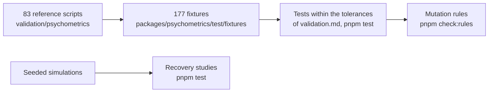

# Evidence for psychometrics

What shows that `@measurekit/psychometrics` does what it says: every statistic against a reference in R or Python within a
stated tolerance, recovery studies where no package is the reference, properties of every function, the samples of the
guides, the peak memory of its readers, its mutation rules and its runs on four runtimes. The counts below are those of
the repository at `1506fa8e`, on 2026-11-06.

| Layer           | Question                                                                                                | Where                                                                                                                                                        | Runs                                                           |
| --------------- | ------------------------------------------------------------------------------------------------------- | ------------------------------------------------------------------------------------------------------------------------------------------------------------ | -------------------------------------------------------------- |
| References      | Does each statistic equal its reference's, on public datasets and seeded simulations?                   | 83 R and Python scripts of `validation/psychometrics/` write 177 fixtures; [validation](validation.md) gives the references, the versions and the tolerances | `pnpm test`; the scripts when a reference or a formula changes |
| Recovery        | Where no package is the reference, do the estimates recover the values a simulation set?                | [validation](validation.md#simulation): 2PL, multidimensional, MH-RM, bifactor, two-tier, several groups, factors                                            | `pnpm test`; at scale, the studies of `validation/`            |
| Properties      | Do the invariants hold for any input: alpha at most 1, probabilities from 0 to 1, the order of persons? | fast-check in `packages/psychometrics/test/*.test.ts`, from the seed of `test/setup.ts`                                                                      | `pnpm test`                                                    |
| Samples         | Does every sample of the guides and every `@example` give the values it shows?                          | `examples/test/guides.test.ts`, `examples/test/tsdoc.test.ts`                                                                                                | `pnpm test --project examples`                                 |
| Untrusted input | Does each reader stay within its heap on its worst input within its limits?                             | `scripts/peak-memory.ts`; [performance](performance.md#memory)                                                                                               | `pnpm test`                                                    |
| Mutation rules  | Does the test of each rule on untrusted input fail without the rule?                                    | `scripts/check-rules.ts`                                                                                                                                     | `pnpm check:rules`, weekly and before a release                |
| Runtimes        | Do Node.js, Deno, Bun and workerd give Node.js's results of a calibration?                              | `compat/`                                                                                                                                                    | `pnpm compat:runtimes`                                         |
| Speed           | How long does each hot path take against its reference?                                                 | [performance](performance.md#speed)                                                                                                                          | `pnpm bench`                                                   |

Some of the comparisons, as [validation](validation.md#tolerances) gives them with the largest difference found:

| Quantity                                                 | Reference            | Tolerance                                    | Largest difference |
| -------------------------------------------------------- | -------------------- | -------------------------------------------- | ------------------ |
| IRT item parameters                                      | mirt 1.48            | 1e-5 absolute                                | 1e-6               |
| EAP and WLE theta and standard error                     | mirt 1.48, base R    | 1e-10 absolute                               | 6e-14              |
| CML recovery: 40 sets of 2,000 persons and 15 items      | The simulated values | RMSE at most 0.06; 95% coverage 0.92 to 0.98 | 0.052; 0.963       |
| Mantel-Haenszel statistics                               | difR 6.1.0, base R   | 1e-12 absolute                               | 1e-15              |
| Kernel equated scores and standard errors                | kequate 1.6.4        | 1e-5 absolute                                | 3.2e-6             |
| Cognitive diagnosis probabilities, proportions, accuracy | GDINA 2.13.2         | 1e-5 absolute                                | 1.1e-6             |
| Scalability coefficients and their standard errors       | mokken 3.1.2         | 1e-10 relative to max(1, value)              | 3e-15              |
| The evaluation of automated scores                       | RSMTool 12.0.0       | 1e-10 absolute                               | 1.3e-13            |
| K, K1 and K2 of answer similarity                        | CopyDetect 1.4       | 1e-10 relative                               | 7e-12              |

## Where the references disagree

Where a reference rounds, stops early or computes another statistic than its documentation says, the test compares with
the computation written out in base R and states the difference: each guide's Differences from the references section
gives them, and [validation](validation.md) the cases, such as mirt's M2* for items with held parameters.
