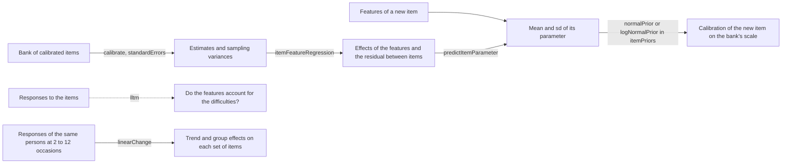
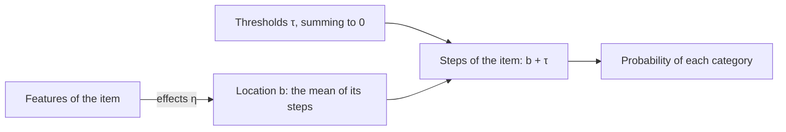
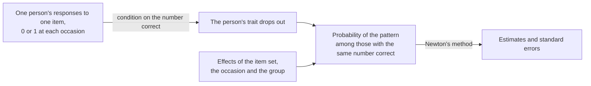

# Explanatory item response theory

`@measurekit/psychometrics/explanatory` explains the parameters of items by their features, such as the number of steps
of a task or whether its response is open, predicts the parameters of items that nobody has answered yet, and estimates
the change of persons between occasions, by item and group.



| Function                | Estimates                                                                   | From                          |
| ----------------------- | --------------------------------------------------------------------------- | ----------------------------- |
| `lltm`                  | The effects of features on difficulty, and the test against the Rasch model | Responses, by marginal ML     |
| `linearChange`          | The change of each set of items between occasions, for each group           | Responses, by conditional ML  |
| `itemFeatureRegression` | The effects on a parameter and the residual between items                   | A calibration, by REML        |
| `predictItemParameter`  | The parameter of a new item, its mean and sd                                | A regression and the features |

The LLTM tests from the responses whether features account for the difficulties; the regression of a calibration's
estimates predicts a new item with a standard deviation that includes the variation between items, which becomes the
prior of the item's first calibration. `linearChange` measures how persons changed on each item with a trait of their
own for every person and item. The LLTM is validated against a base R maximum with mirt, eRm and TAM as cross-checks, the
regression against base R and metafor, the change against glm and base R with eRm as a cross-check
([validation](validation.md)).

## The linear logistic test model

The LLTM (Fischer, 1973) makes the difficulty of each item the sum of the effects of its features: the probability of a
correct response is logistic(θ - b_i), b_i = x_iᵀη, with θ ~ N(0, σ²). `lltm(data, features, options)` estimates η and σ
by the Bock-Aitkin EM algorithm on the engine of the [many-facet Rasch model](rater.md), and tests the model against
the Rasch model that gives every item a difficulty of its own.

```ts
import { createRandom, lltm, simulateResponses, simulateThetas, twoParameterLogistic } from "@measurekit/psychometrics";

// Six items whose difficulty is -1.5 + 0.5 per step, answered by 500 simulated persons.
const random = createRandom(3);
const items = [1, 2, 3, 4, 5, 6].map((steps) => ({
  model: twoParameterLogistic,
  parameters: { a: 1, b: -1.5 + 0.5 * steps, c: 0, d: 1 },
}));
const responses = simulateResponses(items, simulateThetas(500, random), random);
const features = {
  item1: { steps: 1 },
  item2: { steps: 2 },
  item3: { steps: 3 },
  item4: { steps: 4 },
  item5: { steps: 5 },
  item6: { steps: 6 },
};
const model = lltm(responses, features);
model.effects; // (intercept) -1.56 (SE 0.11), steps 0.50 (SE 0.03)
model.sd; // 0.98
model.comparison; // { raschLogLikelihood: -1831.8, chiSquare: 2.43, degreesOfFreedom: 4, significance: 0.66 }
model.items[0]?.parameters; // { a: 1, b: -1.06, c: 0, d: 1 }
```

`data` is a [response matrix or response records](data.md) of dichotomous responses; `features` are the
[features by item id](#features) of every item in it.

| Option           | Default         | Valid range                                           | Meaning                                                                                      |
| ---------------- | --------------- | ----------------------------------------------------- | -------------------------------------------------------------------------------------------- |
| `model`          | `"dichotomous"` | `"dichotomous"`, `"partial-credit"`, `"rating-scale"` | The responses explained: [items of 2 categories, or several](#items-with-several-categories) |
| `intercept`      | `true`          | `true` or `false`                                     | Whether the difficulties have an intercept                                                   |
| `quadrature`     | 61 rectangular  | as `calibrate`                                        | The rule over theta                                                                          |
| `standardErrors` | `"hessian"`     | `"none"` or `"hessian"`                               | The Hessian of the marginal log-likelihood, by central differences                           |
| `tolerance`      | `1e-4`          | non-negative                                          | EM stops when no parameter changes by more than this in an iteration                         |
| `maxIterations`  | `500`           | positive integer                                      | The most EM iterations                                                                       |

| Result                        | Meaning                                                                                                                                                                                          |
| ----------------------------- | ------------------------------------------------------------------------------------------------------------------------------------------------------------------------------------------------ |
| `effects`                     | `{ name, estimate, standardError }` for the intercept, named `"(intercept)"`, and each feature, on difficulty                                                                                    |
| `sd`                          | σ, the standard deviation of theta, whose mean is 0                                                                                                                                              |
| `items`                       | Each item with `a = 1`, `b` its difficulty from the effects, `c = 0` and `d = 1`, as a calibration's items; for the other models, partial credit items whose steps `b` add the item's thresholds |
| `comparison`                  | The likelihood-ratio test against the Rasch model                                                                                                                                                |
| `logLikelihood`, `aic`, `bic` | The marginal log-likelihood; -2 ℓ + 2p and -2 ℓ + p ln n, p the effects, σ and the free thresholds, n the persons with a response                                                                |
| `converged`, `iterations`     | Whether EM reached `tolerance` within `maxIterations` for the LLTM and for the Rasch model; the iterations of the LLTM                                                                           |

- **Scale.** Discrimination is 1 and theta is N(0, σ²), so effects are in logits on the Rasch scale. With an intercept,
  the effect of a feature is its change of the difficulty for one unit, and the intercept is the difficulty of an item
  whose features are all 0, as theta has mean 0. Without an intercept, the difficulty is Σ feature · effect, and a bank
  whose features do not reproduce its average difficulty is rejected by the test.
- **Test.** The LLTM is nested in the Rasch model: χ² = 2 (ℓ_Rasch - ℓ_LLTM) with degrees of freedom the items less
  the effects, and `significance` the probability of a chi-square at least that large if the features account for the
  difficulties. A small value says that items with the same features still differ. The test is of difficulty only: it
  assumes the model of responses holds for both, and a calibration with 2PL slopes is a different model.
- **Items.** With the default model, every item needs responses in both categories and none above 1; the other models
  [take more categories](#items-with-several-categories). Persons without responses change nothing and are not counted
  in the BIC.
- **Valid input.** More items than effects, and effects that no combination of the others reproduces: a constant
  feature with an intercept, or a feature that is a multiple of another, throws `DataError` naming the effect. A feature
  that is 0 or 1 for every item belongs to the design as any other.
- **No residual between items.** Items with equal features get equal difficulties, so predictions for new items from an
  LLTM would be overconfident. When the test rejects the LLTM, or for a prediction with its uncertainty, regress a
  calibration's estimates with [`itemFeatureRegression`](#regressing-a-parameter-on-features).

### Features

`features` maps each item id to an object of feature values, `{ q1: { fractions: 1, steps: 3 } }`. Every item of the
data needs a finite number for each feature that any item has. A categorical feature is one 0/1 column for each of its
categories but one. The effects are ordered by their first appearance among the items, after the intercept, and
features of ids that are not items are ignored.

### Items with several categories

`model: "partial-credit"` and `model: "rating-scale"` explain items scored from 0 to any highest category. The features
explain the location of each item, the mean of its step difficulties, and the thresholds around it are estimated: item i
gives a person at θ category k with probability P_k ∝ exp(Σ over j ≤ k of (θ - b_i - τ_j)), b_i = x_iᵀη, with the
thresholds τ of a set summing to 0.



| `model`            | Thresholds                   | Categories of the items                    |
| ------------------ | ---------------------------- | ------------------------------------------ |
| `"dichotomous"`    | none: two categories         | 2                                          |
| `"partial-credit"` | Each item has its own        | Any number from 2; they may differ by item |
| `"rating-scale"`   | One set, shared by all items | The same for every item                    |

```ts
import { createRandom, lltm, partialCredit, simulateResponses, simulateThetas } from "@measurekit/psychometrics";

// Six items of three categories: the mean step of item i is -1 + 0.5 per step, and its thresholds are -0.5 and 0.5.
const random = createRandom(7);
const items = [1, 2, 3, 4, 5, 6].map((steps) => ({
  model: partialCredit,
  parameters: { a: 1, b: [-1.5 + 0.5 * steps, -0.5 + 0.5 * steps] },
}));
const responses = simulateResponses(items, simulateThetas(800, random), random);
const features = Object.fromEntries([1, 2, 3, 4, 5, 6].map((steps) => [`item${steps}`, { steps }]));
const model = lltm(responses, features, { model: "partial-credit" });
model.effects; // (intercept) -1.01 (SE 0.07), steps 0.51 (SE 0.02)
model.comparison; // { raschLogLikelihood: -4236.6, chiSquare: 7.13, degreesOfFreedom: 4, significance: 0.13, ... }
model.items[0]?.parameters; // { a: 1, b: [-1.04, 0.03] }
```

- **Result.** The effects, σ and the test are those of the dichotomous model, and `items` are partial credit items with
  `a = 1`, each step the item's difficulty from the effects plus its threshold. The mean of an item's steps is its
  difficulty. The Rasch model of the test gives each item a location of its own and the same thresholds, so the degrees
  of freedom are still the items less the effects, and the information criteria count the free thresholds: the
  categories of a set less 2.
- **Items.** Each item needs responses in every category from 0 to its highest, and at least two categories, as in a
  calibration. With the rating scale every item has the same highest category, as the thresholds are shared.
- **Two categories.** Both models give the dichotomous model for items of two categories.
- **Features of single steps.** The features explain an item's location. A step with features of its own, as in the
  linear partial credit model of Fischer and Ponocny (1995) with a design for each step, is not included.

## Linear change

`linearChange(occasions, options)` estimates the linear logistic model for change (LLRA; Fischer, 1995) of the same
persons answering the same items at 2 to 12 occasions. Each person has a trait of their own on each item, so the
change of an item is measured without assuming that the items measure one trait.



```ts
import {
  createRandom,
  linearChange,
  simulateResponses,
  simulateThetas,
  twoParameterLogistic,
} from "@measurekit/psychometrics";

// 800 persons in two groups answer 4 items twice. At the second occasion the control group has gained 0.3 logits and the
// treated group 0.8.
const random = createRandom(5);
const thetas = simulateThetas(800, random);
const group = thetas.map((_, person) => (person < 400 ? "control" : "treated"));
const items = [-0.5, 0, 0.5, 1].map((b) => ({ model: twoParameterLogistic, parameters: { a: 1, b, c: 0, d: 1 } }));
const before = simulateResponses(items, thetas, random);
const gain = (person: number) => (group[person] === "treated" ? 0.8 : 0.3);
const after = simulateResponses(
  items,
  thetas.map((theta, person) => theta + gain(person)),
  random,
);

const change = linearChange([before, after], {
  groups: group,
  baseline: "control",
  itemGroups: Object.fromEntries(before.itemIds.map((id) => [id, "test"])),
});
change.effects;
// test, occasion 2, control: 0.35 (SE 0.08), the trend
// test, occasion 2, treated: 0.35 (SE 0.12), the gain beyond the trend
```

| Option          | Default                        | Valid range                           | Meaning                                                                        |
| --------------- | ------------------------------ | ------------------------------------- | ------------------------------------------------------------------------------ |
| `groups`        | One group of everyone, `"all"` | One non-empty name for each person    | The group of each person                                                       |
| `baseline`      | The first person's group       | A name in `groups`                    | The group whose change is the trend; the others' effects are relative to it    |
| `itemGroups`    | Each item alone, by its id     | A set name for every item, by item id | Items that share one effect for each occasion and group                        |
| `tolerance`     | `1e-8`                         | non-negative                          | The estimation stops when no effect changes by more than this in a Newton step |
| `maxIterations` | `100`                          | positive integer                      | The most Newton steps                                                          |

`occasions` are response matrices of 0, 1 and `null`, in time order, with the same persons and items in the same order.

| Result                    | Meaning                                                                                                                      |
| ------------------------- | ---------------------------------------------------------------------------------------------------------------------------- |
| `effects`                 | `{ itemGroup, occasion, group, estimate, standardError }`, by item set, then occasion from 2, then group, the baseline first |
| `logLikelihood`           | The conditional log-likelihood at the estimates                                                                              |
| `converged`, `iterations` | Whether no effect changed by more than `tolerance` within `maxIterations`, and the Newton steps taken                        |

- **Model.** The logit of a correct response is the person's trait on the item plus, from the second occasion, the effect
  of the item's set, the occasion and the person's group; the first occasion is the reference. The effect of the baseline
  group is the trend, and that of another group is its change beyond the trend. The estimates are in logits.
- **Conditioning.** The likelihood of a person's pattern on an item is taken among the patterns with the same number of
  correct responses, which removes the trait. A person who answered an item correctly or wrongly at every occasion adds
  nothing to it. With two occasions only the persons who changed inform an item, and the model is a logistic regression
  of the direction of their change: `glm` on the changers gives the same estimates.
- **Missing responses.** A person missing a response of an item at any occasion is left out of that item, and of no other.
- **Item sets.** The items of a set share one effect for each occasion and group, so a test of many items is summarized
  by a few effects. Each item alone has its own.
- **No finite estimate.** Where every person who changed on an effect changed the same way, the maximum is at infinity:
  the steps stop beyond 20 logits and `converged` is `false`. eRm's `LLRA` fails the same way.
- **Valid input.** An effect that no person changed on, or that those who changed make a combination of the effects before
  it, throws `DataError` naming the set, the occasion and the group. Responses are 0 or 1.
- **Cost.** Each person and item adds its pattern to a stratum of its set, group and number correct, so the time grows with
  the persons and items, and with the 2ᵀ patterns of each sum: 12 occasions is the limit.

### Change on one trait

When one trait underlies the items, as in a test of one skill, the LLTM on virtual items estimates the change with one
estimate for all items: stack the occasions as items, one for each item and occasion, with one feature for each item and
one, `time2`, for the later occasion. The effect of `time2` is a change of difficulty, so the negative of a gain.

```ts
import {
  createRandom,
  lltm,
  responseMatrix,
  simulateResponses,
  simulateThetas,
  twoParameterLogistic,
} from "@measurekit/psychometrics";

// 600 persons answer 6 items twice, and gain 0.5 logits.
const random = createRandom(9);
const thetas = simulateThetas(600, random);
const items = [-1, -0.5, 0, 0.5, 1, 1.5].map((b) => ({
  model: twoParameterLogistic,
  parameters: { a: 1, b, c: 0, d: 1 },
}));
const before = simulateResponses(items, thetas, random);
const after = simulateResponses(
  items,
  thetas.map((theta) => theta + 0.5),
  random,
);
const ids = before.itemIds;
const stacked = responseMatrix(
  before.responses.map((row, person) => [...row, ...(after.responses[person] ?? [])]),
  { itemIds: [...ids.map((id) => `${id}.t1`), ...ids.map((id) => `${id}.t2`)] },
);
const features = Object.fromEntries(
  stacked.itemIds.map((id, column) => [
    id,
    {
      ...Object.fromEntries(ids.map((name, i) => [name, i === column % ids.length ? 1 : 0])),
      time2: column >= ids.length ? 1 : 0,
    },
  ]),
);
lltm(stacked, features, { intercept: false }).effects.at(-1); // { name: "time2", estimate: -0.44, standardError: 0.06 }
```

It assumes one trait across items and occasions, and treats the two responses of a person as independent given it. Use
`linearChange` when the items differ in what they measure, or when persons differ in their change by item.

## The random-item model

An item's difficulty is its features' effect plus what the features leave unexplained: b_i = x_iᵀη + u_i, with
u_i ~ N(0, τ²) (Janssen, Schepers and Peres, 2004; De Boeck, 2008). Items with the same features still differ, by τ, so
the prediction for a new item has a standard deviation √(τ² + the uncertainty of η) instead of the overconfident zero
of a model that gives equal features equal difficulty.

The model is estimated in two stages. Calibrate the bank with any model and standard errors, then regress each
estimate y_i on the features, taking its sampling variance v_i from the calibration:

y_i = x_iᵀη + u_i + e_i, e_i ~ N(0, v_i).

η and τ² come from restricted maximum likelihood (REML). The covariance of the sampling errors between items is
neglected, as in the usual two-stage analysis (Raudenbush, 2009); a calibration's item estimates are nearly independent
given the common scale.

## Regressing a parameter on features

`itemFeatureRegression(items, features, options)` takes the `items` of a calibration made with standard errors and the
features by item id.

```ts
import {
  calibrate,
  createRandom,
  logNormalPrior,
  normalPrior,
  responseMatrix,
  simulateResponses,
  twoParameterLogistic,
} from "@measurekit/psychometrics";
import { itemFeatureRegression, predictItemParameter } from "@measurekit/psychometrics/explanatory";

// A bank of 16 items with two features each: the difficulty is -1.5 + 0.5 steps + 0.4 open + noise.
const rows = [
  { steps: 1, open: 0, noise: 0.2 },
  { steps: 2, open: 0, noise: -0.3 },
  { steps: 3, open: 0, noise: 0.1 },
  { steps: 4, open: 0, noise: 0.25 },
  { steps: 5, open: 0, noise: -0.2 },
  { steps: 6, open: 0, noise: 0.05 },
  { steps: 1, open: 1, noise: -0.1 },
  { steps: 2, open: 1, noise: 0.3 },
  { steps: 3, open: 1, noise: -0.25 },
  { steps: 4, open: 1, noise: 0.15 },
  { steps: 5, open: 1, noise: 0 },
  { steps: 6, open: 1, noise: -0.05 },
  { steps: 2, open: 0, noise: 0.1 },
  { steps: 3, open: 1, noise: -0.2 },
  { steps: 4, open: 0, noise: 0.3 },
  { steps: 5, open: 1, noise: -0.1 },
];
const difficulty = ({ steps, open, noise }: (typeof rows)[number]) => -1.5 + 0.5 * steps + 0.4 * open + noise;
const bank = rows.map((row, i) => ({
  id: `q${i + 1}`,
  model: twoParameterLogistic,
  parameters: { a: 1, b: difficulty(row), c: 0, d: 1 },
}));
const features = Object.fromEntries(rows.map(({ steps, open }, i) => [`q${i + 1}`, { steps, open }]));
// A new item with 4 steps, open, difficulty 0.9: 25 of 1,000 persons answer it.
const newItem = { id: "new1", model: twoParameterLogistic, parameters: { a: 1, b: 0.9, c: 0, d: 1 } };

const random = createRandom(11);
const thetas = Array.from({ length: 1000 }, () => random.normal());
const { responses } = simulateResponses([...bank, newItem], thetas, random);
const ids = [...bank, newItem].map(({ id }) => id);

// 1. Calibrate the bank, with standard errors, and regress its difficulties and slopes on the features.
const calibration = calibrate(
  responseMatrix(
    responses.map((row) => row.slice(0, 16)),
    { itemIds: ids.slice(0, 16) },
  ),
  { model: twoParameterLogistic, standardErrors: "hessian" },
);
const regression = itemFeatureRegression(calibration.items, features);
regression.effects; // (intercept) -1.40 (SE 0.14), steps 0.49 (0.03), open 0.21 (0.11)
regression.residualSd; // 0.18: the spread of difficulties that the features leave
const slopes = itemFeatureRegression(calibration.items, features, { parameter: "a" });

// 2. Predict the new item from its features: the prior of its difficulty and of its slope.
const itsFeatures = { steps: 4, open: 1 };
const b = predictItemParameter(regression, itsFeatures); // { mean: 0.78, sd: 0.20 }
const a = predictItemParameter(slopes, itsFeatures); // { mean: 0.05, sd: 0.04 }, the logarithm of the slope

// 3. Calibrate the new item on the bank's scale, with the prediction as its prior.
const sparse = responseMatrix(
  responses.map((row, person) => row.map((response, item) => (item === 16 && person >= 25 ? null : response))),
  { itemIds: ids },
);
const fixed = Object.fromEntries(calibration.items.map(({ id, parameters }) => [id, parameters]));
const itemPriors = { new1: { b: normalPrior(b.mean, b.sd), a: logNormalPrior(a.mean, a.sd) } };
calibrate(sparse, { model: twoParameterLogistic, fixed }).items[16]?.parameters; // a: 1.00, b: 0.59
calibrate(sparse, { model: twoParameterLogistic, fixed, itemPriors }).items[16]?.parameters; // a: 1.05, b: 0.75
```

| Option          | Default | Valid range                   | Meaning                                                          |
| --------------- | ------- | ----------------------------- | ---------------------------------------------------------------- |
| `parameter`     | `"b"`   | a parameter name of the items | The parameter regressed, as named in the items' `standardErrors` |
| `intercept`     | `true`  | `true` or `false`             | Whether the design has an intercept                              |
| `tolerance`     | `1e-10` | non-negative                  | Fisher scoring stops when τ² changes by less than this in a step |
| `maxIterations` | `100`   | positive integer              | The most Fisher scoring steps                                    |

| Result          | Meaning                                                                                        |
| --------------- | ---------------------------------------------------------------------------------------------- |
| `parameter`     | The regressed parameter's name                                                                 |
| `scale`         | `"log"` for the slope `a`, `"identity"` for any other parameter                                |
| `itemIds`       | The items in the regression, in item order                                                     |
| `effects`       | `{ name, estimate, standardError }` for the intercept, named `"(intercept)"`, and each feature |
| `covariance`    | The covariance matrix of the estimates of the effects, by rows, in the order of `effects`      |
| `residualSd`    | τ̂, the standard deviation of what the features leave between items                             |
| `logLikelihood` | The restricted log-likelihood at the estimates, with its constants, as metafor's `logLik`      |
| `converged`     | Whether Fisher scoring reached `tolerance` within `maxIterations`                              |
| `iterations`    | The Fisher scoring steps taken                                                                 |

- **Items.** The items are the `items` of a calibration, with an `id`, a model and parameters. Features are finite
  numbers by feature name for each item that enters; a categorical feature is one 0/1 column for each of its categories
  but one. Features of other items are ignored, and the effects are ordered by their first appearance among the items,
  after the intercept.
- **Scale.** The slope `a` is positive, so it is regressed as ln a with the variance (SE / a)² of the delta method, and
  needs positive estimates. Any other parameter, thresholds such as `"b1"` included, is regressed as it is.
- **Items left out.** Items without standard errors, such as the anchors fixed in the calibration, and items whose model
  has no parameter of that name, such as a graded item when `parameter` is `"b"`, do not enter. `itemIds` lists those
  that do. A parameter that the items of a model share, such as the `a` of the 1PL, does not vary by item and throws
  `DataError`, as does a standard error that is not positive.
- **Estimation.** The restricted log-likelihood of τ² is -(n - p) / 2 ln 2π + ½ ln |XᵀX| - ½ Σ ln(v_i + τ²) -
  ½ ln |XᵀWX| - ½ (y - Xη̂)ᵀ W (y - Xη̂), with W = diag(1 / (v_i + τ²)) and η̂ = (XᵀWX)⁻¹ XᵀWy. Fisher scoring on τ²
  starts at 0, halves a step that lowers the likelihood, and stays at 0 when the likelihood falls from there: the
  features then explain all the variation between items beyond the sampling error, and `residualSd` is 0. The
  covariance of η̂ is (XᵀWX)⁻¹.
- **Valid input.** More items with standard errors than effects, and effects that no combination of the others
  reproduces: a constant feature with an intercept, or a feature that is a multiple of another, throws `DataError`
  naming the effect. A regression on few items has an imprecise τ̂; ten items for three effects leave seven degrees of
  freedom.

## Predicting a new item

`predictItemParameter(regression, features)` returns `{ mean, sd }`: xᵀη̂ for the new item's features x, and
√(τ̂² + xᵀ Cov x), the standard deviation of the parameter of an item drawn from the model. The values are on the
regression's `scale`. The features need a finite number for each feature of the regression; other features are ignored.
The regression may be stored as JSON and read back.

| Parameter | Prior from the prediction                         | Passed as                                           |
| --------- | ------------------------------------------------- | --------------------------------------------------- |
| `"b"`     | `normalPrior(mean, sd)`                           | `itemPriors: { new1: { b: prior } }` of `calibrate` |
| `"a"`     | `logNormalPrior(mean, sd)`, as `scale` is `"log"` | `itemPriors: { new1: { a: prior } }`                |

`itemPriors` replaces the `priors` entry for that item and parameter ([priors](irt.md#priors)), so an item answered by
few persons is calibrated on the scale of the bank with its estimate pulled toward the prediction, by as much as the
prediction's sd is small against the item's own standard error. In the simulations of [validation](validation.md), the
90% interval mean ± 1.645 sd covers the difficulty of a held-out item between 85% and 95% of the time.

## Errors

Every function throws `DataError`, with a sentence that names the value, for options and arguments of the wrong type
and for these cases:

| Function                | Cases                                                                                                                                                                                                                                                                                                                                                                                                  |
| ----------------------- | ------------------------------------------------------------------------------------------------------------------------------------------------------------------------------------------------------------------------------------------------------------------------------------------------------------------------------------------------------------------------------------------------------ |
| `lltm`                  | A `model` that is not one of the three; a response above the model's highest category, or an item with responses in one category or none in a category below its highest; for the rating scale, items whose highest categories differ; an item without features, or lacking a feature another has; a feature named `"(intercept)"`; no more items than effects; an effect that other effects reproduce |
| `linearChange`          | Fewer than 2 or more than 12 occasions; occasions that differ in persons or items; a response that is not 0, 1 or `null`; `groups` that do not name every person, a `baseline` that is no person's group, `itemGroups` that miss an item or name another; an effect that no person changed on, or that other effects determine                                                                         |
| `itemFeatureRegression` | No item with the parameter, or none with standard errors; a parameter shared by the items of a model; a standard error that is not positive; a slope that is not positive; repeated item ids; the cases of the features as for `lltm`                                                                                                                                                                  |
| `predictItemParameter`  | A regression that is not an object with effects, a covariance and a residual sd; a feature the regression uses that the item lacks or gives a value that is not finite                                                                                                                                                                                                                                 |

## Not included

- **Polytomous linear change.** No reference: Fischer and Ponocny (1995) treat it, and eRm, the only package, warns that
  it equates the two lowest categories.
- Item features computed from text: finding the features is the caller's job.
- The one-stage random-item model estimated from the responses, and the 2PL model whose slopes are constrained by
  features: the two-stage regression of ln a gives the slopes' prior.
- Standard errors adjusted for few items (Knapp and Hartung), and the regression of several parameters at once.

## Differences from the references

| Topic                       | This package                                                                                | Reference                                                                                                                                                                                                                     |
| --------------------------- | ------------------------------------------------------------------------------------------- | ----------------------------------------------------------------------------------------------------------------------------------------------------------------------------------------------------------------------------- |
| Quadrature of the LLTM      | Nodes μ + σ z on the standard rule, so they follow the distribution                         | mirt keeps its nodes on [-6, 6] when it frees the variance: its estimates differ by up to 2e-5 on the fixtures                                                                                                                |
| Intercept of the LLTM       | The difficulty of an item with all features 0, theta having mean 0                          | mirt's `(Intercept)` is an easiness: its coefficients are minus these effects                                                                                                                                                 |
| Variance of theta           | Reported as the standard deviation σ                                                        | mirt's `COV_11` is σ²                                                                                                                                                                                                         |
| Standard errors of the LLTM | The Hessian of the marginal log-likelihood by central differences of its exact gradient     | mirt supports only `SE.type = "Oakes"` or `"complete"` with an item design: the same covariance, to 1e-3                                                                                                                      |
| Estimation of the LLTM      | Marginal maximum likelihood, theta random                                                   | eRm's `LLTM` is conditional maximum likelihood, on easiness: the estimates agree up to sign within 0.05 on its example                                                                                                        |
| Estimation of τ²            | Fisher scoring from 0, held at the boundary                                                 | metafor's `rma(method = "REML")` agrees where it converges; for a design without an intercept it stopped at a lower likelihood on the fixtures                                                                                |
| Standard errors of η̂        | (XᵀWX)⁻¹ at τ̂²                                                                              | metafor's default `vcov`, the same; its `test = "knha"` adjustment is not included                                                                                                                                            |
| Model                       | Two stages: the calibration's estimates and standard errors are the data                    | lme4's `glmer(y ~ 0 + X + (1 \| person) + (1 \| item))` estimates the effects from the responses at once, with Laplace                                                                                                        |
| Estimates of other items    | Independent given their standard errors                                                     | The covariance between items' estimates is a property of the calibration, not used here                                                                                                                                       |
| Polytomous LLTM             | The features explain the location of each item; the thresholds of a set sum to 0            | TAM's `tam.mml` with a design array `A` gives the same model; its estimates agree to 1e-7 with an intercept. mirt's `itemdesign` takes dichotomous items only, and eRm's `LPCM` with a design matrix diverged on the fixtures |
| Standard errors, TAM        | All parameters estimated together, as the Hessian of the marginal log-likelihood gives them | `tam.se` reports each as if the others were known: 1 / √(diagonal of the information), smaller, 0.56 times the package's on the first fixture for the intercept                                                               |
| Linear change               | Conditional maximum likelihood by Newton's method with a line search                        | eRm's `LLRA`, through `LPCM` and `nlm`: the estimates agree to 1e-4                                                                                                                                                           |
| Baseline group              | The group of the first person, or `baseline`                                                | eRm takes the group with the lowest name, and orders the others by name, decreasing                                                                                                                                           |
| Sets of items               | `itemGroups`                                                                                | eRm's `itmgrps` is documented as not functional; `glm` on the persons who changed, with a column for each set, is the reference                                                                                               |

## References

- Bock, R. D., & Aitkin, M. (1981). Marginal maximum likelihood estimation of item parameters: Application of an EM
  algorithm. Psychometrika, 46(4), 443-459.
- De Boeck, P. (2008). Random item IRT models. Psychometrika, 73(4), 533-559.
- Fischer, G. H. (1973). The linear logistic test model as an instrument in educational research. Acta Psychologica,
  37(6), 359-374.
- Fischer, G. H. (1995). Linear logistic models for change. In G. H. Fischer & I. W. Molenaar (Eds.), Rasch models:
  Foundations, recent developments, and applications (pp. 157-180). Springer.
- Fischer, G. H., & Ponocny, I. (1995). Extended rating scale and partial credit models for assessing change. In
  G. H. Fischer & I. W. Molenaar (Eds.), Rasch models: Foundations, recent developments, and applications (pp. 353-370).
  Springer.
- Harville, D. A. (1977). Maximum likelihood approaches to variance component estimation and to related problems.
  Journal of the American Statistical Association, 72(358), 320-338.
- Janssen, R., Schepers, J., & Peres, D. (2004). Models with item and item group predictors. In P. De Boeck & M. Wilson
  (Eds.), Explanatory item response models (pp. 189-212). Springer.
- Raudenbush, S. W. (2009). Analyzing effect sizes: Random-effects models. In H. Cooper, L. V. Hedges, & J. C.
  Valentine (Eds.), The handbook of research synthesis and meta-analysis (2nd ed., pp. 295-315). Russell Sage Foundation.
- Viechtbauer, W. (2005). Bias and efficiency of meta-analytic variance estimators in the random-effects model. Journal
  of Educational and Behavioral Statistics, 30(3), 261-293.
- Viechtbauer, W. (2010). Conducting meta-analyses in R with the metafor package. Journal of Statistical Software,
  36(3), 1-48.
