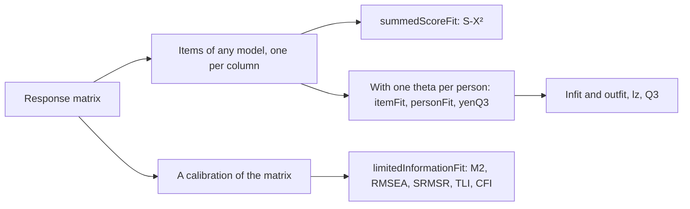
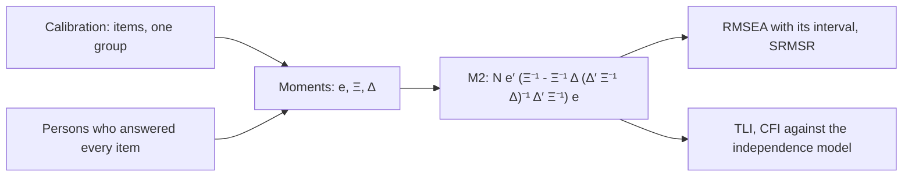

# Item and person fit

`@measurekit/psychometrics/fit` checks how well items and persons fit an [IRT model](irt.md): Rasch infit and
outfit, the S-X² item fit statistic, the lz person fit statistic, Yen's Q3 for local dependence, and the fit of a whole
calibration by M2, M2* and C2 with RMSEA, SRMSR, TLI and CFI. Each is validated against eRm or mirt
([validation](validation.md)).



## Inputs

Every function takes a [response matrix](data.md) and its items, one per column, of any model, such as a
calibration's `items`. The residual statistics also take one theta per person, finite, from any estimator; the
references use maximum likelihood estimates for Rasch items (eRm) and EAP estimates otherwise (mirt).
`limitedInformationFit` takes the calibration itself, whose group it integrates over.

| Function                                        | Result per                    | Persons used                                                |
| ----------------------------------------------- | ----------------------------- | ----------------------------------------------------------- |
| `itemFit(matrix, items, thetas)`                | item: `ItemFit`               | Persons without an extreme score; missing responses skipped |
| `personFit(matrix, items, thetas)`              | person: `PersonFit`           | Each person's answered items                                |
| `summedScoreFit(matrix, items)`                 | item: `SummedScoreFit`        | Persons who answered every item                             |
| `yenQ3(matrix, items, thetas)`                  | pair of items: a matrix entry | For each pair, the persons who answered both                |
| `limitedInformationFit(matrix, calibration, …)` | test: `LimitedInformationFit` | Persons who answered every item                             |

An extreme score has every answered response in its item's lowest category, or every one in its highest; its maximum
likelihood theta is infinite. A statistic undefined for the data is `null`.

```ts
import { responseMatrix } from "@measurekit/psychometrics/data";
import { itemFit, personFit, summedScoreFit, yenQ3 } from "@measurekit/psychometrics/fit";
import {
  calibrate,
  jointMaximumLikelihood,
  logNormalPrior,
  posteriorMeanEstimate,
  twoParameterLogistic,
  weightedLikelihoodEstimate,
} from "@measurekit/psychometrics/irt";

const matrix = responseMatrix([
  [1, 0, 1, 1],
  [0, 0, 1, 0],
  [1, 1, 1, 1],
  [0, 1, 0, 0],
  [1, 1, 0, 1],
  [0, 0, 0, 1],
  [1, 0, 1, 0],
  [1, 1, 1, 0],
]);

// Rasch items and their persons: infit and outfit.
const rasch = jointMaximumLikelihood(matrix);
const raschThetas = matrix.responses.map((row) => weightedLikelihoodEstimate(rasch.items, row).theta);
itemFit(matrix, rasch.items, raschThetas); // [{ id, infitMeanSquare, outfitMeanSquare, ... }, ...]

// Items of any model: S-X², lz and Q3. With few persons, a prior keeps the slopes finite.
const { items } = calibrate(matrix, { model: twoParameterLogistic, priors: { a: logNormalPrior(0, 0.5) } });
const thetas = matrix.responses.map((row) => posteriorMeanEstimate(items, row).theta);
summedScoreFit(matrix, items); // [{ id, chiSquare, degreesOfFreedom, significance }, ...]
personFit(matrix, items, thetas); // [{ id, ..., standardizedLogLikelihood }, ...]
yenQ3(matrix, items, thetas); // 4 × 4, symmetric, 1 on the diagonal
```

## Infit and outfit

For a response x at the person's theta, with E = Σ k P_k the expected score, W = Σ (k - E)² P_k its variance and
C = Σ (k - E)⁴ P_k its fourth central moment (Wright and Masters, 1982):

| Field                | Definition                                                                                |
| -------------------- | ----------------------------------------------------------------------------------------- |
| `outfitMeanSquare`   | The mean of (x - E)² / W over n responses: sensitive to unexpected responses far off      |
| `infitMeanSquare`    | Σ (x - E)² / Σ W: weighted by information, sensitive to responses near the person's level |
| `outfitStandardized` | (MS^(1/3) - 1)(3 / q) + q / 3, q² = Σ (C / W²) / n² - 1 / n (Wilson-Hilferty, ZSTD)       |
| `infitStandardized`  | The same with q² = Σ (C - W²) / (Σ W)²                                                    |

Mean squares near 1 fit. Above 1, responses are noisier than the model predicts; below 1, more predictable. The
standardized values are about N(0, 1) under fit. `itemFit` sums over persons, as eRm's `itemfit`; `personFit` over
items, as eRm's `personfit`, and gives `null` mean squares to persons with an extreme score. Both work for items of any
model, and are meant for the Rasch model and the partial credit models.

## S-X²

`summedScoreFit` computes Orlando and Thissen's (2000) S-X², in Kang and Chen's (2008) form for polytomous items, as
mirt's `itemfit(fit_stats = "S_X2")`:

1. Group the persons by total score s, from 1 to the highest score less 1. O(s, k) counts the persons of group s in
   category k of the item.
2. The expected count is N_s P(X = k | S = s): the integral over theta ~ N(0, 1) of P_k(θ) times the probability of a
   total of s - k on the other items, over the integral of the probability of s on all items. The totals' probabilities
   come from the recursion of Lord and Wingersky (1984), integrated with 61 rectangular points.
3. Collapse the table as mirt 1.48 does, to expected counts of at least 1: merge score groups with impossible cells
   into their neighbors, drop groups without persons, merge groups of one person into the next; for polytomous items,
   merge small categories within a group and rare last categories; then merge each group with a count between 0 and 1
   into a neighbor.
4. S-X² = Σ (O - E)² / E over the cells left, with cells - groups - parameters degrees of freedom; `null` when none
   are left.

The degrees of freedom count every parameter of the item's model as estimated, so for anchor items, which were not
estimated, they are too few by the anchor's parameters.

## lz

`standardizedLogLikelihood` in `PersonFit` is Drasgow, Levine and Williams's (1985) lz for items of any model, as
mirt's `personfit` computes `Zh`. With l0 = Σ ln P(x) over the answered items:

- E(l0) = Σ_i Σ_k P_ik ln P_ik;
- Var(l0) = Σ_i Σ_(k < h) P_ik P_ih (ln P_ik - ln P_ih)², a sum of non-negative terms;
- lz = (l0 - E(l0)) / √Var(l0), `null` when the variance is 0.

lz is about N(0, 1) under fit at the true theta; large negative values flag unexpected patterns.

## Yen's Q3

`yenQ3` correlates the residuals x - E(x | θ) of each pair of items over persons (Yen, 1984), as mirt's
`residuals(type = "Q3")`. Under local independence Q3 is near -1 / (k - 1) for k items; pairs well above the average
Q3 suggest dependence, as items sharing a stimulus.

## Limited-information fit

`limitedInformationFit` tests a calibration on the first- and second-order margins of its test, where a test of all
response patterns has no power: the table of patterns is too sparse for a chi-square.



e holds the residuals of the moments, Ξ their covariance matrix and Δ their Jacobian. `M2` is about chi-square on the
moments less the parameters when the model holds.

| `statistic` | First-order moments            | Takes                       | Source                  |
| ----------- | ------------------------------ | --------------------------- | ----------------------- |
| `"m2-star"` | The mean score of each item    | Ordered items of any number | Cai and Hansen (2013)   |
| `"m2"`      | The share correct of each item | Dichotomous items           | Maydeu-Olivares and Joe |
| `"c2"`      | The share in each category     | Ordered items of any number | Cai and Monroe (2014)   |

Each adds the mean product of the scores of each pair of items. On dichotomous items the three are equal.

| Option      | Meaning                                                       | Default     |
| ----------- | ------------------------------------------------------------- | ----------- |
| `statistic` | The statistic above                                           | `"m2-star"` |
| `fixed`     | The ids of the calibration's anchors, which add no parameters | none        |
| `level`     | The level of the RMSEA interval                               | `0.9`       |

| Field              | Definition                                                                                        |
| ------------------ | ------------------------------------------------------------------------------------------------- |
| `statistic`        | M2, M2* or C2; `null` without degrees of freedom, or when Ξ or Δ′ Ξ⁻¹ Δ is not positive definite  |
| `degreesOfFreedom` | The moments less the estimated parameters, those of the distribution of theta included            |
| `significance`     | The upper tail of the chi-square                                                                  |
| `rmsea`            | √(max(0, χ² / df - 1) / (N - 1))                                                                  |
| `rmseaInterval`    | √(λ / (N df)) at the two noncentralities that place χ² at the tails of `level`; 0 where none does |
| `srmsr`            | The root mean square over the pairs of the sample correlation less the model's                    |
| `tli`              | (χ²₀/df₀ - χ²/df) / (χ²₀/df₀ - 1), which can pass 1                                               |
| `cfi`              | 1 - (χ² - df) / (χ²₀ - df₀), held to [0, 1]                                                       |

TLI and CFI compare the model with the independence model, which holds each item at its observed shares and has no
trait. Its χ²₀ is N Σ_(i<j) r_ij², the form the statistic takes there, on df₀ = J (J - 1) / 2. Both are `null` when
χ²₀ is not above χ², as mirt leaves them.

```ts
import {
  calibrate,
  createRandom,
  limitedInformationFit,
  simulateItems,
  simulateResponses,
  simulateThetas,
  twoParameterLogistic,
} from "@measurekit/psychometrics";

const random = createRandom(7);
const items = simulateItems(twoParameterLogistic, 12, random);
const matrix = simulateResponses(items, simulateThetas(1000, random), random);
const fit = limitedInformationFit(matrix, calibrate(matrix, { model: twoParameterLogistic }));
fit.statistic; // 39.90
fit.degreesOfFreedom; // 54
fit.significance; // 0.92
fit.srmsr; // 0.021
```

The population is the calibration's group, with its nodes and weights. Δ has one column for each estimated parameter:

| Parameter                                                           | Columns of Δ                                          |
| ------------------------------------------------------------------- | ----------------------------------------------------- |
| An item's own                                                       | One, from the model's `parameterDerivatives`          |
| One the items of a model share, as the 1PL's `a` or the RSM's steps | One, the sum of the items' columns                    |
| An anchor's                                                         | None                                                  |
| The mean and SD of an estimated normal group                        | Two, from the derivatives of the weights of the nodes |

The estimated parameters must equal those in the calibration's AIC. A `Calibration` does not record its anchors, so
give their ids in `fixed`. The check catches a list of the wrong size; a list of the right size that swaps anchors for
estimated items of the same model passes and gives a wrong Δ. The moments are unweighted: each person counts once.

Ξ grows with the fourth power of the items, so the function takes 60 at most: 1,830 rows and 27 MB, and a call took 0.6
s here for M2* and 0.9 s for C2. At 12 items and 2,000 persons a call takes about 5 ms, against 38 ms for mirt's `M2`.

## Errors

Invalid input throws `DataError` naming the value found.

| Error                                                | What to do                                                               |
| ---------------------------------------------------- | ------------------------------------------------------------------------ |
| The items or the thetas do not match the matrix      | Give one item for each column and one finite theta for each person       |
| A response is not a category of its item             | Calibrate the item on these data, or give it the categories the data use |
| `summedScoreFit` when no person answered every item  | Use `itemFit`, which works from the answered items of each person        |
| Several groups, covariates, testlets, or a histogram | Calibrate one group of a normal distribution; each group alone is a fit  |
| More than 60 items                                   | Test a part of the form, or use `summedScoreFit` for each item           |
| `"m2"` with a polytomous item                        | Use `"m2-star"` or `"c2"`                                                |
| A nominal item                                       | Its categories have no order for the mean products to read               |
| Parameters that differ from the calibration's AIC    | Give the anchors' ids in `fixed`                                         |
| Fewer than two persons who answered every item       | Calibrate and test the persons with complete responses                   |

## Differences from the references

| Topic                         | This package                                                | Reference                                                                                                |
| ----------------------------- | ----------------------------------------------------------- | -------------------------------------------------------------------------------------------------------- |
| Missing responses             | Infit and outfit skip them in every sum                     | eRm's infit sums W over every person                                                                     |
| Small probabilities           | ln P of an observed category clamped at the smallest double | mirt's `personfit` counts an observed category with P below 2.2e-16 as P = 1                             |
| Person mean squares           | As eRm                                                      | mirt's `personfit` raises W² below 1e-5 to 1e-5 and caps q at 1.4142                                     |
| S-X² degrees of freedom       | Every parameter of the model                                | mirt: the freely estimated parameters                                                                    |
| An empty S-X² table           | `null` for the item                                         | mirt stops collapsing the remaining items                                                                |
| M2 of an estimated group      | Δ has the group's columns, which the df counts              | mirt's Δ leaves them out, while its df counts them, and its M2 is 0.1 higher on the fixtures' 12 items   |
| M2 of a GPCM or PCM           | The derivative of the model                                 | mirt's derivative with respect to a `gpcm` slope is wrong, so its M2 and C2 of these models are off      |
| M2* of the independence model | The closed form, on J (J - 1) / 2 df, on polytomous items   | mirt's Δ has rank J below its columns, so its value changes with the order of the items: 238.6 and 257.6 |
| Missing responses in M2       | The persons who answered every item                         | mirt: each moment from the persons who answered its items                                                |

## Not included

- **M2 for several groups.** Outside the sources: an option of mirt; `limitedInformationFit` takes one population.
- **M2 with covariates, testlets or an empirical histogram.** Outside the sources: options of mirt; the normal population
  is the practice.
- **Fit on two- and three-way margins.** Outside the sources: `limitedInformationFit` is the practice.
