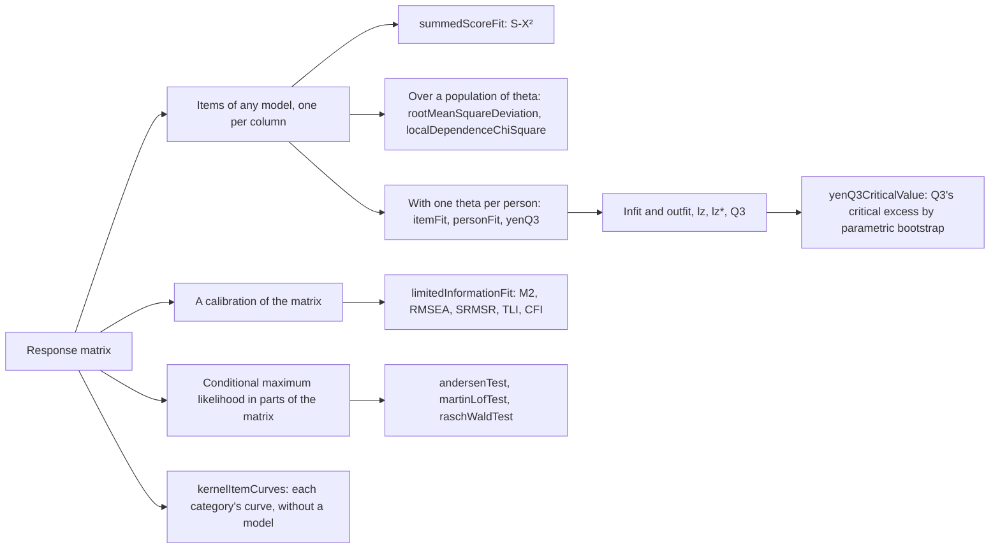
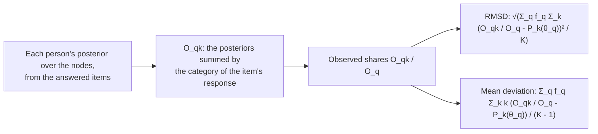
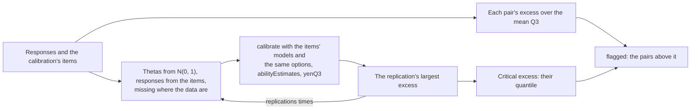
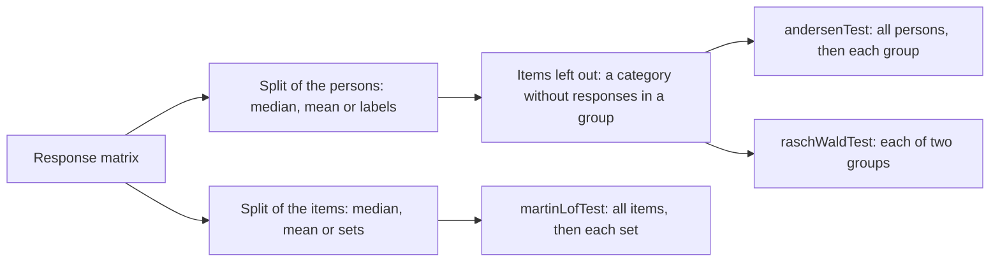
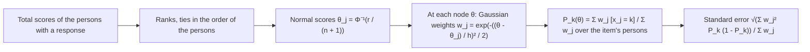

# Item and person fit

`@measurekit/psychometrics/fit` checks how well items and persons fit an [IRT model](irt.md): Rasch infit and
outfit, the S-X² item fit statistic, the RMSD of items, the lz person fit statistic and Snijders' lz*, Yen's Q3 with its
critical value by parametric bootstrap and Chen and Thissen's
chi-square for local dependence, the fit of a whole calibration by M2, M2* and C2 with RMSEA, SRMSR, TLI and CFI,
the Andersen, Martin-Löf and Wald tests of the Rasch family, and kernel-smoothed item curves to inspect an item's shape.
Each is validated against eRm, mirt, TAM, PerFit or KernSmoothIRT ([validation](validation.md)).



## Quick start

Test the fit of Rasch and 2PL items, and of the persons, on eight persons:

```ts
import { buildResponseMatrix } from "@measurekit/psychometrics/data";
import { itemFit, personFit, summedScoreFit, yenQ3 } from "@measurekit/psychometrics/fit";
import {
  calibrate,
  jointMaximumLikelihood,
  logNormalPrior,
  posteriorMeanEstimate,
  twoParameterLogistic,
  weightedLikelihoodEstimate,
} from "@measurekit/psychometrics/irt";

const matrix = buildResponseMatrix([
  [1, 0, 1, 1],
  [0, 0, 1, 0],
  [1, 1, 1, 1],
  [0, 1, 0, 0],
  [1, 1, 0, 1],
  [0, 0, 0, 1],
  [1, 0, 1, 0],
  [1, 1, 1, 0],
]);

// Rasch items and their persons: infit and outfit.
const rasch = jointMaximumLikelihood(matrix);
const raschThetas = matrix.responses.map((row) => weightedLikelihoodEstimate(rasch.items, row).theta);
itemFit(matrix, rasch.items, raschThetas); // => [{ id: "item1", infitMeanSquare: 0.50, outfitMeanSquare: 0.48, ... }, ...]

// Items of any model: S-X², lz and Q3. With few persons, a prior keeps the slopes finite.
const { items } = calibrate(matrix, { model: twoParameterLogistic, priors: { a: logNormalPrior(0, 0.5) } });
const thetas = matrix.responses.map((row) => posteriorMeanEstimate(items, row).theta);
summedScoreFit(matrix, items);
// => [{ id: "item1", chiSquare: null, degreesOfFreedom: 0, significance: null }, ...]: these few persons leave no
//    score group to test
personFit(matrix, items, thetas); // => [{ id: "person1", ..., standardizedLogLikelihood: 0.78 }, ...]
yenQ3(matrix, items, thetas); // => [[1, 0.03, 0.32, 0.03], [0.03, 1, -0.45, -0.17], ...]: 4 × 4, symmetric
```

## Inputs

Every function takes a [response matrix](data.md) and its items, one per column, of any model, such as a
calibration's `items`. The residual statistics also take one theta per person, finite, from any estimator; the
references use maximum likelihood estimates for Rasch items (eRm) and EAP estimates otherwise (mirt).
`rootMeanSquareDeviation` and `localDependenceChiSquare` integrate over a population of theta, the option
`population`, N(0, 1) on 61 rectangular points from -6 to 6 by default: give a calibration's group at its nodes when it
is not standard normal. `limitedInformationFit` takes the calibration itself, whose group it integrates over. The Rasch tests take the matrix
alone, as they estimate the items themselves, and so do the kernel curves, which assume no model.

| Function                                        | Result per                    | Persons used                                                |
| ----------------------------------------------- | ----------------------------- | ----------------------------------------------------------- |
| `itemFit(matrix, items, thetas)`                | item: `ItemFit`               | Persons without an extreme score; missing responses skipped |
| `personFit(matrix, items, thetas)`              | person: `PersonFit`           | Each person's answered items                                |
| `correctedPersonFit(matrix, items, thetas, …)`  | person: `CorrectedPersonFit`  | Each person's answered items; none of an extreme score      |
| `summedScoreFit(matrix, items)`                 | item: `SummedScoreFit`        | Persons who answered every item                             |
| `yenQ3(matrix, items, thetas)`                  | pair of items: a matrix entry | For each pair, the persons who answered both                |
| `yenQ3CriticalValue(matrix, items, random, …)`  | test: `Q3CriticalValue`       | As `yenQ3`; each replication misses the same responses      |
| `rootMeanSquareDeviation(matrix, items, …)`     | item: `ItemDeviation`         | Persons with a response                                     |
| `localDependenceChiSquare(matrix, items, …)`    | pair: `LocalDependencePair`   | For each pair, the persons who answered both                |
| `limitedInformationFit(matrix, calibration, …)` | test: `LimitedInformationFit` | Persons who answered every item                             |
| `andersenTest(matrix, options)`                 | test: `AndersenTest`          | Those of conditional maximum likelihood                     |
| `raschWaldTest(matrix, options)`                | item: `RaschWaldItem`         | Those of conditional maximum likelihood                     |
| `martinLofTest(matrix, options)`                | test: `RaschTest`             | Persons who answered every item                             |
| `kernelItemCurves(matrix, options)`             | item: `KernelItemCurve`       | Persons with a response; for an item, those who answered it |

An extreme score has every answered response in its item's lowest category, or every one in its highest; its maximum
likelihood theta is infinite. A statistic undefined for the data is `null`.

## Infit and outfit

For a response x at the person's theta, with E = Σ k P_k the expected score, W = Σ (k - E)² P_k its variance and
C = Σ (k - E)⁴ P_k its fourth central moment (Wright and Masters, 1982):

| Field                | Definition                                                                                |
| -------------------- | ----------------------------------------------------------------------------------------- |
| `outfitMeanSquare`   | The mean of (x - E)² / W over n responses: sensitive to unexpected responses far off      |
| `infitMeanSquare`    | Σ (x - E)² / Σ W: weighted by information, sensitive to responses near the person's level |
| `outfitStandardized` | (MS^(1/3) - 1)(3 / q) + q / 3, q² = Σ (C / W²) / n² - 1 / n (Wilson-Hilferty, ZSTD)       |
| `infitStandardized`  | The same with q² = Σ (C - W²) / (Σ W)²                                                    |

Mean squares near 1 fit. Above 1, responses are noisier than the model predicts; below 1, more predictable. The
standardized values are about N(0, 1) under fit. `itemFit` sums over persons, as eRm's `itemfit`; `personFit` over
items, as eRm's `personfit`, and gives `null` mean squares to persons with an extreme score. Both work for items of any
model, and are meant for the Rasch model and the partial credit models.

## S-X²

`summedScoreFit` computes Orlando and Thissen's (2000) S-X², in Kang and Chen's (2008) form for polytomous items, as
mirt's `itemfit(fit_stats = "S_X2")`:

1. Group the persons by total score s, from 1 to the highest score less 1. O(s, k) counts the persons of group s in
   category k of the item.
2. The expected count is N_s P(X = k | S = s): the integral over theta ~ N(0, 1) of P_k(θ) times the probability of a
   total of s - k on the other items, over the integral of the probability of s on all items. The totals' probabilities
   come from the recursion of Lord and Wingersky (1984), integrated with 61 rectangular points.
3. Collapse the table as mirt 1.48 does, to expected counts of at least 1: merge score groups with impossible cells
   into their neighbors, drop groups without persons, merge groups of one person into the next; for polytomous items,
   merge small categories within a group and rare last categories; then merge each group with a count between 0 and 1
   into a neighbor.
4. S-X² = Σ (O - E)² / E over the cells left, with cells - groups - parameters degrees of freedom; `null` when none
   are left.

The parameters are those the calibration estimated, as mirt's: the `estimated` names of a calibrated item, so none of an
anchor's and not its [held parameters](irt.md#held-parameters), and every parameter of the model for an item without
`estimated`.

For each item the recursion sums the scores of the other items at every node, which costs the items times the square of
the highest total score, so `summedScoreFit` takes items of a highest total score of at most 300: 300 dichotomous items,
or 75 of five categories, take 2 to 3 s, where 600 dichotomous items took 17 s.

## RMSD

`rootMeanSquareDeviation` compares each item's curve with its observed shares at the nodes of the population, as TAM's
`IRT.RMSD` (Oliveri and von Davier, 2014).



f_q is the mean posterior of the persons with a response, the distribution of theta in the sample, and K the item's
categories. The RMSD is near 0 when the item fits, and does not grow with the persons as a chi-square does. The mean
deviation is signed: positive when the persons score higher than the item's curve expects. Both are `null` for an item
no person answered.

```ts
import {
  calibrate,
  createRandom,
  localDependenceChiSquare,
  rootMeanSquareDeviation,
  simulateItems,
  simulateResponses,
  simulateThetas,
  twoParameterLogistic,
} from "@measurekit/psychometrics";

const random = createRandom(11);
const items = simulateItems(twoParameterLogistic, 6, random);
const matrix = simulateResponses(items, simulateThetas(1000, random), random);
const calibration = calibrate(matrix, { model: twoParameterLogistic });
rootMeanSquareDeviation(matrix, calibration.items)[0]; // => { id: "item1", rmsd: 0.0020, meanDeviation: -2.7e-7 }
localDependenceChiSquare(matrix, calibration.items)[0];
// => { items: ["item1", "item2"], chiSquare: 0.041, degreesOfFreedom: 1, significance: 0.84, cramersV: -0.0064 }
```

On 2,000 seeded persons and 10 2PL items, an item given 1 logit harder than its responses has an RMSD above 0.1, and
the others below 0.05.

## lz

`standardizedLogLikelihood` in `PersonFit` is Drasgow, Levine and Williams's (1985) lz for items of any model, as
mirt's `personfit` computes `Zh`. With l0 = Σ ln P(x) over the answered items:

- E(l0) = Σ_i Σ_k P_ik ln P_ik;
- Var(l0) = Σ_i Σ_(k < h) P_ik P_ih (ln P_ik - ln P_ih)², a sum of non-negative terms;
- lz = (l0 - E(l0)) / √Var(l0), `null` when the variance is 0.

lz is about N(0, 1) under fit at the true theta; large negative values flag unexpected patterns.

### lz*

At an estimated theta lz is not N(0, 1): its variance shrinks, to 0.91 on the simulation below. `correctedPersonFit`
gives Snijders' (2001) lz* of dichotomous items, which corrects for the estimate, as PerFit's `lzstar`. The Smarter
Balanced technical reports of South Dakota and Connecticut flag students by lz in data forensics, citing Snijders for
its null distribution.

| Option      | Default                | Meaning                                                                                                  |
| ----------- | ---------------------- | -------------------------------------------------------------------------------------------------------- |
| `estimator` | `"maximum-likelihood"` | The estimator of the thetas given: `"maximum-likelihood"`, `"weighted-likelihood"` or `"posterior-mode"` |
| `prior`     | N(0, 1)                | The prior of `"posterior-mode"`, `{ mean, sd }`, as the estimator took it                                |

With P the probability of a correct response at the person's theta, Q = 1 - P, P' and P'' its derivatives,
w = ln(P / Q) and r = P' / (P Q), over the answered items:

- W = Σ (x - P) w, c = Σ P' w / Σ P' r, and w̃ = w - c r;
- r₀ = 0 for maximum likelihood, Σ P' P'' / (P Q) over 2 Σ P'² / (P Q) for Warm's weighted likelihood, and (μ - θ) / σ²
  for the posterior mode under N(μ, σ²);
- lz* = (W + c r₀) / √(Σ w̃² P Q), `null` for an extreme score or without variance.

```ts
import { correctedPersonFit } from "@measurekit/psychometrics/fit";
import {
  createRandom,
  simulateItems,
  simulateResponses,
  simulateThetas,
  twoParameterLogistic,
  weightedLikelihoodEstimate,
} from "@measurekit/psychometrics";

// The simulation of the Mokken guide's Guttman errors: 8 2PL items, 400 persons, at Warm's estimates.
const random = createRandom(11);
const items = simulateItems(twoParameterLogistic, 8, random);
const matrix = simulateResponses(items, simulateThetas(400, random), random);
const thetas = matrix.responses.map((row) => weightedLikelihoodEstimate(items, row).theta);
const fit = correctedPersonFit(matrix, items, thetas, { estimator: "weighted-likelihood" });
fit[0]; // => { id: "person1", standardized: 1.20 }
fit[217]; // => { id: "person218", standardized: -2.66 }: that guide's outlier
```

On 5,000 seeded persons and 30 2PL items that fit, at their maximum likelihood estimates, lz* has a standard deviation of
0.998 where lz has 0.914; its mean is 0.098, falling as items are added, to 0.073 at 60 and 0.045 at 100, as the
correction is of the first order. The mean is that of Snijders' correction, not of this implementation: PerFit's
`lzstar` gives the same values, to its 4 decimals ([validation](validation.md)). The nonparametric indices normed G, U3 and Ht are in [mokken](mokken.md#person-fit).

## Local dependence

`yenQ3` correlates the residuals x - E(x | θ) of each pair of items over persons (Yen, 1984), as mirt's
`residuals(type = "Q3")`. Under local independence Q3 is near -1 / (k - 1) for k items; pairs well above the average
Q3 suggest dependence, as items sharing a stimulus.

`localDependenceChiSquare` tests each pair without thetas, as mirt's `residuals(type = "LD")` (Chen and Thissen,
1997). The persons who answered both items fill the table of their categories, O, against the table the model expects
under local independence:

| Field              | Definition                                                                                                   |
| ------------------ | ------------------------------------------------------------------------------------------------------------ |
| `chiSquare`        | Σ (O - E)² / E, with E_kl = n Σ_q w_q P_k(θ_q) P_l(θ_q) over the population; `null` without persons          |
| `degreesOfFreedom` | (K₁ - 1)(K₂ - 1)                                                                                             |
| `significance`     | The upper tail of the chi-square                                                                             |
| `cramersV`         | √(χ² / (n (min(K₁, K₂) - 1))), negative when the observed gamma is below the expected one; `null` without it |

The pairs come in item order: the first item with each later one, then the second. A pair whose items agree more than
the model expects, as items that share a stimulus, has a large chi-square and a positive V.

Both statistics give every pair of items, so each takes at most 1,000 items, the limit of the analyses of pairs of items
in [dimensionality](dimensionality.md#correlations): at that limit `localDependenceChiSquare` returns 499,500 pairs, about
200 MB, and `yenQ3` a matrix of a million entries ([peak memory](performance.md#memory)). Their time grows with
the pairs times the persons. The tables of `localDependenceChiSquare` hold a cell for each pair of categories of each
pair of items, at most 2^24 cells in all: two items of 4,096 categories, or 579 items of 10, which take about a second
and, for the two items, 260 MB.

### Critical value of Q3

Under local independence Q3 is near -1 / (k - 1) on average, and its spread depends on the persons, the items and the
model, so no fixed cut such as 0.2 suits every data set (Christensen, Makransky and Horton, 2017).
`yenQ3CriticalValue(matrix, items, random, options)` compares each pair's excess, its Q3 less the mean Q3 of the
pairs, with a critical excess from a parametric bootstrap of the calibration of `items`:



```ts
import { createRandom } from "@measurekit/psychometrics";
import { buildResponseMatrix } from "@measurekit/psychometrics/data";
import { yenQ3CriticalValue } from "@measurekit/psychometrics/fit";
import { calibrate, twoParameterLogistic } from "@measurekit/psychometrics/irt";
import { simulateItems, simulateResponses, simulateThetas } from "@measurekit/psychometrics/sim";

// 1,000 persons answer 12 items; items 1 to 3 share a passage, which moves each person's theta for them by N(0, 1.5²).
const random = createRandom(2026);
const items = simulateItems(twoParameterLogistic, 12, random);
const thetas = simulateThetas(1000, random);
const passage = simulateResponses(
  items.slice(0, 3),
  thetas.map((theta) => theta + 1.5 * random.normal()),
  random,
);
const others = simulateResponses(items.slice(3), thetas, random);
const matrix = buildResponseMatrix(
  others.responses.map((row, person) => [...(passage.responses[person] ?? []), ...row]),
);

// The calibration takes the items as independent; the bootstrap repeats it with the items' models.
const fit = calibrate(matrix, { model: twoParameterLogistic });
const q3 = yenQ3CriticalValue(matrix, fit.items, createRandom(1), { replications: 100 });
q3.criticalExcess; // => 0.115
q3.flagged.map((pair) => pair.items); // => [["item2", "item3"], ["item1", "item2"], ["item1", "item3"]]
q3.flagged.map((pair) => pair.q3); // => [0.070, 0.068, 0.066]: the fixed cut 0.2 flags none
```

`items` are the calibration's, in the order of the matrix, with their ids; each replication is calibrated with their
models, and `options` hold the calibration's other options: `fixed`, `fixedParameters`, `priors`, `itemPriors`,
`quadrature`, `tolerance` and `maxIterations`. A
calibration with groups, a latent regression, testlets or person weights is not bootstrapped: thetas are drawn from the
standard normal, and Q3 tests the local independence that testlets model.

| Option         | Default                 | Meaning                                                                                                  |
| -------------- | ----------------------- | -------------------------------------------------------------------------------------------------------- |
| `replications` | `40`                    | Replications, each a calibration                                                                         |
| `quantile`     | `0.95`                  | The quantile of the replications' largest excesses that is the critical excess, by R's default (type 7)  |
| `maxRedraws`   | `40`                    | The most draws thrown away because an estimated item lacks a category; past them the bootstrap stops     |
| `slopeLimit`   | `4`                     | The largest slope `a` of an item tested; the pairs of a steeper item are left out and the item is listed |
| `estimator`    | `posteriorMeanEstimate` | The estimate of each person's theta for the residuals, as `abilityEstimates` takes it                    |

| Field                     | Meaning                                                                                                          |
| ------------------------- | ---------------------------------------------------------------------------------------------------------------- |
| `criticalExcess`          | The `quantile` of the replications' largest excesses; `null` without a replication or two items tested           |
| `meanQ3`, `flagged`       | The observed mean Q3 of the pairs tested, and the pairs whose excess is above the critical excess, largest first |
| `largestExcesses`         | Each replication's largest excess, in the order drawn                                                            |
| `replications`            | The replications used: fewer than asked when the redraws ran out                                                 |
| `redrawn`, `notConverged` | The draws thrown away, and the replications whose calibration stopped at `maxIterations`                         |
| `nearDeterministic`       | The items whose slope is above `slopeLimit`                                                                      |

- **The statistic.** The quantile of each replication's largest excess, Christensen, Makransky and Horton's Q3*, holds
  the chance of any false flag among the pairs near 1 - `quantile`. For one pair named before the data, they compare its
  Q3 with a percentile of that pair's own null distribution, which this function does not give: `yenQ3`,
  `simulateResponses` and `calibrate` make the replications.
- **Replications.** Each costs a calibration, an estimate of each person's theta and Q3: 100 replications of the
  example take about 2 seconds. The quantile of 40 replications has a Monte Carlo error of its own; a decision near the
  critical excess takes more, as the example's 100.
- **Redraws.** A draw in which an item that the calibration estimates lacks a response in one of its categories cannot
  be calibrated as the data were, so it is drawn again; an item in `fixed` needs none.
- **Near-deterministic items.** Where responses depend on theta almost alone, as parts of a task that one action
  decides, the fitted slopes grow very large; the residuals are near 0 for most persons, Q3 rests on the few others,
  and the replications' largest excess spreads toward 1. In 500 persons with two such parts, whose slopes reach 175,
  the critical excess is 1.02 without the limit and flags nothing; with it, the parts are listed and the other ten
  items' critical excess is 0.126. Declare such parts a testlet (`calibrate`'s `testlets`) rather than testing their
  dependence. The default 4 is a labeled default: the calibrations of SAT12, LSAT7 and Science in the fixtures reach
  slopes of 2.3.
- **A pair or a testlet.** The rule flags pairs; the mean excess of a testlet's pairs, from `yenQ3` and `meanQ3`, against
  the same critical excess judges a testlet as a whole.

## Limited-information fit

`limitedInformationFit` tests a calibration on the first- and second-order margins of its test, where a test of all
response patterns has no power: the table of patterns is too sparse for a chi-square.


e holds the residuals of the moments, Ξ their covariance matrix and Δ their Jacobian. `M2` is about chi-square on the
moments less the parameters when the model holds.

| `statistic` | First-order moments            | Takes                       | Source                  |
| ----------- | ------------------------------ | --------------------------- | ----------------------- |
| `"m2-star"` | The mean score of each item    | Ordered items of any number | Cai and Hansen (2013)   |
| `"m2"`      | The share correct of each item | Dichotomous items           | Maydeu-Olivares and Joe |
| `"c2"`      | The share in each category     | Ordered items of any number | Cai and Monroe (2014)   |

Each adds the mean product of the scores of each pair of items. On dichotomous items the three are equal.

| Option      | Meaning                         | Default     |
| ----------- | ------------------------------- | ----------- |
| `statistic` | The statistic above             | `"m2-star"` |
| `level`     | The level of the RMSEA interval | `0.9`       |

Δ has a column for each parameter the calibration estimated: each item of the calibration records them in `estimated`,
so an anchor, which `calibrate`'s `fixed` holds, adds none, nor does a [held parameter](irt.md#held-parameters).

| Field              | Definition                                                                                                                                        |
| ------------------ | ------------------------------------------------------------------------------------------------------------------------------------------------- |
| `statistic`        | M2, M2* or C2; `null` without degrees of freedom, or when Ξ is not positive definite                                                              |
| `degreesOfFreedom` | The moments less the rank of Δ: the estimated parameters, those of the distribution of theta included, unless the margins leave some unidentified |
| `significance`     | The upper tail of the chi-square                                                                                                                  |
| `rmsea`            | √(max(0, χ² / df - 1) / (N - 1))                                                                                                                  |
| `rmseaInterval`    | √(λ / (N df)) at the two noncentralities that place χ² at the tails of `level`; 0 where none does                                                 |
| `srmsr`            | The root mean square over the pairs of the sample correlation less the model's                                                                    |
| `tli`              | (χ²₀/df₀ - χ²/df) / (χ²₀/df₀ - 1), which can pass 1                                                                                               |
| `cfi`              | 1 - (χ² - df) / (χ²₀ - df₀), held to [0, 1]                                                                                                       |

TLI and CFI compare the model with the independence model, which holds each item at its observed shares and has no
trait. Its χ²₀ is N Σ_(i<j) r_ij², the form the statistic takes there, on df₀ = J (J - 1) / 2. Both are `null` when
χ²₀ is not above χ², as mirt leaves them.

```ts
import {
  calibrate,
  createRandom,
  limitedInformationFit,
  simulateItems,
  simulateResponses,
  simulateThetas,
  twoParameterLogistic,
} from "@measurekit/psychometrics";

const random = createRandom(7);
const items = simulateItems(twoParameterLogistic, 12, random);
const matrix = simulateResponses(items, simulateThetas(1000, random), random);
const fit = limitedInformationFit(matrix, calibrate(matrix, { model: twoParameterLogistic }));
fit.statistic; // => 39.90
fit.degreesOfFreedom; // => 54
fit.significance; // => 0.92
fit.srmsr; // => 0.021
```

The population is the calibration's group, with its nodes and weights. Δ has one column for each estimated parameter:

| Parameter                                                           | Columns of Δ                                          |
| ------------------------------------------------------------------- | ----------------------------------------------------- |
| An item's own                                                       | One, from the model's `parameterDerivatives`          |
| One the items of a model share, as the 1PL's `a` or the RSM's steps | One, the sum of the items' columns                    |
| An anchor's, and one `fixedParameters` holds                        | None                                                  |
| The mean and SD of an estimated normal group                        | Two, from the derivatives of the weights of the nodes |

The estimated parameters must equal those in the calibration's AIC. A `Calibration` does not record its anchors or its
held parameters, so give the anchors' ids in `fixed` and the held parameters in `fixedParameters`. The check catches
lists of the wrong size; lists of the right size that swap anchors or held parameters for estimated ones pass and give
a wrong Δ. The moments are unweighted: each person counts once, also
for a calibration with [person weights](irt.md#person-weights), whose weights they do not read.

Where the first- and second-order margins do not identify every parameter, Δ's rank is below its columns. The statistic
then uses the whole complement of Δ's span, a column that adds nothing to it is left out, and the degrees of freedom
are the moments less the rank. No model of the fixtures has such a Δ; the diagnosis models of [cdm](cdm.md#model-and-item-fit)
can.

Ξ grows with the fourth power of the items, so the function takes 60 at most: 1,830 rows and 27 MB, and a call took 0.6
s here for M2* and 0.9 s for C2. C2 adds a row for each category above an item's second, so it takes at most the 1,830
moments of 60 dichotomous items: 60 items of 21 categories, 2,970 rows, took 23 s, and items of a thousand would take
gigabytes. At 12 items and 2,000 persons a call takes about 5 ms, against 38 ms for mirt's `M2`.

## Rasch tests

The tests of eRm for the Rasch model, the partial credit model and the rating scale model. Each estimates the model by
[conditional maximum likelihood](irt.md#conditional-maximum-likelihood) in parts of the matrix, which conditioning on
the total score makes free of the distribution of theta, so that parts may differ in ability.



| Function        | Tests that                                   | Statistic                                                                                                      |
| --------------- | -------------------------------------------- | -------------------------------------------------------------------------------------------------------------- |
| `andersenTest`  | The item parameters are equal in every group | 2 (Σ ln L_group - ln L_all), chi-square on the groups' parameters less those of all (Andersen, 1973)           |
| `raschWaldTest` | Each item's location is equal in two groups  | z = (location₂ - location₁) / √(SE₁² + SE₂²), N(0, 1)                                                          |
| `martinLofTest` | The sets of items measure one trait          | 2 (Σ n_(r₁…r_G) ln(n_(r₁…r_G) / n) - Σ n_r ln(n_r / n) + Σ ln L_set - ln L_all), chi-square (Martin-Löf, 1973) |

L is a conditional likelihood, n the persons, n_r those of each total score and n_(r₁…r_G) those of each combination
of the sets' scores. The Martin-Löf test has the cells of the sets' scores less 1 plus the sets' parameters, less the
total scores and the parameters of all items, as degrees of freedom. An item's location is its difficulty, or the mean
of its thresholds, on the scale where the thresholds of all items sum to 0 in each group; z is positive when the item is
harder for the second group.

| Option                                | Functions                       | Meaning                                                                 | Default                    |
| ------------------------------------- | ------------------------------- | ----------------------------------------------------------------------- | -------------------------- |
| `split`                               | `andersenTest`, `raschWaldTest` | `"median"` or `"mean"` of the total score, or one label for each person | `"median"`                 |
| `split`                               | `martinLofTest`                 | `"median"` or `"mean"` of the items' totals, or two or more sets of ids | `"median"`                 |
| `model`, `tolerance`, `maxIterations` | All three                       | As `conditionalMaximumLikelihood`                                       | By the data, `1e-6`, `100` |

| Split               | Groups                                                                                                                                       |
| ------------------- | -------------------------------------------------------------------------------------------------------------------------------------------- |
| Persons, `"median"` | The lower group, at or below the median, then the upper group. With missing responses, the median of the persons who answered the same items |
| Persons, `"mean"`   | The same at the mean                                                                                                                         |
| Persons, labels     | A group for each distinct label, in sorted order: `["reference", "focal"]` makes `"focal"` the first group. `raschWaldTest` needs two        |
| Items, `"median"`   | The items whose totals over the persons who answered every item are above the median, and the others                                         |
| Items, `"mean"`     | The same at the mean                                                                                                                         |
| Items, sets         | Two or more sets of ids that hold every item once, each with at least two items                                                              |

Labels of each person's total score give eRm's `"all.r"` split, with the persons of the lowest and the highest score put
in a neighboring group, as they add nothing to a conditional likelihood.

An item with no response in one of its categories from the persons a group's conditional likelihood uses has an
infinite parameter in that group, as an item every person of the upper group answers right. It leaves the test, in
`excluded`, and every fit, of all persons too, uses the remaining items. A person's total changes without the item, so
the persons are counted again until no such item is left.

```ts
import { andersenTest, martinLofTest, raschWaldTest } from "@measurekit/psychometrics/fit";
import { createRandom, oneParameterLogistic, simulateResponses, simulateThetas } from "@measurekit/psychometrics";

const random = createRandom(7);
const items = [-1.5, -1, -0.5, 0, 0.5, 1, 1.5].map((b) => ({
  model: oneParameterLogistic,
  parameters: { a: 1, b, c: 0, d: 1 },
}));
const matrix = simulateResponses(items, simulateThetas(500, random), random);
andersenTest(matrix); // => { statistic: 6.92, degreesOfFreedom: 6, significance: 0.33, persons: 467, excluded: [], ... }
martinLofTest(matrix); // => { statistic: 7.25, degreesOfFreedom: 11, significance: 0.78, persons: 500, ... }
raschWaldTest(matrix).items[1]; // => { id: "item2", z: 1.72, significance: 0.085 }
const halves = matrix.personIds.map((_, person) => (person % 2 === 0 ? "even" : "odd"));
andersenTest(matrix, { split: halves }).statistic; // => 7.77
```

On 100 seeded sets of 500 persons and 10 Rasch items, at 0.05, Andersen's test rejected 5% of the sets, the Martin-Löf
test 1% and the Wald test 5.8% of the items; Andersen's test rejected 2PL responses with slopes from 0.4 to 2 at p
below 1e-5 on each of 5 sets.

## Kernel item curves

`kernelItemCurves` estimates the curve of each category of each item without a model, as KernSmoothIRT's `ksIRT`
(Ramsay, 1991): the shape a model's curve should have, where a 2PL may miss a dip, a plateau or a lower asymptote.



| Option      | Default                                                            | Meaning                                                                          |
| ----------- | ------------------------------------------------------------------ | -------------------------------------------------------------------------------- |
| `points`    | `51`                                                               | Nodes equally spaced from Φ⁻¹(1 / (n + 1)) to Φ⁻¹(n / (n + 1)), at least 2       |
| `bandwidth` | 1.06 n^(-1/5), Silverman's rule for scores of standard deviation 1 | The kernel's width on the scale of the normal scores: wider is smoother, flatter |

| Field            | Content                                                                                |
| ---------------- | -------------------------------------------------------------------------------------- |
| `nodes`          | The evaluation points, the same for every item                                         |
| `probabilities`  | By category, from 0 to the item's highest response, then node: the categories sum to 1 |
| `standardErrors` | Ramsay's pointwise standard error of each probability, by category, then node          |

n counts the persons with a response. A missing response adds nothing to the person's total and leaves the person
out of that item's averages. Each category up to an item's highest response needs a response; an item answered in one
category has one curve of 1. Where a narrow bandwidth would underflow every weight, the weights are taken relative to
the nearest person's, so that a node takes its nearest persons' responses.

```ts
import { kernelItemCurves } from "@measurekit/psychometrics/fit";
import {
  createRandom,
  simulateItems,
  simulateResponses,
  simulateThetas,
  twoParameterLogistic,
} from "@measurekit/psychometrics";

const random = createRandom(13);
const items = simulateItems(twoParameterLogistic, 10, random); // => [{ parameters: { a: 1.44, b: 1.28, c: 0, d: 1 }, ... }, ...]
const matrix = simulateResponses(items, simulateThetas(1000, random), random);
const [first] = kernelItemCurves(matrix, { points: 5 });
first?.nodes; // => [-3.09, -1.55, 0.00, 1.55, 3.09]
first?.probabilities[1]; // => [2.3e-13, 0.0060, 0.12, 0.65, 0.9994]: P(correct) rises through b
first?.standardErrors[1]; // => [2.3e-7, 0.0070, 0.017, 0.043, 0.011]
```

On 2,000 seeded persons and 20 2PL items with slopes from 0.5 to 2, the curves are 0.059 from the true curves at the
nodes in RMSE, where the normal scores stand for theta.

## Errors

Invalid input throws `DataError` naming the value found.

| Error                                                     | What to do                                                                              |
| --------------------------------------------------------- | --------------------------------------------------------------------------------------- |
| The items or the thetas do not match the matrix           | Give one item for each column and one finite theta for each person                      |
| A response is not a category of its item                  | Calibrate the item on these data, or give it the categories the data use                |
| `summedScoreFit` when no person answered every item       | Use `itemFit`, which works from the answered items of each person                       |
| `summedScoreFit` of a highest total score above 300       | Test a part of the form, such as each section                                           |
| Several groups, covariates, testlets, or a histogram      | Calibrate one group of a normal distribution; each group alone is a fit                 |
| More than 60 items                                        | Test a part of the form, or use `summedScoreFit` for each item                          |
| C2 of more than 1,830 moments                             | Test fewer items, or group the categories of items of many                              |
| More than 1,000 items for `yenQ3` or local dependence     | Test the pairs of a part of the items, such as those that share a stimulus              |
| Items of `yenQ3CriticalValue` without the matrix's ids    | Give the items of a calibration of the matrix, in its order                             |
| An option of the bootstrap out of its range               | Give the replications, quantile, redraws, slope limit and estimator above               |
| A calibration option a replication's `calibrate` refuses  | Give the options that the calibration of the items took                                 |
| Tables of local dependence of more than 2^24 cells        | Test fewer items, or group the categories of items of many                              |
| `"m2"` with a polytomous item                             | Use `"m2-star"` or `"c2"`                                                               |
| A nominal item                                            | Its categories have no order for the mean products to read                              |
| Parameters that differ from the calibration's AIC         | Give the anchors' ids in `fixed`                                                        |
| Fewer than two persons who answered every item            | Calibrate and test the persons with complete responses                                  |
| A split into one group                                    | Give labels of at least two groups; `raschWaldTest` takes exactly two                   |
| Fewer than two items left in a Rasch test                 | Split into fewer groups, or test more persons                                           |
| A set of the Martin-Löf test with one item                | Give sets of two or more items that hold every item once                                |
| `martinLofTest` when no person answered every item        | Test the items that the same persons answered                                           |
| A population that is not nodes with weights summing to 1  | Give finite nodes and non-negative weights that sum to 1, such as a calibration group's |
| A conditional maximum likelihood error                    | As in [irt](irt.md#conditional-maximum-likelihood): a category no person used           |
| Kernel curves of an item without a response in a category | Recode the item's categories so that each from 0 to the highest has a response          |
| Kernel curves of fewer than two persons with a response   | Give the responses of two persons or more                                               |
| lz* of an item of more than two categories                | lz* is for dichotomous items; `personFit`'s lz takes any model                          |

## Not included

| Not included                                                                         | Why                                                                                                               |
| ------------------------------------------------------------------------------------ | ----------------------------------------------------------------------------------------------------------------- |
| Nonparametric Rasch tests, RaschSampler                                              | No fit: a Monte Carlo sampler of matrices.                                                                        |
| Stepwise item elimination                                                            | No fit: a loop over `andersenTest` or `raschWaldTest`.                                                            |
| Bootstrap goodness of fit of the Rasch model                                         | No fit: a loop over `calibrate`.                                                                                  |
| eRm's `gofIRT`                                                                       | Outside the sources: an option of eRm.                                                                            |
| The G² form of local dependence                                                      | Outside the sources: an option of mirt; `localDependenceChiSquare` is Chen and Thissen's X² form.                 |
| Bias-corrected RMSD, MAD and the RMSD chi-square                                     | Outside the sources: options of CDM's `IRT.RMSD`.                                                                 |
| MADaQ3 and TAM's absolute chi-square                                                 | Outside the sources: options of TAM; `yenQ3` and SRMSR cover them.                                                |
| M2 for several groups                                                                | Outside the sources: an option of mirt; `limitedInformationFit` takes one population.                             |
| M2 with covariates, testlets or an empirical histogram                               | Outside the sources: options of mirt; the normal population is the practice.                                      |
| Fit on two- and three-way margins                                                    | Outside the sources: `limitedInformationFit` is the practice.                                                     |
| Person-fit cutoffs by simulation                                                     | No fit: a loop over `simulateResponses` and `correctedPersonFit`.                                                 |
| The Q3 bootstrap of a calibration with groups, a latent regression or person weights | Outside the sources: Christensen, Makransky and Horton bootstrap a calibration of one standard normal population. |
| Quadratic and uniform kernels                                                        | Outside the sources: options of KernSmoothIRT, whose default is the Gaussian.                                     |
| A bandwidth by cross-validation                                                      | Outside the sources: an option of KernSmoothIRT, whose default is Silverman's rule.                               |
| Kernel curves by group, for DIF                                                      | Outside the sources: an option of KernSmoothIRT; the methods of [dif](dif.md) are the practice.                   |
| X2 and G2 on groups of estimated theta                                               | No reference: mirt's flag 79% of the items of a true model at 0.05 on 30 seeded sets, where S-X² flags 6.2%.      |
| PV-Q1 and its star form                                                              | Outside the sources: options of mirt from 2017; PV-Q1 flagged 0% at 0.05 on the same sets.                        |
| X2 star and its degrees of freedom                                                   | Outside the sources: options of mirt, beside S-X².                                                                |
| Yen's Q1 with Monte Carlo p-values                                                   | Outside the sources: S-X² replaced it.                                                                            |
| Wald tests of constraints                                                            | No fit: the library has no constraint language.                                                                   |
| Lagrange tests                                                                       | No fit: the library has no constraint language.                                                                   |
| The second-order convergence test                                                    | No fit: a check of an optimizer, not of a model.                                                                  |
| Bayesian model fit                                                                   | No fit: posterior predictive checks need the draws of a sampler: general Bayesian computation.                    |

## Differences from the references

| Topic                                                  | This package                                                                                     | Reference                                                                                                                                                                                                                                          |
| ------------------------------------------------------ | ------------------------------------------------------------------------------------------------ | -------------------------------------------------------------------------------------------------------------------------------------------------------------------------------------------------------------------------------------------------- |
| The draws of the Q3 bootstrap                          | `createRandom`: other replications than mirt's                                                   | R's generator; the replications' largest excess agrees with mirt's in mean and SD within Monte Carlo error                                                                                                                                         |
| Missing responses                                      | Infit and outfit skip them in every sum                                                          | eRm's infit sums W over every person                                                                                                                                                                                                               |
| Small probabilities                                    | ln P of an observed category clamped at the smallest double                                      | mirt's `personfit` counts an observed category with P below 2.2e-16 as P = 1                                                                                                                                                                       |
| Person mean squares                                    | As eRm                                                                                           | mirt's `personfit` raises W² below 1e-5 to 1e-5 and caps q at 1.4142                                                                                                                                                                               |
| An empty S-X² table                                    | `null` for the item                                                                              | mirt stops collapsing the remaining items                                                                                                                                                                                                          |
| M2 of the Rasch model with a free variance             | Δ has the column of the variance, which the df counts                                            | mirt's Δ leaves it out, while its df counts it: 242.156, against 242.051 with the column, which equals mirt's 1PL, the same model, at 242.052                                                                                                      |
| M2 of an estimated normal group                        | Δ has the columns of its mean and SD, which the df counts                                        | mirt's Δ leaves them out, while its df counts them: 72.176 on the fixtures' anchored 2PL, against 72.079 with the columns                                                                                                                          |
| M2 of 3PL items with c held                            | The derivatives of `threeParameterLogistic`, which the written-out statistic shares              | mirt's M2* differs from the statistic written out in base R, whose Δ has a column for each estimated parameter: 41.98 against 42.31 on the fixture's items                                                                                         |
| M2 and C2 of a GPCM or PCM                             | The model's derivative with respect to its slope                                                 | mirt's `dP` of a `gpcm` slope is wrong: at θ = 1, -0.62 against 0.79 by central differences of mirt's own probabilities; its PCM C2 is 224.87, against 228.77 with the right derivative                                                            |
| M2* of the independence model                          | N Σ r², on J (J - 1) / 2 df: the statistic on the whole complement of Δ, on polytomous items too | mirt's Δ has rank J below its columns, and `qr.Q` takes an arbitrary part of the complement: 238.6, and 257.6 with the items reversed                                                                                                              |
| A Δ whose rank is below its columns                    | The whole complement of its span, with the moments less its rank as df                           | mirt and GDINA take nrow - ncol columns of `qr.Q`'s complement, which depend on the order of Δ's columns                                                                                                                                           |
| Missing responses in M2                                | The persons who answered every item                                                              | mirt: each moment from the persons who answered its items                                                                                                                                                                                          |
| Rasch tests with missing responses of polytomous items | Each conditional likelihood is maximized                                                         | eRm's `PCM` does not maximize it (see [irt](irt.md#erm)), so neither does `LRtest`: 60.46 on the fixtures' small sparse test, whose statistic is 11.65 by base R                                                                                   |
| Items left out of a Rasch test                         | Counted again after each item left out, over the persons each conditional likelihood uses        | eRm checks each group once over all its persons, so an item that another's exclusion leaves constant stays, and its parameter in that group diverges                                                                                               |
| The Wald test of a polytomous item                     | The item's location, the mean of its thresholds                                                  | eRm's `Waldtest` compares each item-category parameter, normalized to sum to 0 for the PCM; for the rating scale model the location equals eRm's first one                                                                                         |
| The Martin-Löf test of the rating scale model          | Its degrees of freedom count the steps of each set                                               | eRm's `MLoef` counts those of the partial credit model: 80 on the fixtures' rating scale test, against 82                                                                                                                                          |
| The Martin-Löf test with missing responses             | The persons who answered every item                                                              | eRm's `MLoef` stops                                                                                                                                                                                                                                |
| A total equal to the mean, with missing responses      | In the lower group                                                                               | eRm puts it in the upper group with missing responses, in the lower without                                                                                                                                                                        |
| The mean deviation of items of unequal categories      | Each item's divided by its own K - 1                                                             | CDM's `IRT.RMSD` divides a table of nodes by items by the vector of the items' K - 1, which R recycles down the nodes, so each node takes another item's divisor: up to 0.0034 off on the fixtures, where the written-out values are the reference |
| RMSD of an item with a category no person chose        | The deviations averaged over the item's categories                                               | CDM averages over the categories chosen                                                                                                                                                                                                            |
| Persons without responses in the RMSD                  | Left out of f, the mean posterior                                                                | TAM's `pi.k` averages the prior of such a person too                                                                                                                                                                                               |
| A pair whose observed gamma is undefined               | The chi-square, with `cramersV` `null`                                                           | mirt gives `NaN` for both                                                                                                                                                                                                                          |
| lz* with missing responses                             | Every sum over the answered items                                                                | PerFit's `lzstar` sums W over the answered items but the variance and the correction over every item; it rounds to 4 decimals                                                                                                                      |
| Standard errors of kernel curves                       | Ramsay's √(Σ w² P (1 - P)) / Σ w, with the curve's P                                             | KernSmoothIRT's `ksIRT` takes for P the running sum of the weighted responses up to each person, so its errors depend on the order of the persons: from 0.006 to 60,000 times Ramsay's on the fixtures                                             |
| A missing response in kernel curves                    | The person leaves the item's averages                                                            | `ksIRT` makes it an option of its own, of score 0, whose curve the others share the node with                                                                                                                                                      |
| A bandwidth that underflows every weight               | The weights relative to the nearest person's                                                     | `ksIRT` gives the curve 0 at that node                                                                                                                                                                                                             |
| A bandwidth given as a number                          | `bandwidth`                                                                                      | `ksIRT` 6.6 refuses one: its `match.arg` takes `"Silverman"` or `"CV"` alone                                                                                                                                                                       |
