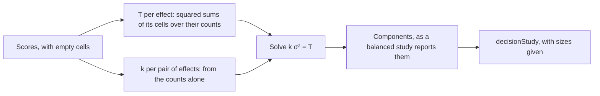
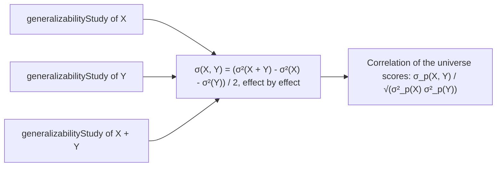

# Generalizability theory

`@measurekit/psychometrics/generalizability` separates the variance of scores into the effects of the objects of
measurement, such as persons, and of the facets of the measurement, such as items and raters, and then asks how a
procedure with other numbers of items and raters would measure. A **G study** estimates the variance components of a
balanced design by the analysis of variance, or of a design with empty cells by Henderson's Method 1; a **D study**
combines them into error variances and the generalizability and dependability coefficients of a procedure. Designs may cross and nest facets: p × i, p × r × i, (r:p) × i, i:p and
others. Components are validated against base R's `aov`, the expected mean squares solved as a linear system, and
lme4's REML estimates, unbalanced designs against Method 1 written out in base R and against GeneralizIT, and decision
studies against the textbook formulas of each design ([validation](validation.md)).

## Designs

Scores are in long format: a `FacetedScore` has the element of each facet in `levels` and a `score`. The design names
the facet of the objects of measurement, `object`, and the others, `facets`. Facets are crossed unless `nested` says that
a facet is nested in others.

| Design        | `facets`            | `nested`                                  |
| ------------- | ------------------- | ----------------------------------------- |
| p × i         | `["item"]`          | none                                      |
| p × r × i     | `["rater", "item"]` | none                                      |
| i:p           | `["item"]`          | `{ item: ["person"] }`                    |
| (r:p) × i     | `["rater", "item"]` | `{ rater: ["person"] }`                   |
| r:(p × i)     | `["rater", "item"]` | `{ rater: ["person", "item"] }`           |
| i:r:p         | `["rater", "item"]` | `{ rater: ["person"], item: ["rater"] }`  |
| (i:p) × (r:p) | `["item", "rater"]` | `{ item: ["person"], rater: ["person"] }` |

The design must be balanced, unless the design has `unbalanced: true` ([unbalanced designs](#unbalanced-designs)):

- every combination of elements has exactly one score;
- every facet has the same number of elements, at least 2, in each combination of the elements it is nested in;
- the object of measurement is not nested, and nesting is not circular;
- a design of k facets, the object included, has at least 2^k scores, and at most 6 facets are allowed, as in GENOVA;
- `levels` has a string element for the object and every facet; other entries are ignored.

An element of a nested facet is identified within the elements it is nested in. Raters may be labeled `r1` and `r2` for
every person, or each with a label of its own: the results are the same, and the first example below shows both.
A design that is not balanced throws a `DataError` that names the first combination with more than one score or, failing
that, with none. The option `unbalanced` is what lets a missing score through, so that a score lost from a design meant
to be balanced is still found.

## G study

`generalizabilityStudy(scores, design)` returns one `VarianceComponent` for each effect of the design, ordered by the
number of facets in the effect and then by the order of the facets: for p × i, the person, the item and the person by item
effect.

```ts
import { generalizabilityStudy } from "@measurekit/psychometrics/generalizability";

const persons = ["p1", "p2", "p3", "p4", "p5", "p6"];
const items = ["i1", "i2", "i3", "i4"];
const ratings = [
  [4, 5, 3, 4],
  [2, 3, 2, 2],
  [5, 5, 4, 5],
  [3, 4, 3, 2],
  [1, 2, 1, 2],
  [4, 4, 5, 4],
];
const scores = ratings.flatMap((row, p) =>
  row.map((score, i) => ({ levels: { person: persons[p] ?? "", item: items[i] ?? "" }, score })),
);
const study = generalizabilityStudy(scores, { facets: ["item"] });
study.sampleSizes; // { person: 6, item: 4 }
study.components.map(({ facets, degreesOfFreedom, meanSquare, variance }) => [
  facets.join(" x "),
  degreesOfFreedom,
  Math.round(meanSquare * 1000) / 1000,
  Math.round(variance * 1000) / 1000,
]);
// [["person", 5, 6.342, 1.506], ["item", 3, 0.819, 0.083], ["person x item", 15, 0.319, 0.319]], after rounding
```

| Field of a component | Meaning                                                                                            |
| -------------------- | -------------------------------------------------------------------------------------------------- |
| `facets`             | The effect's own facets: the rater and the item of the effect of ri:p                              |
| `nestedIn`           | The facets it is nested in, such as the person of r:p; none for a crossed effect                   |
| `degreesOfFreedom`   | The product of the sizes less 1 of its own facets and the sizes of those it is nested in           |
| `sumOfSquares`       | From the marginal means of the effect, with the scores centered                                    |
| `meanSquare`         | The sum of squares over the degrees of freedom                                                     |
| `variance`           | The analysis of variance estimate of the variance component; negative when the mean squares say so |

The highest-order effect, the one of all facets, is confounded with error: p × i has no residual of its own, and its last
component is σ²(pi, e).

### Estimation

The expected mean square of an effect is the sum, over the effects whose facets include its own, of their variance
components times the product of the sizes of the facets they lack (the Cornfield-Tukey rules for random effects). For p ×
i with n_p persons and n_i items:

| Effect | Expected mean square |
| ------ | -------------------- |
| p      | σ²(pi) + n_i σ²(p)   |
| i      | σ²(pi) + n_p σ²(i)   |
| pi     | σ²(pi)               |

The components are solved from the effect of the most facets down. Estimates are not constrained: a mean square below
that of the effects it is confounded with gives a negative component, which the G study reports as estimated and a D
study treats as 0.

### Nested designs

`nested` gives the facets each facet is nested in. The rater of the design (r:p) × i is nested in the person; each person
has their own raters, who each score every item.

```ts
import { generalizabilityStudy } from "@measurekit/psychometrics/generalizability";

// Persons by raters by items; person p has raters r1 and r2, who are not the raters of another person.
const byPerson = [
  [
    [4, 5, 3],
    [5, 5, 4],
  ],
  [
    [2, 3, 2],
    [3, 3, 2],
  ],
  [
    [5, 5, 4],
    [4, 5, 5],
  ],
  [
    [3, 4, 3],
    [2, 4, 3],
  ],
  [
    [1, 2, 1],
    [2, 2, 2],
  ],
];
const scores = byPerson.flatMap((raters, p) =>
  raters.flatMap((row, r) =>
    row.map((score, i) => ({ levels: { person: `p${p + 1}`, rater: `r${r + 1}`, item: `i${i + 1}` }, score })),
  ),
);
const design = { facets: ["rater", "item"], nested: { rater: ["person"] } };
const study = generalizabilityStudy(scores, design);
study.sampleSizes; // { person: 5, rater: 2, item: 3 }: raters per person
study.components.map(({ facets, nestedIn, degreesOfFreedom, variance }) => [
  facets.join(" x "),
  nestedIn.join(" x "),
  degreesOfFreedom,
  Math.round(variance * 1000) / 1000,
]);
// [["person", "", 4, 1.508], ["item", "", 2, 0.2], ["rater", "person", 5, 0.033], ["person x item", "", 8, 0],
//  ["rater x item", "person", 10, 0.233]], after rounding

// Labels of their own for each person's raters give the same study.
const labeled = scores.map(({ levels, score }) => ({
  levels: { ...levels, rater: `${levels.person}-${levels.rater}` },
  score,
}));
JSON.stringify(generalizabilityStudy(labeled, design)) === JSON.stringify(study); // true
```

The sample size of a nested facet is its number of elements within each element it is nested in.

## Unbalanced designs

Rating data are rarely complete. With `unbalanced: true` (default `false`) the G study accepts empty cells and unequal
numbers of nested elements, such as raters who each score some of the persons. The components are the analogous analysis
of variance of Brennan (2001, chapters 7 and 8), which is Henderson's Method 1 and what urGENOVA and GeneralizIT compute.
It is closed form.



| Quantity           | Definition                                                                                       |
| ------------------ | ------------------------------------------------------------------------------------------------ |
| T                  | T_α = Σ_c (sum of the scores of c)² / n_c over the cells c of effect α, and T₀ = (Σ y)² / N      |
| Coefficients       | E[T_α] - E[T₀] = Σ_β (k_αβ - k_0β) σ²_β, with k_αβ = Σ_c Σ_d n_cd² / n_c and k_0β = Σ_d n_d² / N |
| Sum of squares     | T_α - T₀ less the sums of squares of the effects within α                                        |
| Degrees of freedom | The cells of α less 1 and less the degrees of freedom of the effects within α                    |
| Components         | The system of one equation for each effect, solved; negative estimates are reported as estimated |

```ts
import { decisionStudy, generalizabilityStudy } from "@measurekit/psychometrics/generalizability";

// Six persons rated by four raters; three ratings are missing.
const persons = ["p1", "p2", "p3", "p4", "p5", "p6"];
const raters = ["r1", "r2", "r3", "r4"];
const ratings = [
  [4, 5, 3, 4],
  [2, 3, null, 2],
  [5, 5, 4, 5],
  [3, null, 3, 2],
  [1, 2, 1, null],
  [4, 4, 5, 4],
];
const scores = ratings.flatMap((row, p) =>
  row.flatMap((score, r) =>
    score === null ? [] : [{ levels: { person: persons[p] ?? "", rater: raters[r] ?? "" }, score }],
  ),
);
const study = generalizabilityStudy(scores, { facets: ["rater"], unbalanced: true });
study.balanced; // false
study.sampleSizes; // { person: 6, rater: 4 }
study.components.map(({ facets, degreesOfFreedom, variance }) => [
  facets.join(" x "),
  degreesOfFreedom,
  Math.round(variance * 1000) / 1000,
]);
// [["person", 5, 1.576], ["rater", 3, -0.036], ["person x rater", 12, 0.403]]
// A decision study has no one size to default to, so it needs the sizes of the procedure.
decisionStudy(study, { sampleSizes: { rater: 3 } }).generalizability; // 0.922, with the negative rater component as 0
```

| Aspect             | Behavior                                                                                                                                                                            |
| ------------------ | ----------------------------------------------------------------------------------------------------------------------------------------------------------------------------------- |
| Balanced data      | The same estimates as the balanced analysis, and `balanced` is `true`                                                                                                               |
| `sampleSizes`      | The most elements each facet has in any combination of those it is nested in; `balanced` is `false` when a cell is empty                                                            |
| `decisionStudy`    | Needs `sampleSizes` for every facet but the object when the study is not balanced                                                                                                   |
| Scores per cell    | At most 1; a second score for a combination throws a `DataError` naming it                                                                                                          |
| Degrees of freedom | Every effect needs some. A design whose scores only chain its facets, as 5 scores of 3 persons and 3 raters, leaves the person by rater effect none: a `DataError` names the effect |
| Facets             | At most 6 with the object, as in urGENOVA, 63 effects; the scores are read once for each pair of effects, so 7 effects and a million scores make 49 passes                          |

The many-facet Rasch model of the [rater](rater.md) module remains the tool for measures of the raters themselves.

## D study

`decisionStudy(study, options)` takes a study and returns the variances and coefficients of a measurement procedure that
averages over `sampleSizes` elements of each facet.

| Option        | Default           | Meaning                                                                                                               |
| ------------- | ----------------- | --------------------------------------------------------------------------------------------------------------------- |
| `sampleSizes` | the study's sizes | Positive integers, by facet name; for a nested facet, within each element it is nested in                             |
| `fixed`       | `[]`              | Facets fixed in the universe of generalization; a fixed facet's size is the number of conditions of its universe      |
| `nested`      | none              | Facets the decision study nests that the study crossed, such as `{ rater: ["person"] }`; added to the study's nesting |

A study that is not balanced has no one size for a facet to default to: `sampleSizes` must name every facet but the object.

Each effect of the decision study has a variance component, a divisor and a role:

- The **variance** of an effect is the study's component, or the sum of those the effect pools, with any below 0 counted
  as 0. Nesting a crossed facet pools components: σ²(r:p) = σ²(r) + σ²(pr), and σ²(ri:p) = σ²(ri) + σ²(pri).
- The **divisor** is the product of the decision study's sizes of the effect's facets other than the object.
- An effect with the object and only fixed facets besides is in the **universe score** variance, as are the object's own
  component and, for a fixed facet, its interactions with the object: σ²(τ) = σ²(p) + σ²(pi) / n_i for p × i with i fixed.
- An effect with the object and at least one random facet is in the **relative error** variance σ²(δ), which matters when
  persons are ranked or compared with each other.
- Those, and the effects without the object that have a random facet, are in the **absolute error** variance σ²(Δ), which
  matters when a score is read against a standard. Effects of fixed facets alone are in neither.

The coefficients are Eρ² = σ²(τ) / (σ²(τ) + σ²(δ)) and Φ = σ²(τ) / (σ²(τ) + σ²(Δ)). Φ is at most Eρ². They are undefined
when σ²(τ) and σ²(δ) are both 0, which the function reports as a `DataError`.

| Result field                                     | Meaning                                                                           |
| ------------------------------------------------ | --------------------------------------------------------------------------------- |
| `universeScoreVariance`                          | σ²(τ)                                                                             |
| `relativeErrorVariance`, `absoluteErrorVariance` | σ²(δ) and σ²(Δ)                                                                   |
| `generalizability`, `dependability`              | Eρ² and Φ                                                                         |
| `components`                                     | Each effect with its `variance`, `divisor`, `universe`, `relative` and `absolute` |

```ts
import { decisionStudy, generalizabilityStudy } from "@measurekit/psychometrics/generalizability";

// The study of the first example: 6 persons by 4 items.
const persons = ["p1", "p2", "p3", "p4", "p5", "p6"];
const items = ["i1", "i2", "i3", "i4"];
const ratings = [
  [4, 5, 3, 4],
  [2, 3, 2, 2],
  [5, 5, 4, 5],
  [3, 4, 3, 2],
  [1, 2, 1, 2],
  [4, 4, 5, 4],
];
const scores = ratings.flatMap((row, p) =>
  row.map((score, i) => ({ levels: { person: persons[p] ?? "", item: items[i] ?? "" }, score })),
);
const study = generalizabilityStudy(scores, { facets: ["item"] });

const same = decisionStudy(study); // the study's 4 items
Math.round(same.generalizability * 1000) / 1000; // 0.95
Math.round(same.dependability * 1000) / 1000; // 0.937
const longer = decisionStudy(study, { sampleSizes: { item: 8 } });
[
  longer.universeScoreVariance,
  longer.relativeErrorVariance,
  longer.absoluteErrorVariance,
  longer.generalizability,
  longer.dependability,
].map((value) => Math.round(value * 1000) / 1000); // [1.506, 0.04, 0.05, 0.974, 0.968]
```

Pooling and fixed facets work on any study. With the study of raters crossed with persons, a decision study in which each
person has raters of their own gives the components of (r:p) × i:

```ts
import { decisionStudy, generalizabilityStudy } from "@measurekit/psychometrics/generalizability";

const byPerson = [
  [
    [4, 5, 3],
    [5, 5, 4],
  ],
  [
    [2, 3, 2],
    [3, 3, 2],
  ],
  [
    [5, 5, 4],
    [4, 5, 5],
  ],
  [
    [3, 4, 3],
    [2, 4, 3],
  ],
  [
    [1, 2, 1],
    [2, 2, 2],
  ],
];
const scores = byPerson.flatMap((raters, p) =>
  raters.flatMap((row, r) =>
    row.map((score, i) => ({ levels: { person: `p${p + 1}`, rater: `r${r + 1}`, item: `i${i + 1}` }, score })),
  ),
);
const crossed = generalizabilityStudy(scores, { facets: ["rater", "item"] });
const nested = decisionStudy(crossed, { sampleSizes: { rater: 2, item: 3 }, nested: { rater: ["person"] } });
nested.components.map(({ facets, nestedIn, variance, divisor }) => [
  facets.join(" x "),
  nestedIn.join(" x "),
  Math.round(variance * 1000) / 1000,
  divisor,
]);
// [["person", "", 1.517, 1], ["item", "", 0.2, 3], ["rater", "person", 0.033, 2], ["person x item", "", 0, 3],
//  ["rater x item", "person", 0.233, 6]], after rounding

// With the items fixed, the effects of the item alone are not error and the person by item effect joins the universe.
const fixed = decisionStudy(crossed, {
  sampleSizes: { rater: 2, item: 3 },
  nested: { rater: ["person"] },
  fixed: ["item"],
});
[fixed.universeScoreVariance, fixed.relativeErrorVariance, fixed.generalizability].map(
  (value) => Math.round(value * 1000) / 1000,
);
// [1.517, 0.056, 0.965], after rounding
```

A study is plain data that JSON serializes; `decisionStudy` checks one that comes from storage: its design, a size for
every facet and one finite component for each effect.

## Recipe: a multivariate G study

Two scores of the same persons on the same items, such as a reading and a listening score on six items each, have a
covariance as well as variances. The variance components of a score X + Y are those of X and Y plus twice their
covariance components, so the covariance component of every effect comes from three studies of the univariate
functions:



The facets must be linked across the two scores: the same persons and the same items in both, which the cell of a
person and an item having both scores gives. The sum is formed cell by cell.

```ts
import { createRandom } from "@measurekit/psychometrics";
import { generalizabilityStudy } from "@measurekit/psychometrics/generalizability";

// 300 persons answer 6 items twice; the universe scores correlate 0.6.
const persons = 300;
const items = 6;
const random = createRandom(2026);
const reading = Array.from({ length: persons }, () => random.normal());
const listening = reading.map((score) => 0.6 * score + 0.8 * random.normal());
const readingItems = Array.from({ length: items }, () => 0.3 * random.normal());
const listeningItems = Array.from({ length: items }, () => 0.3 * random.normal());
const x = reading.map((truth) => readingItems.map((effect) => truth + effect + random.normal()));
const y = listening.map((truth) => listeningItems.map((effect) => truth + effect + random.normal()));

/** The variance components of p × i for a score at each cell: the person, the item and the person by item. */
const components = (cell: (person: number, item: number) => number): number[] =>
  generalizabilityStudy(
    Array.from({ length: persons * items }, (_, k) => {
      const person = Math.floor(k / items);
      const item = k % items;
      return { levels: { person: `p${person}`, item: `i${item}` }, score: cell(person, item) };
    }),
    { facets: ["item"] },
  ).components.map(({ variance }) => variance);

const varianceX = components((p, i) => x[p]?.[i] ?? 0);
const varianceY = components((p, i) => y[p]?.[i] ?? 0);
const varianceSum = components((p, i) => (x[p]?.[i] ?? 0) + (y[p]?.[i] ?? 0));
const covariance = varianceSum.map((total, k) => (total - (varianceX[k] ?? 0) - (varianceY[k] ?? 0)) / 2);
// [0.568, 0.018, 0.0076], after rounding
const correlation = (covariance[0] ?? 0) / Math.sqrt((varianceX[0] ?? 1) * (varianceY[0] ?? 1)); // 0.567
```

The covariance components equal those from the mean products of the two scores, (MP(p) - MP(pi)) / n_i for the person,
within rounding. The universe scores correlate 0.567 here, against 0.6 in the data. The test of this recipe runs the
code on the seeded scores and compares it with the mean products to 1e-9.

## Not included

- **Henderson's Method 2.** Outside the sources: the estimator for unbalanced designs is Method 1, which urGENOVA and
  GeneralizIT compute and which is built.
- **Henderson's Method 3.** Outside the sources: the estimator for unbalanced designs is Method 1, which urGENOVA and
  GeneralizIT compute and which is built.
- **REML estimates of the components of an unbalanced design.** Outside the sources: the estimator for unbalanced
  designs is Method 1, which urGENOVA and GeneralizIT compute and which is built; lme4 fits REML.
- **MIVQUE estimates of the components of an unbalanced design.** Outside the sources: the estimator for unbalanced
  designs is Method 1, which urGENOVA and GeneralizIT compute and which is built.
- **Multivariate generalizability theory.** No reference: Brennan's chapters 9 to 12 treat it, but no package runs it,
  as mGENOVA is a Windows program. [A recipe](#recipe-a-multivariate-g-study) gets the covariance components from three
  univariate studies.
- **Standard errors and confidence intervals of the components.** No reference: Brennan's chapter 6 treats them, but no
  package runs them.
- **Mixed-model G studies.** No fit: fixed facets are handled in the D study, from the random-effects components.
- **Facets in the object of measurement.** No reference: no package that fits an object nested in another facet, such as
  persons within schools, was found.

## Differences from the references

| Topic                         | This package                                                   | Reference                                                     |
| ----------------------------- | -------------------------------------------------------------- | ------------------------------------------------------------- |
| Estimation                    | The analysis of variance, in closed form, for balanced designs | lme4 fits REML, which equals it when no component is negative |
| Negative components           | Reported as estimated; counted as 0 in a D study               | lme4's REML estimates are bounded at 0                        |
| Unbalanced designs            | `DataError`, or Method 1 with `unbalanced`                     | lme4 estimates them by REML, which differs from Method 1      |
| GeneralizIT                   | The same Method 1, at full precision                           | Rounds its T values and components to 4 decimals              |
| Coefficients with no variance | `DataError` when σ²(τ) and σ²(δ) are both 0                    | The quotient 0 / 0 is `NaN` in R                              |
